# DCH & SO99+ — Authentication & Authorization Technical Analysis

> **Purpose:** Technical reference for the meeting with the Senior Director, Product Management.
> **Scope:** DCH 4.40 and SO99+ 2026.3 (WebClient and WebAPI).
> **Source:** Direct analysis of the source code and configuration files of both products. Every statement in this document can be traced to the files listed in the appendix.
> **Date:** November 2026

---

## Table of Contents

1. [Summary](#1-summary)
2. [Key concepts, in plain words](#2-key-concepts-in-plain-words)
3. [The big picture](#3-the-big-picture)
4. [DCH — Authentication](#4-dch--authentication)
5. [DCH — Authorization](#5-dch--authorization)
6. [SO99+ — Authentication](#6-so99--authentication)
7. [SO99+ — Authorization](#7-so99--authorization)
8. [How DCH and SO99+ are connected today](#8-how-dch-and-so99-are-connected-today)
9. [Side-by-side comparison](#9-side-by-side-comparison)
10. [Compatibilities, incompatibilities, and integration options](#10-compatibilities-incompatibilities-and-integration-options)
11. [Open questions for the meeting](#11-open-questions-for-the-meeting)
12. [Appendix: key files](#12-appendix-key-files)
13. [Glossary](#13-glossary)

---

## 1. Summary

| Aspect | DCH (Demand Collaboration Hub) | SO99+ |
|---|---|---|
| **Technology** | ASP.NET MVC 5 / Web API 2 on .NET Framework 4.8 (OWIN) | ASP.NET Core on .NET 8 |
| **Login modes** | Internal, Windows, SAML, SAML + Internal, Azure AD multi-tenant | SO99PLUS, Windows, SAML, MIXED, Azure AD, Auth0 |
| **SAML library** | ComponentSpace SAML 2.0 | ComponentSpace SAML 2.0 |
| **Where users live** | DCH identity database | SO99+ server |
| **Who decides access** | DCH | SO99+ server |
| **Role model** | 4 business roles + feature permissions + data permissions | `admin` / `user` in the web client + permissions held by the SO99+ server |
| **Roles taken from the IdP** | No | No |
| **Exposed API** | API for DCHRemote: IP restriction + API Key | REST WebAPI: API Key **or** OAuth 2.0 (JWT) with read/write scopes |

**In plain words:** both products work the same way. An external identity provider (Azure AD, a SAML provider, Windows) can confirm *who* the user is, but **each product keeps its own list of users and decides on its own what that user can do.** This is why sharing a login provider between both products is straightforward, while sharing users, roles, or permissions is not.

---

## 2. Key concepts, in plain words

A useful analogy is an office building:

| Concept | Analogy | In the software |
|---|---|---|
| **Authentication** | Showing your ID at reception | Proving who you are: password, corporate login, Windows session |
| **Identity Provider (IdP)** | The reception desk that checks IDs for the whole building | Azure AD / Microsoft Entra ID, a SAML provider, Auth0, Active Directory |
| **Authorization** | The list on each office door saying who may enter and what they can touch | Roles and permissions inside each product |
| **Session** | The visitor badge you wear after reception | A cookie that keeps you logged in |
| **SSO (Single Sign-On)** | Reception recognizes you, so you don't show your ID again | The IdP remembers you and does not ask for credentials again |

Two important consequences, valid for both DCH and SO99+:

1. **Reception (IdP) does not decide which offices you can enter.** Each product has its own door list.
2. **Being known at reception is not enough.** The user must also exist in the product's own user list.

**Protocols mentioned in this document:**

- **SAML 2.0** — mature corporate standard for delegating login to an IdP. Widely used with Azure AD, ADFS, Okta, etc.
- **OpenID Connect (OIDC)** — modern standard for the same purpose, built on OAuth 2.0. Used by Azure AD, Auth0, etc.
- **OAuth 2.0 / JWT** — standard for system-to-system access with signed tokens that carry permissions ("scopes").
- **API Key** — a shared secret sent with each request. Simple, but it identifies a system, not a user.

---

## 3. The big picture

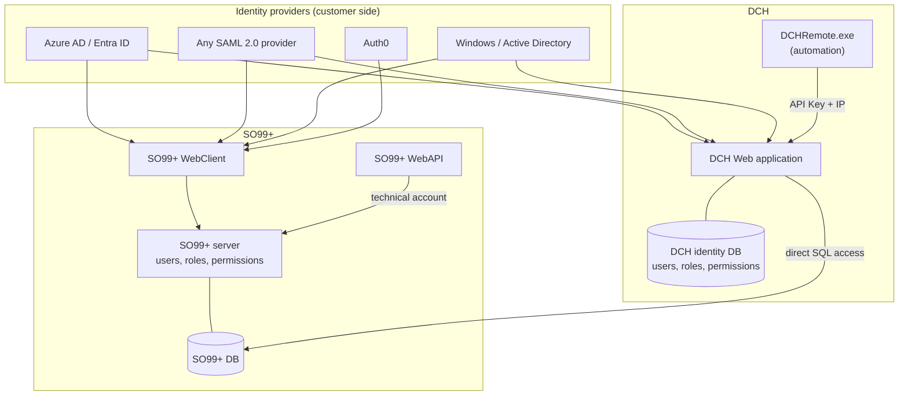

What the picture shows:

- Both products can use the **same kinds of identity providers**.
- Each product has **its own user store**: DCH in its identity database, SO99+ in its server.
- DCH reads SO99+ data **directly from the SO99+ database**, not through the SO99+ API.
- Each product exposes an API for automation, protected in different ways.

---

## 4. DCH — Authentication

### 4.1. Login modes

The mode is selected per installation with `AuthenticationType` in `Config/Settings.config`.

| Code | Mode | How the user logs in | Typical use |
|---|---|---|---|
| `I` | Internal | Username and password stored in DCH | Customers without a corporate IdP, or service users |
| `W` | Windows | Automatically, with their Windows session (IIS + Active Directory) | On-premise installations inside the customer network |
| `S` | SAML | "Login with corporate account" → redirected to the customer's IdP | Customers with Azure AD, ADFS, Okta… |
| `SI` | SAML + Internal | Both options on the login screen | Corporate users + some local users (e.g. ToolsGroup consultants) |
| `AMT` | Azure AD multi-tenant | Microsoft login page; any Azure AD organization | Hosted / demo scenarios with users from several organizations |

### 4.2. The common rule

Whatever the mode, DCH applies the same two checks before letting anyone in:

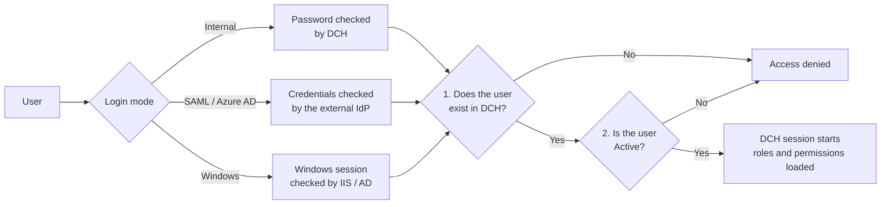

> **Why it matters:** a customer can let their IdP handle passwords and MFA, while DCH still controls exactly who has access to the product and what each user can do. Deactivating a user in DCH blocks access even if the IdP still accepts them.

### 4.3. Internal login, step by step

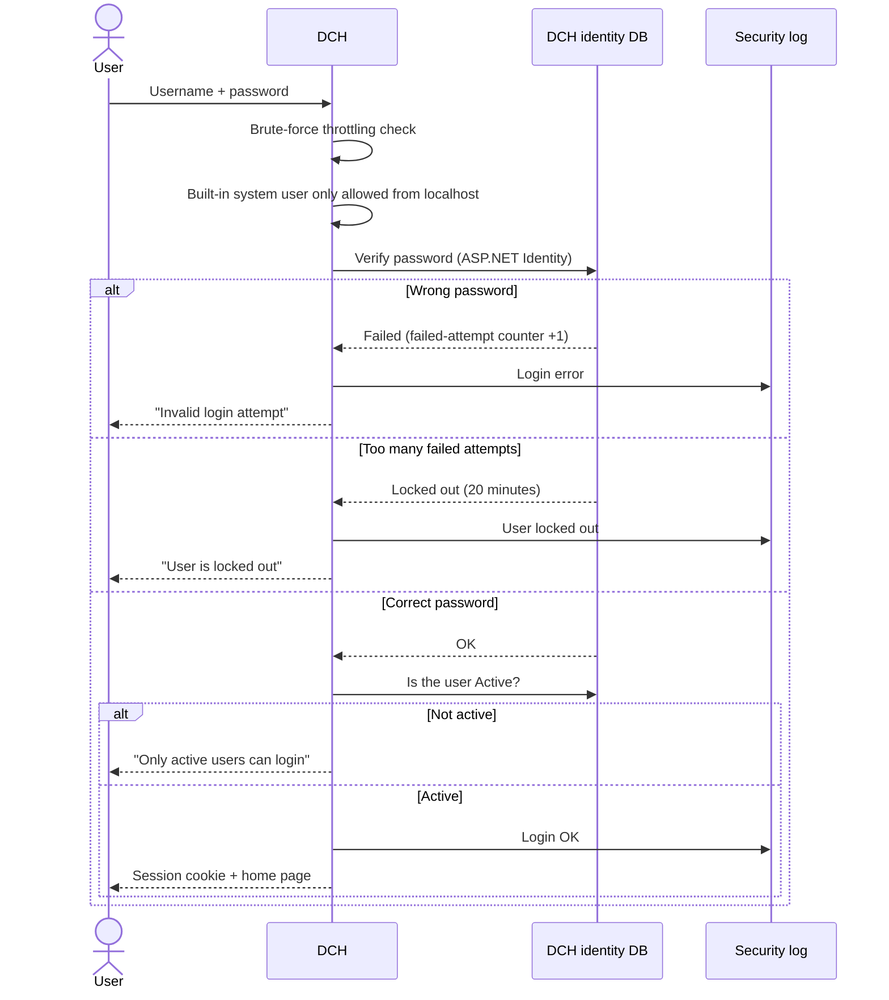

Details:

- Passwords are stored with the standard ASP.NET Identity hashing. Old hashes from the previous *Membership* system are still accepted and re-hashed automatically at login.
- The password policy is configurable per installation: minimum length, uppercase, lowercase, digits, special characters, and expiration (users with an expired password are forced to change it).
- The number of failed attempts before lockout is configurable (bounded between 2 and 15); the lockout lasts 20 minutes.

### 4.4. SAML login, step by step

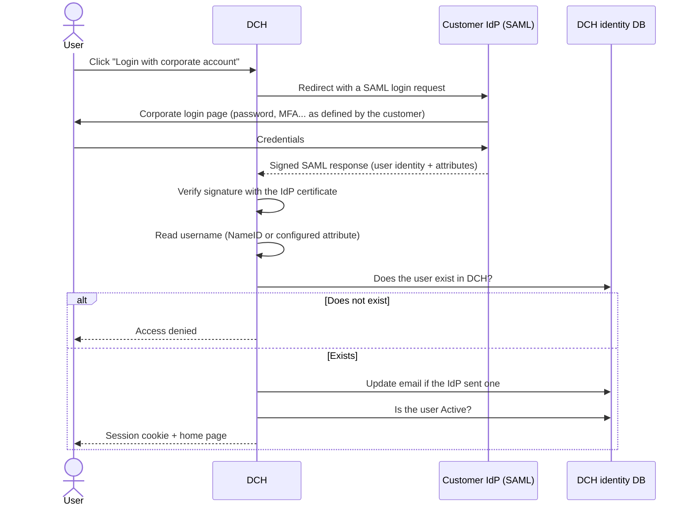

Details:

- DCH never sees the user's corporate password: the IdP handles it.
- The username can come from the standard SAML *NameID* or from any attribute the customer chooses (`SamlTokenUserProperty`). This is what allows matching the IdP identity with the DCH user.
- Only one exception creates users automatically: the first SAML user configured (`FirstSamlUser`), used to bootstrap a new installation.
- Single Logout is supported: logging out from the IdP can close the DCH session.

### 4.5. Azure AD multi-tenant login, step by step

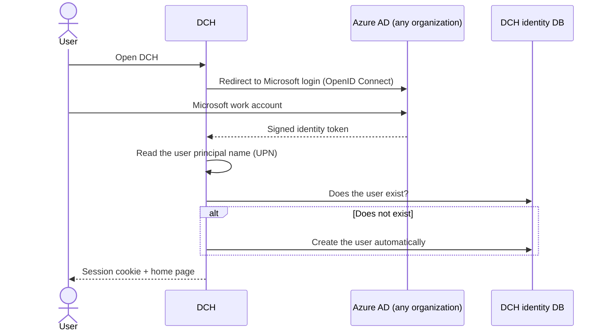

Details:

- **Multi-tenant** means DCH accepts users from **any** Azure AD organization, not only the customer's.
- Unlike SAML, users are created automatically on first login (they still need roles to do anything useful).
- For a single customer with its own Azure AD, **SAML is the mode that restricts access to that customer's organization.**

### 4.6. Windows login

The user is identified by their Windows session through IIS and Active Directory, with no login screen. The same checks (user exists in DCH, user is active) apply afterwards.

### 4.7. Security controls

| Control | What DCH does | Why it matters |
|---|---|---|
| Session cookie | `HttpOnly` always; HTTPS-only in the Release configuration | The session cannot be read by scripts or sent over plain HTTP |
| Session lifetime | Configurable, sliding, **bounded in code between 3 and 540 minutes** | Inactive sessions expire |
| Identity revalidation | Every 30 minutes the session is checked against the user record | Changes to the user (e.g. password reset) invalidate open sessions |
| Anti-CSRF tokens | Forms carry an antiforgery token | Prevents actions triggered from malicious sites |
| Safe redirects | After login, only internal URLs are allowed | Prevents phishing redirects |
| Brute-force throttling | Above 100 login attempts per hour, each attempt is delayed and logged | Slows down automated password guessing |
| Security log | Logins, failures, lockouts, and logouts are recorded | Auditing and incident analysis |
| Two-factor authentication | Not available in DCH itself (the screens are disabled) | MFA is expected to be enforced by the customer's IdP |

---

## 5. DCH — Authorization

### 5.1. Three layers

Once the user is in, every screen and every piece of data goes through up to three checks. **All the information comes from DCH, never from the IdP.**

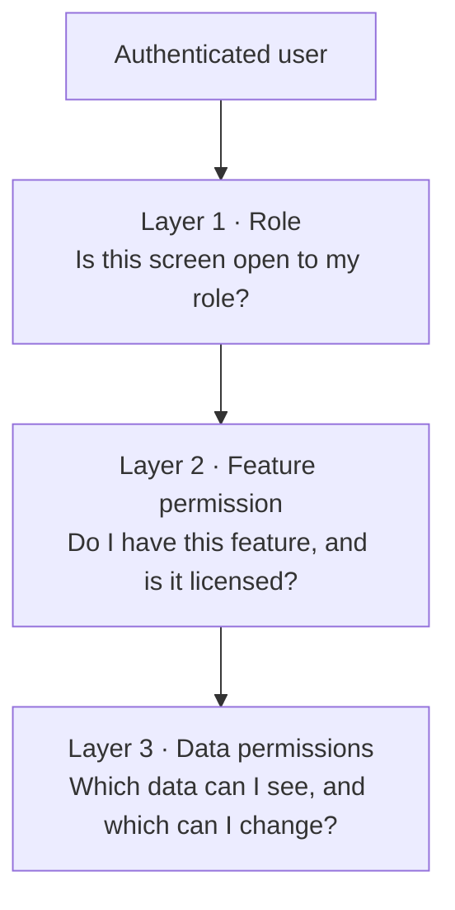

| Layer | Question it answers | Example |
|---|---|---|
| **1. Role** | Can I open this screen at all? | Configuration screens are only for `DCHAdmin` |
| **2. Feature permission** | Do I have access to this module, and has the customer licensed it? | Promotions require the user permission **and** an active Promotions license |
| **3. Data permissions** | What exactly can I see and edit? | A planner can read the budget but only edit a specific forecast revision, for a specific product group |

### 5.2. Roles

| Role | Typical user |
|---|---|
| `DCHAdmin` | Administrator: configuration, users, system |
| `DCHPowerUser` | Advanced planner; can read all product/market areas |
| `DCHMasterData` | Master data manager |
| `DCHUser` | Business user (planner, sales, etc.) |

- Roles are **independent**, not a hierarchy: each screen lists which roles may open it, and a user can hold several roles.
- Roles are assigned by an administrator in DCH's user management.
- An inactive user receives no roles.

### 5.3. Feature and data permissions

- **Feature permissions:** read/write for Forecast Editing, Promotions, forecast analysis (on DCH data and on SO99+ data), and user file imports. Each one is also checked against the active licenses.
- **Data permissions:** read/write per demand line, budget, SO99+ forecast, each forecast revision, display series, units of measure, product/market attributes, calculated fields, and more.
- **Data visibility:** users can be restricted to specific data groups and promotion groups.

### 5.4. Worked example

A planner opens the Forecast Editing screen:

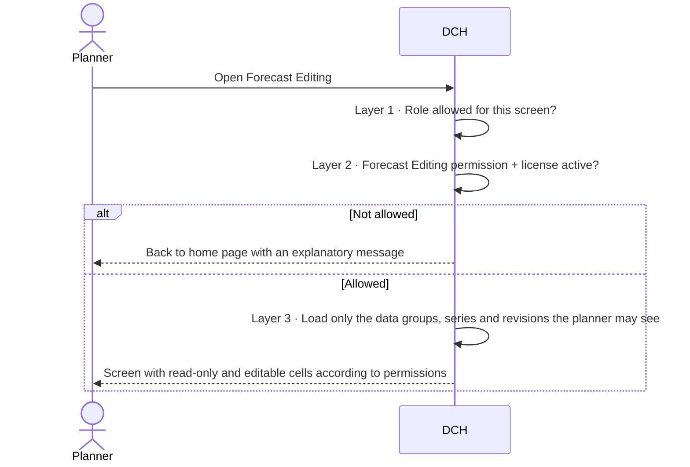

### 5.5. Technical mechanisms

| Mechanism | Applies to | What it checks |
|---|---|---|
| `RolesPermissionsFilter` | Web screens | User has at least one of the roles listed for the screen |
| `UserPermissionsAttribute` | Web screens | Feature permission **and** active license |
| `APIAuthorizeAttribute` | Internal API used by the web screens | User roles from the session; returns "403 Forbidden" otherwise |
| `ApiSecurityFilter` | API used by DCHRemote | Caller IP (`localhost` only by default, or an IP whitelist) **and**, optionally, an `ApiKey` header |

### 5.6. DCHRemote (automation)

`DCHRemote.exe` is a command-line tool used in scheduled jobs (imports, sign-off, cache clearing, e-mails…). It does not log in as a user; it calls a dedicated DCH API protected by **origin IP** and an optional **API key**.

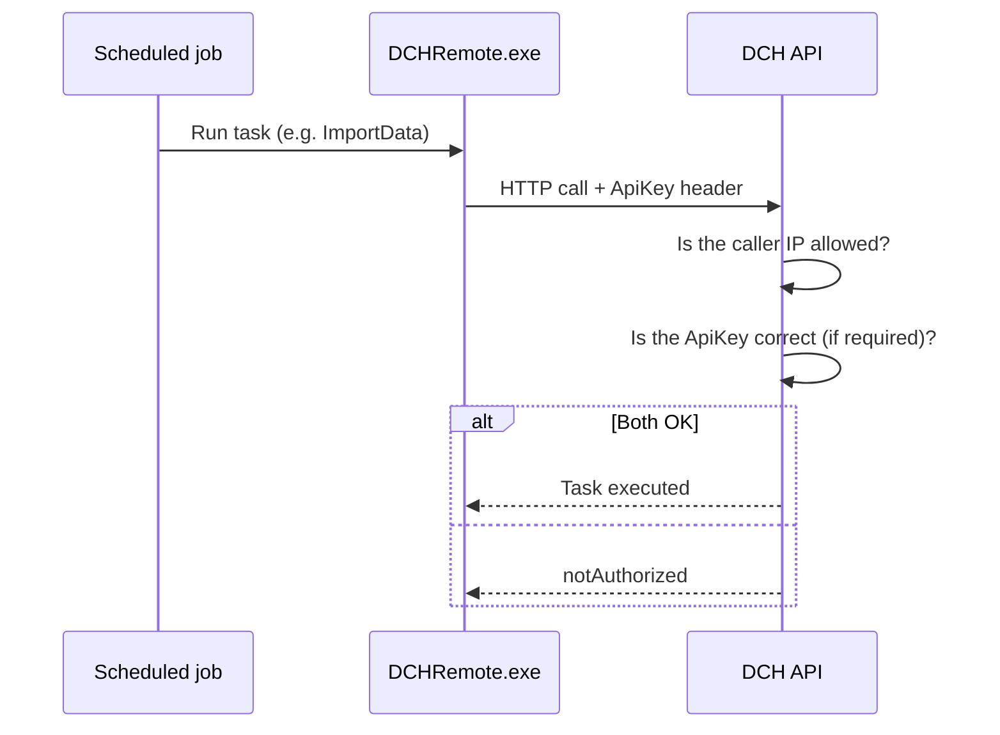

---

## 6. SO99+ — Authentication

### 6.1. Login modes (WebClient)

The mode is selected per installation with `AuthenticationType` in `Config/Settings.json`. The current repository value is `SO99PLUS`.

| Value | How the user logs in |
|---|---|
| `SO99PLUS` | Username and password of the SO99+ user |
| `SAML` | Redirected to the customer's SAML IdP |
| `MIXED` | Both options on the login screen |
| `WINDOWS` | Automatically, with the Windows session |
| `AAD` | Microsoft login for **one specific** Azure AD organization |
| `AUTH0` | Auth0 login page |

### 6.2. The common rule

The central point of SO99+: **whatever the login mode, the final decision is always taken by the SO99+ server.** The web client opens a session on the server (`SessionConnect`); the server checks the user and returns whether they are an administrator.

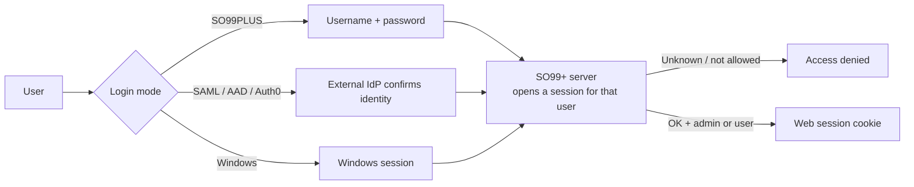

### 6.3. SO99PLUS login, step by step

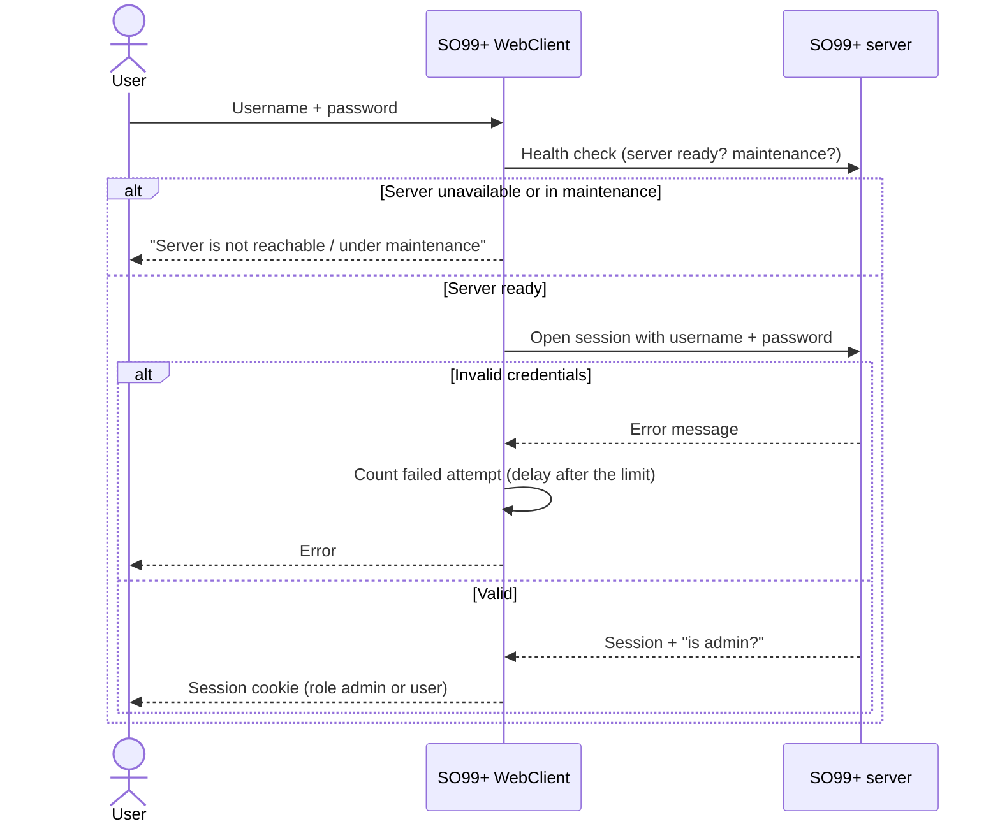

### 6.4. SAML, Azure AD and Auth0 login, step by step

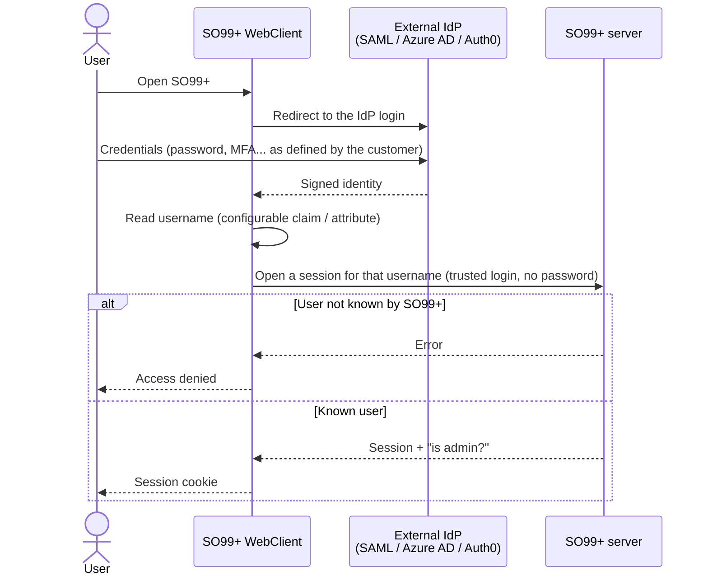

Details:

- **SAML:** the username is read from the attribute configured in `TokenUserProperty`.
- **Azure AD:** uses Microsoft's official library (`Microsoft.Identity.Web`), configured for one organization (tenant).
- **Auth0:** the username is read from a configurable claim (`nickname` by default).
- In all three cases, **the user must exist in SO99+**; SO99+ does not create users automatically.

### 6.5. Security controls

| Control | What SO99+ does |
|---|---|
| Session cookie | `HttpOnly`; HTTPS-only configurable; `SameSite=Lax` (or `None` when embedded in another application) |
| Session lifetime | Configurable (60 minutes in the current configuration), sliding |
| Failed attempts | After a configurable number of failures, each new attempt is delayed (20 seconds in the current configuration) |
| Server availability | Login is refused while the server is in maintenance |
| Federated logout | Logout also signs out from Azure AD, Auth0, or the SAML IdP |
| Two-factor authentication | Not implemented in SO99+ itself; enforced by the external IdP when needed |

---

## 7. SO99+ — Authorization

### 7.1. Web client

- Every protected screen requires an authenticated session.
- The web session carries a simple role: `admin` or `user`.
- **What each user can see and do in detail is decided by the SO99+ server**, using the user's configuration in SO99+.

### 7.2. WebAPI (system-to-system)

The SO99+ WebAPI is used by integrations (other systems, ETL, data pipelines). It does not log in end users. It supports two modes, set in `appsettings.json`.

**API Key mode** (current setting)

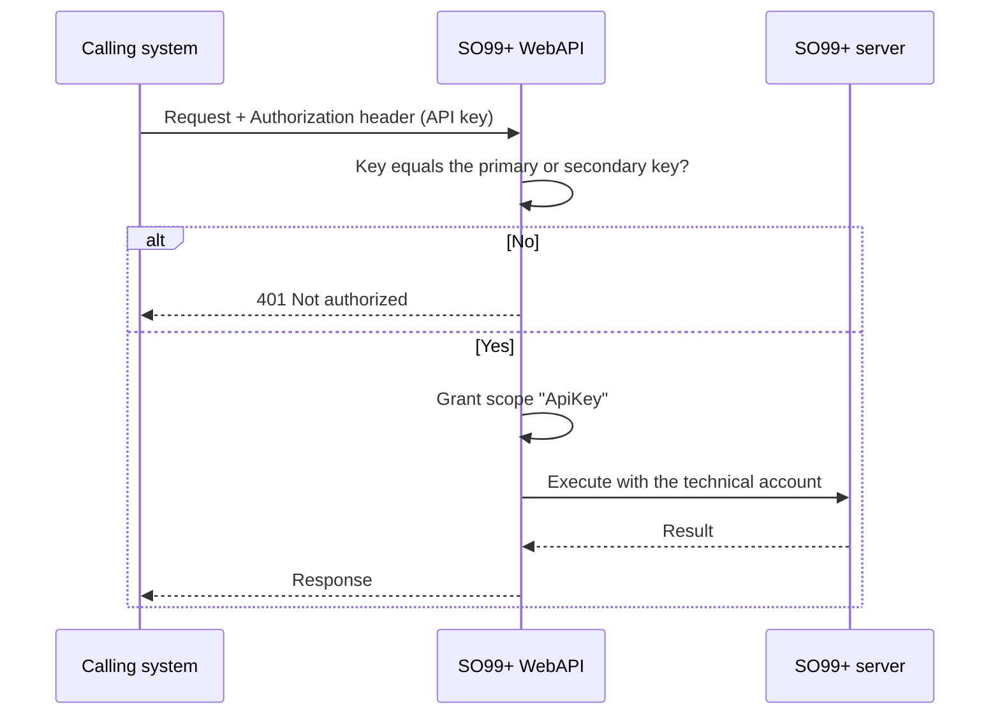

**OAuth 2.0 mode**

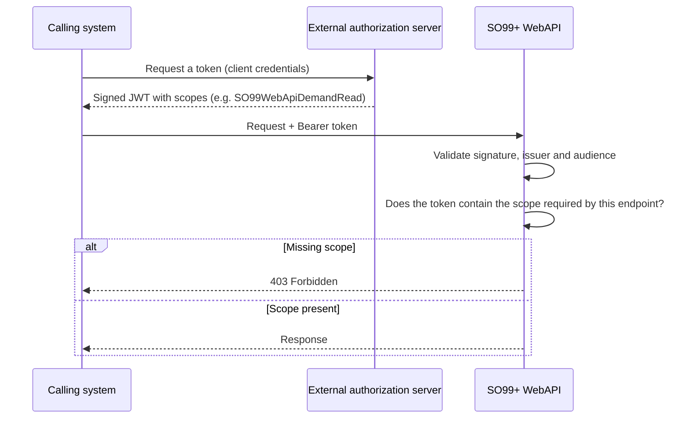

Endpoint protection:

| Policy | Example endpoints | Scope required in OAuth mode |
|---|---|---|
| `SystemRead` | Batch status, Import queries, System, STS | `SO99WebApiSystemRead` |
| `SystemWrite` | Import, Export, Exchange, Data pipelines | `SO99WebApiSystemWrite` |
| `DemandRead` | Promotions, Aggregate forecast, Seasonality | `SO99WebApiDemandRead` |
| `DemandWrite` | — | `SO99WebApiDemandWrite` |

Important points:

- The WebAPI does **not** issue tokens; in OAuth mode it relies on an external authorization server.
- Two API keys (primary and secondary) allow rotating keys without downtime.
- ⚠️ **In API Key mode, any valid key satisfies all four policies**, so it grants full read and write access. Read/write separation only exists in OAuth mode.
- All WebAPI calls reach the SO99+ server through a single **technical account**, so the server sees them as that account.

---

## 8. How DCH and SO99+ are connected today

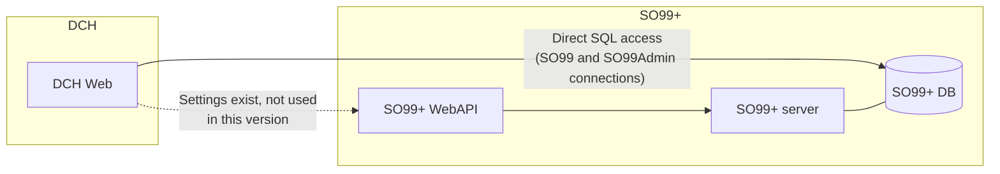

| Topic | Current situation |
|---|---|
| **Data exchange** | DCH connects **directly to the SO99+ database** with two SQL connections configured per installation (`SO99` and `SO99Admin`). Access is governed by those SQL credentials |
| **SO99+ WebAPI** | DCH has settings to call it (API Key or OAuth), but **no code in this version uses them** |
| **Users** | Independent: a person using both products has one user in DCH and another in SO99+ |
| **Roles and permissions** | Independent in each product |
| **Session** | Not shared: logging into one product does not log you into the other |

> **In plain words:** today the two products are connected at the **data** level, not at the **identity** level.

---

## 9. Side-by-side comparison

### 9.1. Authentication

| Aspect | DCH | SO99+ | What it means |
|---|---|---|---|
| Own username/password | ✅ | ✅ | Both work without a corporate IdP |
| Windows / Active Directory | ✅ | ✅ | Both fit on-premise networks |
| SAML 2.0 | ✅ | ✅ | Same library (ComponentSpace) and protocol |
| Azure AD | ✅ any organization | ✅ one organization | Different scope; for a single customer, DCH's SAML mode is the equivalent |
| Auth0 | ❌ | ✅ | Only SO99+ supports it directly |
| Own + SAML combined | ✅ | ✅ | Both allow corporate and local users at the same time |
| Configurable username source | ✅ | ✅ | Both can align the IdP identity with the product username |
| Automatic user creation | Azure AD multi-tenant and first SAML user only | No | In both, users are normally created by an administrator |
| Two-factor in the product | ❌ | ❌ | Both rely on the IdP for MFA |
| Protection against repeated failures | Account lockout | Delay per session | Different technique, same goal |

### 9.2. Authorization

| Aspect | DCH | SO99+ | What it means |
|---|---|---|---|
| Roles | 4 business roles | `admin` / `user` in the web client | No direct mapping between products |
| Feature permissions | In DCH, tied to licenses | In the SO99+ server | Each product governs its own features |
| Data permissions | Very granular, in DCH | In the SO99+ server | Each product governs its own data |
| Roles from the IdP (e.g. Azure AD groups) | ❌ | ❌ | In both, roles are maintained inside the product |
| API protection | IP + API Key | API Key (full access) or OAuth with scopes | SO99+ WebAPI supports finer-grained API permissions |

---

## 10. Compatibilities, incompatibilities, and integration options

### 10.1. What is compatible

| Area | Why |
|---|---|
| **Same security model** | In both products the IdP identifies the user and the product authorizes against its own users |
| **SAML 2.0** | Same library and protocol: one customer IdP can serve both products by registering them as two applications |
| **Azure AD / Entra ID** | Supported by both |
| **Windows / Active Directory** | Supported by both |
| **Username alignment** | Both can choose which IdP attribute is the username, so the same person can be recognized in both |
| **MFA strategy** | Both delegate MFA to the IdP |

### 10.2. What is different or incompatible

| Area | Difference | Practical impact |
|---|---|---|
| **User store** | DCH database vs. SO99+ server | Users are created, deactivated, and removed in each product |
| **Role model** | 4 roles + detailed permissions vs. admin/user + server permissions | A role in one product does not translate automatically to the other |
| **Azure AD scope** | Any organization (DCH multi-tenant) vs. one organization (SO99+) | For a single customer, use SAML in DCH to get the same behavior as SO99+ |
| **Session** | Independent cookies | Opening one product does not open the other |
| **Auth0** | SO99+ only | A customer on Auth0 needs Auth0 to act as a SAML IdP for DCH |
| **Technology** | .NET Framework 4.8 vs. .NET 8 | Security components cannot be shared as code |

### 10.3. Integration options with no development in DCH

#### Option A — The same identity provider for both products

The customer registers DCH and SO99+ as two applications in their IdP (typically Azure AD via SAML). Both products are configured to read the same username.

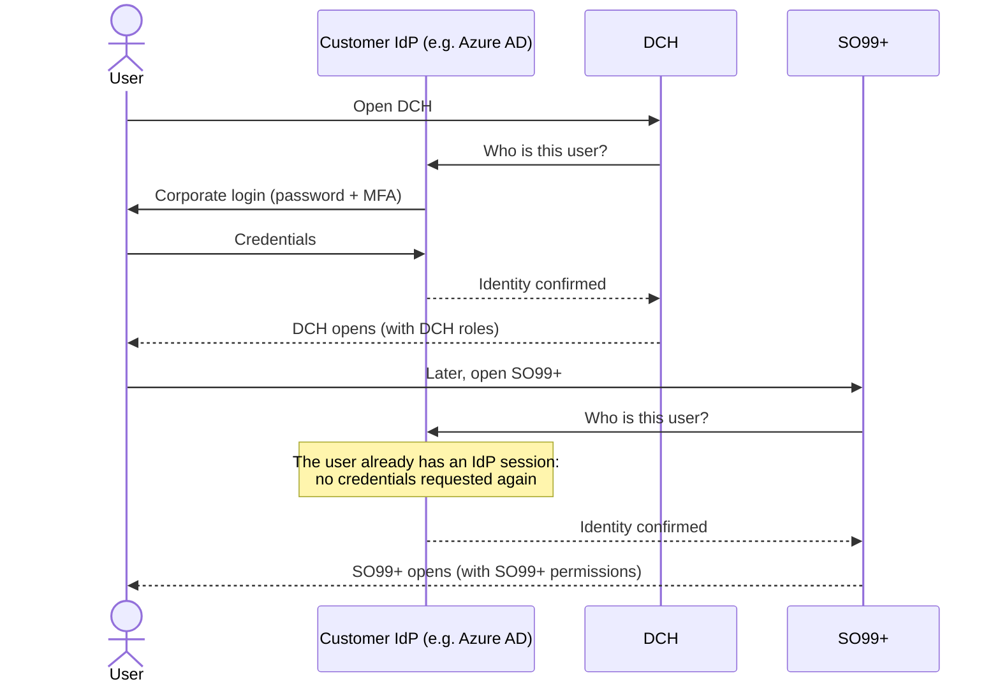

| Benefit | Requirement |
|---|---|
| One corporate login and one password for both products | Configuration in both products and in the IdP |
| Users are not asked again for credentials while their IdP session is valid | The **same username** must exist in DCH and SO99+ |
| MFA, password policy, and leaver blocking managed in one place by the customer | The customer has a SAML or Azure AD identity provider |

#### Option B — Common user governance

Joiners, leavers, and changes applied consistently in both products through an operational process. DCH already provides user import, which helps keep the user list in sync.

#### Option C — Corporate MFA

Neither product implements MFA itself; enabling it in the customer's IdP protects both at once (requires Option A).

#### What these options do not solve

- Roles and permissions remain separate in each product.
- Each product keeps its own session; logging out of one does not necessarily log out of the other.

---

## 11. Open questions for the meeting

1. What is meant by "alignment with SO99": same login experience, same role model, or technical integration between products?
2. Do customers using both products already have a corporate identity provider? Which login mode do they use today in each product?
3. Is a common role model across products needed, or is it enough for each product to keep its own?
4. Are there customer requirements on MFA, auditing, or centralized leaver management?
5. Is Auth0 a strategic direction for SO99+ that should also be considered for DCH?

---

## 12. Appendix: key files

### DCH

| File | Content |
|---|---|
| `Config/Settings.config` | `AuthenticationType`, password policy, session, DCHRemote API |
| `Config/authentication.config` / `authorization.config` | ASP.NET authentication mode (Forms or Windows) |
| `Config/saml.config` | SAML service provider and IdP, certificates |
| `Config/connectionStrings.config` | Connections to the DCH and SO99+ databases |
| `App_Start/Startup.Auth.vb` | Login configuration per mode |
| `Controllers/AccountController.vb` | Internal login, SSO start, logout |
| `Controllers/SamlController.vb` | SAML response and Single Logout |
| `SrcWeb/Global/Filters/RolesPermissionsFilter.vb` | Role check |
| `SrcWeb/Global/Filters/UserPermissionsFilter.vb` | Feature permission + license check |
| `SrcWeb/Global/Filters/ApiSecurityFilter.vb` | DCHRemote API protection |
| `DCH.Application/Users/UserInfo.cs`, `PermissionInformation.cs` | User roles and permissions |

### SO99+

| File | Content |
|---|---|
| `Web/SO99WebClient/Config/Settings.json` | `AuthenticationType`, session, login attempts |
| `Web/SO99WebClient/Config/saml.json`, `aad.json`, `auth0.json` | Configuration of each IdP |
| `Web/SO99WebClient/Src/Extensions/BuilderExtensions.cs` | Login configuration per mode |
| `Web/SO99WebClient/Controllers/AccountController.cs`, `SamlController.cs` | Login and SAML |
| `Web/SO99WebClient/Models/UserManager.cs` | Session opening on the SO99+ server for every mode |
| `Web/SO99WebClient/Src/Global/Filters/SO99Authorize.cs` | Session opening for Windows, Azure AD, and Auth0 |
| `Web/SO99WebAPI/.../appsettings.json` | WebAPI `apikey` / `oauth` mode |
| `Web/SO99WebAPI/.../Program.cs` | `SystemRead/Write`, `DemandRead/Write` policies |
| `Web/SO99WebAPI/.../Infrastructure/Middleware/KeyValidatorsMiddleware.cs` | API key validation |

> **Note:** both repositories contain configuration files with plain-text secrets (API keys, Azure AD application secrets, certificate passwords). This document does not reproduce them.

---

## 13. Glossary

| Term | Meaning |
|---|---|
| **DCH** | Demand Collaboration Hub |
| **IdP** | Identity Provider: the system that confirms who the user is |
| **SAML 2.0** | Corporate standard for delegating login to an IdP |
| **OpenID Connect (OIDC)** | Modern standard for delegating login to an IdP |
| **OAuth 2.0** | Standard for system-to-system access with tokens |
| **JWT** | Signed token carrying identity and permissions (scopes) |
| **Scope** | A permission written inside a token (e.g. "read demand data") |
| **API Key** | Shared secret sent by a system to call an API |
| **Tenant** | An organization inside Azure AD |
| **Multi-tenant** | Accepts users from any Azure AD organization |
| **SSO** | Single Sign-On: one login reused across applications |
| **MFA / 2FA** | Multi-factor authentication: password plus a second proof |
| **ComponentSpace** | Commercial SAML library used by both DCH and SO99+ |
| **DCHRemote** | Command-line tool that automates DCH tasks through the DCH API |
