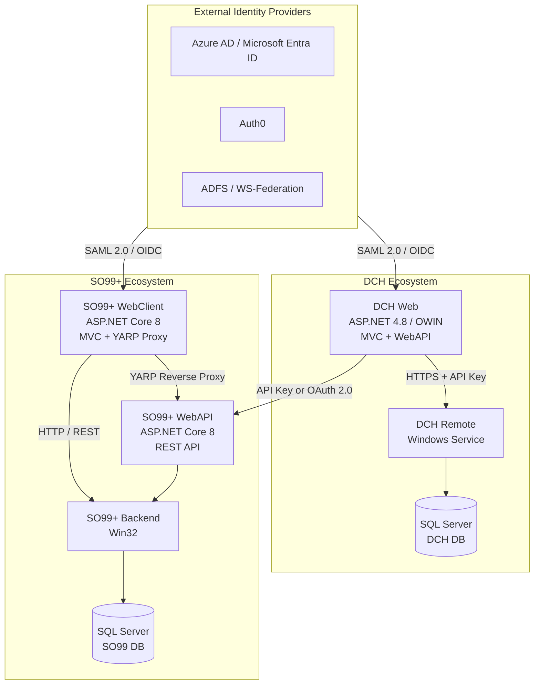
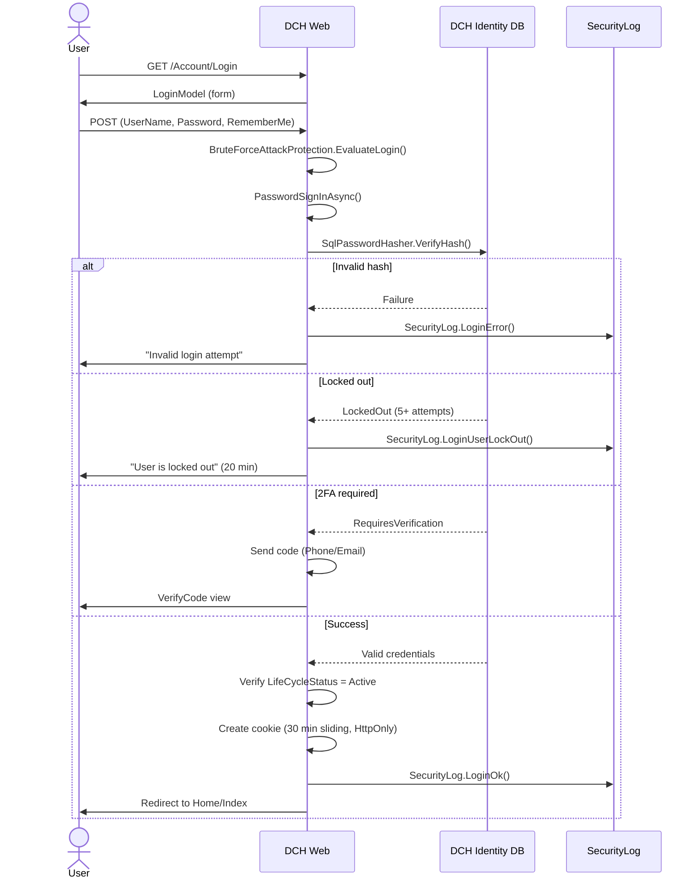
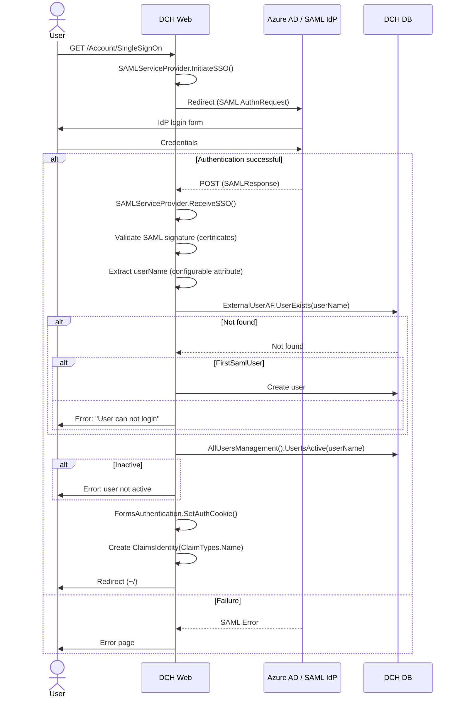
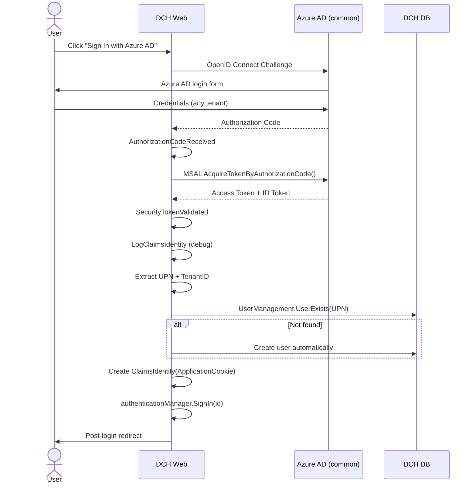
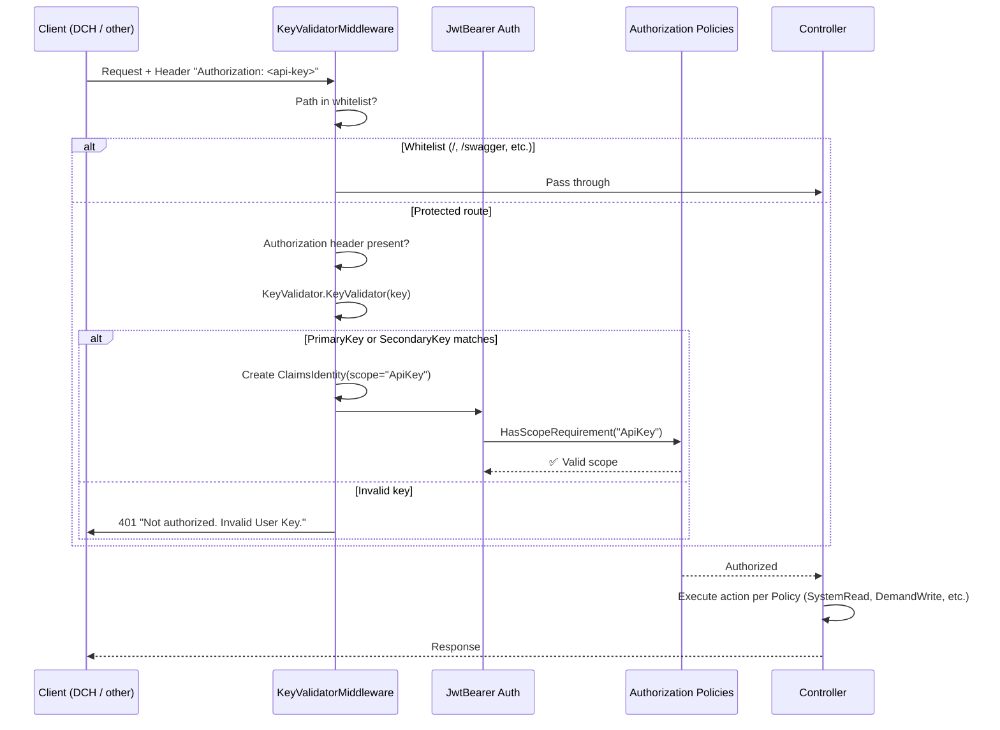
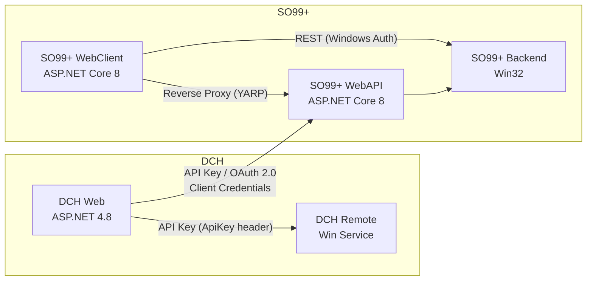
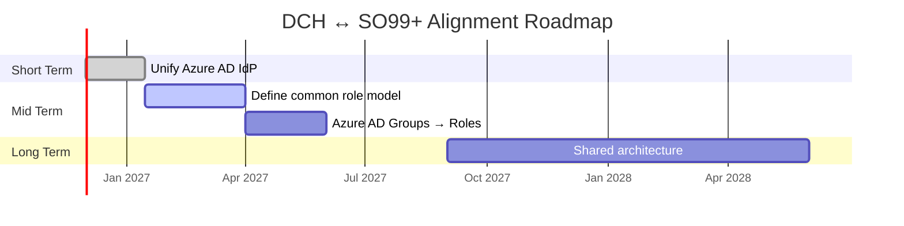

| [README](README.md) | 📄 Full Analysis | [Executive Summary](DCH_SO99_Authentication_ExecutiveSummary.en.md) |
|:---:|:---:|:---:|

&nbsp;

# DCH & SO99+ — Authentication & Authorization Technical Analysis

> **Purpose:** Technical reference document prepared for the Senior Director, Product Management meeting.
> **Objective:** Understand the current security mechanisms in DCH and SO99+, analyze compatibility, and evaluate alignment opportunities with the SO99 strategy.
> **Date:** November 2026
> **Author:** Analysis generated by Copilot from source code

---

## Table of Contents

1. [Executive Summary](#1-executive-summary)
2. [General Architecture](#2-general-architecture)
3. [Authentication in DCH (Demand Chain Hub)](#3-authentication-in-dch-demand-chain-hub)
4. [Authorization in DCH](#4-authorization-in-dch)
5. [Authentication in SO99+ (Order Management)](#5-authentication-in-so99-order-management)
6. [Authorization in SO99+](#6-authorization-in-so99)
7. [DCH to SO99+ Communication](#7-dch-to-so99-communication)
8. [DCH vs SO99+ Comparison](#8-dch-vs-so99-comparison)
9. [Compatibility Analysis and Integration Opportunities](#9-compatibility-analysis-and-integration-opportunities)
10. [Recommendations and Alignment Roadmap](#10-recommendations-and-alignment-roadmap)
11. [Appendix: Key Configuration Files](#11-appendix-key-configuration-files)

---

## 1. Executive Summary

Both **DCH** and **SO99+** are ToolsGroup enterprise web applications with notably similar authentication mechanisms implemented on **different technology stacks**:

| Aspect | DCH | SO99+ |
|---------|-----|-------|
| **Framework** | ASP.NET Framework 4.8 (VB.NET + C#) | ASP.NET Core 8 (C#) |
| **Primary authentication** | SAML 2.0 + Internal | SO99PLUS (built-in user/password) + SAML |
| **Available modes** | 11 modes (Internal, SAML, Windows, Azure AD, + 6 **legacy** modes) | 6 modes (SO99PLUS, SAML, MIXED, WINDOWS, AAD, AUTH0) |
| **MFA/2FA** | Yes (Phone/Email Code) | Not detected |
| **External API** | API Key + IP restriction | API Key + OAuth 2.0 (Client Credentials) |
| **Roles** | 4 business roles (Admin, PowerUser, MasterData, User) + granular permissions | Admin/User + SO99 backend session permissions |
| **Brute force protection** | Yes (brute force protection filter) | Yes (progressive delay) |

**Key takeaway:** Both systems share **the same authentication mental model** (multi-mode with SAML as corporate gold standard) but differ in **technology maturity** and **authorization model precision**. Alignment with SO99 is **technically viable and desirable**, especially in the authorization domain.

---

## 2. General Architecture



---

## 3. Authentication in DCH (Demand Chain Hub)

### 3.1. Supported Authentication Modes

DCH supports **11 authentication modes**, selectable via the `AuthenticationType` property in `Config/Settings.config`:

| Code | Mode | Status | Description |
|------|------|--------|-------------|
| `I` | Internal | ✅ Active | Built-in user/password (DCH database) |
| `W` | Windows | ✅ Active | On-premise Active Directory (Negotiate / Integrated Windows Auth) |
| `S` | SAML | ✅ Active | SAML 2.0 pure (via ComponentSpace) |
| `SI` | SAMLMixed | ✅ Active | SAML + internal users |
| `AMT` | AzureMultiTenant | ✅ Active | Azure AD multi-tenant via OpenID Connect |

> 🟢 **Recommended modes for new deployments:** `SAML`, `SAMLMixed`, or `AzureMultiTenant`.

**Active configuration in the repository:** `SI` (SAML + Internal)

### 3.2. Detailed Authentication Flows

#### 3.2.1. Internal (Forms Authentication)



**Key points:**
- Passwords verified via `SqlPasswordHasher` (ASP.NET Identity defaults to PBKDF2)
- Configurable lockout: `MaxFailedAccessAttemptsBeforeLockout = 5`
- Session timeout: 4500 minutes (75 hours) — extremely long, likely to avoid session drops in plant-floor environments
- `SecurityStampValidator` forces re-login every 30 minutes if the user changed in DB
- Internal passwords have **very lax requirements** (min length 4, no uppercase, digits, or special chars required)

#### 3.2.2. SAML 2.0 (ComponentSpace)



**Key points:**
- Uses **ComponentSpace SAML 2.0** library
- SP certificate: `Certificates\sp.pfx` (password: "password")
- IdP certificate: `Certificates\DCH410Local.cer`
- Configured IdP: Azure AD (`c7ff37ea-49aa-4430-bfeb-8b4d08ecf17b`)
- SAML username can be extracted from a configurable attribute (`SamlTokenUserProperty`)
- Email can be overwritten from the SAML `Email` attribute
- **Does not assign roles based on SAML attributes** — roles are always DCH database-defined
- **No Azure AD group-to-role mapping**

#### 3.2.3. Azure AD Multi-Tenant (OpenID Connect)



**Key points:**
- **Multi-tenant**: any user from any Azure AD tenant can authenticate (ValidateIssuer = false)
- Uses `Microsoft.Identity.Client` (MSAL) for code exchange
- Users are auto-created if they don't exist
- **No Azure AD group-to-role mapping**

#### 3.2.4. Windows Authentication (Active Directory)

- Configurable by setting `<authentication mode="Windows">` in `Config/authentication.config`
- Requires additional IIS/IIS Express configuration
- OWIN setup is empty: `WindowsUserSetUp()` does nothing
- Authorization depends on `Config/authorization.config` (deny anonymous users)

### 3.3. Additional Security in DCH

#### 3.3.1. Brute Force Protection
- File: `Security/TGSecurity/Authentication/BruteForceAttackProtection.cs`
- Evaluates each login attempt based on IP address and username
- Progressive timeout on failed attempts

#### 3.3.2. Anti-Forgery Tokens
- `AntiForgery` configured in `Startup.Auth.vb`
- `AntiforgeryUseNameAsClaim = true`

#### 3.3.3. Session Security
- Cookies marked as `HttpOnly`
- `SameSite` configured in Web.config
- ApplicationCookie with sliding expiration
- Configurable session timeout (capped between 3 and 540 minutes)

#### 3.3.4. File Security
- Direct access to `UserFiles` blocked (Web.config)
- `CheckMimeTypeUploadingFiles = true` — MIME type validation on uploads

---

## 4. Authorization in DCH

### 4.1. Role Model

DCH defines **4 business roles** with increasing privilege levels:

| Role | Privileges |
|------|------------|
| **DCHUser** | Basic read/write access to assigned data |
| **DCHMasterData** | Master data management |
| **DCHPowerUser** | Advanced privileges: can read all items, access all areas |
| **DCHAdmin** | Full system administration, user/config management |

### 4.2. Authorization Mechanisms

```mermaid
graph TB
    USER[("Authenticated User")]
    
    subgraph MIDDLEWARE["Middleware / Filters"]
        RP[RolesPermissionsFilter<br/>(MVC Controllers)]
        UP[UserPermissionsAttribute<br/>(Feature Permissions)]
        API[APIAuthorizeAttribute<br/>(Internal Web API)]
        ASF[ApiSecurityFilter<br/>(Remote / External API)]
    end
    
    subgraph SOURCE["Data Source"]
        SESSION[(Session<br/>CurrentUserRoles)]
        USERINFO[(UserInfo<br/>PermissionInformation)]
        LIC[(Active Licenses)]
        CFG[(Config API Key + IP)]
    end
    
    subgraph LOGIC["Authorization Logic"]
        CHK_ROLE[Check Role<br/>in StringCollection]
        CHK_PERM[Check Feature<br/>+ Active Licenses]
        CHK_IP[Check Source IP]
        CHK_KEY[Check ApiKey<br/>header]
    end
    
    subgraph OUTCOME["Result"]
        OK[✅ 200 OK]
        REDIRECT[↩️ Redirect to Login/Home]
        FORBIDDEN[🚫 403 Forbidden]
        JSON_ERR[📄 JSON Error + Login URL]
    end
    
    RP --> CHK_ROLE
    UP --> CHK_PERM
    API --> CHK_ROLE
    ASF --> CHK_IP
    ASF --> CHK_KEY
    
    CHK_ROLE -->|Authorized| OK
    CHK_ROLE -->|Unauthorized| REDIRECT
    CHK_PERM -->|Authorized| OK
    CHK_PERM -->|Unauthorized| REDIRECT
    CHK_IP -->|Valid IP| CHK_KEY
    CHK_IP -->|Invalid IP| JSON_ERR
    CHK_KEY -->|Valid Key| OK
    CHK_KEY -->|Invalid Key| JSON_ERR
```

#### 4.2.1. Roles Filter (MVC)
- **`RolesPermissionsFilter`**: MVC filter applied as attribute on controllers
- Checks if the user's role is in `MainData.CurrentUserRoles`
- Authorizes if user has **at least one** of the specified roles
- Example: `<RolesPermissionsFilter(Roles:="DCHAdmin,DCHPowerUser")>`

#### 4.2.2. User Permission Filter (Feature)
- **`UserPermissionsAttribute`**: Fine-grained access control to specific features
- Available permissions:
  - `FORECAST_EDITING_READ` / `FORECAST_EDITING_WRITE`
  - `PROMOTIONS_READ` / `PROMOTIONS_WRITE`
  - `IMPORT_FR_USER_FILE` / `IMPORT_PROMOTION_USER_FILE`
  - `FORECAST_ANALYSIS_SO99` / `FORECAST_ANALYSIS_DCH`
- Permissions are checked against `MainData.CurrentUserInfo.Permission` and active licenses

#### 4.2.3. API Filter (Web API)
- **`APIAuthorizeAttribute`**: For internal APIs (Web API controllers)
- Reads roles from `Session["CurrentUserRoles"]` and validates against specified roles
- Returns 403 Forbidden if unauthorized

#### 4.2.4. API Security Filter (Remote/DCH API)
- **`ApiSecurityFilter`**: For APIs that may be consumed externally
- **Double verification**:
  1. **By IP**: Restrict to localhost or IP whitelist
  2. **By API Key**: `ApiKey` header must match configured key
- Authorizes only if **both** conditions are met

### 4.3. User Lifecycle

Each user has a `LifeCycleStatus` that can be:
- **Active**: Can log in and is assigned roles
- **Other states**: No roles assigned (except `FirstWindowsUser` and `FirstSamlUser`)

### 4.4. Granular Permission Model

Beyond roles, DCH has an **extremely granular permission system** (defined in `PermissionInformation.cs`):

```
Read/Write permissions for:
  - Demand lines
  - Budget lines
  - SO99 forecast lines
  - Customer Orders (multiple)
  - Outstanding orders
  - Promotions
  - Units of Measure (UoM)
  - Free attributes (product/market)
  - Display series
  - Forecast Editing
  - Calculated fields
  - Data groups
  - Promotion groups
  - And more...
```

This level of granularity is **more precise** than SO99+'s model.

---

## 5. Authentication in SO99+ (Order Management)

### 5.1. Supported Authentication Modes

SO99+ WebClient supports **6 modes** (configured in `Config/Settings.json`):

| Mode | Description |
|------|-------------|
| `SO99PLUS` | Built-in user/password against SO99 backend (default) |
| `SAML` | SAML 2.0 via ComponentSpace |
| `MIXED` | SO99PLUS + SAML simultaneously |
| `WINDOWS` | Windows Authentication (Negotiate) |
| `AAD` | Azure AD / Microsoft Entra ID via Microsoft.Identity.Web |
| `AUTH0` | Auth0 as external Identity Provider |

**Active configuration in the repository:** `SO99PLUS`

### 5.2. Detailed Authentication Flow

#### 5.2.1. SO99PLUS (Built-in user/password)

```
User → /Account/Login (GET)
       ↓ POST (username, password)
       ↓ Validate backend server availability
       ↓ AuthenticateUser(username, password)
           ↓ REST call to SO99 backend
           ↓ Backend validates credentials
           ↓ Backend returns session info (roles, permissions)
       ↓ Create ClaimsIdentity with:
           - ClaimTypes.Name = username
           - ClaimTypes.Role = "admin" | "user" (based on user.Session.IsAdmin)
       ↓ Authentication cookie (ASP.NET Core)
       ↓ Redirect
```

**Key points:**
- Credentials are validated against the **SO99 backend** (not directly against DB)
- The SO99 backend is a Win32 application exposing REST services
- Session timeout: 60 minutes
- `InvalidLoginAttempts`: 3 attempts
- `InvalidLoginDelaySeconds`: 20 seconds progressive delay

#### 5.2.2. SAML 2.0

```
User → /Saml/AssertionConsumerService (POST from IdP)
       ↓ ComponentSpace.Saml2 receives and validates the response
       ↓ Look up SO99 user associated with SAML identity
       ↓ Create ClaimsIdentity with roles
       ↓ Authentication cookie
```

- Configuration in `Config/saml.json` (currently with placeholder values)
- Uses ComponentSpace.Saml2 (same library as DCH)

#### 5.2.3. Azure AD / Microsoft Entra ID

- Configuration in `Config/aad.json`
- Uses **Microsoft.Identity.Web** (Microsoft's official ASP.NET Core library)
- Configured against tenant `edb1616f-8f7b-4b1c-b924-3609b7131590`
- Client ID: `a2ef195c-44ce-4ce9-acfd-2e08f99c40f3`

#### 5.2.4. Auth0

- Configuration in `Config/auth0.json`
- Domain: `dev-nk1pjod2uxzc2z6a.us.auth0.com`
- Client ID: `izzXakJ0v2jSn9G4aVusOY5VLboNsS5r`

### 5.3. Additional Security in SO99+

- `CookieSecurePolicy`: Configurable for HTTPS-only
- `DashboardProtectionLevel`: 1 (dashboard protection)
- Frame protection: Configurable via CSP
- Secure domains: Allowed domain whitelist

---

## 6. Authorization in SO99+

### 6.1. Role Model

SO99+ has a **simpler role model**:

| Role | Description |
|------|-------------|
| **admin** | (`IsAdmin = true`) — Full administrative access |
| **user** | (`IsAdmin = false`) — Standard user with SO99 session-based permissions |

### 6.2. Authorization Mechanisms

#### 6.2.1. `[Authorize]` Attribute
- Standard ASP.NET Core attribute for controllers
- Verifies the user has an authenticated identity

#### 6.2.2. `[SO99Authorize]` Filter
- Custom filter that initializes the SO99 session
- Supports Windows, Azure, and Auth0 identities
- Loads session context from the SO99 backend

### 6.3. Authorization in SO99+ WebAPI

The SO99+ REST API uses **two authentication/authorization modes**:

#### 6.3.1. API Key Mode (active by default)



**Available authorization policies:**
- `SystemRead` / `SystemWrite`
- `DemandRead` / `DemandWrite`

**Unauthenticated path whitelist:**
- `/.well-known/openid-configuration`
- `/swagger`, `/documentation/`
- `/`, `/Home/Index`

#### 6.3.2. OAuth 2.0 Mode

```
Client → Request + JWT Bearer Token
       ↓ JwtBearerMiddleware:
           ↓ Validate token against Authority/Audience
           ↓ Verify scope in token
```

**Available scopes:**
- `SO99WebApiSystemRead` / `SO99WebApiSystemWrite`
- `SO99WebApiDemandRead` / `SO99WebApiDemandWrite`

**Configured clients (examples):**
- `SO99WebAPIPromotions` → scopes: `SO99WebAPIDemandRead`, `SO99WebAPISystemRead`

---

## 7. DCH to SO99+ Communication



### 7.1. DCH → SO99+ WebAPI

DCH communicates with `SO99+ WebAPI` to read forecast/demand data. The authentication method is configurable:

#### Option 1: API Key
```
DCH → SO99+ WebAPI
Header: Authorization: <SO99WebApiKey>
```

DCH configuration (`Config/Settings.config`):
```xml
<setting name="WebServiceAuthentication" serializeAs="String"><value>APIKey</value></setting>
<setting name="SO99WebApiKey" serializeAs="String"><value>8799e914d696af765cb33604694a4b076db6981a</value></setting>
```

#### Option 2: OAuth 2.0 (Client Credentials)
```
DCH → Authorization Server (Identity Provider)
       ↓ ClientId + ClientSecret → Access Token
DCH → SO99+ WebAPI
Header: Authorization: Bearer <access_token>
```

DCH configuration:
```xml
<setting name="WebServiceAuthentication" serializeAs="String"><value>OAuth</value></setting>
<setting name="SO99WebApiOAuthClientId" serializeAs="String"><value>SO99WebAPIPromotions</value></setting>
<setting name="SO99WebApiOAuthSecret" serializeAs="String"><value>8799e914d696af765cb33604694a4b076db6981a</value></setting>
<setting name="SO99WebApiOAuthScope" serializeAs="String"><value>SO99WebAPIDemandRead</value></setting>
```

**Note:** The API Key and Secret values are notably similar (or identical) in the current configuration — likely a placeholder or development value.

### 7.2. DCH → DCH Remote (Backend Service)

```
DCH Web → DCH Remote (Windows Service)
       ↓ HTTP + ApiKey header
       ↓ Authentication: encrypted/decrypted ApiKey
       ↓ Security: TGSecurity.Encryption
       ↓ Methods: Import/Export, T-SQL Execution, SignOff, Email
```

### 7.3. SO99+ WebClient → SO99+ WebAPI → SO99+ Backend

```
SO99 WebClient → YARP Reverse Proxy → SO99+ WebAPI
       ↓ API Key in Authorization header (or JWT Bearer in OAuth mode)
       ↓ WebAPI → SO99+ Backend (REST, Windows Auth)
       ↓ Win32 Backend → SQL Server (SO99 db)
```

---

## 8. DCH vs SO99+ Comparison

### 8.1. Authentication

| Aspect | DCH | SO99+ |
|--------|-----|-------|
| **Framework** | ASP.NET 4.8 (Owin/Katana) | ASP.NET Core 8 |
| **OWIN** | Yes (Microsoft.Owin) | No (native ASP.NET Core middleware) |
| **SAML 2.0** | ComponentSpace.SAML2 | ComponentSpace.Saml2 |
| **Azure AD** | Manual OpenID Connect (MSAL) | Microsoft.Identity.Web |
| **Auth0** | No | Yes |
| **Windows Auth** | Yes (IIS) | Yes (Negotiate) |
| **2FA/MFA** | Yes (Phone + Email) | No |
| **Brute force protection** | IP+user evaluation | Progressive delay, limited attempts |
| **Cookie expiration** | 4500 min (75h) sliding | 60 min |
| **Security stamp** | Yes (30 min) | Not detected |

### 8.2. Authorization

| Aspect | DCH | SO99+ |
|--------|-----|-------|
| **Role model** | 4 roles (Admin, PowerUser, MasterData, User) | 2 roles (admin, user) |
| **Granular permissions** | Extremely granular (20+ R/W categories) | Based on SO99 backend |
| **Feature-level control** | Yes (UserPermissionsAttribute) | Partial (SO99 session) |
| **Roles from IdP** | No | No |
| **Azure AD Groups** | No | No |
| **Policy-based auth** | No (except API) | Yes (in WebAPI) |
| **Scope-based auth** | No | Yes (in WebAPI, OAuth mode) |
| **API authorization** | ApiSecurityFilter (IP + Key) | KeyValidatorMiddleware + Policies |

### 8.3. Security Technology Stack

| Aspect | DCH | SO99+ |
|--------|-----|-------|
| **Language** | VB.NET (MVC) + C# (layers) | C# |
| **ORM/Identity** | ASP.NET Identity (EntityFramework) | Custom session (backed by SO99) |
| **Password hashing** | SqlPasswordHasher (ASP.NET Identity) | SO99 Backend (Win32) |
| **Certificates** | PFX + CER (local files) | PFX + CER (local files) |
| **Config encryption** | Not detected (plain text config) | Optional (RSA local machine) |
| **Security logging** | SecurityLog (login/logout/attack events) | Log4Net in WebAPI |
| **CORS** | Not explicitly configured | Yes (configurable whitelist) |
| **API versioning** | Manual versioning | Header Accept-Version (Asp.Versioning) |

---

## 9. Compatibility Analysis and Integration Opportunities

### 9.1. Natural Compatibility Areas

| Area | Analysis | Recommended Action |
|------|----------|-------------------|
| **SAML 2.0** | Both use ComponentSpace, same protocol version | High compatibility already. Same IdP (Azure AD) can serve both |
| **Azure AD** | DCH uses manual OIDC (MSAL), SO99 uses Microsoft.Identity.Web | Same IdP concept, different implementation |
| **Password policy** | Both have flexible configurations | Alignable if using the same IdP |
| **Certificates** | Same format (PFX + CER) | High compatibility |

### 9.2. Gaps and Challenges

| Challenge | Severity | Description |
|-----------|----------|-------------|
| **Framework difference** | High | DCH: ASP.NET 4.8 (Owin). SO99+: ASP.NET Core 8. Migrating DCH to Core is a major project |
| **Role model** | Medium | DCH has more granular DB-defined roles. SO99+ has simplified backend roles |
| **2FA** | Medium | DCH supports 2FA, SO99+ does not. Could be a SO99+ requirement |
| **AD group mapping** | Low | Neither assigns groups. Would need implementation in both |
| **SSO between DCH and SO99+** | Low | No SSO currently. User must authenticate separately. External SAML doesn't solve internal SSO |

### 9.3. Integration Opportunities

#### Opportunity 1: Single Identity Provider (Azure AD / Entra ID)
**High priority.** Both systems can already be configured against Azure AD. If they already use SAML against Azure AD, **they already share an IdP**. If not, aligning the IdP is the most natural step:
- DCH already has Azure AD configured as SAML IdP and as multi-tenant OIDC
- SO99+ already has Azure AD configured (Microsoft.Identity.Web)
- **Unifying the IdP** enables a single set of access policies, MFA, and user lifecycle management

**What would be needed?**
- Configure the same Azure AD tenant in both systems
- Decide whether each app maintains its own user base or unifies
- Note: DCH is already multi-tenant, SO99+ is not

#### Opportunity 2: Role Assignment from Azure AD Groups
**Medium priority.** Currently:
- DCH assigns roles from its DB (user table)
- SO99+ assigns admin/user based on the SO99 backend session

Improvement: Both could read **group claims** from Azure AD and map groups to roles.

#### Opportunity 3: SSO between DCH and SO99+
**Low priority short-term.** Since DCH and SO99+ already integrate at the API level (DCH reads data via SO99+ WebAPI), SSO is not critical. However, for users who use both systems:
- Both support SAML against the same IdP → the experience is effectively SSO from the user's perspective (the IdP remembers the session)
- True SSO (no separate login) would require shared session/cookies between applications (requires common domain)

#### Opportunity 4: Unified Authorization Model
**Medium priority.**
- DCH has a **more granular and mature** authorization model (R/W permissions per forecast feature, promotions, etc.)
- SO99+ has a simpler model (admin/user)
- **Proposal:** DCH's model could serve as a reference for enriching SO99+'s authorization

#### Opportunity 5: Centralized API Key Management
**Low priority.**
- DCH has its own API Key (for DCH Remote)
- SO99+ WebAPI has PrimaryKey and SecondaryKey
- DCH uses another API Key/Secret to call SO99+
- Could centralize API Key management (e.g., Azure Key Vault, or an internal service)

### 9.4. Alignment with SO99 Strategy

The SO99 strategy (mentioned in the meeting context) includes platform modernization toward **.NET Core**, **microservices architecture**, and **standards-based authentication** (OAuth 2.0 / OIDC).

**Current state vs. SO99 strategy:**

| SO99 Element | DCH Current | Gap |
|--------------|------------|-----|
| .NET Core | ❌ ASP.NET 4.8 | Significant gap |
| OAuth 2.0 / OIDC | ⚠️ SAML (not OAuth) + OIDC for Azure AD | Partial gap |
| Microservices | ❌ Monolithic with Remote Service | Significant gap |
| JWT for APIs | ❌ Cookie + API Key in header | SO99+ WebAPI already uses JWT |
| Central Identity Provider | ⚠️ Multiple IdPs configured | Partial gap |
| Auth0 | ❌ Not supported | SO99+ already supports Auth0 |

---

## 10. Recommendations and Alignment Roadmap



    ### 10.1. Short Term

1. **Unify Azure AD IdP**
   - Ensure DCH and SO99+ point to the same Azure AD tenant
   - Benefit: unified access policies, MFA, centralized reporting
   - Effort: Low (configuration)

    ### 10.2. Mid Term

1. **Define common role model**
   - DCH already has well-defined, battle-tested roles (Admin, PowerUser, MasterData, User)
   - Propose DCH model as reference for SO99+
   - Implement Azure AD group-to-role mapping

    ### 10.3. Long Term

    1. **Shared architecture**
       - Align authentication and authorization approaches over time
       - Evaluate centralized identity management

---

## 11. Appendix: Key Configuration Files

### 11.1. DCH: Configuration Files

| File | Purpose |
|------|---------|
| `Web.config` | IIS configuration, HTTP modules, cookies, security headers |
| `Config/authentication.config` | ASP.NET authentication mode |
| `Config/authorization.config` | Global authorization rules |
| `Config/saml.config` | Active SAML 2.0 configuration |
| `Config/saml.template.azureAD.config` | SAML template for Azure AD |
| `Config/Settings.config` | Application settings (auth type, API keys, etc.) |
| `Config/roleManagerAD.config` | Role provider (SQL-based, not actual AD) |
| `Config/WeakPasswords.txt` | Weak password list (for validation) |
| `App_Start/Startup.Auth.vb` | OWIN authentication configuration |

### 11.2. DCH: Key Source Files

| File | Purpose |
|------|---------|
| `Controllers/AccountController.vb` | Login, Logout, External Login, SAML initiation |
| `Controllers/SamlController.vb` | SAML Assertion Consumer Service, SLO |
| `SrcWeb/Global/Filters/RolesPermissionsFilter.vb` | Role-based authorization filter |
| `SrcWeb/Global/Filters/UserPermissionsFilter.vb` | Feature permission filter |
| `SrcWeb/Global/Filters/ApiSecurityFilter.vb` | API security filter (IP + Key) |
| `DCH.Common/WebApi/Filters/APIAuthorizeAttribute.cs` | Web API authorization filter |

### 11.3. SO99+: Configuration Files

| File | Purpose |
|------|---------|
| `Web/SO99WebClient/Config/Settings.json` | Main configuration (auth type, timeout, etc.) |
| `Web/SO99WebClient/Config/saml.json` | SAML 2.0 configuration |
| `Web/SO99WebClient/Config/aad.json` | Azure AD / Microsoft Entra ID configuration |
| `Web/SO99WebClient/Config/auth0.json` | Auth0 configuration |
| `Web/SO99WebAPI/.../appsettings.json` | WebAPI configuration (auth mode, keys, OAuth) |

### 11.4. SO99+: Key Source Files

| File | Purpose |
|------|---------|
| `Controllers/AccountController.cs` | Login, Auth0 Login, authentication |
| `Controllers/SamlController.cs` | SAML Assertion Consumer Service |
| `Src/Extensions/BuilderExtensions.cs` | Authentication service registration |
| `Src/Global/Filters/SO99Authorize.cs` | Custom authorization filter |
| `Infrastructure/Middleware/KeyValidatorMiddleware.cs` | API Key validation middleware |
| `Infrastructure/Middleware/Validators/KeyValidator.cs` | Key validator (Primary/Secondary) |

---

## Glossary

| Term | Meaning |
|------|---------|
| **DCH** | Demand Chain Hub — Demand collaboration and planning tool |
| **SO99+** | Service Optimizer 99+ — Supply chain optimization suite (Order Management) |
| **IdP** | Identity Provider — Entity that authenticates users (Azure AD, Auth0, etc.) |
| **SP** | Service Provider — The application that delegates authentication to the IdP |
| **SAML 2.0** | Security Assertion Markup Language 2.0 — Identity federation standard |
| **OIDC** | OpenID Connect — Modern authentication protocol built on OAuth 2.0 |
| **SSO** | Single Sign-On |
| **SLO** | Single Log-Out |
| **UPN** | User Principal Name — Azure AD user identifier (email format) |
| **MSAL** | Microsoft Authentication Library |
| **ComponentSpace** | Commercial SAML 2.0 library used by both DCH and SO99+ |
| **YARP** | Yet Another Reverse Proxy — Reverse proxy used by SO99+ WebClient |
| **API Key** | Shared secret key for API authentication |
| **JWT** | JSON Web Token — Standard authentication/authorization token |
| **2FA/MFA** | Two-Factor / Multi-Factor Authentication |
| **CORS** | Cross-Origin Resource Sharing |