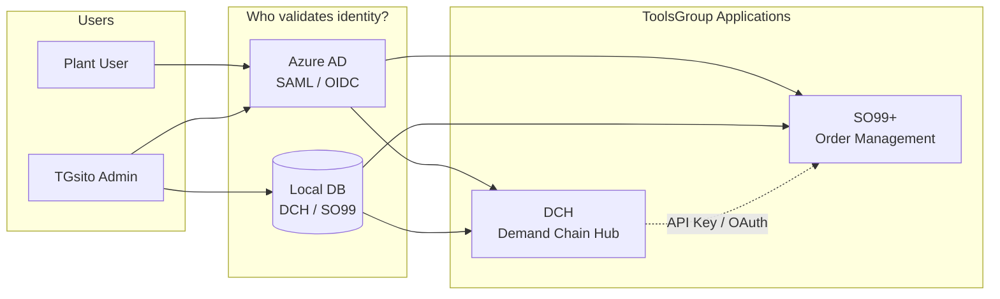
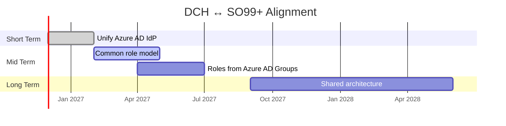

| [README](README.md) | [Full Analysis](DCH_SO99_Authentication_Analysis.en.md) | 📄 Executive Summary |
|:---:|:---:|:---:|

&nbsp;

# DCH & SO99+ — Authentication & Authorization: Executive Summary

> **To:** Senior Director, Product Management
> **Prepared for:** Meeting on authentication and alignment with SO99
> **Date:** November 2026

---

## What problem does this solve?

Every time a user opens **DCH** or **SO99+**, the system must answer two questions:

1. **Who are you?** → *Authentication* (login, password, SAML, Azure AD...)
2. **What can you do?** → *Authorization* (what data you see, which buttons appear)

Today each product answers these questions **on its own**, with similar but not identical technologies. The business question is: **should we align our approach?**

---

## The current landscape (in 1 minute)



**Two applications that can share the same identity provider (Azure AD), but each manages its own users and permissions independently.**

---

## How DCH works

| Access mode | Status | What is it for? |
|-------------|--------|-----------------|
| **SAML 2.0** (via Azure AD, ADFS...) | ✅ Active | Corporate standard. One click → login with corporate credentials |
| **Azure AD multi-tenant** | ✅ Active | Modern variant (OpenID Connect). Any Azure AD tenant can log in |
| **Internal User/Password** | ✅ Active | Classic login with username and password stored in DCH database |
| **Windows Auth** (on-prem AD) | ✅ Active | For environments without Azure (intranets) |

**Who can log in:** DCH decides against its own database. Even if you authenticate via Azure AD, DCH checks: *"Does this user exist in my user list? Are they active?"*

**What they can do:** DCH has **4 roles** (Admin, PowerUser, MasterData, User) and a very granular permission system: read/write by data type (demand, forecast, promotions...), by unit of measure, by product group, etc.

---

## How SO99+ works

| Access mode | Status | What is it for? |
|-------------|--------|-----------------|
| **SO99PLUS** (built-in) | ✅ Active | Login with username/password against the SO99 backend |
| **SAML 2.0** | ✅ Active | Same standard as DCH. Via ComponentSpace |
| **Azure AD** (Microsoft.Identity.Web) | ✅ Active | Modern Microsoft Entra ID integration |
| **Auth0** | ✅ Active | Alternative external Identity Provider |
| **Windows Auth** | ✅ Active | On-premise environments |

**Who can log in:** The SO99+ backend (Win32 application) validates credentials. It also accepts SAML and Azure AD logins.

**What they can do:** SO99+ has a simpler model: **admin** or **user**. Fine-grained permissions are managed internally by the SO99 backend.

---

## How DCH and SO99+ communicate

```
DCH  ────────────────>  SO99+ WebAPI
     (Shared API Key
      or OAuth 2.0)
```

DCH calls the SO99+ API to read forecast and demand data. They use a **shared secret key** (API Key) or a configured **OAuth token**. This is machine-to-machine communication, with no user interaction.

---

## SO99 alignment — Quick comparison

| Aspect | DCH | SO99+ | Compatible? |
|--------|-----|-------|:---:|
| **SAML 2.0** | ComponentSpace | ComponentSpace | ✅ Same library |
| **Azure AD** | MSAL (manual) | Microsoft.Identity.Web | ✅ Same IdP possible |
| **Roles from IdP** | ❌ Not mapped | ❌ Not mapped | ✅ Same limitation |
| **Granular permissions** | ✅ Very mature | ⚠️ Basic | DCH is more complete |

---

## Can we integrate? What do we recommend?

### ✅ Yes we can — with concrete steps from the SO99+ side

1. **Unify the Identity Provider (Azure AD)**
   - Already configured in both (SAML and OIDC)
   - Cost: near zero. Configuration change
   - Benefit: unified access policies, MFA, and lifecycle management

2. **Define a common role model**
   - DCH has 4 well-defined, battle-tested roles
   - Could serve as a reference for SO99+

3. **Read Azure AD groups to assign roles automatically**
   - Nobody does this today. It would be a maturity leap

---

## Meeting summary

```
┌──────────────────────────────────────────────────────────┐
│                                                          │
│  🟢  DCH and SO99+ ALREADY SHARE THE SAME IdP (Azure AD)│
│                                                          │
│  🟡  DCH has a better permission model than SO99+       │
│                                                          │
│  💡  Alignment is feasible with configuration            │
│      changes, not architecture overhauls                 │
│                                                          │
└──────────────────────────────────────────────────────────┘
```

---

## Suggested timeline



---

*Document generated from the full technical analysis of both codebases: DCH (ASP.NET 4.8 / VB.NET) and SO99+ (.NET Core 8 / C#). The detailed technical document is available for deeper dives.*