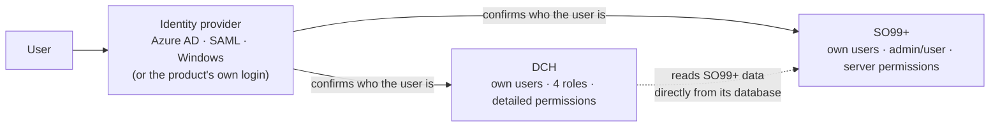
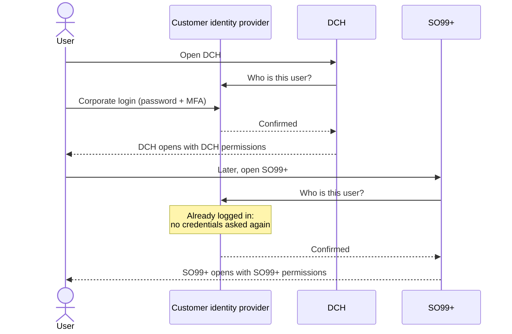

| [Technical Analysis](DCH_SO99_Authentication_Analysis.en.md) | 📄 Executive Summary | [README](README.md) |
|:---:|:---:|:---:|

&nbsp;

# DCH & SO99+ — Authentication & Authorization: Executive Summary

> **To:** Senior Director, Product Management
> **Context:** Meeting on DCH's authentication and authorization mechanism and its alignment with SO99+
> **Reading time:** ~10 minutes
> **Date:** November 2026

---

## 1. Two questions every application answers

| Question | Name | Example |
|---|---|---|
| **Who are you?** | Authentication | Logging in with a password, a corporate account, or Windows |
| **What can you do?** | Authorization | Which screens, functions, and data a user can see or change |

**An analogy that applies to both products:** think of an office building.

- The **reception desk** checks your ID → this is the **identity provider** (Azure AD, a SAML provider, Windows).
- Each **office** has its own list of who may enter and what they can touch → these are **DCH** and **SO99+**.
- Being accepted at reception does not open every office: **each office keeps its own list.**

---

## 2. How it works today

**Both products follow the same pattern:** the identity provider confirms who the user is, and each product then decides, with its own users and rules, whether the user can get in and what they can do.

---

## 3. DCH at a glance

**How users log in** (one mode chosen per installation)

| Mode | What the user experiences |
|---|---|
| DCH username/password | Classic login screen |
| Windows | No login screen: the Windows session is used |
| SAML 2.0 | "Login with corporate account" → customer's login page (e.g. Azure AD) |
| SAML + DCH users | Both options on the same screen |
| Azure AD multi-tenant | Microsoft login page, accepting any Azure AD organization |

**Who can get in:** only users registered in DCH and marked *Active*, even when the login is done by Azure AD or SAML. Deactivating a user in DCH blocks their access, even if the identity provider still accepts them.

**What they can do** — three layers, all managed inside DCH:

1. **Role** — Admin, PowerUser, MasterData, User: which screens can be opened.
2. **Feature permission** — e.g. Forecast Editing or Promotions, always combined with the customer's licenses.
3. **Data permission** — exactly which data can be read or edited (series, revisions, units of measure, attributes, data groups).

**Security basics:** account lockout after repeated failures, configurable password policy and expiration, session expiration, protection against automated attacks, and a security log. MFA is not built into DCH; it is enforced by the customer's identity provider.

---

## 4. SO99+ at a glance

**How users log in**

| Mode | What the user experiences |
|---|---|
| SO99+ username/password | Classic login screen |
| Windows | No login screen: the Windows session is used |
| SAML 2.0 | Customer's corporate login page |
| SAML + SO99+ users | Both options on the same screen |
| Azure AD | Microsoft login page for the customer's organization |
| Auth0 | Auth0 login page |

**Who can get in:** the **SO99+ server** always takes the final decision, whatever the login mode. Azure AD, SAML, or Auth0 only confirm the identity.

**What they can do:** the web application distinguishes `admin` and `user`; detailed permissions are configured and enforced by the SO99+ server.

**Integrations (WebAPI):** other systems call SO99+ with an API key (full access) or with OAuth 2.0 tokens that separate read and write permissions.

---

## 5. How the two products are connected today

| | Situation |
|---|---|
| **Data** | DCH reads SO99+ data **directly from the SO99+ database** |
| **Users** | Separate: a person using both products has one user in each |
| **Roles and permissions** | Separate, with different models |
| **Login session** | Separate: logging into one does not log into the other |

> **In short:** the products are connected at the **data** level, not at the **identity** level.

---

## 6. Compatibility at a glance

| | DCH | SO99+ | Assessment |
|---|---|---|---|
| SAML 2.0 | ✅ | ✅ | 🟢 Same library and protocol — one customer IdP can serve both |
| Azure AD | ✅ | ✅ | 🟢 Compatible — for one customer, DCH uses its SAML mode |
| Windows / AD | ✅ | ✅ | 🟢 Compatible |
| MFA | Via the IdP | Via the IdP | 🟢 Same approach |
| Auth0 | ❌ | ✅ | 🟡 SO99+ only (Auth0 could act as a SAML provider for DCH) |
| User lists | Own | Own | 🟡 Users must be maintained in both |
| Roles & permissions | 4 roles + detailed permissions | admin/user + server permissions | 🔴 Different models, no direct equivalence |
| Shared session | ❌ | ❌ | 🔴 Each product has its own |

---

## 7. Can they be integrated?

**Yes — at the identity level, with configuration only (no development).**

Both products are registered as two applications in the customer's identity provider (typically Azure AD via SAML):

| What the customer gets | What is needed |
|---|---|
| One corporate login for both products | Configuration in both products and in the customer's IdP |
| No second password prompt while the corporate session is active | The **same username** in DCH and SO99+ |
| MFA, password rules, and leaver blocking managed in one place | A corporate identity provider (SAML or Azure AD) |

**What remains separate:** users still have to exist in both products, and roles and permissions are still managed in each product.

---

## 8. Key messages for the meeting

| | Message |
|---|---|
| 🟢 | DCH and SO99+ share the same security model: identity comes from outside, permissions are managed inside |
| 🟢 | The same customer identity provider can serve both products today, through configuration |
| 🟡 | Users are maintained separately in each product |
| 🔴 | Roles and permissions follow different models and cannot be mapped automatically |
| 💡 | Aligning **identity** is configuration; aligning **roles and permissions** is a product decision |

---

## 9. Questions to decide

1. What does "alignment with SO99" mean for us: same login experience, same role model, or technical integration?
2. Do shared customers already have a corporate identity provider, and which login mode do they use today in each product?
3. Do we need a common role model across products, or does each product keep its own?

---

*Based on code analysis of DCH 4.40 and SO99+ 2026.3. Step-by-step flows and technical details are in the Technical Analysis document.*
