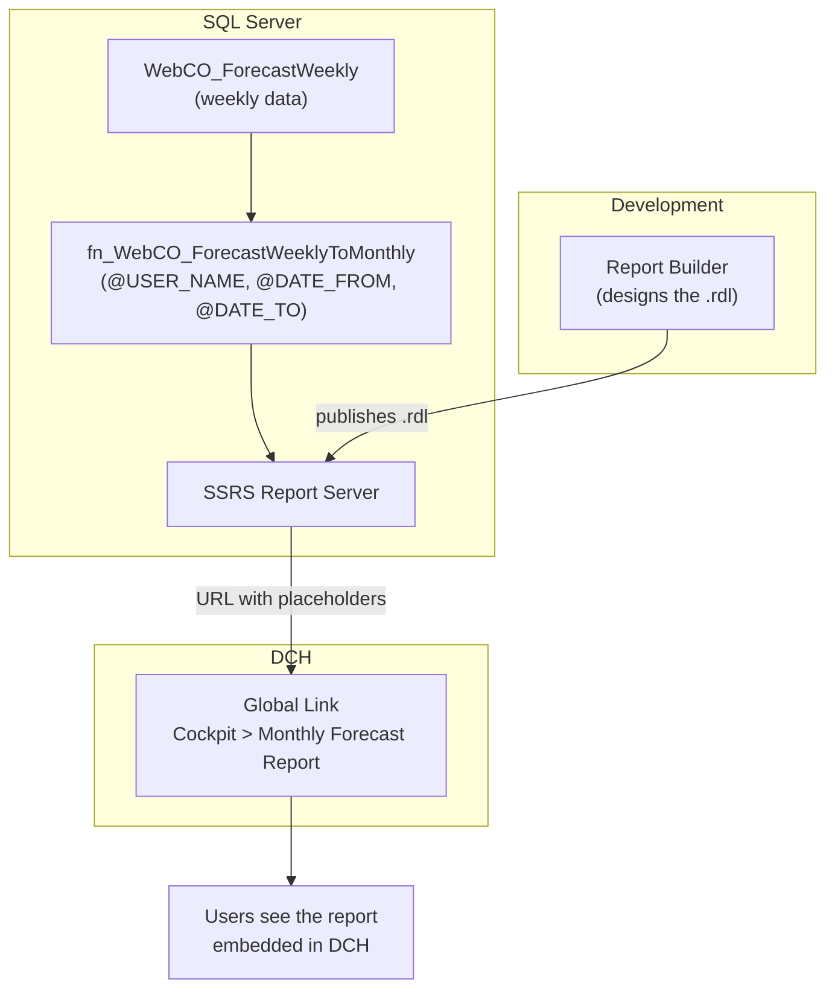
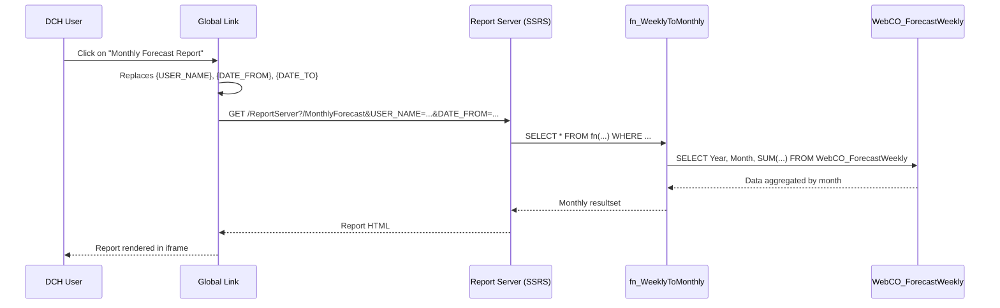

# DCH Weekly → Monthly Report

## Solution for generating a monthly report from Weekly configuration and displaying it within DCH

**Client:** Dr. Schaer  
**Version:** 1.0  
**Date:** 2026-08-05  
**Scope:** DCH 440 — Weekly Mode  

**Related documents:**
- [DCH_WeeklyToMonthly_SQL.md](./DCH_WeeklyToMonthly_SQL_en.md) — SQL aggregation function and DB scripts
- [DCH_WeeklyToMonthly_SSRS.md](./DCH_WeeklyToMonthly_SSRS_en.md) — SSRS guide: installation, Report Builder and publishing
- [DCH_WeeklyToMonthly_PowerBI.md](./DCH_WeeklyToMonthly_PowerBI_en.md) — Alternative: Power BI (licensing, implementation, comparison)
- [DCH_WeeklyToMonthly_GlobalLink.md](./DCH_WeeklyToMonthly_GlobalLink_en.md) — Global Link configuration in DCH
- [DCH_WeeklyToMonthly_HTML.md](./DCH_WeeklyToMonthly_HTML_en.md) — Alternative: static HTML report via Custom Procedure

---

## 1. Executive Summary

Dr. Schaer operates DCH in **Weekly mode** but needs to view a **monthly-level report** within DCH. DCH does not allow data at two time granularities simultaneously, nor does it offer a native reporting mechanism for externally aggregated data.

The solution combines two pieces:

1. **SQL Aggregation**: A database function that aggregates `WebCO_ForecastWeekly` at a monthly level (`Year`, `Month`), accepting user and date parameters.
2. **Visualization via SSRS + Global Link**: An SSRS report that consumes the function, is published on a Report Server, and is embedded in DCH through a Global Link with placeholders.

---

## 2. The Problem

### 2.1 Business need

Dr. Schaer requires:

1. **Monthly-level forecast data**, aggregated from the `WebCO_ForecastWeekly` table (the only available source in Weekly mode).
2. **Viewing this data within DCH**, ideally as a navigable table/report, with filtering and Excel export capabilities.
3. **The report to respect the user context** (DataGroups, permissions) and the configured forecast horizon.

### 2.2 Why DCH doesn't support it natively

| Limitation | Detail |
|---|---|
| **Single Time Bucket** | DCH operates in Weekly or Monthly mode, not both at once. The `WebCO_ForecastMonthly` table is empty in Weekly mode. |
| **No internal reporting** | DCH has no reporting engine. Data is only visible in Tree View (dynamic aggregation) or Report View, but always at the configured Time Bucket granularity. |
| **Alerts are not reports** | The `Alerts` table only has `AlertId, COProductId, COMarketId, Metric` — it has no time axis. Month-by-month values cannot be represented. See section 3.1. |

---

## 3. Analysis of Alternatives

### 3.1 Alerts (discarded)

The idea of using the Alerts system with TSQL to aggregate weekly → monthly data was considered. **Not viable**:

- **No time axis**: `AlertsDetail` only has `AlertId, COProductId, COMarketId, Metric`. There is no `Year`/`Month` column. A single `Metric` value per product/market, not a time series.
- **Not a report**: Alerts are designed to detect exceptions, not to display data tables.
- **No formatting**: No period columns, no totals, no hierarchies, no Excel export.

### 3.2 Option A: SSRS + Global Link ✅

- SQL aggregation via parameterizable function
- SSRS report published on Report Server
- Global Link in DCH with placeholders `{USER_NAME}`, `{DATE_FORECAST_CURRENT}`, `{DATE_FORECAST_END}`
- **Selected**: Professional, no additional license cost (included in SQL Server), interactive, exportable to Excel.

> See [DCH_WeeklyToMonthly_SSRS.md](./DCH_WeeklyToMonthly_SSRS_en.md) for more details on installation, Report Builder and publishing

### 3.3 Option B: Power BI + Global Link

- SQL aggregation via parameterizable function
- Power BI report published on Power BI Service (cloud) or Power BI Report Server (on-premise)
- Global Link in DCH with embedding URL
- Advanced visualizations: interactive charts, filters, slicers, KPIs
- **Main disadvantage**: Requires Power BI Pro/Premium licenses per user (~$10-20/user/month)
- **Recommended if**: The client already has Power BI licenses or wants interactive dashboards

> See [DCH_WeeklyToMonthly_PowerBI.md](./DCH_WeeklyToMonthly_PowerBI_en.md) for licensing details, implementation and comparison.

### 3.4 Option C: Static HTML via Custom Procedure

- SQL generates an `.html` file with a formatted table
- Saved in a folder accessible by IIS
- Global Link points to the file or to a URL that regenerates it on demand
- **Viable alternative**: Zero external dependencies, but no interactivity (no filters, no native Excel export).

> See [DCH_WeeklyToMonthly_HTML.md](./DCH_WeeklyToMonthly_HTML_en.md) for details on this alternative.

---

## 4. Designed Solution

### 4.1 General architecture

### 4.2 Data flow

### 4.3 Solution components

| Component | Description | Document |
|---|---|---|
| **SQL Function** | `fn_WebCO_ForecastWeeklyToMonthly` — aggregates weeks into months with parameters | [SQL.md](./DCH_WeeklyToMonthly_SQL_en.md) |
| **SSRS Report Server** | Publishes and serves the `.rdl` report | [SSRS.md](./DCH_WeeklyToMonthly_SSRS_en.md) |
| **Report Builder** | Free tool for designing the report | [SSRS.md](./DCH_WeeklyToMonthly_SSRS_en.md) |
| **Global Link** | URL embedded in DCH with placeholders | [GlobalLink.md](./DCH_WeeklyToMonthly_GlobalLink_en.md) |

### 4.4 Placeholders available in Global Links

| Placeholder | Replaced by | Example |
|---|---|---|
| `{USER_NAME}` | Authenticated user's username | `john.doe` |
| `{DATE_FORECAST_CURRENT}` | Forecast horizon start date | `2026-01-05` |
| `{DATE_FORECAST_END}` | Forecast horizon end date | `2026-12-28` |

These placeholders are passed as parameters to the SSRS report, allowing filtering by user and date range.

---

## 5. Implementation Guide

### 5.1 Prerequisites

- DCH 440 running in **Weekly** mode
- **SQL Server Standard/Enterprise** with SSRS installed and configured
- Access to the **Report Server** via HTTP from the DCH server
- **Report Builder** installed on the developer's machine (free download)

### 5.2 Implementation sequence

| Step | Description | Document |
|---|---|---|
| **1** | Create the `fn_WebCO_ForecastWeeklyToMonthly` function in the DCH database | [SQL.md](./DCH_WeeklyToMonthly_SQL_en.md) |
| **2** | Verify/install SSRS on the SQL Server | [SSRS.md](./DCH_WeeklyToMonthly_SSRS_en.md) |
| **3** | Design the report in Report Builder and publish it | [SSRS.md](./DCH_WeeklyToMonthly_SSRS_en.md) |
| **4** | Configure the Global Link in DCH | [GlobalLink.md](./DCH_WeeklyToMonthly_GlobalLink_en.md) |
| **5** | Verify the report displays correctly in Cockpit | [GlobalLink.md](./DCH_WeeklyToMonthly_GlobalLink_en.md) |

### 5.3 Note on DataGroups

The SSRS report is external to DCH — **it does not automatically inherit DataGroups or user permissions**. If DataGroup filtering is required:

- **Option 1**: Pass the DataGroup as an additional parameter in the URL (requires extending placeholders or encoding the DataGroup in the function).
- **Option 2**: Create a dataset in the report that queries `ADMIN_UserDataGroup` for `@USER_NAME` and filters accordingly.
- **Option 3**: Assume that users viewing this report have access to all data (simplifies implementation).

---

## 6. Troubleshooting

| Problem | Likely cause | Solution |
|---|---|---|
| Report doesn't load in DCH | The iframe is blocked by X-Frame-Options | Configure SSRS to allow iframes |
| "Access Denied" error in SSRS | Incorrect credentials in the datasource | Configure stored credentials in the report |
| Global Link URL doesn't replace placeholders | Incorrect format | Verify `{PLACEHOLDER}` braces and exact names |
| SSRS is not installed | Feature not selected in SQL Server | Run SQL Server installer > Add features > Reporting Services |
| The function returns no data | `WebCO_ForecastWeekly` has no data in the range | Verify dates and forecast horizon |

---

## 7. Appendices

### 7.1 Tables involved

| Table | Use |
|---|---|
| `WebCO_ForecastWeekly` | Weekly source data to aggregate |
| `MasterData_COProduct` | Product descriptions |
| `MasterData_COMarket` | Market descriptions |
| `MasterData_Week` | Week information (optional, for date mapping) |
| `CONFIG_Link` | Global Links registry |
| `CONFIG_ParamGen` | `PARAM_GLOBAL_LINKS_DATE_FORMAT` (date format) |

### 7.2 References

- DCH440 System Admin Guide
- [SSRS Documentation (Microsoft)](https://learn.microsoft.com/en-us/sql/reporting-services/)
- [Report Builder Documentation](https://learn.microsoft.com/en-us/sql/reporting-services/report-builder/)

---

> **Document version**: 1.0  
> **Date**: 2026-08-05  
> **Scope**: DCH 440 — Weekly Mode  
> **Client**: Dr. Schaer