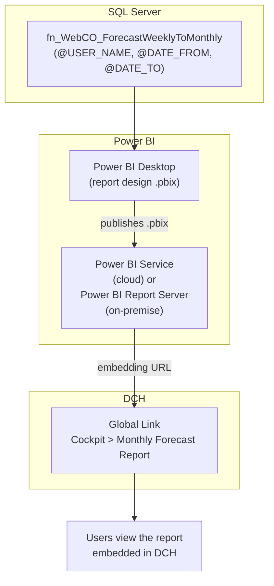

# DCH Weekly → Monthly — Alternative: Power BI

**Client:** Dr. Schaer  
**Version:** 1.0  
**Date:** 2026-08-05  
**Scope:** DCH 440 — Weekly Mode  

**Related documents:**
- [DCH_WeeklyToMonthly_Main.md](./DCH_WeeklyToMonthly_1_Main_en.md) ← Main document
- [DCH_WeeklyToMonthly_SQL.md](./DCH_WeeklyToMonthly_SQL_en.md) — SQL aggregation function
- [DCH_WeeklyToMonthly_SSRS.md](./DCH_WeeklyToMonthly_SSRS_en.md) — SSRS guide (recommended option)
- [DCH_WeeklyToMonthly_GlobalLink.md](./DCH_WeeklyToMonthly_GlobalLink_en.md) — Global Link in DCH
- [DCH_WeeklyToMonthly_HTML.md](./DCH_WeeklyToMonthly_HTML_en.md) — Static HTML alternative

---

## 1. Description

**Power BI** is Microsoft's analytics and data visualization platform. For this use case, it enables:

- Connecting directly to the SQL function `fn_WebCO_ForecastWeeklyToMonthly`
- Creating interactive reports with tables, charts, filters, and slicers
- Publishing the report to **Power BI Service** (cloud) or **Power BI Report Server** (on-premise)
- Embedding the report in DCH via a Global Link

---

## 2. Licensing options

Power BI has several licensing models. For this scenario, the relevant options are:

| Option | Cost | Ideal for |
|---|---|---|
| **Power BI Desktop** | Free | Local report development. Does NOT allow sharing or publishing. |
| **Power BI Pro** | ~$10/user/month | Publish to Power BI Service and share with other Pro users. Every user viewing the report needs a Pro license. |
| **Power BI Premium** | ~$20/user/month (or dedicated capacity starting at ~$5,000/month) | Publish and share without requiring each viewer to have a license. |
| **Power BI Report Server** | Included in SQL Server Enterprise Edition with Software Assurance | On-premise alternative. Users access the report without additional licensing. |
| **Power BI Embedded** | Pay-per-use (Azure) | For embedding reports in web applications. Not directly applicable here. |

### Which one applies for Dr. Schaer?

| Scenario | Option |
|---|---|
| SQL Server Enterprise + SA | **Power BI Report Server** (no additional cost) |
| Few users (< 10) | **Power BI Pro** (~$10/user/month) — requires a license for each person viewing the report in DCH |
| Many users (≥ 10) | **Power BI Premium** (~$20/user/month) or dedicated capacity — more expensive |
| Development/testing only | **Power BI Desktop** (free) — does not allow shared viewing in DCH |

> ⚠️ **The cost factor is critical.** Unlike SSRS (included in SQL Server), Power BI requires additional per-user licenses to share reports.

---

## 3. Architecture



---

## 4. SSRS vs Power BI comparison

| Feature | SSRS | Power BI |
|---|---|---|
| **License cost** | Included in SQL Server | Power BI Pro (~$10/user/month) or Premium |
| **Additional installation** | SQL Server feature | Power BI Desktop (free) + service license |
| **Interactivity** | Parameters, basic drill-down | Filters, slicers, drill-through, cross-filtering |
| **Visualizations** | Tables, basic charts | Advanced charts, maps, KPIs, treemaps |
| **Excel export** | Native | Native (from the service) |
| **Data refresh** | Real-time | Scheduled (refresh) or DirectQuery (real-time) |
| **Learning curve** | Medium | Medium-low (more intuitive) |
| **Publishing** | Report Server (on-premise) | Power BI Service (cloud) or Report Server (on-premise) |
| **Embedded in DCH** | Direct URL | Embedding URL (requires authentication setup) |
| **Ideal for** | Operational reporting, data tables | Interactive dashboards, visual analysis |

---

## 5. Step-by-step implementation

### 5.1 Install Power BI Desktop

1. Download from: https://powerbi.microsoft.com/en-us/desktop/
2. Install on the developer's machine
3. It's free — no license required

### 5.2 Connect to the SQL function

1. Open Power BI Desktop
2. **Get Data > SQL Server**
3. Server: `SERVER_NAME`
4. Database: `DCH_DATABASE`
5. Choose **Advanced Options** and write the query:
   ```sql
   SELECT * 
   FROM [dbo].[fn_WebCO_ForecastWeeklyToMonthly]('SSRS_REPORT', NULL, NULL)
   ```
6. Configure credentials (Windows Auth or SQL Auth)

### 5.3 Alternative: use dynamic parameters

Power BI allows creating **parameters** that can be passed via URL (in Power BI Service). To do this:

1. In Power Query Editor, create parameters: `UserName`, `DateFrom`, `DateTo`
2. Modify the query to use the parameters:
   ```sql
   SELECT * 
   FROM [dbo].[fn_WebCO_ForecastWeeklyToMonthly](@UserName, @DateFrom, @DateTo)
   ```
3. Once published, these parameters can be passed via URL

### 5.4 Design the report

Power BI offers many more visualization types than SSRS:

| Visualization | Use in this report |
|---|---|
| **Table/Matrix** | Detailed data: Product × Market × Month × Quantities |
| **Slicers** | Interactive filters: select product, market, year, month |
| **Line Chart** | Time evolution of FrcQty, Budget, COQty across months |
| **Bar Chart** | FR1..FR5 comparison by product/market |
| **KPI Cards** | Totals: Forecast Total, Budget Total, % Variation |
| **Map** | If market free attributes contain geographic data |

### 5.5 Publish the report

#### Option A: Power BI Service (cloud)

1. Save the `.pbix` in Power BI Desktop
2. **Publish** to Power BI Service (requires Pro or Premium account)
3. In Power BI Service, go to the published report
4. **File > Embed report > Website or portal**
5. Copy the embedding URL (iframe)

#### Option B: Power BI Report Server (on-premise)

1. **File > Save As > Power BI Report Server** (requires the Power BI Desktop version optimized for Report Server)
2. Server URL: `http://server/ReportServer`
3. The report is published and accessible via a URL similar to SSRS

### 5.6 Configure the Global Link in DCH

The published report URL is configured as a Global Link in DCH:

```
https://app.powerbi.com/reportEmbed?reportId=...&USER_NAME={USER_NAME}&DATE_FROM={DATE_FORECAST_CURRENT}&DATE_TO={DATE_FORECAST_END}
```

> **Note on authentication**: For DCH's iframe to display the Power BI report, the user must be authenticated in Power BI Service. This may require:
> - Users having a Power BI Pro account
> - Or using **Power BI Embedded** with anonymous authentication (more complex)
> - Or using **Power BI Report Server** on-premise with Windows Auth (the DCH server and Report Server must be on the same domain)

This is the **main challenge** of Power BI compared to SSRS: authentication for iframe embedding.

---

## 6. Power BI advantages over SSRS

1. **Much richer visualizations**: interactive charts, maps, KPIs, tooltips
2. **Advanced interactivity**: cross-filtering (clicking a chart automatically filters the others), drill-through to detail pages
3. **Filters and slicers**: the user can explore data freely
4. **Scheduled refresh**: the dataset refreshes automatically every day/hour without intervention
5. **Mobile access**: Power BI Mobile allows viewing reports on smartphone/tablet

---

## 7. Power BI disadvantages compared to SSRS

1. **Cost**: Pro/Premium licenses required for sharing
2. **Authentication**: Complex to configure for iframe embedding
3. **Cloud dependency**: Power BI Service requires an Internet connection (except Power BI Report Server on-premise)
4. **Overkill for simple tables**: If only a data table is needed, Power BI is excessive
5. **Administration complexity**: Workspaces, permissions, datasets, gateways...

---

## 8. Recommendation

**Power BI is the best option if:**
- The client already has Power BI Pro/Premium licenses
- An interactive dashboard with charts is needed, not just a table
- Mobile access is valued
- There is budget for licenses ($10-20/user/month)

**SSRS is a better option if:**
- The budget for additional licenses is zero
- Only a monthly data table is needed
- A 100% on-premise solution is preferred
- Administration simplicity is a priority

---

> **Document version**: 1.0  
> **Date**: 2026-08-05  
> **Scope**: DCH 440 — Weekly Mode  
> **Client**: Dr. Schaer