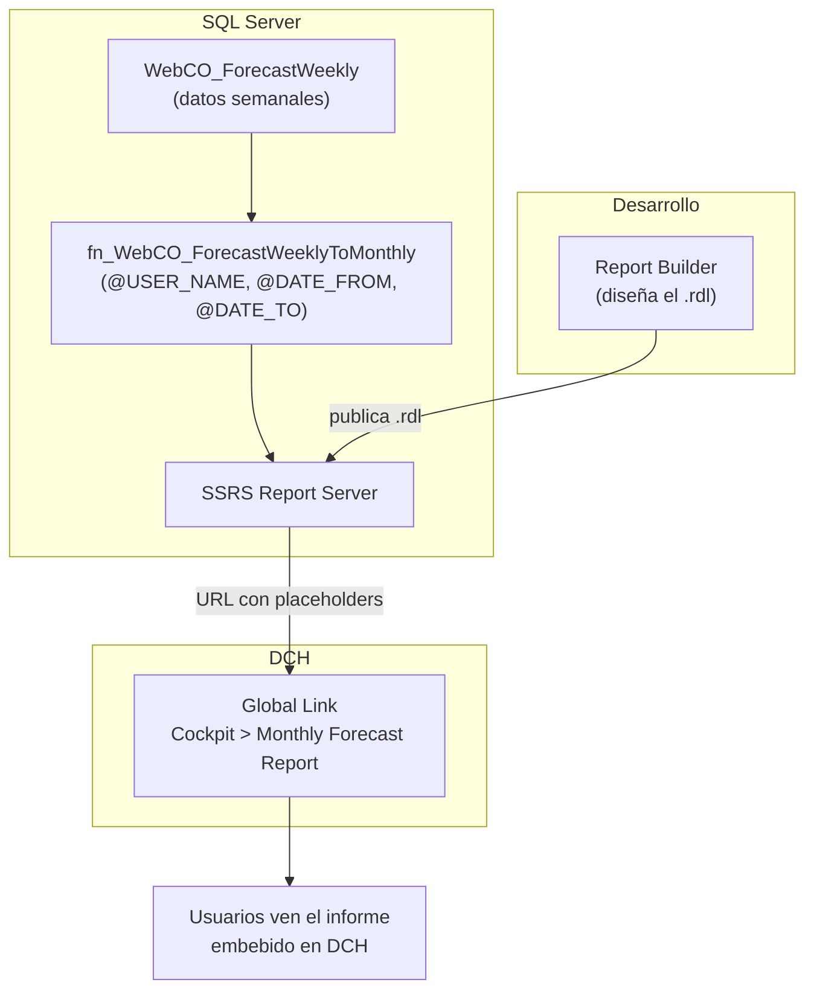
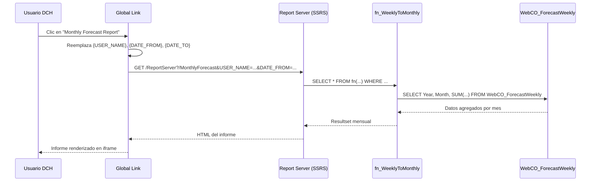

# DCH Weekly → Monthly Report

## Solución para generación de reporte mensual desde configuración Weekly y visualización dentro de DCH

**Cliente:** Dr. Schaer  
**Versión:** 1.0  
**Fecha:** 2026-08-05  
**Ámbito:** DCH 440 — Modo Weekly  

**Documentos relacionados:**
- [DCH_WeeklyToMonthly_SQL.md](./DCH_WeeklyToMonthly_SQL_es.md) — Function SQL de agregación y scripts de BD
- [DCH_WeeklyToMonthly_SSRS.md](./DCH_WeeklyToMonthly_SSRS_es.md) — Guía SSRS: instalación, Report Builder y publicación
- [DCH_WeeklyToMonthly_PowerBI.md](./DCH_WeeklyToMonthly_PowerBI_es.md) — Alternativa: Power BI (licencias, implementación, comparativa)
- [DCH_WeeklyToMonthly_GlobalLink.md](./DCH_WeeklyToMonthly_GlobalLink_es.md) — Configuración del Global Link en DCH
- [DCH_WeeklyToMonthly_HTML.md](./DCH_WeeklyToMonthly_HTML_es.md) — Alternativa: reporte HTML estático vía Custom Procedure

---

## 1. Resumen Ejecutivo

Dr. Schaer opera DCH en **modo Weekly** pero necesita visualizar un **reporte a nivel mensual** dentro de DCH. DCH no permite tener datos en dos granularidades temporales simultáneamente, ni ofrece un mecanismo nativo de reporting para datos agregados externamente.

La solución combina dos piezas:

1. **Agregación SQL**: Una function en la base de datos que agrega `WebCO_ForecastWeekly` a nivel mensual (`Year`, `Month`), aceptando parámetros de usuario y fechas.
2. **Visualización vía SSRS + Global Link**: Un informe SSRS que consume la function, se publica en un Report Server, y se embebe en DCH mediante un Global Link con placeholders.

---

## 2. El Problema

### 2.1 Necesidad de negocio

Dr. Schaer requiere:

1. **Datos de forecast a nivel mensual**, agregados desde la tabla `WebCO_ForecastWeekly` (única fuente disponible en modo Weekly).
2. **Visualizar estos datos dentro de DCH**, idealmente en forma de tabla/reporte navegable, con capacidad de filtrado y exportación a Excel.
3. **Que el reporte respete el contexto del usuario** (DataGroups, permisos) y el horizonte de forecast configurado.

### 2.2 Por qué DCH no lo soporta nativamente

| Limitación | Detalle |
|---|---|
| **Un solo Time Bucket** | DCH opera en modo Weekly o Monthly, no en ambos a la vez. La tabla `WebCO_ForecastMonthly` está vacía en modo Weekly. |
| **Sin reporting interno** | DCH no tiene un motor de reporting. Los datos solo se ven en Tree View (agregación dinámica) o Report View, pero siempre en la granularidad del Time Bucket configurado. |
| **Los Alerts no son reportes** | La tabla `Alerts` solo tiene `AlertId, COProductId, COMarketId, Metric` — no tiene eje temporal. No se pueden representar valores mes a mes. Ver sección 3.1. |

---

## 3. Análisis de Alternativas

### 3.1 Alerts (descartado)

Se planteó usar el sistema de Alerts con TSQL para agregar datos semanales → mensuales. **No es viable**:

- **Sin eje temporal**: `AlertsDetail` solo tiene `AlertId, COProductId, COMarketId, Metric`. No existe columna `Year`/`Month`. Un solo valor `Metric` por producto/mercado, no una serie temporal.
- **No es un reporte**: Los alerts están diseñados para detectar excepciones, no para visualizar tablas de datos.
- **Sin formato**: Sin columnas de período, sin totales, sin jerarquías, sin exportación a Excel.

### 3.2 Opción A: SSRS + Global Link ✅

- Agregación SQL vía function parametrizable
- Informe SSRS publicado en Report Server
- Global Link en DCH con placeholders `{USER_NAME}`, `{DATE_FORECAST_CURRENT}`, `{DATE_FORECAST_END}`
- **Seleccionada**: Profesional, sin coste adicional de licencia (incluido en SQL Server), interactivo, exportable a Excel.

> Ver [DCH_WeeklyToMonthly_SSRS.md](./DCH_WeeklyToMonthly_SSRS_es.md) para mas detalles instalación, Report Builder y publicación

### 3.3 Opción B: Power BI + Global Link

- Agregación SQL vía function parametrizable
- Informe Power BI publicado en Power BI Service (nube) o Power BI Report Server (on-premise)
- Global Link en DCH con URL de embedding
- Visualizaciones avanzadas: gráficos interactivos, filtros, segmentaciones, KPIs
- **Desventaja principal**: Requiere licencias Power BI Pro/Premium por usuario (~$10-20/usuario/mes)
- **Recomendado si**: El cliente ya tiene licencias Power BI o quiere dashboards interactivos

> Ver [DCH_WeeklyToMonthly_PowerBI.md](./DCH_WeeklyToMonthly_PowerBI_es.md) para detalles de licencias, implementación y comparativa.

### 3.4 Opción C: HTML estático vía Custom Procedure

- SQL genera fichero `.html` con tabla formateada
- Se guarda en carpeta accesible por IIS
- Global Link apunta al fichero o a una URL que lo regenera bajo demanda
- **Alternativa viable**: Cero dependencias externas, pero sin interactividad (no filtros, no exportación nativa a Excel).

> Ver [DCH_WeeklyToMonthly_HTML.md](./DCH_WeeklyToMonthly_HTML_es.md) para detalles de esta alternativa.

---

## 4. Solución Diseñada

### 4.1 Arquitectura general

### 4.2 Flujo de datos

### 4.3 Componentes de la solución

| Componente | Descripción | Documento |
|---|---|---|
| **Function SQL** | `fn_WebCO_ForecastWeeklyToMonthly` — agrega semanas a meses con parámetros | [SQL.md](./DCH_WeeklyToMonthly_SQL_es.md) |
| **SSRS Report Server** | Publica y sirve el informe `.rdl` | [SSRS.md](./DCH_WeeklyToMonthly_SSRS_es.md) |
| **Report Builder** | Herramienta gratuita para diseñar el informe | [SSRS.md](./DCH_WeeklyToMonthly_SSRS_es.md) |
| **Global Link** | URL embebida en DCH con placeholders | [GlobalLink.md](./DCH_WeeklyToMonthly_GlobalLink_es.md) |

### 4.4 Placeholders disponibles en Global Links

| Placeholder | Se reemplaza por | Ejemplo |
|---|---|---|
| `{USER_NAME}` | Username del usuario autenticado | `john.doe` |
| `{DATE_FORECAST_CURRENT}` | Fecha de inicio del horizonte de forecast | `2026-01-05` |
| `{DATE_FORECAST_END}` | Fecha de fin del horizonte de forecast | `2026-12-28` |

Estos placeholders se pasan como parámetros al informe SSRS, permitiendo filtrar por usuario y rango de fechas.

---

## 5. Guía de Implementación

### 5.1 Requisitos previos

- DCH 440 funcionando en modo **Weekly**
- **SQL Server Standard/Enterprise** con SSRS instalado y configurado
- Acceso al **Report Server** vía HTTP desde el servidor DCH
- **Report Builder** instalado en la máquina del desarrollador (descarga gratuita)

### 5.2 Secuencia de implementación

| Paso | Descripción | Documento |
|---|---|---|
| **1** | Crear la function `fn_WebCO_ForecastWeeklyToMonthly` en la BD de DCH | [SQL.md](./DCH_WeeklyToMonthly_SQL_es.md) |
| **2** | Verificar/instalar SSRS en el servidor SQL Server | [SSRS.md](./DCH_WeeklyToMonthly_SSRS_es.md) |
| **3** | Diseñar el informe en Report Builder y publicarlo | [SSRS.md](./DCH_WeeklyToMonthly_SSRS_es.md) |
| **4** | Configurar el Global Link en DCH | [GlobalLink.md](./DCH_WeeklyToMonthly_GlobalLink_es.md) |
| **5** | Verificar que el informe se ve correctamente en Cockpit | [GlobalLink.md](./DCH_WeeklyToMonthly_GlobalLink_es.md) |

### 5.3 Nota sobre DataGroups

El informe SSRS es externo a DCH — **no hereda automáticamente los DataGroups ni los permisos del usuario**. Si se requiere filtrado por DataGroup:

- **Opción 1**: Pasar el DataGroup como parámetro adicional en la URL (requiere extender los placeholders o codificar el DataGroup en la function).
- **Opción 2**: Crear un dataset en el informe que consulte `ADMIN_UserDataGroup` para el `@USER_NAME` y filtre en consecuencia.
- **Opción 3**: Asumir que los usuarios que ven este reporte tienen acceso a todos los datos (simplifica la implementación).

---

## 6. Troubleshooting

| Problema | Causa probable | Solución |
|---|---|---|
| El informe no carga en DCH | El iframe está bloqueado por X-Frame-Options | Configurar SSRS para permitir iframes |
| Error "Access Denied" en SSRS | Credenciales incorrectas en el datasource | Configurar stored credentials en el informe |
| La URL del Global Link no reemplaza placeholders | El formato es incorrecto | Verificar llaves `{PLACEHOLDER}` y nombres exactos |
| SSRS no está instalado | Feature no seleccionado en SQL Server | Ejecutar instalador de SQL Server > Add features > Reporting Services |
| La function no devuelve datos | `WebCO_ForecastWeekly` sin datos en el rango | Verificar fechas y horizonte de forecast |

---

## 7. Anexos

### 7.1 Tablas involucradas

| Tabla | Uso |
|---|---|
| `WebCO_ForecastWeekly` | Datos fuente semanales a agregar |
| `MasterData_COProduct` | Descripciones de producto |
| `MasterData_COMarket` | Descripciones de mercado |
| `MasterData_Week` | Información de semanas (opcional, para mapeo de fechas) |
| `CONFIG_Link` | Registro de Global Links |
| `CONFIG_ParamGen` | `PARAM_GLOBAL_LINKS_DATE_FORMAT` (formato de fecha) |

### 7.2 Referencias

- Manual DCH440 System Admin Guide
- [SSRS Documentation (Microsoft)](https://learn.microsoft.com/en-us/sql/reporting-services/)
- [Report Builder Documentation](https://learn.microsoft.com/en-us/sql/reporting-services/report-builder/)

---

> **Documento versión**: 1.0  
> **Fecha**: 2026-08-05  
> **Ámbito**: DCH 440 — Modo Weekly  
> **Cliente**: Dr. Schaer