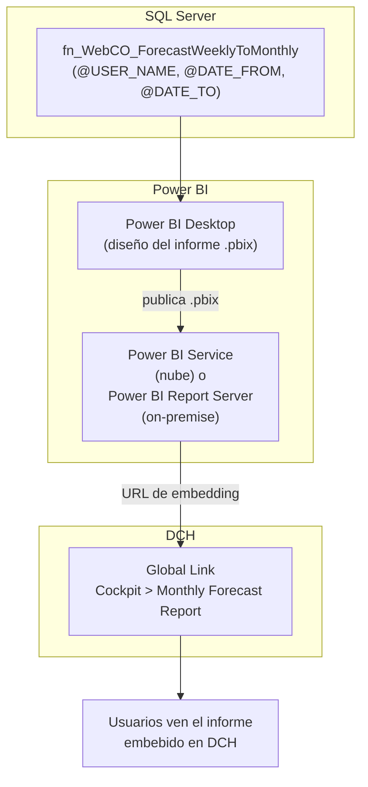

# DCH Weekly → Monthly — Alternativa: Power BI

**Cliente:** Dr. Schaer  
**Versión:** 1.0  
**Fecha:** 2026-08-05  
**Ámbito:** DCH 440 — Modo Weekly  

**Documentos relacionados:**
- [DCH_WeeklyToMonthly_Main.md](./DCH_WeeklyToMonthly_1_Main_es.md) ← Documento principal
- [DCH_WeeklyToMonthly_SQL.md](./DCH_WeeklyToMonthly_SQL_es.md) — Function SQL de agregación
- [DCH_WeeklyToMonthly_SSRS.md](./DCH_WeeklyToMonthly_SSRS_es.md) — Guía SSRS (opción recomendada)
- [DCH_WeeklyToMonthly_GlobalLink.md](./DCH_WeeklyToMonthly_GlobalLink_es.md) — Global Link en DCH
- [DCH_WeeklyToMonthly_HTML.md](./DCH_WeeklyToMonthly_HTML_es.md) — Alternativa HTML estático

---

## 1. Descripción

**Power BI** es la plataforma de análisis y visualización de datos de Microsoft. Para este caso de uso, permite:

- Conectarse directamente a la function SQL `fn_WebCO_ForecastWeeklyToMonthly`
- Crear informes interactivos con tablas, gráficos, filtros y segmentaciones
- Publicar el informe en **Power BI Service** (nube) o **Power BI Report Server** (on-premise)
- Embeber el informe en DCH mediante un Global Link

---

## 2. Opciones de licencia

Power BI tiene varios modelos de licencia. Para este escenario, las opciones relevantes son:

| Opción | Coste | Ideal para |
|---|---|---|
| **Power BI Desktop** | Gratuito | Desarrollo local de informes. NO permite compartir ni publicar. |
| **Power BI Pro** | ~$10/usuario/mes | Publicar en Power BI Service y compartir con otros usuarios Pro. Cada usuario que vea el informe necesita licencia Pro. |
| **Power BI Premium** | ~$20/usuario/mes (o capacidad dedicada desde ~$5,000/mes) | Publicar y compartir sin que cada espectador necesite licencia. |
| **Power BI Report Server** | Incluido en SQL Server Enterprise Edition con Software Assurance | Alternativa on-premise. Los usuarios acceden al informe sin licencia adicional. |
| **Power BI Embedded** | Pago por uso (Azure) | Para embeber informes en aplicaciones web. No aplica directamente aquí. |

### ¿Cuál aplica para Dr. Schaer?

| Escenario | Opción |
|---|---|
| Tienen SQL Server Enterprise + SA | **Power BI Report Server** (sin coste adicional) |
| Pocos usuarios (< 10) | **Power BI Pro** (~$10/usuario/mes) — requiere licencia para cada persona que vea el informe en DCH |
| Muchos usuarios (≥ 10) | **Power BI Premium** (~$20/usuario/mes) o capacidad dedicada — más caro |
| Solo desarrollo/prueba | **Power BI Desktop** (gratuito) — no permite visualización compartida en DCH |

> ⚠️ **El factor de coste es determinante.** A diferencia de SSRS (incluido en SQL Server), Power BI requiere licencias adicionales por usuario para compartir informes.

---

## 3. Arquitectura



---

## 4. Comparativa SSRS vs Power BI

| Característica | SSRS | Power BI |
|---|---|---|
| **Coste de licencia** | Incluido en SQL Server | Power BI Pro (~$10/usuario/mes) o Premium |
| **Instalación adicional** | Feature de SQL Server | Power BI Desktop (gratuito) + licencia de servicio |
| **Interactividad** | Parámetros, drill-down básico | Filtros, segmentaciones, drill-through, cross-filtering |
| **Visualizaciones** | Tablas, gráficos básicos | Gráficos avanzados, mapas, KPIs, treemaps |
| **Exportación a Excel** | Nativa | Nativa (desde el servicio) |
| **Actualización de datos** | En tiempo real | Programada (refresh) o DirectQuery (tiempo real) |
| **Curva de aprendizaje** | Media | Media-baja (más intuitivo) |
| **Publicación** | Report Server (on-premise) | Power BI Service (nube) o Report Server (on-premise) |
| **Embebido en DCH** | URL directa | URL de embedding (requiere configurar autenticación) |
| **Ideal para** | Reporting operacional, tablas de datos | Dashboards interactivos, análisis visual |

---

## 5. Implementación paso a paso

### 5.1 Instalar Power BI Desktop

1. Descargar de: https://powerbi.microsoft.com/en-us/desktop/
2. Instalar en la máquina del desarrollador
3. Es gratuito — no requiere licencia

### 5.2 Conectar a la function SQL

1. Abrir Power BI Desktop
2. **Get Data > SQL Server**
3. Server: `SERVER_NAME`
4. Database: `DCH_DATABASE`
5. Elegir **Advanced Options** y escribir la consulta:
   ```sql
   SELECT * 
   FROM [dbo].[fn_WebCO_ForecastWeeklyToMonthly]('SSRS_REPORT', NULL, NULL)
   ```
6. Configurar credenciales (Windows Auth o SQL Auth)

### 5.3 Alternativa: usar parámetros dinámicos

Power BI permite crear **parámetros** que se pueden pasar vía URL (en Power BI Service). Para ello:

1. En Power Query Editor, crear parámetros: `UserName`, `DateFrom`, `DateTo`
2. Modificar la consulta para usar los parámetros:
   ```sql
   SELECT * 
   FROM [dbo].[fn_WebCO_ForecastWeeklyToMonthly](@UserName, @DateFrom, @DateTo)
   ```
3. Al publicar, estos parámetros se pueden pasar por URL

### 5.4 Diseñar el informe

Power BI ofrece muchos más tipos de visualización que SSRS:

| Visualización | Uso en este informe |
|---|---|
| **Table/Matrix** | Datos detallados: Producto × Mercado × Mes × Cantidades |
| **Slicers** | Filtros interactivos: seleccionar producto, mercado, año, mes |
| **Line Chart** | Evolución temporal de FrcQty, Budget, COQty a lo largo de los meses |
| **Bar Chart** | Comparativa de FR1..FR5 por producto/mercado |
| **KPI Cards** | Totales: Forecast Total, Budget Total, % Variación |
| **Map** | Si hay datos geográficos en los free attributes de mercado |

### 5.5 Publicar el informe

#### Opción A: Power BI Service (nube)

1. Guardar el `.pbix` en Power BI Desktop
2. **Publish** a Power BI Service (requiere cuenta Pro o Premium)
3. En Power BI Service, ir al informe publicado
4. **File > Embed report > Website or portal**
5. Copiar la URL de embedding (iframe)

#### Opción B: Power BI Report Server (on-premise)

1. **File > Save As > Power BI Report Server** (requiere la versión de Power BI Desktop optimizada para Report Server)
2. URL del servidor: `http://server/ReportServer`
3. El informe se publica y queda accesible vía URL similar a SSRS

### 5.6 Configurar el Global Link en DCH

La URL del informe publicado se configura como Global Link en DCH:

```
https://app.powerbi.com/reportEmbed?reportId=...&USER_NAME={USER_NAME}&DATE_FROM={DATE_FORECAST_CURRENT}&DATE_TO={DATE_FORECAST_END}
```

> **Nota sobre autenticación**: Para que el iframe de DCH pueda mostrar el informe de Power BI, el usuario debe estar autenticado en Power BI Service. Esto puede requerir:
> - Que los usuarios tengan cuenta Power BI Pro
> - O usar **Power BI Embedded** con autenticación anónima (más complejo)
> - O usar **Power BI Report Server** on-premise con Windows Auth (el servidor DCH y el Report Server deben estar en el mismo dominio)

Este es el **principal desafío** de Power BI frente a SSRS: la autenticación para el embedding en iframe.

---

## 6. Ventajas de Power BI sobre SSRS

1. **Visualizaciones mucho más ricas**: gráficos interactivos, mapas, KPIs, tooltips
2. **Interactividad avanzada**: cross-filtering (clic en un gráfico filtra automáticamente los demás), drill-through a páginas de detalle
3. **Filtros y segmentaciones**: el usuario puede explorar los datos libremente
4. **Actualización programada**: el dataset se refresca automáticamente cada día/hora sin intervención
5. **Acceso móvil**: Power BI Mobile permite ver los informes en smartphone/tablet

---

## 7. Desventajas de Power BI frente a SSRS

1. **Coste**: Licencias Pro/Premium necesarias para compartir
2. **Autenticación**: Compleja de configurar para embedding en iframe
3. **Dependencia de la nube**: Power BI Service requiere conexión a Internet (salvo Power BI Report Server on-premise)
4. **Sobrecarga para tablas simples**: Si solo se necesita una tabla de datos, Power BI es excesivo
5. **Complejidad de administración**: Workspaces, permisos, datasets, gateways...

---

## 8. Recomendación

**Power BI es la mejor opción si:**
- El cliente ya tiene licencias Power BI Pro/Premium
- Se necesita un dashboard interactivo con gráficos, no solo una tabla
- Se valora el acceso móvil
- Hay presupuesto para licencias ($10-20/usuario/mes)

**SSRS es mejor opción si:**
- El presupuesto en licencias adicionales es cero
- Solo se necesita una tabla de datos mensuales
- Se prefiere una solución 100% on-premise
- La simplicidad de administración es prioritaria

---

> **Documento versión**: 1.0  
> **Fecha**: 2026-08-05  
> **Ámbito**: DCH 440 — Modo Weekly  
> **Cliente**: Dr. Schaer