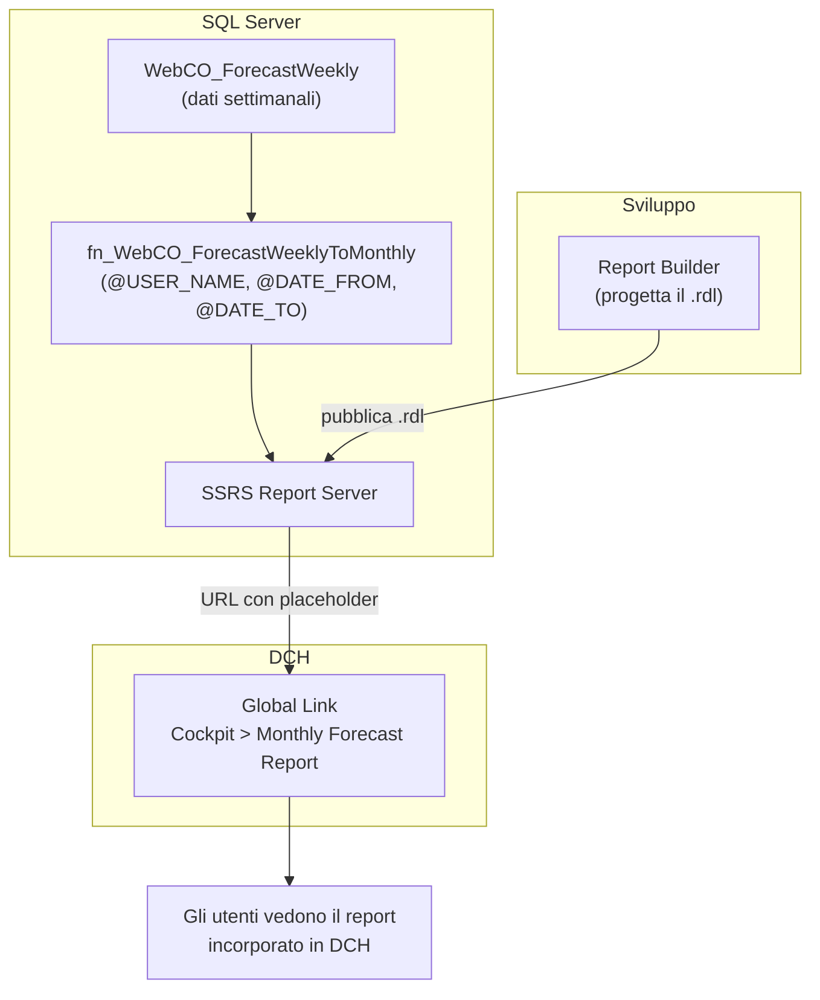
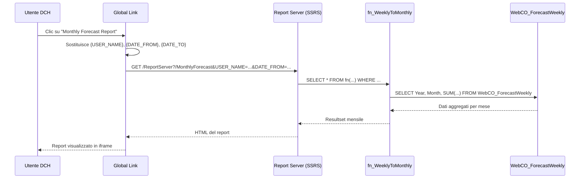

# DCH Weekly → Monthly Report

## Soluzione per la generazione di un report mensile dalla configurazione Weekly e visualizzazione all'interno di DCH

**Cliente:** Dr. Schaer  
**Versione:** 1.0  
**Data:** 2026-08-05  
**Ambito:** DCH 440 — Modalità Weekly  

**Documenti correlati:**
- [DCH_WeeklyToMonthly_SQL.md](./DCH_WeeklyToMonthly_SQL_it.md) — Function SQL di aggregazione e script DB
- [DCH_WeeklyToMonthly_SSRS.md](./DCH_WeeklyToMonthly_SSRS_it.md) — Guida SSRS: installazione, Report Builder e pubblicazione
- [DCH_WeeklyToMonthly_PowerBI.md](./DCH_WeeklyToMonthly_PowerBI_it.md) — Alternativa: Power BI (licenze, implementazione, comparativa)
- [DCH_WeeklyToMonthly_GlobalLink.md](./DCH_WeeklyToMonthly_GlobalLink_it.md) — Configurazione del Global Link in DCH
- [DCH_WeeklyToMonthly_HTML.md](./DCH_WeeklyToMonthly_HTML_it.md) — Alternativa: report HTML statico tramite Custom Procedure

---

## 1. Riepilogo Esecutivo

Dr. Schaer utilizza DCH in **modalità Weekly** ma ha bisogno di visualizzare un **report a livello mensile** all'interno di DCH. DCH non consente di avere dati a due granularità temporali contemporaneamente, né offre un meccanismo nativo di reporting per dati aggregati esternamente.

La soluzione combina due elementi:

1. **Aggregazione SQL**: Una function nel database che aggrega `WebCO_ForecastWeekly` a livello mensile (`Year`, `Month`), accettando parametri utente e date.
2. **Visualizzazione tramite SSRS + Global Link**: Un report SSRS che consuma la function, viene pubblicato su un Report Server e incorporato in DCH mediante un Global Link con placeholder.

---

## 2. Il Problema

### 2.1 Esigenza di business

Dr. Schaer richiede:

1. **Dati di forecast a livello mensile**, aggregati dalla tabella `WebCO_ForecastWeekly` (unica fonte disponibile in modalità Weekly).
2. **Visualizzare questi dati all'interno di DCH**, idealmente come tabella/report navigabile, con capacità di filtraggio ed esportazione in Excel.
3. **Che il report rispetti il contesto utente** (DataGroups, permessi) e l'orizzonte di forecast configurato.

### 2.2 Perché DCH non lo supporta nativamente

| Limitazione | Dettaglio |
|---|---|
| **Un solo Time Bucket** | DCH opera in modalità Weekly o Monthly, non in entrambe contemporaneamente. La tabella `WebCO_ForecastMonthly` è vuota in modalità Weekly. |
| **Nessun reporting interno** | DCH non dispone di un motore di reporting. I dati sono visibili solo in Tree View (aggregazione dinamica) o Report View, ma sempre alla granularità del Time Bucket configurato. |
| **Gli Alerts non sono report** | La tabella `Alerts` contiene solo `AlertId, COProductId, COMarketId, Metric` — non ha un asse temporale. Non è possibile rappresentare valori mese per mese. Vedere sezione 3.1. |

---

## 3. Analisi delle Alternative

### 3.1 Alerts (scartato)

È stato considerato l'uso del sistema Alerts con TSQL per aggregare dati settimanali → mensili. **Non è fattibile**:

- **Nessun asse temporale**: `AlertsDetail` contiene solo `AlertId, COProductId, COMarketId, Metric`. Non esiste una colonna `Year`/`Month`. Un singolo valore `Metric` per prodotto/mercato, non una serie temporale.
- **Non è un report**: Gli alert sono progettati per rilevare eccezioni, non per visualizzare tabelle di dati.
- **Nessuna formattazione**: Nessuna colonna di periodo, nessun totale, nessuna gerarchia, nessuna esportazione in Excel.

### 3.2 Opzione A: SSRS + Global Link ✅

- Aggregazione SQL tramite function parametrizzabile
- Report SSRS pubblicato su Report Server
- Global Link in DCH con placeholder `{USER_NAME}`, `{DATE_FORECAST_CURRENT}`, `{DATE_FORECAST_END}`
- **Selezionata**: Professionale, senza costi aggiuntivi di licenza (incluso in SQL Server), interattivo, esportabile in Excel.

> Vedere [DCH_WeeklyToMonthly_SSRS.md](./DCH_WeeklyToMonthly_SSRS_it.md) per maggiori dettagli su installazione, Report Builder e pubblicazione

### 3.3 Opzione B: Power BI + Global Link

- Aggregazione SQL tramite function parametrizzabile
- Report Power BI pubblicato su Power BI Service (cloud) o Power BI Report Server (on-premise)
- Global Link in DCH con URL di embedding
- Visualizzazioni avanzate: grafici interattivi, filtri, segmentazioni, KPI
- **Svantaggio principale**: Richiede licenze Power BI Pro/Premium per utente (~$10-20/utente/mese)
- **Consigliato se**: Il cliente dispone già di licenze Power BI o desidera dashboard interattive

> Vedere [DCH_WeeklyToMonthly_PowerBI.md](./DCH_WeeklyToMonthly_PowerBI_it.md) per dettagli su licenze, implementazione e comparativa.

### 3.4 Opzione C: HTML statico tramite Custom Procedure

- SQL genera un file `.html` con tabella formattata
- Salvato in una cartella accessibile da IIS
- Il Global Link punta al file o a un URL che lo rigenera su richiesta
- **Alternativa praticabile**: Zero dipendenze esterne, ma senza interattività (nessun filtro, nessuna esportazione nativa in Excel).

> Vedere [DCH_WeeklyToMonthly_HTML.md](./DCH_WeeklyToMonthly_HTML_it.md) per i dettagli di questa alternativa.

---

## 4. Soluzione Progettata

### 4.1 Architettura generale

### 4.2 Flusso di dati

### 4.3 Componenti della soluzione

| Componente | Descrizione | Documento |
|---|---|---|
| **Function SQL** | `fn_WebCO_ForecastWeeklyToMonthly` — aggrega settimane in mesi con parametri | [SQL.md](./DCH_WeeklyToMonthly_SQL_it.md) |
| **SSRS Report Server** | Pubblica e serve il report `.rdl` | [SSRS.md](./DCH_WeeklyToMonthly_SSRS_it.md) |
| **Report Builder** | Strumento gratuito per progettare il report | [SSRS.md](./DCH_WeeklyToMonthly_SSRS_it.md) |
| **Global Link** | URL incorporato in DCH con placeholder | [GlobalLink.md](./DCH_WeeklyToMonthly_GlobalLink_it.md) |

### 4.4 Placeholder disponibili nei Global Link

| Placeholder | Sostituito da | Esempio |
|---|---|---|
| `{USER_NAME}` | Username dell'utente autenticato | `john.doe` |
| `{DATE_FORECAST_CURRENT}` | Data di inizio dell'orizzonte di forecast | `2026-01-05` |
| `{DATE_FORECAST_END}` | Data di fine dell'orizzonte di forecast | `2026-12-28` |

Questi placeholder vengono passati come parametri al report SSRS, consentendo il filtraggio per utente e intervallo di date.

---

## 5. Guida all'Implementazione

### 5.1 Prerequisiti

- DCH 440 in esecuzione in modalità **Weekly**
- **SQL Server Standard/Enterprise** con SSRS installato e configurato
- Accesso al **Report Server** via HTTP dal server DCH
- **Report Builder** installato sulla macchina dello sviluppatore (download gratuito)

### 5.2 Sequenza di implementazione

| Passo | Descrizione | Documento |
|---|---|---|
| **1** | Creare la function `fn_WebCO_ForecastWeeklyToMonthly` nel database DCH | [SQL.md](./DCH_WeeklyToMonthly_SQL_it.md) |
| **2** | Verificare/installare SSRS sul server SQL Server | [SSRS.md](./DCH_WeeklyToMonthly_SSRS_it.md) |
| **3** | Progettare il report in Report Builder e pubblicarlo | [SSRS.md](./DCH_WeeklyToMonthly_SSRS_it.md) |
| **4** | Configurare il Global Link in DCH | [GlobalLink.md](./DCH_WeeklyToMonthly_GlobalLink_it.md) |
| **5** | Verificare che il report venga visualizzato correttamente in Cockpit | [GlobalLink.md](./DCH_WeeklyToMonthly_GlobalLink_it.md) |

### 5.3 Nota sui DataGroups

Il report SSRS è esterno a DCH — **non eredita automaticamente i DataGroups né i permessi dell'utente**. Se è richiesto il filtraggio per DataGroup:

- **Opzione 1**: Passare il DataGroup come parametro aggiuntivo nell'URL (richiede l'estensione dei placeholder o la codifica del DataGroup nella function).
- **Opzione 2**: Creare un dataset nel report che interroga `ADMIN_UserDataGroup` per `@USER_NAME` e filtra di conseguenza.
- **Opzione 3**: Presupporre che gli utenti che visualizzano questo report abbiano accesso a tutti i dati (semplifica l'implementazione).

---

## 6. Risoluzione dei Problemi

| Problema | Causa probabile | Soluzione |
|---|---|---|
| Il report non si carica in DCH | L'iframe è bloccato da X-Frame-Options | Configurare SSRS per consentire iframe |
| Errore "Access Denied" in SSRS | Credenziali errate nell'origine dati | Configurare stored credentials nel report |
| L'URL del Global Link non sostituisce i placeholder | Il formato non è corretto | Verificare le parentesi `{PLACEHOLDER}` e i nomi esatti |
| SSRS non è installato | Funzionalità non selezionata in SQL Server | Eseguire il programma di installazione di SQL Server > Aggiungi funzionalità > Reporting Services |
| La function non restituisce dati | `WebCO_ForecastWeekly` senza dati nell'intervallo | Verificare le date e l'orizzonte di forecast |

---

## 7. Allegati

### 7.1 Tabelle coinvolte

| Tabella | Utilizzo |
|---|---|
| `WebCO_ForecastWeekly` | Dati sorgente settimanali da aggregare |
| `MasterData_COProduct` | Descrizioni dei prodotti |
| `MasterData_COMarket` | Descrizioni dei mercati |
| `MasterData_Week` | Informazioni sulle settimane (opzionale, per mappatura date) |
| `CONFIG_Link` | Registro dei Global Link |
| `CONFIG_ParamGen` | `PARAM_GLOBAL_LINKS_DATE_FORMAT` (formato data) |

### 7.2 Riferimenti

- Manuale DCH440 System Admin Guide
- [Documentazione SSRS (Microsoft)](https://learn.microsoft.com/en-us/sql/reporting-services/)
- [Documentazione Report Builder](https://learn.microsoft.com/en-us/sql/reporting-services/report-builder/)

---

> **Versione documento**: 1.0  
> **Data**: 2026-08-05  
> **Ambito**: DCH 440 — Modalità Weekly  
> **Cliente**: Dr. Schaer