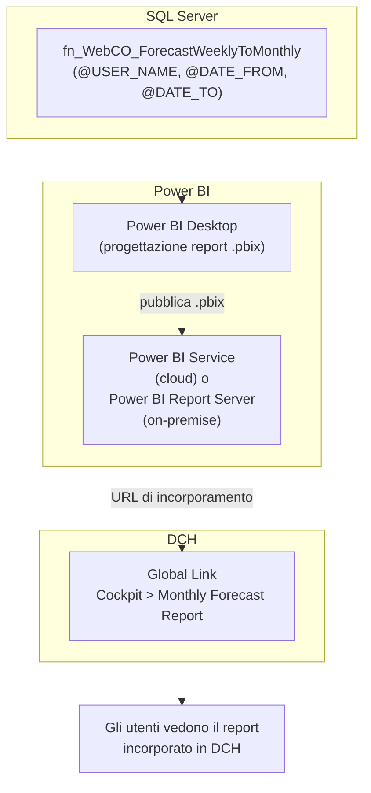

# DCH Weekly → Monthly — Alternativa: Power BI

**Cliente:** Dr. Schaer  
**Versione:** 1.0  
**Data:** 2026-08-05  
**Ambito:** DCH 440 — Modalità Weekly  

**Documenti correlati:**
- [DCH_WeeklyToMonthly_Main.md](./DCH_WeeklyToMonthly_1_Main_it.md) ← Documento principale
- [DCH_WeeklyToMonthly_SQL.md](./DCH_WeeklyToMonthly_SQL_it.md) — Function SQL di aggregazione
- [DCH_WeeklyToMonthly_SSRS.md](./DCH_WeeklyToMonthly_SSRS_it.md) — Guida SSRS (opzione consigliata)
- [DCH_WeeklyToMonthly_GlobalLink.md](./DCH_WeeklyToMonthly_GlobalLink_it.md) — Global Link in DCH
- [DCH_WeeklyToMonthly_HTML.md](./DCH_WeeklyToMonthly_HTML_it.md) — Alternativa HTML statico

---

## 1. Descrizione

**Power BI** è la piattaforma di analisi e visualizzazione dati di Microsoft. Per questo caso d'uso, consente di:

- Connettersi direttamente alla function SQL `fn_WebCO_ForecastWeeklyToMonthly`
- Creare report interattivi con tabelle, grafici, filtri e segmentazioni
- Pubblicare il report in **Power BI Service** (cloud) o **Power BI Report Server** (on-premise)
- Incorporare il report in DCH tramite un Global Link

---

## 2. Opzioni di licenza

Power BI ha diversi modelli di licenza. Per questo scenario, le opzioni rilevanti sono:

| Opzione | Costo | Ideale per |
|---|---|---|
| **Power BI Desktop** | Gratuito | Sviluppo locale di report. NON consente la condivisione né la pubblicazione. |
| **Power BI Pro** | ~$10/utente/mese | Pubblicare in Power BI Service e condividere con altri utenti Pro. Ogni utente che visualizza il report necessita di una licenza Pro. |
| **Power BI Premium** | ~$20/utente/mese (o capacità dedicata a partire da ~$5.000/mese) | Pubblicare e condividere senza che ogni visualizzatore necessiti di una licenza. |
| **Power BI Report Server** | Incluso in SQL Server Enterprise Edition con Software Assurance | Alternativa on-premise. Gli utenti accedono al report senza licenza aggiuntiva. |
| **Power BI Embedded** | Pagamento a consumo (Azure) | Per incorporare report in applicazioni web. Non direttamente applicabile qui. |

### Quale si applica per Dr. Schaer?

| Scenario | Opzione |
|---|---|
| SQL Server Enterprise + SA | **Power BI Report Server** (nessun costo aggiuntivo) |
| Pochi utenti (< 10) | **Power BI Pro** (~$10/utente/mese) — richiede una licenza per ogni persona che visualizza il report in DCH |
| Molti utenti (≥ 10) | **Power BI Premium** (~$20/utente/mese) o capacità dedicata — più costoso |
| Solo sviluppo/test | **Power BI Desktop** (gratuito) — non consente la visualizzazione condivisa in DCH |

> ⚠️ **Il fattore costo è determinante.** A differenza di SSRS (incluso in SQL Server), Power BI richiede licenze aggiuntive per utente per condividere i report.

---

## 3. Architettura



---

## 4. Confronto SSRS vs Power BI

| Caratteristica | SSRS | Power BI |
|---|---|---|
| **Costo licenza** | Incluso in SQL Server | Power BI Pro (~$10/utente/mese) o Premium |
| **Installazione aggiuntiva** | Feature di SQL Server | Power BI Desktop (gratuito) + licenza servizio |
| **Interattività** | Parametri, drill-down di base | Filtri, segmentazioni, drill-through, cross-filtering |
| **Visualizzazioni** | Tabelle, grafici di base | Grafici avanzati, mappe, KPI, treemap |
| **Esportazione Excel** | Nativa | Nativa (dal servizio) |
| **Aggiornamento dati** | In tempo reale | Programmato (refresh) o DirectQuery (tempo reale) |
| **Curva di apprendimento** | Media | Medio-bassa (più intuitivo) |
| **Pubblicazione** | Report Server (on-premise) | Power BI Service (cloud) o Report Server (on-premise) |
| **Incorporato in DCH** | URL diretto | URL di incorporamento (richiede configurazione autenticazione) |
| **Ideale per** | Reporting operativo, tabelle dati | Dashboard interattivi, analisi visiva |

---

## 5. Implementazione passo passo

### 5.1 Installare Power BI Desktop

1. Scaricare da: https://powerbi.microsoft.com/en-us/desktop/
2. Installare sulla macchina dello sviluppatore
3. È gratuito — non richiede licenza

### 5.2 Connettersi alla function SQL

1. Aprire Power BI Desktop
2. **Get Data > SQL Server**
3. Server: `SERVER_NAME`
4. Database: `DCH_DATABASE`
5. Scegliere **Advanced Options** e scrivere la query:
   ```sql
   SELECT * 
   FROM [dbo].[fn_WebCO_ForecastWeeklyToMonthly]('SSRS_REPORT', NULL, NULL)
   ```
6. Configurare le credenziali (Windows Auth o SQL Auth)

### 5.3 Alternativa: usare parametri dinamici

Power BI consente di creare **parametri** che possono essere passati via URL (in Power BI Service). Per farlo:

1. In Power Query Editor, creare parametri: `UserName`, `DateFrom`, `DateTo`
2. Modificare la query per utilizzare i parametri:
   ```sql
   SELECT * 
   FROM [dbo].[fn_WebCO_ForecastWeeklyToMonthly](@UserName, @DateFrom, @DateTo)
   ```
3. Una volta pubblicato, questi parametri possono essere passati via URL

### 5.4 Progettare il report

Power BI offre molti più tipi di visualizzazione rispetto a SSRS:

| Visualizzazione | Uso in questo report |
|---|---|
| **Table/Matrix** | Dati dettagliati: Prodotto × Mercato × Mese × Quantità |
| **Slicers** | Filtri interattivi: selezionare prodotto, mercato, anno, mese |
| **Line Chart** | Evoluzione temporale di FrcQty, Budget, COQty nel corso dei mesi |
| **Bar Chart** | Confronto FR1..FR5 per prodotto/mercato |
| **KPI Cards** | Totali: Forecast Totale, Budget Totale, % Variazione |
| **Map** | Se gli attributi liberi del mercato contengono dati geografici |

### 5.5 Pubblicare il report

#### Opzione A: Power BI Service (cloud)

1. Salvare il `.pbix` in Power BI Desktop
2. **Publish** su Power BI Service (richiede account Pro o Premium)
3. In Power BI Service, andare al report pubblicato
4. **File > Embed report > Website or portal**
5. Copiare l'URL di incorporamento (iframe)

#### Opzione B: Power BI Report Server (on-premise)

1. **File > Save As > Power BI Report Server** (richiede la versione di Power BI Desktop ottimizzata per Report Server)
2. URL del server: `http://server/ReportServer`
3. Il report viene pubblicato e reso accessibile tramite URL simile a SSRS

### 5.6 Configurare il Global Link in DCH

L'URL del report pubblicato si configura come Global Link in DCH:

```
https://app.powerbi.com/reportEmbed?reportId=...&USER_NAME={USER_NAME}&DATE_FROM={DATE_FORECAST_CURRENT}&DATE_TO={DATE_FORECAST_END}
```

> **Nota sull'autenticazione**: Affinché l'iframe di DCH possa mostrare il report di Power BI, l'utente deve essere autenticato in Power BI Service. Questo può richiedere:
> - Che gli utenti dispongano di un account Power BI Pro
> - Oppure l'uso di **Power BI Embedded** con autenticazione anonima (più complesso)
> - Oppure l'uso di **Power BI Report Server** on-premise con Windows Auth (il server DCH e il Report Server devono essere nello stesso dominio)

Questa è la **principale sfida** di Power BI rispetto a SSRS: l'autenticazione per l'incorporamento in iframe.

---

## 6. Vantaggi di Power BI rispetto a SSRS

1. **Visualizzazioni molto più ricche**: grafici interattivi, mappe, KPI, tooltip
2. **Interattività avanzata**: cross-filtering (cliccando su un grafico si filtrano automaticamente gli altri), drill-through a pagine di dettaglio
3. **Filtri e segmentazioni**: l'utente può esplorare i dati liberamente
4. **Aggiornamento programmato**: il dataset si aggiorna automaticamente ogni giorno/ora senza intervento
5. **Accesso mobile**: Power BI Mobile consente di visualizzare i report su smartphone/tablet

---

## 7. Svantaggi di Power BI rispetto a SSRS

1. **Costo**: Licenze Pro/Premium necessarie per la condivisione
2. **Autenticazione**: Complessa da configurare per l'incorporamento in iframe
3. **Dipendenza dal cloud**: Power BI Service richiede connessione Internet (ad eccezione di Power BI Report Server on-premise)
4. **Eccessivo per tabelle semplici**: Se serve solo una tabella dati, Power BI è eccessivo
5. **Complessità di amministrazione**: Workspace, permessi, dataset, gateway...

---

## 8. Raccomandazione

**Power BI è l'opzione migliore se:**
- Il cliente dispone già di licenze Power BI Pro/Premium
- È necessario un dashboard interattivo con grafici, non solo una tabella
- Si apprezza l'accesso mobile
- C'è budget per le licenze ($10-20/utente/mese)

**SSRS è l'opzione migliore se:**
- Il budget per licenze aggiuntive è zero
- È necessaria solo una tabella di dati mensili
- Si preferisce una soluzione 100% on-premise
- La semplicità di amministrazione è prioritaria

---

> **Versione documento**: 1.0  
> **Data**: 2026-08-05  
> **Ambito**: DCH 440 — Modalità Weekly  
> **Cliente**: Dr. Schaer