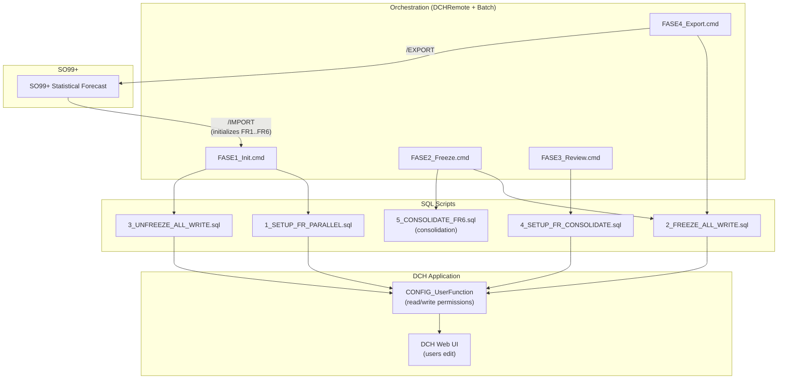
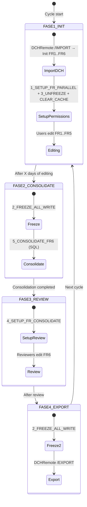
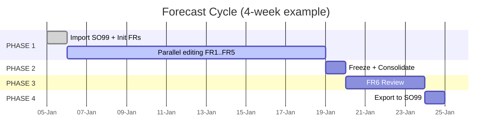

# DCH Multi-FR Parallel Workflow

**Client:** Dr. Schaer  
**Version:** 1.0  
**Date:** 2026-08-05  
**Scope:** DCH 440 — Weekly Mode  
**Related documents:**  
- [DCH_MultiFR_Scripts.md](./DCH_MultiFR_Scripts_en.md) — SQL scripts and batch commands  
- [DCHRemote_Command_Reference.md](./DCHRemote_Command_Reference_en.md) — Complete DCHRemote command reference

---

## Solution for working with multiple Forecast Revisions in parallel without Approval Workflow

---

## 1. Executive Summary

A client needs **multiple users to simultaneously edit different Forecast Revisions (FR1 through FR5)** initialized from SO99+, in order to subsequently **consolidate all edits into FR6**, which will be reviewed and exported back to SO99+. DCH does not support this flow natively.

The proposed solution uses **DCHRemote + SQL Custom Procedures** to orchestrate the complete cycle without activating DCH's Approval Workflow, managing write permissions per user and FR directly on the `CONFIG_UserFunction` table.

---

## 2. The Business Problem

### 2.1 Client need

The client operates DCH in **Weekly mode** and requires the following process:

1. **5 Forecast Revisions open in parallel** (FR1, FR2, FR3, FR4, FR5), each assigned to different users or teams.
2. Users edit simultaneously for a period of time (days/weeks).
3. After that time, **all edits are consolidated into FR6**.
4. A review team validates FR6.
5. FR6 is **exported to SO99+** as the official forecast.
6. The cycle restarts.

### 2.2 Why standard DCH does not support it

| Required functionality | Standard DCH |
|---|---|
| Multiple FRs editable at once by different users | ❌ Approval Workflow links UserLevel to 1 single FR |
| Sequential workflow FR1→FR2→... | ✅ But it is sequential, not parallel |
| Automatic consolidation of FRs | ❌ Does not exist |
| Assign users to specific FRs without Workflow | ❌ No UI for this |
| Bulk enable/disable write access | ❌ Only user by user via DCHRemote |

---

## 3. Analysis of Alternatives

Three approaches were evaluated:

### 3.1 Option A: Use the Approval Workflow
- Enable/disable `APPROVAL_WORKFLOW_ENABLED` dynamically
- Use user hierarchy with sequential SignOff
- **Discarded**: Too complex, interferes with `CopyDataToParent`, requires manipulating Workflow states in unintended ways.

### 3.2 Option B: Workflow without enforcing FR permissions
- `APPROVAL_WFL_FORCE_FR_PERMISSIONS = False`
- **Discarded**: Still requires managing Waiting/Editing/SignOff states that add no value here.

### 3.3 Option C: Workflow OFF + DCHRemote Init + manual permissions via SQL
- Approval Workflow **always disabled**
- FR initialization via `DCHRemote /INIT_CO N /INIT_FROM_SO99_FRC`
- Write permissions managed directly on `CONFIG_UserFunction`
- **Discarded**: DCHRemote does not wait for each `/INIT_CO` to finish before launching the next one (async execution), which can cause race conditions between consecutive initializations. Additionally, it requires 6 separate calls.

### 3.4 Option D: Workflow OFF + DCH Import Settings + SQL ✅
- Approval Workflow **always disabled**
- FR initialization via DCH's standard Import configuration:  
  **Import settings > Forecast and Demand > Initialize Forecast Revisions after Forecast Import**  
  with the string: `SO99F-FR1;SO99F-FR2;SO99F-FR3;SO99F-FR4;SO99F-FR5;SO99F-FR6`
- `/IMPORT` is executed via DCHRemote, and initialization is **internal to DCH within the same System Job** → no risk of race conditions
- Write permissions (`1_SETUP_FR_PARALLEL` + `3_UNFREEZE_ALL_WRITE` + `CLEAR_CACHE`) managed via 3 sequential DCHRemote calls in `FASE1_Init.cmd`
- **Selected**: Uses DCH's standard mechanism for initialization, eliminates the async risk between initializations. Permissions are applied in the same batch sequentially.

> **Fallback alternative**: If exceptionally the DCHRemote execution of `permissions + unfreeze + clearcache` causes synchronization issues (due to DCHRemote's async nature), they can be unified into a single `.cmd` script and configured as the Import's PostProcess (`PostProcessType = externalProcess`). This guarantees that permissions are applied within the same System Job, after FR initialization.

---

## 4. Designed Solution

### 4.1 General architecture



### 4.2 Cycle state diagram



### 4.3 Permissions in each phase

| Phase | ForecastEditing | FR1 | FR2 | FR3 | FR4 | FR5 | FR6 |
|------|:---:|:---:|:---:|:---:|:---:|:---:|:---:|
| **PHASE 1** - Parallel editing | ✏️ All | ✏️ | ✏️ | ✏️ | ✏️ | ✏️ | 👁️ |
| **PHASE 2** - Freeze + Consolidate | 🔒 None | 🔒 | 🔒 | 🔒 | 🔒 | 🔒 | 🔒 |
| **PHASE 3** - FR6 Review | ✏️ Reviewers | 👁️ | 👁️ | 👁️ | 👁️ | 👁️ | ✏️ |
| **PHASE 4** - Export | 🔒 None | 🔒 | 🔒 | 🔒 | 🔒 | 🔒 | 🔒 |

> ✏️ = Write | 👁️ = Read-only | 🔒 = No access

### 4.4 Solution components

| Component | Description |
|---|---|
| **4 Custom Procedures** (type `sqlScript`) | Stored in `SYSTEM_CustomProcedure`, point to `.sql` files |
| **1 additional Custom Procedure** | `5_CONSOLIDATE_FR6` — the SQL that aggregates FR1..FR5 → FR6 |
| **4 .cmd scripts** | One batch per phase, executable by the scheduler |
| **4 .sql files** | The SQL scripts referenced by the Custom Procedures |

---

## 5. Implementation Guide

### 5.1 Prerequisites

- DCH 440 installed and running in **Weekly** mode
- **6 Forecast Revisions configured** (`FORECAST_REVISIONS_MAX = 6` in `CONFIG_ParamGen`)
- DCHRemote configured and functional
- **Approval Workflow DISABLED** (`APPROVAL_WORKFLOW_ENABLED = 0`)
- Write access to a folder on the DCH server (e.g.: `D:\DCH\Scripts\`)
- **Import configuration in DCH** for automatic FR initialization (see 5.2b)

### 5.2 Validate Forecast Revisions

```sql
-- Should return 6
SELECT ValNum FROM CONFIG_ParamGen WHERE ParName = 'FORECAST_REVISIONS_MAX'

-- Verify that FR1 through FR6 exist in CONFIG_ForecastRevision
SELECT ForecastRevisionId, Enabled, Tag FROM CONFIG_ForecastRevision
```

### 5.2b Configure FR initialization in Import

In the DCH UI, go to **Import settings > Forecast and Demand** and in the **"Initialize Forecast Revisions after Forecast Import"** field, enter:

```
SO99F-FR1;SO99F-FR2;SO99F-FR3;SO99F-FR4;SO99F-FR5;SO99F-FR6
```

This will cause DCH to automatically initialize the 6 Forecast Revisions from the SO99 Statistical Forecast every time `DCHRemote /IMPORT` is executed, **within the same import System Job, without risk of race conditions**.

> **Syntax**: `Source-Destination` separated by `;`. Codes: `SO99F` = SO99+ statistical forecast, `FRN` = Forecast Revision N.

### 5.3 Create scripts folder on the server

On the server where DCH runs, create:
```
D:\DCH\Scripts\
```

Copy the following files there: ([DCH_MultiFR_Scripts.md](./DCH_MultiFR_Scripts_en.md))
- `1_SETUP_FR_PARALLEL.sql`
- `2_FREEZE_ALL_WRITE.sql`
- `3_UNFREEZE_ALL_WRITE.sql`
- `4_SETUP_FR_CONSOLIDATE.sql`
- `5_CONSOLIDATE_FR6.sql`

> ⚠️ **Important**: The folder must be accessible by the IIS Application Pool. Grant read permissions to `IIS AppPool\DCH` or the appropriate user.

### 5.4 Register Custom Procedures in DCH

This can be done from the DCH UI → `Menu > Admin > Custom Procedures`

> Alternatively, I recommend doing it via SQL.

Execute on the DCH database:

```sql
DELETE FROM SYSTEM_CustomProcedure WHERE CustomProcedureId IN (
    '1_SETUP_FR_PARALLEL', '2_FREEZE_ALL_WRITE', '3_UNFREEZE_ALL_WRITE', 
    '4_SETUP_FR_CONSOLIDATE', '5_CONSOLIDATE_FR6'
)

-- Register the new procedures (Source = 1 = sqlScript)
INSERT INTO SYSTEM_CustomProcedure (CustomProcedureId, Descr, Source, tsql, scriptPath, processPath)
VALUES 
('1_SETUP_FR_PARALLEL',    'Setup FR parallel: user permissions per FR',           1, '', 'D:\DCH\Scripts\1_SETUP_FR_PARALLEL.sql',    ''),
('2_FREEZE_ALL_WRITE',     'Freeze write access for all users',                   1, '', 'D:\DCH\Scripts\2_FREEZE_ALL_WRITE.sql',     ''),
('3_UNFREEZE_ALL_WRITE',   'Unfreeze write access for all users',                 1, '', 'D:\DCH\Scripts\3_UNFREEZE_ALL_WRITE.sql',   ''),
('4_SETUP_FR_CONSOLIDATE', 'Final review setup: only FR6 editable for reviewers', 1, '', 'D:\DCH\Scripts\4_SETUP_FR_CONSOLIDATE.sql', ''),
('5_CONSOLIDATE_FR6',      'Consolidate FR1..FR5 into FR6',                       1, '', 'D:\DCH\Scripts\5_CONSOLIDATE_FR6.sql',     '')
```

> **Note**: `Source = 1` = `sqlScript`, `Source = 0` = `tsql`. We use `sqlScript` because the scripts are extensive.

### 5.5 Customize the SQL scripts

Edit each `.sql` file and modify the variables at the top:

**`1_SETUP_FR_PARALLEL.sql`:**
```sql
DECLARE @UseAutoDetectUsers INT = 1
DECLARE @UserList NVARCHAR(MAX) = N'user1,user2,user3,...'
DECLARE @FrcRevList NVARCHAR(MAX) = N'1,2,3,4,5'
```

**`4_SETUP_FR_CONSOLIDATE.sql`:**
```sql
DECLARE @UseAutoDetectReviewers INT = 0
DECLARE @ReviewerList NVARCHAR(MAX) = N'reviewer1,reviewer2'
DECLARE @ReadOnlyFrcRevList NVARCHAR(MAX) = N'1,2,3,4,5'
DECLARE @ConsolidatedFR INT = 6
```

**`5_CONSOLIDATE_FR6.sql`:**
```sql
-- Customize consolidation logic according to client needs
-- (sum, average, etc.)
```

### 5.6 Create .cmd scripts

Create in an accessible folder (e.g.: `D:\DCH\Batch\`):

| File | Content |
|---|---|
| `FASE1_Init.cmd` | Import SO99 + permissions + unfreeze + clearcache |
| `FASE2_Freeze.cmd` | Freeze + consolidation |
| `FASE3_Review.cmd` | FR6 review setup |
| `FASE4_Export.cmd` | Freeze + export |

### 5.7 Test in pre-production environment

Manually run each phase and verify:

1. **PHASE 1**: `/IMPORT` runs correctly and FRs appear initialized. Users can see and edit their assigned FRs after applying permissions.
2. **PHASE 2**: Users cannot edit; consolidation runs without errors
3. **PHASE 3**: Reviewers see FR1..FR5 (read-only) and can edit FR6
4. **PHASE 4**: Export file is generated correctly

---

## 6. Daily Operations

### 6.1 Standard work cycle



### 6.2 SO99 Batch Scheduling

```
Task 1: "DCH - PHASE1 Init"     → Monday week 1    → FASE1_Init.cmd
Task 2: "DCH - PHASE2 Freeze"   → Friday week 2    → FASE2_Freeze.cmd
Task 3: "DCH - PHASE3 Review"   → Friday week 2    → FASE3_Review.cmd
Task 4: "DCH - PHASE4 Export"   → Friday week 3    → FASE4_Export.cmd
Task 5: "DCH - PHASE1 Init"     → Monday week 4    → FASE1_Init.cmd
```

> ⚠️ Always schedule a `DCHRemote.exe /CLEAR_CACHE` after each permission change.

### 6.3 Consultant Checklist

- [ ] Verify that the Approval Workflow is disabled
- [ ] Check that all 6 FRs are initialized before PHASE 1
- [ ] Validate DCHRemote logs after each execution
- [ ] Verify that users confirm they can/cannot edit according to each phase
- [ ] Review the exported file before sending it to SO99+

---

## 7. Troubleshooting

| Problem | Likely cause | Solution |
|---|---|---|
| Users cannot edit in PHASE 1 | `CLEAR_CACHE` not executed | Run `DCHRemote.exe /CLEAR_CACHE` |
| Users CAN edit in PHASE 2 | `2_FREEZE_ALL_WRITE` failed | Check DCHRemote log; verify `CONFIG_UserFunction` |
| Consolidation does not update FR6 | `5_CONSOLIDATE_FR6.sql` has errors | Run manually in SSMS and debug |
| DCHRemote error "Can not find procedure" | CustomProcedure is not registered | Check `SYSTEM_CustomProcedure` |
| .sql script not found | Incorrect path or folder permissions | Verify path in `scriptPath` and IIS permissions |
| `STRING_SPLIT` not recognized error | SQL Server < 2016 | Use `fnSplit` or update database compatibility |

### 7.1 Quick diagnostic command

```sql
-- View current permission status
SELECT UserName, FunctionName, FunctionId, ReadPermission, WritePermission
FROM CONFIG_UserFunction
WHERE FunctionName IN ('ForecastEditing', 'LineForecastRevision')
ORDER BY UserName, FunctionName, FunctionId
```

---

## 8. Appendices

### 8.1 Tables involved

| Table | Usage |
|---|---|
| `CONFIG_UserFunction` | Read/write permissions per user, function, and FR |
| `SYSTEM_CustomProcedure` | Registry of SQL procedures executable via DCHRemote |
| `CONFIG_ParamGen` | Global parameters (`FORECAST_REVISIONS_MAX`, `APPROVAL_WORKFLOW_ENABLED`) |
| `CONFIG_ForecastRevision` | Definition of each FR (tag, color, enabled, frozen periods) |
| `WebCO_ForecastWeekly` | Weekly forecast data |

### 8.2 DCHRemote commands used

See **[DCHRemote_Command_Reference.md](./DCHRemote_Command_Reference_en.md)** for the full reference.

| Command | Purpose |
|---|---|
| `/INIT_CO N /INIT_FROM_SO99_FRC` | Initialize FR N from SO99 Forecast |
| `/IMPORT` | Run all configured imports (includes FR init) |
| `/EXECUTESQL PROCEDURE_ID` | Execute a Custom Procedure |
| `/EXPORT` | Run all configured exports |
| `/CLEAR_CACHE` | Clear DCH cache to force configuration reload |

### 8.3 References

- DCH440 Workflow Manual
- DCH440 System Admin Guide
- DCHRemote command reference (`DCHRemote.exe` without parameters)

---

## 9 Appendix: User Management in DCH

### 9.1 Where users are stored

DCH manages two types of users in separate tables:

| Type | Table | Authentication |
|---|---|---|
| **Internal** | `AspNetUsers` | Identity Framework (username/password) |
| **External** | `User_Windows` | SSO / SAML / Windows Auth |

Both types share the same permissions table: **`CONFIG_UserFunction`**.

### 9.3 Implications for scripts

The `1_SETUP_FR_PARALLEL` and `4_SETUP_FR_CONSOLIDATE` scripts use the `@UseAutoDetectUsers` flag:

- **`@UseAutoDetectUsers = 1` (default):** Automatically detects all users (internal + external) who have the `ForecastEditing` permission. This means that when new users are added to DCH, they will be automatically included in the next initialization cycle.
- **`@UseAutoDetectUsers = 0`:** Allows manually defining the user list in `@UserList`. Useful for testing or restricting to a subset.

### 9.4 ⚠️ New users mid-phase

If a new user is added to DCH during editing (PHASE 1), this user **will not have permissions applied automatically**. You will need to:

1. Go to `Menu > Admin > Custom Procedures`
2. Locate `1_SETUP_FR_PARALLEL`
3. Click the **`Run`** button on that row
4. Click the `Clear Cache` button *(top menu above the grid)*
5. Check the result in `Menu > Admin > Custom Procedure Log`

> **Note**: The `Run` button in the Custom Procedures UI executes the script immediately, without needing DCHRemote. It is the fastest way to apply permissions to a new user.

---

---

> **Document version**: 1.0  
> **Date**: 2026-08-05  
> **Scope**: DCH 440