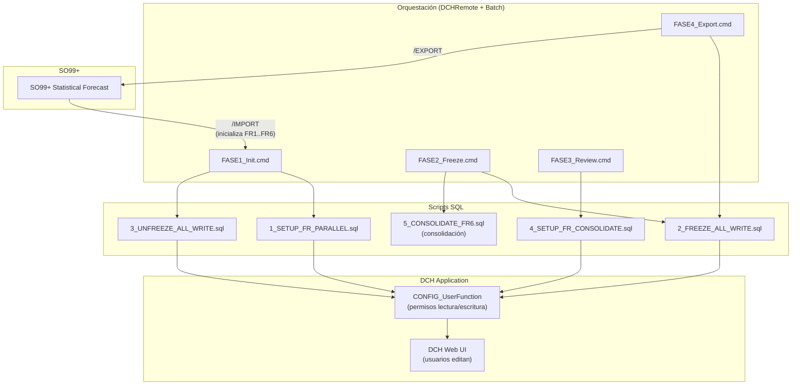
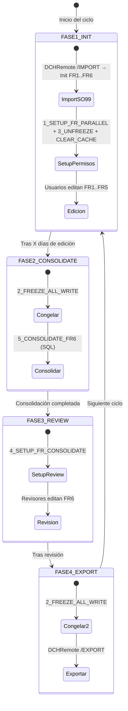
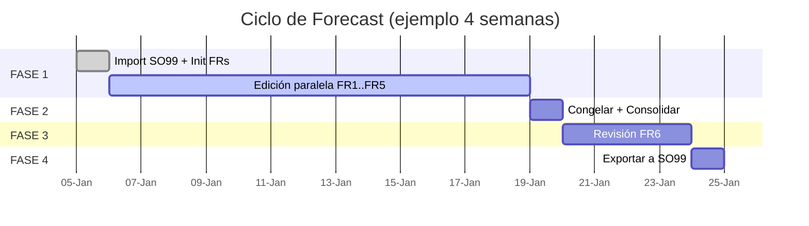

# DCH Multi-FR Parallel Workflow

**Cliente:** Dr. Schaer  
**Versión:** 1.0  
**Fecha:** 2026-08-05  
**Ámbito:** DCH 440 — Modo Weekly  
**Documentos relacionados:**  
- [DCH_MultiFR_Scripts.md](./DCH_MultiFR_Scripts_es.md) — Scripts SQL y comandos batch  
- [DCHRemote_Command_Reference.md](./DCHRemote_Command_Reference_es.md) — Referencia completa de comandos DCHRemote

---

## Solución para trabajo con múltiples Forecast Revisions en paralelo sin Approval Workflow

---

## 1. Resumen Ejecutivo

Un cliente necesita que **múltiples usuarios editen simultáneamente distintas Forecast Revisions (FR1 a FR5)** inicializadas desde SO99+, para posteriormente **consolidar todas las ediciones en una FR6** que será revisada y exportada de vuelta a SO99+. DCH no soporta este flujo de forma nativa.

La solución propuesta utiliza **DCHRemote + Custom Procedures SQL** para orquestar el ciclo completo sin activar el Approval Workflow de DCH, gestionando los permisos de escritura por usuario y FR directamente sobre la tabla `CONFIG_UserFunction`.

---

## 2. El Problema de Negocio

### 2.1 Necesidad del cliente

El cliente opera con DCH en **modo Weekly** y requiere el siguiente proceso:

1. **5 Forecast Revisions abiertas en paralelo** (FR1, FR2, FR3, FR4, FR5), cada una asignada a distintos usuarios o equipos.
2. Los usuarios editan simultáneamente durante un período de tiempo (días/semanas).
3. Transcurrido ese plazo, **todas las ediciones se consolidan en FR6**.
4. Un equipo revisor valida FR6.
5. FR6 se **exporta a SO99+** como forecast oficial.
6. El ciclo se reinicia.

### 2.2 Por qué DCH estándar no lo soporta

| Funcionalidad necesaria | DCH estándar |
|---|---|
| Múltiples FRs editables a la vez por distintos usuarios | ❌ El Approval Workflow vincula UserLevel a 1 sola FR |
| Workflow secuencial FR1→FR2→... | ✅ Pero es secuencial, no paralelo |
| Consolidación automática de FRs | ❌ No existe |
| Asignar usuarios a FRs específicas sin Workflow | ❌ No hay UI para esto |
| Activar/desactivar escritura masivamente | ❌ Solo usuario a usuario vía DCHRemote |

---

## 3. Análisis de Alternativas

Se evaluaron tres enfoques:

### 3.1 Opción A: Usar el Approval Workflow
- Activar/desactivar `APPROVAL_WORKFLOW_ENABLED` dinámicamente
- Usar jerarquía de usuarios con SignOff secuencial
- **Descartado**: Demasiado complejo, interfiere con `CopyDataToParent`, requiere manipular estados del Workflow de forma no prevista.

### 3.2 Opción B: Workflow sin forzar permisos de FR
- `APPROVAL_WFL_FORCE_FR_PERMISSIONS = False`
- **Descartado**: Sigue requiriendo gestión de estados Waiting/Editing/SignOff que no aportan valor aquí.

### 3.3 Opción C: Workflow OFF + DCHRemote Init + permisos manuales vía SQL
- Approval Workflow **siempre desactivado**
- Inicialización de FRs mediante `DCHRemote /INIT_CO N /INIT_FROM_SO99_FRC`
- Permisos de escritura gestionados directamente sobre `CONFIG_UserFunction`
- **Descartado**: DCHRemote no espera a que cada `/INIT_CO` termine antes de lanzar el siguiente (ejecución async), lo que puede provocar condiciones de carrera entre inicializaciones consecutivas. Además, requiere 6 llamadas independientes.

### 3.4 Opción D: Workflow OFF + Import Settings de DCH + SQL ✅
- Approval Workflow **siempre desactivado**
- Inicialización de FRs mediante la configuración estándar de Import de DCH:  
  **Import settings > Forecast and Demand > Initialize Forecast Revisions after Forecast Import**  
  con la cadena: `SO99F-FR1;SO99F-FR2;SO99F-FR3;SO99F-FR4;SO99F-FR5;SO99F-FR6`
- `/IMPORT` se ejecuta vía DCHRemote, y la inicialización es **interna de DCH dentro del mismo System Job** → sin riesgo de condiciones de carrera
- Permisos de escritura (`1_SETUP_FR_PARALLEL` + `3_UNFREEZE_ALL_WRITE` + `CLEAR_CACHE`) gestionados vía 3 llamadas DCHRemote secuenciales en `FASE1_Init.cmd`
- **Seleccionada**: Usa el mecanismo estándar de DCH para la inicialización, elimina el riesgo async entre inicializaciones. Los permisos se aplican en el mismo batch de forma secuencial.

> **Alternativa de respaldo**: Si excepcionalmente la ejecución vía DCHRemote de `permisos + unfreeze + clearcache` diera problemas de sincronización (por la naturaleza async de DCHRemote), se pueden unificar en un único script `.cmd` y configurarlo como PostProcess del Import (`PostProcessType = externalProcess`). Esto garantiza que los permisos se apliquen dentro del mismo System Job, tras la inicialización de FRs.

---

## 4. Solución Diseñada

### 4.1 Arquitectura general



### 4.2 Diagrama de estados del ciclo



### 4.3 Permisos en cada fase

| Fase | ForecastEditing | FR1 | FR2 | FR3 | FR4 | FR5 | FR6 |
|------|:---:|:---:|:---:|:---:|:---:|:---:|:---:|
| **FASE 1** - Edición paralela | ✏️ Todos | ✏️ | ✏️ | ✏️ | ✏️ | ✏️ | 👁️ |
| **FASE 2** - Congelar + Consolidar | 🔒 Nadie | 🔒 | 🔒 | 🔒 | 🔒 | 🔒 | 🔒 |
| **FASE 3** - Revisión FR6 | ✏️ Revisores | 👁️ | 👁️ | 👁️ | 👁️ | 👁️ | ✏️ |
| **FASE 4** - Exportar | 🔒 Nadie | 🔒 | 🔒 | 🔒 | 🔒 | 🔒 | 🔒 |

> ✏️ = Escritura | 👁️ = Solo lectura | 🔒 = Sin acceso

### 4.4 Componentes de la solución

| Componente | Descripción |
|---|---|
| **4 Custom Procedures** (tipo `sqlScript`) | Almacenados en `SYSTEM_CustomProcedure`, apuntan a ficheros `.sql` |
| **1 Custom Procedure adicional** | `5_CONSOLIDATE_FR6` — el SQL que agrega FR1..FR5 → FR6 |
| **4 scripts .cmd** | Un batch por cada fase, ejecutables por el scheduler |
| **4 ficheros .sql** | Los scripts SQL referenciados por los Custom Procedures |

---

## 5. Guía de Implementación

### 5.1 Requisitos previos

- DCH 440 instalado y funcionando en modo **Weekly**
- **6 Forecast Revisions configuradas** (`FORECAST_REVISIONS_MAX = 6` en `CONFIG_ParamGen`)
- DCHRemote configurado y funcional
- **Approval Workflow DESACTIVADO** (`APPROVAL_WORKFLOW_ENABLED = 0`)
- Acceso de escritura a una carpeta en el servidor DCH (ej: `D:\DCH\Scripts\`)
- **Configuración de Import en DCH** para inicialización automática de FRs (ver 5.2b)

### 5.2 Validar Forecast Revisions

```sql
-- Debe devolver 6
SELECT ValNum FROM CONFIG_ParamGen WHERE ParName = 'FORECAST_REVISIONS_MAX'

-- Verificar que FR1 a FR6 existen en CONFIG_ForecastRevision
SELECT ForecastRevisionId, Enabled, Tag FROM CONFIG_ForecastRevision
```

### 5.2b Configurar inicialización de FRs en el Import

En la UI de DCH, ir a **Import settings > Forecast and Demand** y en el campo **"Initialize Forecast Revisions after Forecast Import"** introducir:

```
SO99F-FR1;SO99F-FR2;SO99F-FR3;SO99F-FR4;SO99F-FR5;SO99F-FR6
```

Esto hará que cada vez que se ejecute `DCHRemote /IMPORT`, DCH inicialice automáticamente las 6 Forecast Revisions desde el SO99 Statistical Forecast, **dentro del mismo System Job de import, sin riesgo de condiciones de carrera**.

> **Sintaxis**: `Origen-Destino` separados por `;`. Códigos: `SO99F` = SO99+ statistical forecast, `FRN` = Forecast Revision N.

### 5.3 Crear carpeta de scripts en el servidor

En el servidor donde corre DCH, crear:
```
D:\DCH\Scripts\
```

Copiar allí los siguientes ficheros:
- `1_SETUP_FR_PARALLEL.sql`
- `2_FREEZE_ALL_WRITE.sql`
- `3_UNFREEZE_ALL_WRITE.sql`
- `4_SETUP_FR_CONSOLIDATE.sql`
- `5_CONSOLIDATE_FR6.sql`

> ⚠️ **Importante**: La carpeta debe ser accesible por el Application Pool de IIS. Asignar permisos de lectura a `IIS AppPool\DCH` o el usuario que corresponda.

### 5.4 Registrar los Custom Procedures en DCH

Puede hacerse de la UI de DCH →  ` Menu > Admin > Custom Procedures `

> Alternativamente recomiendo hacerlo via SQL.

Ejecutar en la base de datos DCH:

```sql
DELETE FROM SYSTEM_CustomProcedure WHERE CustomProcedureId IN (
    '1_SETUP_FR_PARALLEL', '2_FREEZE_ALL_WRITE', '3_UNFREEZE_ALL_WRITE', 
    '4_SETUP_FR_CONSOLIDATE', '5_CONSOLIDATE_FR6'
)

-- Registrar los nuevos procedures (Source = 1 = sqlScript)
INSERT INTO SYSTEM_CustomProcedure (CustomProcedureId, Descr, Source, tsql, scriptPath, processPath)
VALUES 
('1_SETUP_FR_PARALLEL',    'Setup FR parallel: permisos usuarios por FR',           1, '', 'D:\DCH\Scripts\1_SETUP_FR_PARALLEL.sql',    ''),
('2_FREEZE_ALL_WRITE',     'Congelar escritura de todos los usuarios',             1, '', 'D:\DCH\Scripts\2_FREEZE_ALL_WRITE.sql',     ''),
('3_UNFREEZE_ALL_WRITE',   'Descongelar escritura de todos los usuarios',          1, '', 'D:\DCH\Scripts\3_UNFREEZE_ALL_WRITE.sql',   ''),
('4_SETUP_FR_CONSOLIDATE', 'Setup revision final: solo FR6 editable para revisores', 1, '', 'D:\DCH\Scripts\4_SETUP_FR_CONSOLIDATE.sql', ''),
('5_CONSOLIDATE_FR6',      'Consolidar FR1..FR5 en FR6',                           1, '', 'D:\DCH\Scripts\5_CONSOLIDATE_FR6.sql',     '')
```

> **Nota**: `Source = 1` = `sqlScript`, `Source = 0` = `tsql`. Usamos `sqlScript` porque los scripts son extensos.

### 5.5 Personalizar los scripts SQL

Editar cada fichero `.sql` y modificar las variables al inicio:

**`1_SETUP_FR_PARALLEL.sql`:**
```sql
DECLARE @UseAutoDetectUsers INT = 1
DECLARE @UserList NVARCHAR(MAX) = N'user1,user2,user3,...'
DECLARE @FrcRevList NVARCHAR(MAX) = N'1,2,3,4,5'
```

**`4_SETUP_FR_CONSOLIDATE.sql`:**
```sql
DECLARE @UseAutoDetectReviewers INT = 0
DECLARE @ReviewerList NVARCHAR(MAX) = N'revisor1,revisor2'
DECLARE @ReadOnlyFrcRevList NVARCHAR(MAX) = N'1,2,3,4,5'
DECLARE @ConsolidatedFR INT = 6
```

**`5_CONSOLIDATE_FR6.sql`:**
```sql
-- Personalizar la lógica de consolidación según necesidad del cliente
-- (suma, promedio, etc.)
```

### 5.6 Crear los scripts .cmd

Crear en una carpeta accesible (ej: `D:\DCH\Batch\`):

| Fichero | Contenido |
|---|---|
| `FASE1_Init.cmd` | Import SO99 + permisos + unfreeze + clearcache |
| `FASE2_Freeze.cmd` | Freeze + consolidación |
| `FASE3_Review.cmd` | Setup revisión FR6 |
| `FASE4_Export.cmd` | Freeze + export |

### 5.7 Probar en entorno de pre-producción

Ejecutar manualmente cada fase y verificar:

1. **FASE 1**: El `/IMPORT` se ejecuta correctamente y las FRs aparecen inicializadas. Los usuarios ven y pueden editar sus FRs asignadas tras aplicar los permisos.
2. **FASE 2**: Los usuarios no pueden editar; la consolidación se ejecuta sin errores
3. **FASE 3**: Los revisores ven FR1..FR5 (lectura) y pueden editar FR6
4. **FASE 4**: Se genera el fichero de export correctamente

---

## 6. Operativa Diaria

### 6.1 Ciclo de trabajo estándar



### 6.2 Programación en Batch de SO99

```
Tarea 1: "DCH - FASE1 Init"     → Lunes semana 1    → FASE1_Init.cmd
Tarea 2: "DCH - FASE2 Freeze"   → Viernes semana 2  → FASE2_Freeze.cmd
Tarea 3: "DCH - FASE3 Review"   → Viernes semana 2  → FASE3_Review.cmd
Tarea 4: "DCH - FASE4 Export"   → Viernes semana 3  → FASE4_Export.cmd
Tarea 5: "DCH - FASE1 Init"     → Lunes semana 4    → FASE1_Init.cmd
```

> ⚠️ Programar siempre un `DCHRemote.exe /CLEAR_CACHE` después de cada cambio de permisos.

### 6.3 Checklist del Consultor

- [ ] Verificar que el Approval Workflow está desactivado
- [ ] Comprobar que las 6 FRs están inicializadas antes de FASE 1
- [ ] Validar logs de DCHRemote tras cada ejecución
- [ ] Verificar que los usuarios confirmen poder/no poder editar según fase
- [ ] Revisar el fichero exportado antes de enviarlo a SO99+

---

## 7. Troubleshooting

| Problema | Causa probable | Solución |
|---|---|---|
| Usuarios no pueden editar en FASE 1 | `CLEAR_CACHE` no ejecutado | Ejecutar `DCHRemote.exe /CLEAR_CACHE` |
| Usuarios PUEDEN editar en FASE 2 | `2_FREEZE_ALL_WRITE` falló | Revisar log de DCHRemote; verificar `CONFIG_UserFunction` |
| La consolidación no actualiza FR6 | `5_CONSOLIDATE_FR6.sql` tiene errores | Ejecutar manualmente en SSMS y depurar |
| DCHRemote error "Can not find procedure" | El CustomProcedure no está registrado | Verificar `SYSTEM_CustomProcedure` |
| El script .sql no se encuentra | Ruta incorrecta o permisos de carpeta | Verificar ruta en `scriptPath` y permisos de IIS |
| Error `STRING_SPLIT` no reconocido | SQL Server < 2016 | Usar `fnSplit` o actualizar compatibilidad de la BD |

### 7.1 Comando rápido de diagnóstico

```sql
-- Ver estado actual de permisos
SELECT UserName, FunctionName, FunctionId, ReadPermission, WritePermission
FROM CONFIG_UserFunction
WHERE FunctionName IN ('ForecastEditing', 'LineForecastRevision')
ORDER BY UserName, FunctionName, FunctionId
```

---

## 8. Anexos

### 8.1 Tablas involucradas

| Tabla | Uso |
|---|---|
| `CONFIG_UserFunction` | Permisos de lectura/escritura por usuario, función y FR |
| `SYSTEM_CustomProcedure` | Registro de procedimientos SQL ejecutables vía DCHRemote |
| `CONFIG_ParamGen` | Parámetros globales (`FORECAST_REVISIONS_MAX`, `APPROVAL_WORKFLOW_ENABLED`) |
| `CONFIG_ForecastRevision` | Definición de cada FR (tag, color, enabled, frozen periods) |
| `WebCO_ForecastWeekly` | Datos de forecast semanal |

### 8.2 Comandos DCHRemote utilizados

Ver **[DCHRemote_Command_Reference.md](./DCHRemote_Command_Reference_es.md)** para la referencia completa.

| Comando | Propósito |
|---|---|
| `/INIT_CO N /INIT_FROM_SO99_FRC` | Inicializar FR N desde SO99 Forecast |
| `/IMPORT` | Ejecutar todos los imports configurados (incluye init de FRs) |
| `/EXECUTESQL PROCEDURE_ID` | Ejecutar un Custom Procedure |
| `/EXPORT` | Ejecutar todas las exportaciones configuradas |
| `/CLEAR_CACHE` | Limpiar caché de DCH para forzar recarga de configuración |

### 8.3 Referencias

- Manual DCH440 Workflow
- Manual DCH440 System Admin Guide
- DCHRemote command reference (`DCHRemote.exe` sin parámetros)

---

## 9 Apéndice: Gestión de usuarios en DCH

### 9.1 Dónde se almacenan los usuarios

DCH gestiona dos tipos de usuarios en tablas separadas:

| Tipo | Tabla | Autenticación |
|---|---|---|
| **Internos** | `AspNetUsers` | Identity Framework (usuario/contraseña) |
| **Externos** | `User_Windows` | SSO / SAML / Windows Auth |

Ambos tipos comparten la misma tabla de permisos: **`CONFIG_UserFunction`**.

### 9.3 Implicaciones para los scripts

Los scripts `1_SETUP_FR_PARALLEL` y `4_SETUP_FR_CONSOLIDATE` usan el flag `@UseAutoDetectUsers`:

- **`@UseAutoDetectUsers = 1` (por defecto):** Detecta automáticamente todos los usuarios (internos + externos) que tienen el permiso `ForecastEditing`. Esto significa que al añadir nuevos usuarios a DCH, se incluirán automáticamente en el siguiente ciclo de inicialización.
- **`@UseAutoDetectUsers = 0`:** Permite definir manualmente la lista de usuarios en `@UserList`. Útil para pruebas o para restringir a un subconjunto.

### 9.4 ⚠️ Nuevos usuarios en mitad de una fase

Si se añade un nuevo usuario a DCH durante la edición (FASE 1), este usuario **no tendrá los permisos aplicados automáticamente**. Será necesario:

1. Ir a `Menu > Admin > Custom Procedures`
2. Localizar `1_SETUP_FR_PARALLEL`
3. Hacer clic en el botón **`Run`** de esa fila
4. Ejecutar botón `Clear Cache` *(menú superior sobre la grid)*
5. Verificar el resultado en `Menu > Admin > Custom Procedure Log`

> **Nota**: El botón `Run` en la UI de Custom Procedures ejecuta el script inmediatamente, sin necesidad de DCHRemote. Es la forma más rápida de aplicar los permisos a un nuevo usuario.

---

---

> **Documento versión**: 1.0  
> **Fecha**: 2026-08-05  
> **Ámbito**: DCH 440