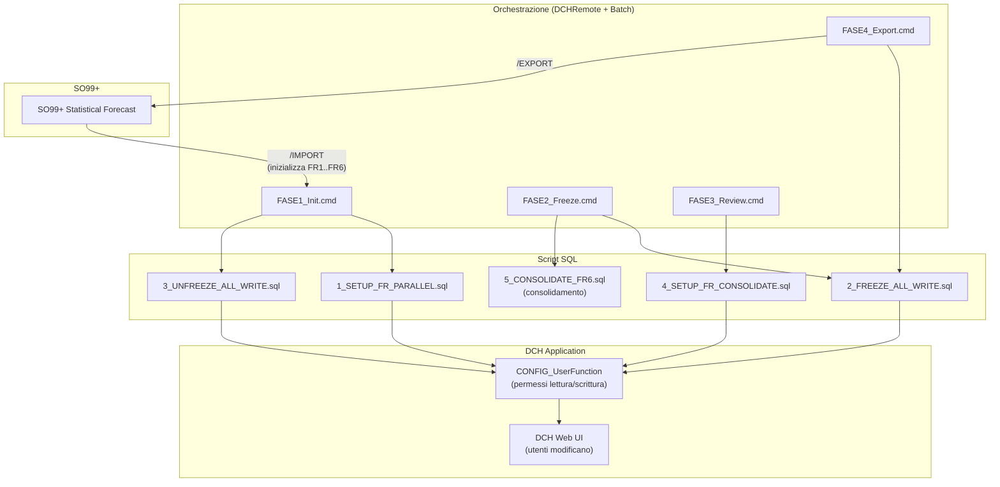
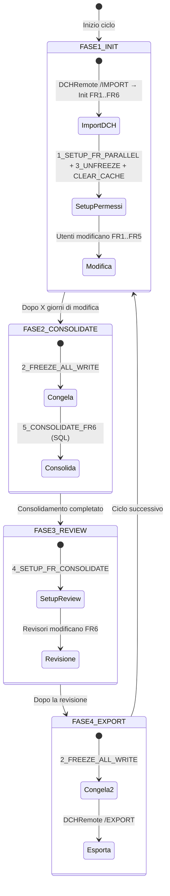
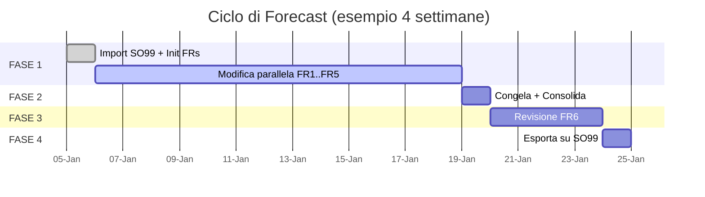

# DCH Multi-FR Parallel Workflow

**Cliente:** Dr. Schaer  
**Versione:** 1.0  
**Data:** 2026-08-05  
**Ambito:** DCH 440 — Modalità Weekly  
**Documenti correlati:**  
- [DCH_MultiFR_Scripts.md](./DCH_MultiFR_Scripts_it.md) — Script SQL e comandi batch  
- [DCHRemote_Command_Reference.md](./DCHRemote_Command_Reference_it.md) — Riferimento completo comandi DCHRemote

---

## Soluzione per lavorare con più Forecast Revision in parallelo senza Approval Workflow

---

## 1. Riepilogo Esecutivo

Un cliente ha bisogno che **più utenti modifichino simultaneamente diverse Forecast Revision (da FR1 a FR5)** inizializzate da SO99+, per poi **consolidare tutte le modifiche in una FR6** che sarà revisionata ed esportata di nuovo su SO99+. DCH non supporta questo flusso in modo nativo.

La soluzione proposta utilizza **DCHRemote + Custom Procedure SQL** per orchestrare l'intero ciclo senza attivare l'Approval Workflow di DCH, gestendo i permessi di scrittura per utente e FR direttamente sulla tabella `CONFIG_UserFunction`.

---

## 2. Il Problema di Business

### 2.1 Esigenza del cliente

Il cliente opera con DCH in **modalità Weekly** e richiede il seguente processo:

1. **5 Forecast Revision aperte in parallelo** (FR1, FR2, FR3, FR4, FR5), ciascuna assegnata a utenti o team diversi.
2. Gli utenti modificano simultaneamente per un periodo di tempo (giorni/settimane).
3. Trascorso tale periodo, **tutte le modifiche vengono consolidate in FR6**.
4. Un team di revisione convalida FR6.
5. FR6 viene **esportata su SO99+** come forecast ufficiale.
6. Il ciclo riprende.

### 2.2 Perché DCH standard non lo supporta

| Funzionalità necessaria | DCH standard |
|---|---|
| Più FR modificabili contemporaneamente da utenti diversi | ❌ L'Approval Workflow collega UserLevel a 1 sola FR |
| Workflow sequenziale FR1→FR2→... | ✅ Ma è sequenziale, non parallelo |
| Consolidamento automatico delle FR | ❌ Non esiste |
| Assegnare utenti a FR specifiche senza Workflow | ❌ Nessuna UI per questo |
| Attivare/disattivare la scrittura in massa | ❌ Solo utente per utente via DCHRemote |

---

## 3. Analisi delle Alternative

Sono stati valutati tre approcci:

### 3.1 Opzione A: Usare l'Approval Workflow
- Attivare/disattivare `APPROVAL_WORKFLOW_ENABLED` dinamicamente
- Usare la gerarchia utenti con SignOff sequenziale
- **Scartata**: Troppo complessa, interferisce con `CopyDataToParent`, richiede la manipolazione degli stati del Workflow in modi non previsti.

### 3.2 Opzione B: Workflow senza forzare i permessi FR
- `APPROVAL_WFL_FORCE_FR_PERMISSIONS = False`
- **Scartata**: Richiede comunque la gestione degli stati Waiting/Editing/SignOff che non apportano valore qui.

### 3.3 Opzione C: Workflow OFF + DCHRemote Init + permessi manuali via SQL
- Approval Workflow **sempre disattivato**
- Inizializzazione FR tramite `DCHRemote /INIT_CO N /INIT_FROM_SO99_FRC`
- Permessi di scrittura gestiti direttamente su `CONFIG_UserFunction`
- **Scartata**: DCHRemote non attende il completamento di ogni `/INIT_CO` prima di avviare il successivo (esecuzione asincrona), il che può causare condizioni di gara tra inizializzazioni consecutive. Inoltre, richiede 6 chiamate separate.

### 3.4 Opzione D: Workflow OFF + Import Settings di DCH + SQL ✅
- Approval Workflow **sempre disattivato**
- Inizializzazione FR tramite la configurazione standard di Import di DCH:  
  **Import settings > Forecast and Demand > Initialize Forecast Revisions after Forecast Import**  
  con la stringa: `SO99F-FR1;SO99F-FR2;SO99F-FR3;SO99F-FR4;SO99F-FR5;SO99F-FR6`
- `/IMPORT` viene eseguito via DCHRemote e l'inizializzazione è **interna a DCH all'interno dello stesso System Job** → nessun rischio di condizioni di gara
- Permessi di scrittura (`1_SETUP_FR_PARALLEL` + `3_UNFREEZE_ALL_WRITE` + `CLEAR_CACHE`) gestiti tramite 3 chiamate DCHRemote sequenziali in `FASE1_Init.cmd`
- **Selezionata**: Utilizza il meccanismo standard di DCH per l'inizializzazione, elimina il rischio asincrono tra le inizializzazioni. I permessi vengono applicati nello stesso batch in modo sequenziale.

> **Alternativa di riserva**: Se eccezionalmente l'esecuzione via DCHRemote di `permessi + unfreeze + clearcache` causasse problemi di sincronizzazione (a causa della natura asincrona di DCHRemote), è possibile unificarli in un unico script `.cmd` e configurarlo come PostProcess dell'Import (`PostProcessType = externalProcess`). Ciò garantisce che i permessi vengano applicati all'interno dello stesso System Job, dopo l'inizializzazione delle FR.

---

## 4. Soluzione Progettata

### 4.1 Architettura generale



### 4.2 Diagramma degli stati del ciclo



### 4.3 Permessi in ogni fase

| Fase | ForecastEditing | FR1 | FR2 | FR3 | FR4 | FR5 | FR6 |
|------|:---:|:---:|:---:|:---:|:---:|:---:|:---:|
| **FASE 1** - Modifica parallela | ✏️ Tutti | ✏️ | ✏️ | ✏️ | ✏️ | ✏️ | 👁️ |
| **FASE 2** - Congela + Consolida | 🔒 Nessuno | 🔒 | 🔒 | 🔒 | 🔒 | 🔒 | 🔒 |
| **FASE 3** - Revisione FR6 | ✏️ Revisori | 👁️ | 👁️ | 👁️ | 👁️ | 👁️ | ✏️ |
| **FASE 4** - Esporta | 🔒 Nessuno | 🔒 | 🔒 | 🔒 | 🔒 | 🔒 | 🔒 |

> ✏️ = Scrittura | 👁️ = Sola lettura | 🔒 = Nessun accesso

### 4.4 Componenti della soluzione

| Componente | Descrizione |
|---|---|
| **4 Custom Procedure** (tipo `sqlScript`) | Memorizzate in `SYSTEM_CustomProcedure`, puntano a file `.sql` |
| **1 Custom Procedure aggiuntiva** | `5_CONSOLIDATE_FR6` — il SQL che aggrega FR1..FR5 → FR6 |
| **4 script .cmd** | Un batch per ogni fase, eseguibili dallo scheduler |
| **4 file .sql** | Gli script SQL referenziati dalle Custom Procedure |

---

## 5. Guida all'Implementazione

### 5.1 Prerequisiti

- DCH 440 installato e funzionante in modalità **Weekly**
- **6 Forecast Revision configurate** (`FORECAST_REVISIONS_MAX = 6` in `CONFIG_ParamGen`)
- DCHRemote configurato e funzionante
- **Approval Workflow DISATTIVATO** (`APPROVAL_WORKFLOW_ENABLED = 0`)
- Accesso in scrittura a una cartella sul server DCH (es: `D:\DCH\Scripts\`)
- **Configurazione Import in DCH** per l'inizializzazione automatica delle FR (vedi 5.2b)

### 5.2 Convalidare le Forecast Revision

```sql
-- Deve restituire 6
SELECT ValNum FROM CONFIG_ParamGen WHERE ParName = 'FORECAST_REVISIONS_MAX'

-- Verificare che da FR1 a FR6 esistano in CONFIG_ForecastRevision
SELECT ForecastRevisionId, Enabled, Tag FROM CONFIG_ForecastRevision
```

### 5.2b Configurare l'inizializzazione delle FR nell'Import

Nell'UI di DCH, andare su **Import settings > Forecast and Demand** e nel campo **"Initialize Forecast Revisions after Forecast Import"** inserire:

```
SO99F-FR1;SO99F-FR2;SO99F-FR3;SO99F-FR4;SO99F-FR5;SO99F-FR6
```

Ciò farà sì che ogni volta che viene eseguito `DCHRemote /IMPORT`, DCH inizializzi automaticamente le 6 Forecast Revision dal SO99 Statistical Forecast, **all'interno dello stesso System Job di import, senza rischio di condizioni di gara**.

> **Sintassi**: `Origine-Destinazione` separati da `;`. Codici: `SO99F` = SO99+ statistical forecast, `FRN` = Forecast Revision N.

### 5.3 Creare la cartella degli script sul server

Sul server dove è in esecuzione DCH, creare:
```
D:\DCH\Scripts\
```

Copiare lì i seguenti file: ([DCH_MultiFR_Scripts.md](./DCH_MultiFR_Scripts_en.md))
- `1_SETUP_FR_PARALLEL.sql`
- `2_FREEZE_ALL_WRITE.sql`
- `3_UNFREEZE_ALL_WRITE.sql`
- `4_SETUP_FR_CONSOLIDATE.sql`
- `5_CONSOLIDATE_FR6.sql`

> ⚠️ **Importante**: La cartella deve essere accessibile dall'Application Pool di IIS. Assegnare i permessi di lettura a `IIS AppPool\DCH` o all'utente corrispondente.

### 5.4 Registrare le Custom Procedure in DCH

Può essere fatto dall'UI di DCH → `Menu > Admin > Custom Procedures`

> In alternativa, raccomando di farlo via SQL.

Eseguire sul database DCH:

```sql
DELETE FROM SYSTEM_CustomProcedure WHERE CustomProcedureId IN (
    '1_SETUP_FR_PARALLEL', '2_FREEZE_ALL_WRITE', '3_UNFREEZE_ALL_WRITE', 
    '4_SETUP_FR_CONSOLIDATE', '5_CONSOLIDATE_FR6'
)

-- Registrare le nuove procedure (Source = 1 = sqlScript)
INSERT INTO SYSTEM_CustomProcedure (CustomProcedureId, Descr, Source, tsql, scriptPath, processPath)
VALUES 
('1_SETUP_FR_PARALLEL',    'Setup FR parallel: permessi utenti per FR',              1, '', 'D:\DCH\Scripts\1_SETUP_FR_PARALLEL.sql',    ''),
('2_FREEZE_ALL_WRITE',     'Congelare scrittura di tutti gli utenti',                1, '', 'D:\DCH\Scripts\2_FREEZE_ALL_WRITE.sql',     ''),
('3_UNFREEZE_ALL_WRITE',   'Scongelare scrittura di tutti gli utenti',               1, '', 'D:\DCH\Scripts\3_UNFREEZE_ALL_WRITE.sql',   ''),
('4_SETUP_FR_CONSOLIDATE', 'Setup revisione finale: solo FR6 modificabile per revisori', 1, '', 'D:\DCH\Scripts\4_SETUP_FR_CONSOLIDATE.sql', ''),
('5_CONSOLIDATE_FR6',      'Consolidare FR1..FR5 in FR6',                            1, '', 'D:\DCH\Scripts\5_CONSOLIDATE_FR6.sql',     '')
```

> **Nota**: `Source = 1` = `sqlScript`, `Source = 0` = `tsql`. Usiamo `sqlScript` perché gli script sono estesi.

### 5.5 Personalizzare gli script SQL

Modificare ogni file `.sql` e cambiare le variabili all'inizio:

**`1_SETUP_FR_PARALLEL.sql`:**
```sql
DECLARE @UseAutoDetectUsers INT = 1
DECLARE @UserList NVARCHAR(MAX) = N'utente1,utente2,utente3,...'
DECLARE @FrcRevList NVARCHAR(MAX) = N'1,2,3,4,5'
```

**`4_SETUP_FR_CONSOLIDATE.sql`:**
```sql
DECLARE @UseAutoDetectReviewers INT = 0
DECLARE @ReviewerList NVARCHAR(MAX) = N'revisore1,revisore2'
DECLARE @ReadOnlyFrcRevList NVARCHAR(MAX) = N'1,2,3,4,5'
DECLARE @ConsolidatedFR INT = 6
```

**`5_CONSOLIDATE_FR6.sql`:**
```sql
-- Personalizzare la logica di consolidamento secondo le esigenze del cliente
-- (somma, media, ecc.)
```

### 5.6 Creare gli script .cmd

Creare in una cartella accessibile (es: `D:\DCH\Batch\`):

| File | Contenuto |
|---|---|
| `FASE1_Init.cmd` | Import SO99 + permessi + unfreeze + clearcache |
| `FASE2_Freeze.cmd` | Freeze + consolidamento |
| `FASE3_Review.cmd` | Setup revisione FR6 |
| `FASE4_Export.cmd` | Freeze + export |

### 5.7 Testare in ambiente di pre-produzione

Eseguire manualmente ogni fase e verificare:

1. **FASE 1**: `/IMPORT` viene eseguito correttamente e le FR appaiono inizializzate. Gli utenti vedono e possono modificare le proprie FR assegnate dopo l'applicazione dei permessi.
2. **FASE 2**: Gli utenti non possono modificare; il consolidamento viene eseguito senza errori
3. **FASE 3**: I revisori vedono FR1..FR5 (sola lettura) e possono modificare FR6
4. **FASE 4**: Il file di export viene generato correttamente

---

## 6. Operatività Quotidiana

### 6.1 Ciclo di lavoro standard



### 6.2 Pianificazione Batch SO99

```
Task 1: "DCH - FASE1 Init"     → Lunedì settimana 1    → FASE1_Init.cmd
Task 2: "DCH - FASE2 Freeze"   → Venerdì settimana 2   → FASE2_Freeze.cmd
Task 3: "DCH - FASE3 Review"   → Venerdì settimana 2   → FASE3_Review.cmd
Task 4: "DCH - FASE4 Export"   → Venerdì settimana 3   → FASE4_Export.cmd
Task 5: "DCH - FASE1 Init"     → Lunedì settimana 4    → FASE1_Init.cmd
```

> ⚠️ Pianificare sempre un `DCHRemote.exe /CLEAR_CACHE` dopo ogni modifica dei permessi.

### 6.3 Checklist del Consulente

- [ ] Verificare che l'Approval Workflow sia disattivato
- [ ] Controllare che tutte e 6 le FR siano inizializzate prima della FASE 1
- [ ] Convalidare i log di DCHRemote dopo ogni esecuzione
- [ ] Verificare che gli utenti confermino di poter/non poter modificare secondo la fase
- [ ] Riesaminare il file esportato prima di inviarlo a SO99+

---

## 7. Risoluzione dei Problemi

| Problema | Causa probabile | Soluzione |
|---|---|---|
| Gli utenti non possono modificare nella FASE 1 | `CLEAR_CACHE` non eseguito | Eseguire `DCHRemote.exe /CLEAR_CACHE` |
| Gli utenti POSSONO modificare nella FASE 2 | `2_FREEZE_ALL_WRITE` fallito | Controllare il log di DCHRemote; verificare `CONFIG_UserFunction` |
| Il consolidamento non aggiorna FR6 | `5_CONSOLIDATE_FR6.sql` presenta errori | Eseguire manualmente in SSMS e correggere |
| DCHRemote errore "Can not find procedure" | La CustomProcedure non è registrata | Verificare `SYSTEM_CustomProcedure` |
| Lo script .sql non viene trovato | Percorso errato o permessi della cartella | Verificare il percorso in `scriptPath` e i permessi IIS |
| Errore `STRING_SPLIT` non riconosciuto | SQL Server < 2016 | Usare `fnSplit` o aggiornare la compatibilità del DB |

### 7.1 Comando rapido di diagnostica

```sql
-- Vedere lo stato attuale dei permessi
SELECT UserName, FunctionName, FunctionId, ReadPermission, WritePermission
FROM CONFIG_UserFunction
WHERE FunctionName IN ('ForecastEditing', 'LineForecastRevision')
ORDER BY UserName, FunctionName, FunctionId
```

---

## 8. Allegati

### 8.1 Tabelle coinvolte

| Tabella | Utilizzo |
|---|---|
| `CONFIG_UserFunction` | Permessi di lettura/scrittura per utente, funzione e FR |
| `SYSTEM_CustomProcedure` | Registro delle procedure SQL eseguibili via DCHRemote |
| `CONFIG_ParamGen` | Parametri globali (`FORECAST_REVISIONS_MAX`, `APPROVAL_WORKFLOW_ENABLED`) |
| `CONFIG_ForecastRevision` | Definizione di ogni FR (tag, colore, enabled, frozen periods) |
| `WebCO_ForecastWeekly` | Dati di forecast settimanale |

### 8.2 Comandi DCHRemote utilizzati

Vedere **[DCHRemote_Command_Reference.md](./DCHRemote_Command_Reference_it.md)** per il riferimento completo.

| Comando | Scopo |
|---|---|
| `/INIT_CO N /INIT_FROM_SO99_FRC` | Inizializzare FR N da SO99 Forecast |
| `/IMPORT` | Eseguire tutti gli import configurati (include init FR) |
| `/EXECUTESQL PROCEDURE_ID` | Eseguire una Custom Procedure |
| `/EXPORT` | Eseguire tutte le esportazioni configurate |
| `/CLEAR_CACHE` | Pulire la cache di DCH per forzare il ricaricamento della configurazione |

### 8.3 Riferimenti

- Manuale DCH440 Workflow
- Manuale DCH440 System Admin Guide
- Riferimento comandi DCHRemote (`DCHRemote.exe` senza parametri)

---

## 9 Appendice: Gestione degli utenti in DCH

### 9.1 Dove sono memorizzati gli utenti

DCH gestisce due tipi di utenti in tabelle separate:

| Tipo | Tabella | Autenticazione |
|---|---|---|
| **Interni** | `AspNetUsers` | Identity Framework (utente/password) |
| **Esterni** | `User_Windows` | SSO / SAML / Windows Auth |

Entrambi i tipi condividono la stessa tabella dei permessi: **`CONFIG_UserFunction`**.

### 9.3 Implicazioni per gli script

Gli script `1_SETUP_FR_PARALLEL` e `4_SETUP_FR_CONSOLIDATE` utilizzano il flag `@UseAutoDetectUsers`:

- **`@UseAutoDetectUsers = 1` (predefinito):** Rileva automaticamente tutti gli utenti (interni + esterni) che possiedono il permesso `ForecastEditing`. Ciò significa che quando si aggiungono nuovi utenti a DCH, verranno inclusi automaticamente nel ciclo di inizializzazione successivo.
- **`@UseAutoDetectUsers = 0`:** Consente di definire manualmente l'elenco degli utenti in `@UserList`. Utile per test o per limitare a un sottoinsieme.

### 9.4 ⚠️ Nuovi utenti a metà di una fase

Se si aggiunge un nuovo utente a DCH durante la modifica (FASE 1), questo utente **non avrà i permessi applicati automaticamente**. Sarà necessario:

1. Andare su `Menu > Admin > Custom Procedures`
2. Individuare `1_SETUP_FR_PARALLEL`
3. Cliccare il pulsante **`Run`** di quella riga
4. Cliccare il pulsante `Clear Cache` *(menu superiore sopra la griglia)*
5. Verificare il risultato in `Menu > Admin > Custom Procedure Log`

> **Nota**: Il pulsante `Run` nell'UI delle Custom Procedure esegue lo script immediatamente, senza bisogno di DCHRemote. È il modo più rapido per applicare i permessi a un nuovo utente.

---

---

> **Versione documento**: 1.0  
> **Data**: 2026-08-05  
> **Ambito**: DCH 440