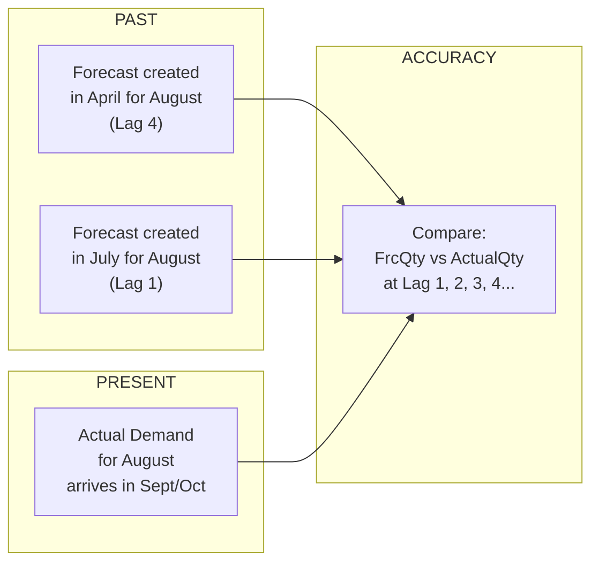
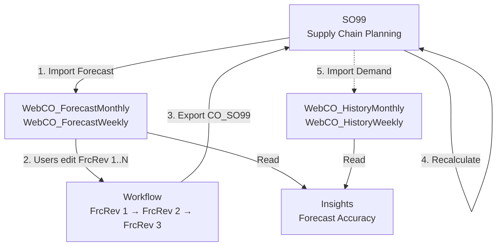
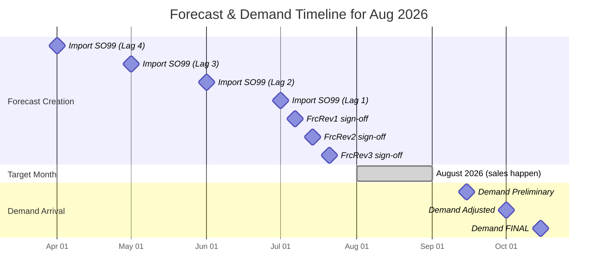
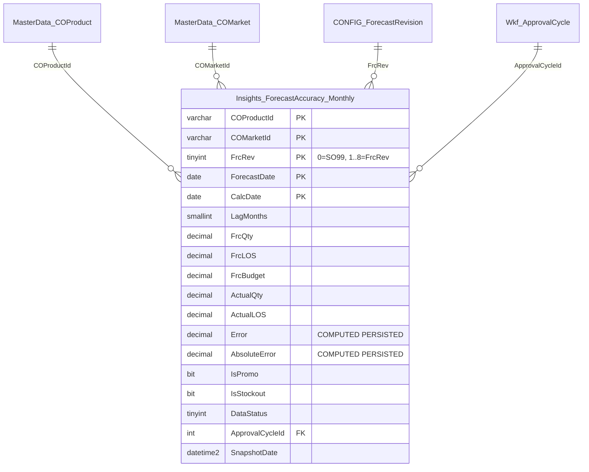
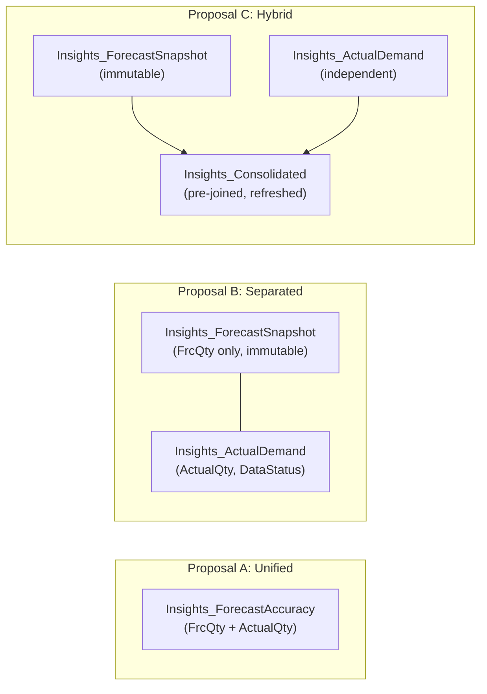
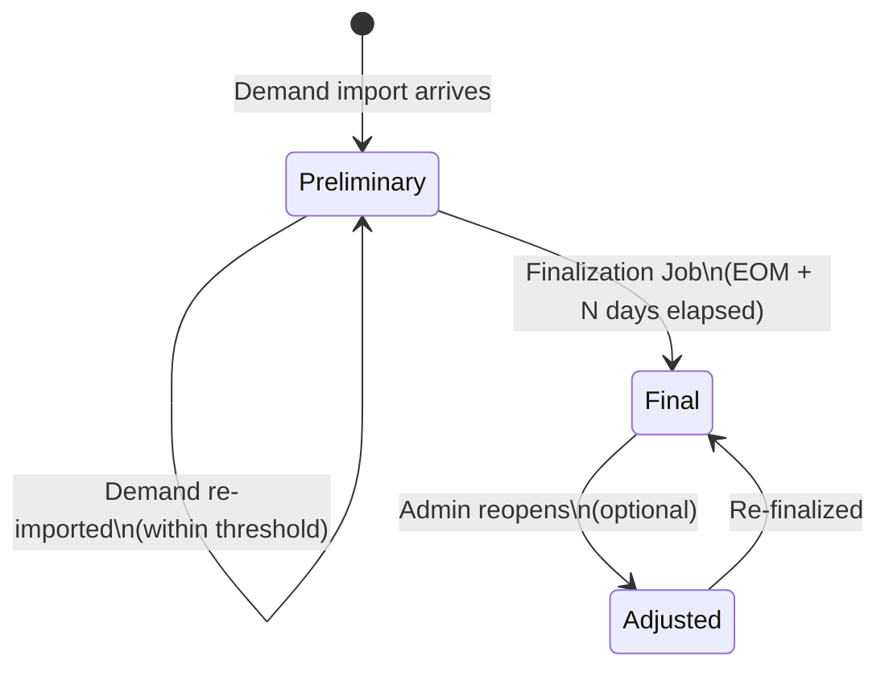
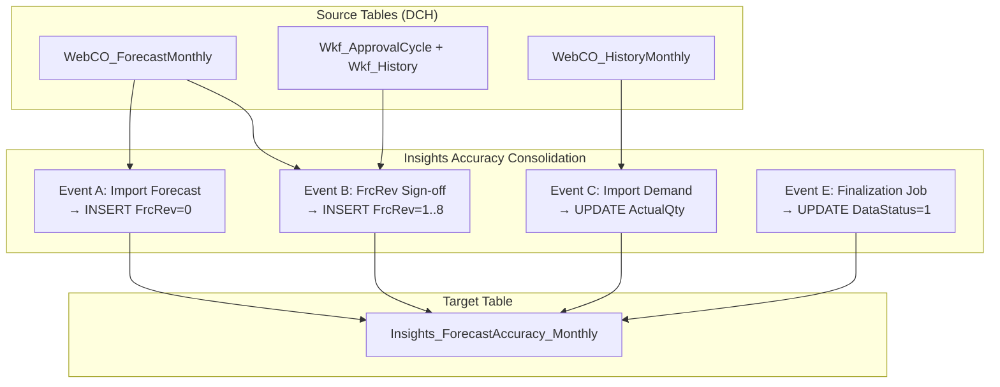

# Forecast Accuracy Model for DCH Insights

> **Status:** Draft  
> **Date:** 2026-09-07  
> **Author:** DCH Insights Team  
> **Version:** 1.0

---

## 1. Executive Summary

### 1.1. Objective

Define a scalable, traceable, and performant data model to measure **Forecast Accuracy with N Lags** within DCH Insights. The model must integrate seamlessly with the existing DCH data ecosystem (`WebCO_Forecast*`, `WebCO_History*`, Workflow FrcRev) and SO99 supply chain planning system.

### 1.2. What is Forecast Accuracy?

Forecast Accuracy measures **how close the forecast was to the actual demand** that materialized. It answers the question:

> *"When we predicted X units for month M, made N months ago, how close were we to the Y units that actually sold?"*

Key concepts:



**Lag** is the number of periods between when the forecast was **created** and the **target period** being forecasted:

```
Lag = TargetPeriod − ForecastCreationPeriod

Example: Forecast for December 2026, created in September 2026
         → Lag = 3 months
```

### 1.3. Key Decisions Summary

| Decision | Choice | Rationale |
|----------|--------|-----------|
| **Storage model** | Tabla Unificada (Forecast + Actuals) | Queries sin JOIN. Rendimiento óptimo para análisis en vivo |
| **Table granularity** | Monthly + Weekly (separadas) | DCH solo usa una a la vez. Esquemas específicos |
| **FrcRev modeling** | Rows (FrcRev as dimension) | GROUP BY FrcRev natural. Sin ALTER TABLE para añadir niveles |
| **Dates** | `DATE` type | 3 bytes. BETWEEN queries. Sargable |
| **Lag** | Materialized (`LagMonths`/`LagWeeks`) | Rendimiento en filtros y agrupaciones |
| **Metrics** | Aditivos (`FrcQty`, `ActualQty`, `Error`, `AbsoluteError`) | WAPE, MAE, Bias, RMSE calculados en queries |
| **Keys** | VARCHARs (DCH native) | Consistencia con ecosistema DCH. Columnstore dictionary encoding |
| **Storage engine** | Clustered Columnstore Index | Compresión + batch mode analítico |
| **MVP scope** | Monthly granularity. Proposal A (unificada) | Time-to-value mínimo |

### 1.4. Scope & Out of Scope

| In Scope | Out of Scope |
|----------|-------------|
| Forecast Accuracy with Lags (Monthly) | Daily granularity |
| FrcRev 0..8 (SO99 baseline + workflow levels) | Custom forecast models |
| WAPE, MAE, Bias, RMSE | Probabilistic forecast metrics |
| Integration with DCH WebCO tables | Real-time streaming |
| DataStatus lifecycle (Preliminary/Final) | Automated forecast generation |
| IsPromo flag (Phase 2) | Promotion effectiveness analysis |
| IsStockout flag (Phase 2) | Stockout root cause analysis |

---

## 2. Domain Context

### 2.1. DCH Overview

DCH (Demand Hub Collaboration) is an external module for SO99 that:

1. **Imports Forecast** from SO99 into `WebCO_ForecastMonthly`/`WebCO_ForecastWeekly`
2. **Allows users to edit forecasts** through configurable Forecast Revisions (FrcRev, up to 8 levels)
3. **Manages a workflow** where Level 1 users edit → Level 2 reviews → Level 3 approves
4. **Exports the final FrcRev** back to SO99 as Commercial Override (CO_SO99)
5. **Imports Demand** (actual sales/orders) into `WebCO_HistoryMonthly`/`WebCO_HistoryWeekly`

### 2.2. SO99 Integration Points



### 2.3. Current DCH Data Model

**WebCO_ForecastMonthly** (one row per Product × Market × Year × Month):

| Column Group | Columns | Purpose |
|-------------|---------|---------|
| Keys | `COProductId`, `COMarketId`, `Year`, `Month` | Primary key |
| SO99 Baseline | `FrcQty`, `FrcLOS`, `COSO99`, `Budget` | Imported from SO99 |
| Outstanding | `OutstQty`, `OutstLOS` | Outstanding orders |
| FrcRev 1..8 | `COQty1..COQty8`, `Note1..Note8`, `COEdited1..COEdited8` | Workflow levels |
| Visualization | `VisQty1..VisQty8` | Additional display series |

**WebCO_HistoryMonthly** (one row per Product × Market × Year × Month):

| Column | Purpose |
|--------|---------|
| `Quantity`, `OrdLines` | Actual demand (units + order lines) |
| `ExQuantity`, `ExOrdLines` | Exceptional demand |
| `SSQty`, `SSLOS` | Sell-out (consumption) |
| `Budget` | Historical budget |

**CONFIG_ForecastRevision** (one row per FrcRev, 1..8):

| Column | Purpose |
|--------|---------|
| `ForecastRevisionId` | 1..8 |
| `Enabled`, `Blocked` | Activation flags |
| `FrozenPeriods`, `EditablePeriods` | Period control |
| `Tag`, `Color` | UI display |

**Wkf_ApprovalCycle**: Tracks workflow cycles (`DateInit` → `DateEnd`)

**Wkf_History**: Audit trail of status changes (`UserName`, `StatusOld` → `StatusNew`, `StatusChangeDate`)

**MasterData_COProduct** / **MasterData_COMarket**: Hierarchies with 20 free attributes each (family, brand, category, region, channel...)

### 2.4. Illustrative Example: Forecast + Demand Timeline

The following example shows how Forecast Accuracy with Lags works across a typical DCH workflow cycle, using August 2026 as the target period being evaluated.



**Step-by-step explanation:**

```
TARGET PERIOD: August 2026
═══════════════════════════════════════════════════════════════

APRIL 2026 — Forecast Lag 4:
  Import SO99 → INSERT Insights:
    FrcRev=0, ForecastDate=2026-08-01, CalcDate=2026-04-01
    LagMonths=4, FrcQty=800
    ActualQty=NULL (August hasn't happened yet)

MAY 2026 — Forecast Lag 3:
  Import SO99 → INSERT Insights:
    FrcRev=0, ForecastDate=2026-08-01, CalcDate=2026-05-01
    LagMonths=3, FrcQty=820
    ActualQty=NULL

JUNE 2026 — Forecast Lag 2:
  Import SO99 → INSERT Insights:
    FrcRev=0, ForecastDate=2026-08-01, CalcDate=2026-06-01
    LagMonths=2, FrcQty=850
    ActualQty=NULL

JULY 2026 — Forecast Lag 1 (last forecasts before target month):
  Import SO99 → INSERT Insights:
    FrcRev=0, ForecastDate=2026-08-01, CalcDate=2026-07-01
    LagMonths=1, FrcQty=830, ActualQty=NULL

  FrcRev1 sign-off → INSERT Insights:
    FrcRev=1, ForecastDate=2026-08-01, CalcDate=2026-07-07
    LagMonths=1, FrcQty=845, ActualQty=NULL

  FrcRev2 sign-off → INSERT Insights:
    FrcRev=2, ForecastDate=2026-08-01, CalcDate=2026-07-14
    LagMonths=1, FrcQty=860, ActualQty=NULL

  FrcRev3 sign-off → INSERT Insights:
    FrcRev=3, ForecastDate=2026-08-01, CalcDate=2026-07-21
    LagMonths=1, FrcQty=870, ActualQty=NULL

AUGUST 2026 — Target month:
  Products are sold. Demand is created.
  No forecast import for August (it's the current month).
  No demand data yet (sales are still happening).

SEPTEMBER 2026 — Demand starts arriving:
  15-Sep: Import Demand → UPDATE Insights:
    ActualQty=850, DataStatus=0 (Preliminary)
    Affects ALL rows with ForecastDate=2026-08-01

OCTOBER 2026 — Demand consolidation:
  01-Oct: Import Demand (adjusted) → UPDATE Insights:
    ActualQty=855, DataStatus=0 (still Preliminary)

  15-Oct: Finalization Job runs:
    EOMONTH(2026-08-01) = 2026-08-31 + 45 days = 2026-10-15
    DataStatus changes: 0 → 1 (Final)
    → DEMAND IS NOW FROZEN. No more updates for August 2026.

═══════════════════════════════════════════════════════════════
ACCURACY CALCULATION (after DataStatus = Final):
═══════════════════════════════════════════════════════════════

ForecastDate=2026-08-01, ActualQty=855

Lag 4 (Apr): FrcQty=800 → Error=-55, AbsError=55, Acc=93.6%
Lag 3 (May): FrcQty=820 → Error=-35, AbsError=35, Acc=95.9%
Lag 2 (Jun): FrcQty=850 → Error= -5, AbsError= 5, Acc=99.4%
Lag 1 (Jul): FrcQty=830 → Error=-25, AbsError=25, Acc=97.1%
  FrcRev1:   FrcQty=845 → Error=-10, AbsError=10, Acc=98.8%
  FrcRev2:   FrcQty=860 → Error= +5, AbsError= 5, Acc=99.4%
  FrcRev3:   FrcQty=870 → Error=+15, AbsError=15, Acc=98.2%

WAPE (Lag 1-4, FrcRev=0): 
  = (55+35+5+25) / (855×4) × 100 = 120 / 3420 × 100 = 3.5%
```

**Key observations from this example:**

1. **Forecast improved as Lag decreased** (800→820→850→830), showing the forecast got more accurate closer to the target month
2. **FrcRev2 had the best accuracy** (99.4%), slightly over-forecasting by 5 units
3. **FrcRev3 over-forecast** by 15 units (870 vs 855 actual)
4. **Demand was adjusted twice** (850→855) before being finalized 45 days after month-end

---

## 3. Data Model Design

### 3.1. Core Design Principles

| Principle | Description |
|-----------|-------------|
| **Long format (EAV)** | One row per forecast observation. No pivot columns for periods or lags |
| **FrcRev as dimension** | `FrcRev` is a row attribute, not a column prefix. Enables `GROUP BY FrcRev` |
| **Additive metrics only** | Store `FrcQty`, `ActualQty`, `Error`, `AbsoluteError`. WAPE/Bias/RMSE are derived in queries |
| **Immutability (best effort)** | Forecast rows are INSERT-only after creation. ActualQty may be UPDATEd until DataStatus=Final |
| **DCH naming convention** | Same column names and types as DCH ecosystem (`COProductId VARCHAR(32)`, `COMarketId VARCHAR(12)`) |
| **Columnstore storage** | Clustered Columnstore Index for compression and batch-mode analytics |

### 3.2. PROPOSAL A: Tabla Unificada (Default / Recommended for MVP) ⭐

Forecast quantities and actual demand reside in the **same table**. `ActualQty` is duplicated across FrcRev rows, but Columnstore compression makes this overhead negligible.

**Why this is the default:**
- Queries have no JOINs → optimal performance for live analytics
- `Error` and `AbsoluteError` are computed columns on the same row
- Simpler mental model: one row = one complete accuracy observation
- Aligned with SO99's `MONFORCHIST`/`WEEKFORCHIST` pattern (same table holds forecast values per Lag)

#### 3.2.1. DDL: Insights_ForecastAccuracy_Monthly

```sql
-- ============================================================
-- Monthly Forecast Accuracy Table (Proposal A: Unified)
-- ============================================================
CREATE TABLE Insights_ForecastAccuracy_Monthly (
    -- ── Dimension Keys ──
    COProductId     VARCHAR(32)     NOT NULL,   -- FK → MasterData_COProduct
    COMarketId      VARCHAR(12)     NOT NULL,   -- FK → MasterData_COMarket
    FrcRev          TINYINT         NOT NULL,   -- 0=SO99 baseline, 1..8=FrcRev workflow
    
    -- ── Period Columns ──
    ForecastDate    DATE            NOT NULL,   -- Day 1 of the target month (e.g., '2026-08-01')
    CalcDate        DATE            NOT NULL,   -- Actual date the forecast was imported/signed-off
    
    -- ── Lag (materialized for performance) ──
    LagMonths       SMALLINT        NOT NULL,   -- DATEDIFF(MONTH, CalcDate, ForecastDate)
    
    -- ── Forecast Metrics ──
    FrcQty          DECIMAL(18,4)   NOT NULL,   -- Forecast quantity (units)
    FrcLOS          DECIMAL(18,4)   NULL,       -- Forecast Lost Sales / Order Lines
    FrcBudget       DECIMAL(18,4)   NULL,       -- Budget value (only for FrcRev=0)
    
    -- ── Actual Demand Metrics ──
    ActualQty       DECIMAL(18,4)   NULL,       -- Actual demand quantity (filled after month closes)
    ActualLOS       DECIMAL(18,4)   NULL,       -- Actual Order Lines
    
    -- ── Computed Error Columns (PERSISTED) ──
    Error           AS (FrcQty - ActualQty) PERSISTED,            -- Signed error (aditive)
    AbsoluteError   AS (ABS(FrcQty - ActualQty)) PERSISTED,      -- Absolute error (aditive)
    
    -- ── Context Flags ──
    IsPromo         BIT             NULL,       -- Phase 2: TRUE if promotion was active (Promo_DetailMonthly / C_PROMOAREA)
    IsStockout      BIT             NULL,       -- Phase 2: TRUE if stockout occurred (C_STOCKOUTS)
    
    -- ── Data Quality ──
    DataStatus      TINYINT         NOT NULL DEFAULT 0,
    -- 0 = Preliminary (demand data is partial, can be updated)
    -- 1 = Final (demand data is closed, no more updates)
    -- 2 = Adjusted (optional: post-close correction by admin)
    
    -- ── Audit ──
    ApprovalCycleId INT             NULL,       -- FK → Wkf_ApprovalCycle
    SnapshotDate    DATETIME2       NOT NULL DEFAULT GETUTCDATE(),
    
    -- ── Primary Key ──
    CONSTRAINT PK_Insights_FrcAcc_Monthly PRIMARY KEY (
        COProductId, COMarketId, FrcRev, ForecastDate, CalcDate
    )
);

-- Storage: Clustered Columnstore for compression + batch-mode analytics
CREATE CLUSTERED COLUMNSTORE INDEX CCI_Insights_FrcAcc_Monthly 
    ON Insights_ForecastAccuracy_Monthly;
```

#### 3.2.2. DDL: Insights_ForecastAccuracy_Weekly

```sql
-- ============================================================
-- Weekly Forecast Accuracy Table (Proposal A: Unified)
-- ============================================================
CREATE TABLE Insights_ForecastAccuracy_Weekly (
    -- ── Dimension Keys ──
    COProductId     VARCHAR(32)     NOT NULL,
    COMarketId      VARCHAR(12)     NOT NULL,
    FrcRev          TINYINT         NOT NULL,
    
    -- ── Period Columns ──
    ForecastDate    DATE            NOT NULL,   -- Monday of the target week
    CalcDate        DATE            NOT NULL,   -- Actual date of import/sign-off
    
    -- ── Lag ──
    LagWeeks        SMALLINT        NOT NULL,   -- DATEDIFF(WEEK, CalcDate, ForecastDate)
    
    -- ── Forecast Metrics ──
    FrcQty          DECIMAL(18,4)   NOT NULL,
    FrcLOS          DECIMAL(18,4)   NULL,
    FrcBudget       DECIMAL(18,4)   NULL,
    
    -- ── Actual Demand ──
    ActualQty       DECIMAL(18,4)   NULL,
    ActualLOS       DECIMAL(18,4)   NULL,
    
    -- ── Computed Error Columns ──
    Error           AS (FrcQty - ActualQty) PERSISTED,
    AbsoluteError   AS (ABS(FrcQty - ActualQty)) PERSISTED,
    
    -- ── Context Flags ──
    IsPromo         BIT             NULL,
    IsStockout      BIT             NULL,
    
    -- ── Data Quality ──
    DataStatus      TINYINT         NOT NULL DEFAULT 0,
    
    -- ── Weekly-specific ──
    WeekNumber      INT             NULL,       -- ISO week number (1-53)
    
    -- ── Audit ──
    ApprovalCycleId INT             NULL,
    SnapshotDate    DATETIME2       NOT NULL DEFAULT GETUTCDATE(),
    
    CONSTRAINT PK_Insights_FrcAcc_Weekly PRIMARY KEY (
        COProductId, COMarketId, FrcRev, ForecastDate, CalcDate
    )
);

CREATE CLUSTERED COLUMNSTORE INDEX CCI_Insights_FrcAcc_Weekly 
    ON Insights_ForecastAccuracy_Weekly;
```

#### 3.2.3. Entity Relationship Diagram



---

### 3.3. PROPOSAL B: Tablas Separadas (Forecast Snapshot + Actual Demand)

**Concept**: Forecast snapshots and actual demand values live in **separate tables**. The forecast table is truly immutable (INSERT-only). The actual demand table is independently managed via MERGE operations.

**Key advantage**: Forecast immutability is guaranteed — no UPDATEs ever touch forecast rows. The `DataStatus` lifecycle and demand values are managed in a dedicated table, avoiding the UPDATE-on-forecast-table anti-pattern.

**Key disadvantage**: Accuracy queries require a JOIN between Forecast and ActualDemand tables. However, with Columnstore indexes on both tables and JOIN on the PK of ActualDemand, the performance impact is minimal in batch mode.

**When to choose B over A**: If forecast immutability is a strict architectural requirement, or if the demand update frequency is very high (multiple times per day) and you want to isolate that write activity from the forecast table.

#### 3.3.1. DDL: Insights_ForecastSnapshot_Monthly (Proposal B)

```sql
-- ============================================================
-- Monthly Forecast Snapshot Table (Proposal B: Immutable)
-- Only INSERTs. Never UPDATEs.
-- ============================================================
CREATE TABLE Insights_ForecastSnapshot_Monthly (
    COProductId     VARCHAR(32)     NOT NULL,
    COMarketId      VARCHAR(12)     NOT NULL,
    FrcRev          TINYINT         NOT NULL,
    ForecastDate    DATE            NOT NULL,
    CalcDate        DATE            NOT NULL,
    LagMonths       SMALLINT        NOT NULL,
    FrcQty          DECIMAL(18,4)   NOT NULL,
    FrcLOS          DECIMAL(18,4)   NULL,
    FrcBudget       DECIMAL(18,4)   NULL,
    IsPromo         BIT             NULL,
    ApprovalCycleId INT             NULL,
    SnapshotDate    DATETIME2       NOT NULL DEFAULT GETUTCDATE(),

    CONSTRAINT PK_Insights_FrcSnap_Monthly PRIMARY KEY (
        COProductId, COMarketId, FrcRev, ForecastDate, CalcDate
    )
);

CREATE CLUSTERED COLUMNSTORE INDEX CCI_FrcSnap_Monthly
    ON Insights_ForecastSnapshot_Monthly;
```

#### 3.3.2. DDL: Insights_ActualDemand_Monthly (Proposal B)

```sql
-- ============================================================
-- Monthly Actual Demand Table (Proposal B)
-- Independent from Forecast. Managed via MERGE.
-- ============================================================
CREATE TABLE Insights_ActualDemand_Monthly (
    COProductId     VARCHAR(32)     NOT NULL,
    COMarketId      VARCHAR(12)     NOT NULL,
    ForecastDate    DATE            NOT NULL,
    ActualQty       DECIMAL(18,4)   NOT NULL,
    ActualLOS       DECIMAL(18,4)   NULL,
    IsStockout      BIT             NULL,
    DataStatus      TINYINT         NOT NULL DEFAULT 0,
    LastUpdated     DATETIME2       NOT NULL DEFAULT GETUTCDATE(),

    CONSTRAINT PK_Insights_ActDem_Monthly PRIMARY KEY (
        COProductId, COMarketId, ForecastDate
    )
);

CREATE CLUSTERED COLUMNSTORE INDEX CCI_ActDem_Monthly
    ON Insights_ActualDemand_Monthly;
```

#### 3.3.3. Accuracy Query with JOIN (Proposal B)

```sql
-- WAPE by family and lag — requires JOIN between Forecast and ActualDemand
SELECT
    p.FREEATTR1 AS Family,
    fs.LagMonths,
    SUM(ABS(fs.FrcQty - ad.ActualQty)) / NULLIF(SUM(ad.ActualQty), 0) * 100 AS WAPE
FROM Insights_ForecastSnapshot_Monthly fs
JOIN Insights_ActualDemand_Monthly ad
    ON fs.COProductId = ad.COProductId
    AND fs.COMarketId = ad.COMarketId
    AND fs.ForecastDate = ad.ForecastDate
JOIN MasterData_COProduct p ON fs.COProductId = p.COProductId
WHERE fs.FrcRev = 3
  AND fs.LagMonths BETWEEN 1 AND 6
  AND ad.DataStatus = 1
GROUP BY p.FREEATTR1, fs.LagMonths;
```

#### 3.3.4. Trade-offs: Proposal A vs Proposal B

| Criterion | Proposal A (Unified) | Proposal B (Separated) |
|-----------|:---:|:---:|
| **Forecast immutability** | ⭐⭐ (UPDATEs for ActualQty) | ⭐⭐⭐ (never UPDATEd) |
| **Query performance** | ⭐⭐⭐ (no JOIN) | ⭐⭐ (JOIN required) |
| **Demand management** | UPDATE on forecast table | MERGE on dedicated table |
| **DataStatus consistency** | Per-row (can diverge) | Centralized in ActualDemand |
| **ETL complexity** | ⭐⭐ (INSERT + UPDATE) | ⭐⭐⭐ (INSERT + MERGE) |
| **Storage efficiency** | ⭐⭐ (ActualQty duplicated) | ⭐⭐⭐ (ActualQty stored once) |
| **Conceptual simplicity** | ⭐⭐⭐ (one row = one observation) | ⭐⭐ (two-table mental model) |

---

### 3.4. PROPOSAL C: Híbrido (Tablas Separadas + Materialized Consolidated)

**Concept**: Keep Proposal B's clean separation (Forecast immutable + ActualDemand independent) but add a **third materialized table** that pre-joins both for optimal query performance. This table is refreshed after each demand import or on a schedule.

**Why consider C**: If Proposal B's JOIN performance becomes a bottleneck at scale (hundreds of millions of rows), the consolidated table eliminates the JOIN at query time while preserving the clean ETL separation.

#### 3.4.1. DDL: Insights_ForecastAccuracy_Consolidated (Proposal C)

```sql
CREATE TABLE Insights_ForecastAccuracy_Consolidated (
    COProductId     VARCHAR(32)     NOT NULL,
    COMarketId      VARCHAR(12)     NOT NULL,
    FrcRev          TINYINT         NOT NULL,
    ForecastDate    DATE            NOT NULL,
    CalcDate        DATE            NOT NULL,
    LagMonths       SMALLINT        NOT NULL,
    FrcQty          DECIMAL(18,4)   NOT NULL,
    FrcLOS          DECIMAL(18,4)   NULL,
    FrcBudget       DECIMAL(18,4)   NULL,
    ActualQty       DECIMAL(18,4)   NULL,
    ActualLOS       DECIMAL(18,4)   NULL,
    Error           AS (FrcQty - ActualQty) PERSISTED,
    AbsoluteError   AS (ABS(FrcQty - ActualQty)) PERSISTED,
    DataStatus      TINYINT         NOT NULL,
    IsPromo         BIT             NULL,
    IsStockout      BIT             NULL,
    LastRefresh     DATETIME2       NOT NULL,

    CONSTRAINT PK_Insights_FrcConsolidated PRIMARY KEY (
        COProductId, COMarketId, FrcRev, ForecastDate, CalcDate
    )
);

CREATE CLUSTERED COLUMNSTORE INDEX CCI_FrcConsolidated
    ON Insights_ForecastAccuracy_Consolidated;
```

#### 3.4.2. Refresh Strategy

```sql
-- Step 1: INSERT new forecasts not yet in consolidated table
INSERT INTO Insights_ForecastAccuracy_Consolidated (...)
SELECT fs.*, ad.ActualQty, ad.ActualLOS, ad.DataStatus, ...
FROM Insights_ForecastSnapshot_Monthly fs
LEFT JOIN Insights_ActualDemand_Monthly ad
    ON fs.COProductId = ad.COProductId
    AND fs.COMarketId = ad.COMarketId
    AND fs.ForecastDate = ad.ForecastDate
WHERE NOT EXISTS (
    SELECT 1 FROM Insights_ForecastAccuracy_Consolidated c
    WHERE c.COProductId = fs.COProductId
      AND c.COMarketId = fs.COMarketId
      AND c.FrcRev = fs.FrcRev
      AND c.ForecastDate = fs.ForecastDate
      AND c.CalcDate = fs.CalcDate
);

-- Step 2: UPDATE ActualQty for non-Final periods
UPDATE c
SET c.ActualQty = ad.ActualQty, c.ActualLOS = ad.ActualLOS,
    c.DataStatus = ad.DataStatus, c.IsStockout = ad.IsStockout,
    c.LastRefresh = GETUTCDATE()
FROM Insights_ForecastAccuracy_Consolidated c
JOIN Insights_ActualDemand_Monthly ad
    ON c.COProductId = ad.COProductId
    AND c.COMarketId = ad.COMarketId
    AND c.ForecastDate = ad.ForecastDate
WHERE c.DataStatus != 1
  AND (c.ActualQty != ad.ActualQty OR c.ActualQty IS NULL);
```

#### 3.4.3. When to Migrate from A → C

| Trigger | Action |
|---------|--------|
| Query response time > 5 seconds for typical accuracy dashboard | Evaluate C |
| Row count exceeds 500M in unified table | Implement C |
| Multiple consumers hitting the same table simultaneously | Implement C |
| Need for strict forecast immutability audit | Implement C (or B) |

#### 3.4.4. Architecture Comparison: All Three Proposals



| Proposal | Tables | JOIN in queries | Forecast immutability | Recommended for |
|----------|:------:|:---:|:---:|-----------------|
| **A** ⭐ | 1 | No | Best-effort | **MVP** |
| **B** | 2 | Yes | Guaranteed | Audit-heavy environments |
| **C** | 3 | No | Guaranteed | High-scale (Phase 3) |

---

## 4. Column Detail & Rationale

### 4.1. Dimension Columns

| Column | Type | Rationale |
|--------|------|-----------|
| `COProductId` | `VARCHAR(32)` | Native DCH product identifier. Same type as `WebCO_ForecastMonthly` and `MasterData_COProduct`. Columnstore dictionary encoding compresses repeated values efficiently. |
| `COMarketId` | `VARCHAR(12)` | Native DCH market identifier. Consistent with DCH ecosystem. |
| `FrcRev` | `TINYINT` | 0 = SO99 baseline forecast, 1..8 = workflow revision levels. Using `TINYINT` as a dimension (rows) instead of column prefixes (pivot) enables natural `GROUP BY FrcRev` queries and avoids `ALTER TABLE` when adding new revision levels. |

### 4.2. Date & Lag Columns

| Column | Type | Rationale |
|--------|------|-----------|
| `ForecastDate` | `DATE` | Day 1 of the target month (e.g. `'2026-08-01'`). `DATE` is 3 bytes vs 4 bytes for `SMALLINT`+`TINYINT`. Enables simple `BETWEEN` range queries. |
| `CalcDate` | `DATE` | **Actual date** the forecast was imported or the FrcRev was signed off. Using the real date (not day 1) enables distinguishing multiple imports within the same month — each gets a unique `CalcDate`, preventing PK collisions. |
| `LagMonths` | `SMALLINT` | `DATEDIFF(MONTH, CalcDate, ForecastDate)`. Materialized for performance: enables `WHERE LagMonths BETWEEN 1 AND 6` with segment elimination in Columnstore, and `GROUP BY LagMonths` without runtime calculation. |

### 4.3. Metric Columns

| Column | Type | Rationale |
|--------|------|-----------|
| `FrcQty` | `DECIMAL(18,4)` | Forecast quantity in units. `DECIMAL` chosen over `REAL` (FLOAT) to avoid floating-point rounding issues in financial/aggregate calculations. |
| `FrcLOS` | `DECIMAL(18,4)` | Forecast Lost Sales / Order Lines. Nullable — not all configurations use this metric. |
| `FrcBudget` | `DECIMAL(18,4)` | Budget value. **Only populated for FrcRev=0** (SO99 baseline). NULL for FrcRev 1..8 to avoid meaningless duplication. Budget is a separate business concept (financial target), not a forecast revision. |
| `ActualQty` | `DECIMAL(18,4)` | Actual demand quantity. Initially NULL (future months). Filled via UPDATE when demand data arrives. Duplicated across FrcRev rows — Columnstore RLE compression makes the storage cost negligible. |
| `ActualLOS` | `DECIMAL(18,4)` | Actual Order Lines. Same lifecycle as `ActualQty`. |
| `Error` | `DECIMAL(18,4)` PERSISTED | `FrcQty - ActualQty`. Computed column, persisted to disk. Aditive — `SUM(Error)` gives total bias. Automatically recalculated when `ActualQty` is UPDATEd. |
| `AbsoluteError` | `DECIMAL(18,4)` PERSISTED | `ABS(FrcQty - ActualQty)`. Aditive — `SUM(AbsoluteError)` is the numerator for WAPE and MAE. |

### 4.4. Context Flags

| Column | Type | Phase | Rationale |
|--------|------|:---:|-----------|
| `IsPromo` | `BIT NULL` | Phase 2 | TRUE if a promotion was active during the target period. Sources: DCH `Promo_DetailMonthly`/`Promo_DetailWeekly` or SO99 `C_PROMOAREA`. Enables filtering accuracy for promotional vs. baseline periods. |
| `IsStockout` | `BIT NULL` | Phase 2 | TRUE if a stockout occurred during the target period. Source: SO99 `C_STOCKOUTS` (`ITEM, LOCATION, YEAR, MONTH, LOST_SALES_QTY`). Enables excluding stockout periods from accuracy measurement. |

### 4.5. Data Quality

| Column | Type | Values | Rationale |
|--------|------|--------|-----------|
| `DataStatus` | `TINYINT` | 0, 1, 2 | **0 = Preliminary**: demand data can still be updated. **1 = Final**: demand data is frozen (month closed + threshold elapsed). **2 = Adjusted**: optional post-close admin correction. Using `TINYINT` (1 byte) instead of `VARCHAR` saves space and enables faster filtering. |

**DataStatus lifecycle:**



### 4.6. Audit Columns

| Column | Type | Rationale |
|--------|------|-----------|
| `ApprovalCycleId` | `INT NULL` | References `Wkf_ApprovalCycle`. Links each forecast snapshot to the workflow cycle in which it was captured. NULL for baseline SO99 imports that occur outside active cycles. |
| `SnapshotDate` | `DATETIME2` | UTC timestamp of when the row was created or last updated. Minimal audit trail. |

### 4.7. Excluded Columns & Rationale

These columns were considered but deliberately excluded from the model:

| Excluded Column | Why Excluded |
|-----------------|--------------|
| `ImportJobId` / `SnapshotBatchId` | `SYSTEM_FrImportJobs` and `SYSTEM_Job` are **volatile work tables** that users can purge at any time. Referencing them creates orphaned FKs. No added value over `ApprovalCycleId` + `SnapshotDate`. |
| `SnapshotSource` | Redundant. `FrcRev=0` always means SO99 import. `FrcRev>=1` always means workflow snapshot. The source is implicit in the FrcRev value. |
| `PeriodSequence` | YAGNI (You Ain't Gonna Need It). DCH does not use custom months. `DATE` + `DATEDIFF` + materialized `LagMonths` cover all use cases. Custom weeks are handled in the ETL when calculating `LagWeeks`. |
| `AccuracyPct` / `BiasPct` / `MAPE` | **Not additive.** Cannot be aggregated with SUM or AVG. These metrics must be computed at query time from additive components (`Error`, `AbsoluteError`, `ActualQty`, row count). |
| `Year` / `Month` / `Day` (separate) | `DATE` (3 bytes) is more compact and enables `BETWEEN` queries that are sargable. Separating into components adds complexity without benefit. |
| Surrogate INT keys (`ProductKey`, `MarketKey`) | VARCHARs are native to DCH. Columnstore dictionary encoding compresses repeated strings efficiently. Surrogate keys would require a complex ID persistence mechanism across imports — not justified by the minimal space savings. |
| Pivot columns (`FrcRev1_Qty`, `FrcRev2_Qty`...) | FrcRev as rows enables `GROUP BY FrcRev` queries. Adding a new FrcRev level requires only INSERTs, not `ALTER TABLE`. Columnstore eliminates unreferenced columns in queries, so pivot width is not a performance issue — but the analytical flexibility of rows is superior. |

---

## 5. Insights Accuracy Consolidation Process

### 5.1. Process Overview

The consolidation process is triggered by DCH import jobs and workflow events. It reads from `WebCO_Forecast*` and `WebCO_History*` and writes to `Insights_ForecastAccuracy_*`.



### 5.2. Event A: Import Forecast → INSERT FrcRev=0

**Trigger**: DCH completes an import of SO99 forecast into `WebCO_ForecastMonthly`.

**Action**: INSERT new rows into `Insights_ForecastAccuracy_Monthly` for `FrcRev=0`.

```sql
INSERT INTO Insights_ForecastAccuracy_Monthly (
    COProductId, COMarketId, FrcRev,
    ForecastDate, CalcDate, LagMonths,
    FrcQty, FrcLOS, FrcBudget,
    ActualQty, ActualLOS,
    IsPromo, DataStatus,
    ApprovalCycleId, SnapshotDate
)
SELECT
    f.COProductId, f.COMarketId, 0 AS FrcRev,
    DATEFROMPARTS(f.Year, f.Month, 1) AS ForecastDate,
    @ActualImportDate AS CalcDate,
    DATEDIFF(MONTH, @ActualImportDate, DATEFROMPARTS(f.Year, f.Month, 1)) AS LagMonths,
    f.FrcQty, f.FrcLOS, f.Budget,
    h.Quantity AS ActualQty,
    h.OrdLines AS ActualLOS,
    NULL AS IsPromo,
    CASE WHEN h.Quantity IS NOT NULL
         THEN CASE WHEN DATEDIFF(DAY, EOMONTH(DATEFROMPARTS(f.Year, f.Month, 1)), GETDATE())
                        >= @DataFinalThreshold THEN 1 ELSE 0 END
         ELSE 0 END AS DataStatus,
    @CurrentApprovalCycleId,
    GETUTCDATE()
FROM WebCO_ForecastMonthly f
LEFT JOIN WebCO_HistoryMonthly h
    ON f.COProductId = h.COProductId
    AND f.COMarketId = h.COMarketId
    AND f.Year = h.Year AND f.Month = h.Month
WHERE NOT EXISTS (
    SELECT 1 FROM Insights_ForecastAccuracy_Monthly a
    WHERE a.COProductId = f.COProductId
      AND a.COMarketId = f.COMarketId
      AND a.FrcRev = 0
      AND a.ForecastDate = DATEFROMPARTS(f.Year, f.Month, 1)
      AND a.CalcDate = @ActualImportDate
);

-- Repeat for FrcRev 1..8 (see Event B pattern)
```

**Design notes**:
- `CalcDate` is the **actual import date** (e.g. `2026-09-01`, `2026-09-21`), not day 1 of the month. This prevents PK collisions when multiple imports occur in the same calendar month.
- The `LEFT JOIN` to `WebCO_HistoryMonthly` handles the case where demand arrived **before** the first forecast import. If demand exists, `ActualQty` is pre-populated.
- If demand does not yet exist (future month), `ActualQty` remains NULL — it will be filled later by Event C.
- `FrcBudget` is only populated for `FrcRev=0`. For FrcRev 1..8 it remains NULL.

### 5.3. Event B: Workflow Sign-off → INSERT FrcRev=1..8

**Trigger**: All users at level N complete their edits and the workflow signs off.

**Action**: INSERT new rows capturing the final values of `COQty{N}` at the moment of sign-off.

```sql
INSERT INTO Insights_ForecastAccuracy_Monthly (
    COProductId, COMarketId, FrcRev,
    ForecastDate, CalcDate, LagMonths,
    FrcQty, FrcLOS,
    ActualQty, ActualLOS,
    IsPromo, DataStatus,
    ApprovalCycleId, SnapshotDate
)
SELECT
    f.COProductId, f.COMarketId, @FrcRevLevel AS FrcRev,
    DATEFROMPARTS(f.Year, f.Month, 1) AS ForecastDate,
    @SignOffDate AS CalcDate,
    DATEDIFF(MONTH, @SignOffDate, DATEFROMPARTS(f.Year, f.Month, 1)) AS LagMonths,
    CASE @FrcRevLevel
        WHEN 1 THEN f.COQty1 WHEN 2 THEN f.COQty2
        WHEN 3 THEN f.COQty3 WHEN 4 THEN f.COQty4
        WHEN 5 THEN f.COQty5 WHEN 6 THEN f.COQty6
        WHEN 7 THEN f.COQty7 WHEN 8 THEN f.COQty8
    END AS FrcQty,
    NULL AS FrcLOS,      -- FrcRev edits are on Qty only
    NULL AS FrcBudget,   -- Budget only for FrcRev=0
    h.Quantity AS ActualQty,
    h.OrdLines AS ActualLOS,
    NULL AS IsPromo,
    CASE WHEN h.Quantity IS NOT NULL
         THEN CASE WHEN DATEDIFF(DAY, EOMONTH(DATEFROMPARTS(f.Year, f.Month, 1)), GETDATE())
                        >= @DataFinalThreshold THEN 1 ELSE 0 END
         ELSE 0 END AS DataStatus,
    @CurrentApprovalCycleId,
    GETUTCDATE()
FROM WebCO_ForecastMonthly f
LEFT JOIN WebCO_HistoryMonthly h
    ON f.COProductId = h.COProductId
    AND f.COMarketId = h.COMarketId
    AND f.Year = h.Year AND f.Month = h.Month
WHERE NOT EXISTS (
    SELECT 1 FROM Insights_ForecastAccuracy_Monthly a
    WHERE a.COProductId = f.COProductId
      AND a.COMarketId = f.COMarketId
      AND a.FrcRev = @FrcRevLevel
      AND a.ForecastDate = DATEFROMPARTS(f.Year, f.Month, 1)
      AND a.CalcDate = @SignOffDate
);
```

**Design notes**:
- `CalcDate` = the date the sign-off occurred (from `Wkf_History.StatusChangeDate`).
- Each FrcRev level captures the value of `COQty{N}` at the **exact moment of sign-off**. Post-sign-off corrections are NOT re-captured (accepted limitation for MVP — see §5.7.2).
- `FrcBudget` is NULL for FrcRev 1..8 — budget is a baseline concept, not a revision-level metric.

### 5.4. Event C: Import Demand → UPDATE ActualQty

**Trigger**: DCH completes an import of demand data into `WebCO_HistoryMonthly`.

**Action**: UPDATE `ActualQty` and `ActualLOS` for all forecast rows matching the target period, **only if `DataStatus != 1` (Final)**.

```sql
UPDATE a
SET
    a.ActualQty = h.Quantity,
    a.ActualLOS = h.OrdLines,
    a.SnapshotDate = GETUTCDATE()
FROM Insights_ForecastAccuracy_Monthly a
JOIN WebCO_HistoryMonthly h
    ON a.COProductId = h.COProductId
    AND a.COMarketId = h.COMarketId
    AND a.ForecastDate = DATEFROMPARTS(h.Year, h.Month, 1)
WHERE a.DataStatus = 0;  -- Only Preliminary rows
```

**Design notes**:
- The UPDATE affects **ALL rows** with the same `ForecastDate` across all `FrcRev` and `CalcDate` values. This is correct: the actual demand for August 2026 is 855 regardless of when or by whom the forecast was made.
- The `WHERE a.DataStatus = 0` guard prevents overwriting finalized demand data.
- `DataStatus` is **NOT changed** during this event. The Finalization Job handles that separately (see §5.6).

### 5.5. Event D: Demand without Forecast → Ignore

**Scenario**: `WebCO_HistoryMonthly` has a row for (Product X, Market Y, August 2026) but `Insights_ForecastAccuracy_Monthly` has no forecast rows for that combination.

**Action**: **No action.** No row is created.

**Rationale**: Without a forecast to compare against, there is no accuracy to measure. These orphan demand rows would only add noise to the accuracy table (requiring `WHERE FrcQty IS NOT NULL` filters on every query).

If a forecast is imported later for that same period, Event A's LEFT JOIN will pick up the existing demand value at that time.

### 5.6. Event E: DataStatus Finalization Job

**Trigger**: Scheduled job (daily or weekly), independent of any import.

**Action**: Transition `DataStatus` from 0 (Preliminary) to 1 (Final) for periods whose month-end date is older than the configured threshold.

```sql
UPDATE Insights_ForecastAccuracy_Monthly
SET DataStatus = 1,
    SnapshotDate = GETUTCDATE()
WHERE DataStatus = 0
  AND EOMONTH(ForecastDate) < DATEADD(DAY, -@DataFinalThreshold, GETDATE());
```

**Configuration**: `@DataFinalThreshold` is configurable per customer. Default: **45 days**.

**Example**: If `@DataFinalThreshold = 45` and today is 2026-10-15:
- `ForecastDate = 2026-08-01` → `EOMONTH = 2026-08-31` → 45 days ago = 2026-08-31 → **YES, finalize**
- `ForecastDate = 2026-09-01` → `EOMONTH = 2026-09-30` → 45 days ago = 2026-08-22 → **NO, still preliminary**

**Design notes**:
- This job is **independent** of import events. If no demand imports occur for a week, the job still runs and finalizes periods whose threshold has elapsed.
- Prevents the "stuck in Preliminary" problem where `DataStatus` would remain 0 indefinitely if imports are infrequent.
- For the optional `DataStatus = 2` (Adjusted) state: an admin can manually set a row back to 0 to allow re-import, or directly to 2 to mark a post-close adjustment.

### 5.7. Edge Cases & Error Handling

#### 5.7.1. Multiple Imports in the Same Calendar Month

**Scenario**: SO99 recalculates forecast weekly. DCH imports on Sep 1 and Sep 21 — both for the same target months.

**Resolution**: `CalcDate` is the **actual import date** (not day 1). Each import gets a unique `CalcDate`:

```
Import 1: CalcDate = 2026-09-01 → INSERT OK
Import 2: CalcDate = 2026-09-21 → INSERT OK (different CalcDate, no PK collision)
```

Both rows have the same `ForecastDate` and potentially the same `LagMonths`, but different `CalcDate`. The accuracy analysis can compare how the forecast evolved within the same month.

#### 5.7.2. Post-Close FrcRev Corrections

**Scenario**: FrcRev1 was signed off on Jul 7. On Jul 8, a user corrects FrcRev1.

**Resolution**: **Not re-captured in MVP.** The snapshot taken at sign-off (Jul 7) is the official record. Rationale:
- Post-close edits are operational exceptions, not the norm.
- The correction would appear in the next cycle's baseline (SO99 recalculation includes the corrected value).
- If this becomes a frequent business need, Proposal C's re-capture mechanism can be implemented in Phase 3.

#### 5.7.3. Demand Arrives Before First Forecast

**Scenario**: `WebCO_HistoryMonthly` is imported on Sep 15. The first forecast import for that period occurs on Oct 1.

**Resolution**:
- Sep 15: Event D → Demand exists but no forecast → **ignored** (no row created).
- Oct 1: Event A → INSERT forecast with `LEFT JOIN` to History → `ActualQty` is pre-populated from the existing demand data.

No data is lost. The `LEFT JOIN` in Event A handles this gracefully.

#### 5.7.4. Forecast for Future Months (No Demand Yet)

**Scenario**: Forecast for December 2026 is imported in September 2026.

**Resolution**: Event A INSERTs the row with `ActualQty = NULL` and `DataStatus = 0`. This is normal — the month hasn't happened yet. When demand arrives in January 2027, Event C will UPDATE `ActualQty`. Until then, accuracy queries naturally exclude these rows (`WHERE ActualQty IS NOT NULL`).---

## 6. Accuracy Metrics & Queries

### 6.1. Metric Principles

All accuracy metrics are **derived at query time** from additive components stored in the table. No non-additive metrics are stored.

| Component | Additive? | Use |
|-----------|:---:|-----|
| FrcQty | SUM | Forecast total |
| ActualQty | SUM | Demand total |
| Error (FrcQty - ActualQty) | SUM | Bias numerator |
| AbsoluteError (ABS(FrcQty - ActualQty)) | SUM | WAPE/MAE numerator |

### 6.2. WAPE — Weighted Absolute Percentage Error

The **recommended primary metric** for DCH Insights.

`
WAPE = (SUM(AbsoluteError) / SUM(ActualQty)) x 100
`

Volume-weighted. Robust to zero demand. Industry standard for supply chain.

### 6.3. MAE — Mean Absolute Error

`
MAE = SUM(AbsoluteError) / COUNT(*)
`

### 6.4. Bias — Systematic Directional Error

`
Bias = (SUM(Error) / SUM(ActualQty)) x 100
`

Negative = under-forecasting. Positive = over-forecasting.

### 6.5. RMSE — Root Mean Square Error

`
RMSE = SQRT(SUM(POWER(Error, 2)) / COUNT(*))
`

### 6.6. Example Queries

#### WAPE by Product Family and Lag

``sql
SELECT
    p.FREEATTR1 AS ProductFamily,
    fa.LagMonths,
    SUM(fa.AbsoluteError) / NULLIF(SUM(fa.ActualQty), 0) * 100 AS WAPE,
    SUM(fa.Error) / NULLIF(SUM(fa.ActualQty), 0) * 100 AS Bias,
    COUNT(*) AS Observations
FROM Insights_ForecastAccuracy_Monthly fa
JOIN MasterData_COProduct p ON fa.COProductId = p.COProductId
WHERE fa.FrcRev = 3 AND fa.LagMonths BETWEEN 1 AND 6
  AND fa.DataStatus = 1 AND fa.ForecastDate >= '2026-01-01'
GROUP BY p.FREEATTR1, fa.LagMonths
ORDER BY p.FREEATTR1, fa.LagMonths;
``

#### FrcRev Comparison: SO99 Baseline vs Edited Forecast

``sql
SELECT fa.FrcRev, fr.Tag AS FrcRevName,
    SUM(fa.AbsoluteError) / NULLIF(SUM(fa.ActualQty), 0) * 100 AS WAPE,
    SUM(fa.Error) / NULLIF(SUM(fa.ActualQty), 0) * 100 AS Bias
FROM Insights_ForecastAccuracy_Monthly fa
LEFT JOIN CONFIG_ForecastRevision fr ON fa.FrcRev = fr.ForecastRevisionId
WHERE fa.LagMonths = 1 AND fa.DataStatus = 1
GROUP BY fa.FrcRev, fr.Tag ORDER BY fa.FrcRev;
``

#### Accuracy Excluding Stockouts/Promos (Phase 2)

``sql
SELECT fa.LagMonths,
    SUM(fa.AbsoluteError) / NULLIF(SUM(fa.ActualQty), 0) * 100 AS WAPE_All,
    SUM(CASE WHEN fa.IsStockout = 0 THEN fa.AbsoluteError ELSE 0 END)
        / NULLIF(SUM(CASE WHEN fa.IsStockout = 0 THEN fa.ActualQty ELSE 0 END), 0) * 100 AS WAPE_ExclStockouts,
    SUM(CASE WHEN fa.IsPromo = 0 THEN fa.AbsoluteError ELSE 0 END)
        / NULLIF(SUM(CASE WHEN fa.IsPromo = 0 THEN fa.ActualQty ELSE 0 END), 0) * 100 AS WAPE_ExclPromos
FROM Insights_ForecastAccuracy_Monthly fa
WHERE fa.FrcRev = 0 AND fa.DataStatus = 1
GROUP BY fa.LagMonths ORDER BY fa.LagMonths;
``

---

## 7. Implementation Roadmap

### 7.1. Phase 1: MVP (Proposal A)

**Goal**: Working Forecast Accuracy with Lags for Monthly granularity.

| # | Task | Description |
|---|------|-------------|
| 1 | Create Monthly table | DDL Insights_ForecastAccuracy_Monthly + CCI |
| 2 | Event A | INSERT FrcRev=0 from WebCO_ForecastMonthly |
| 3 | Event B | INSERT FrcRev=1..8 on workflow sign-off |
| 4 | Event C | UPDATE ActualQty/ActualLOS from WebCO_HistoryMonthly |
| 5 | Event E | Scheduled job: DataStatus 0-to-1 after threshold (default 45 days) |
| 6 | Validation | Run queries against real customer data |

**ETL Integration Points**:

- DCH Import Forecast -> INSERT Insights (FrcRev=0)
- DCH Workflow Sign-off -> INSERT Insights (FrcRev=N)
- DCH Import Demand -> UPDATE Insights (ActualQty)
- SQL Agent (daily) -> Finalization Job (DataStatus)

### 7.2. Phase 2: Context Flags & Weekly Granularity

| # | Task | Source |
|---|------|--------|
| 1 | Populate IsPromo flag | DCH Promo_DetailMonthly or SO99 C_PROMOAREA |
| 2 | Populate IsStockout flag | SO99 C_STOCKOUTS (requires new import into DCH) |
| 3 | Weekly table | Full Insights_ForecastAccuracy_Weekly implementation with all events |

### 7.3. Phase 3: Performance Optimization (if needed)

**Trigger**: any of the following conditions:
- Average query response time exceeds 5 seconds for main accuracy dashboard
- Row count in unified table exceeds 500M
- Multiple concurrent consumers hitting the same table

**Action**: Implement Proposal C (Hybrid).

1. Create Insights_ForecastAccuracy_Consolidated table
2. Implement scheduled refresh job (INSERT new forecasts + UPDATE changed Actuals)
3. Switch dashboard queries to consolidated table
4. Migration from A to C is additive: no schema changes to existing tables, no ETL changes for source tables


---

## 8. Appendix

### 8.1. Full DDL (Proposal A - MVP)

``sql
-- ============================================================
-- DCH Insights: Forecast Accuracy Model
-- Proposal A: Unified Table (MVP)
-- Version: 1.0 / Date: 2026-09-07
-- ============================================================

CREATE TABLE Insights_ForecastAccuracy_Monthly (
    COProductId     VARCHAR(32)     NOT NULL,
    COMarketId      VARCHAR(12)     NOT NULL,
    FrcRev          TINYINT         NOT NULL,
    ForecastDate    DATE            NOT NULL,
    CalcDate        DATE            NOT NULL,
    LagMonths       SMALLINT        NOT NULL,
    FrcQty          DECIMAL(18,4)   NOT NULL,
    FrcLOS          DECIMAL(18,4)   NULL,
    FrcBudget       DECIMAL(18,4)   NULL,
    ActualQty       DECIMAL(18,4)   NULL,
    ActualLOS       DECIMAL(18,4)   NULL,
    Error           AS (FrcQty - ActualQty) PERSISTED,
    AbsoluteError   AS (ABS(FrcQty - ActualQty)) PERSISTED,
    IsPromo         BIT             NULL,
    IsStockout      BIT             NULL,
    DataStatus      TINYINT         NOT NULL DEFAULT 0,
    ApprovalCycleId INT             NULL,
    SnapshotDate    DATETIME2       NOT NULL DEFAULT GETUTCDATE(),
    CONSTRAINT PK_Insights_FrcAcc_Monthly PRIMARY KEY (
        COProductId, COMarketId, FrcRev, ForecastDate, CalcDate
    )
);
CREATE CLUSTERED COLUMNSTORE INDEX CCI_Insights_FrcAcc_Monthly
    ON Insights_ForecastAccuracy_Monthly;
``

### 8.2. Glossary

| Term | Definition |
|------|------------|
| **Accuracy** | How close forecast is to actual demand |
| **Actual Demand** | Real quantity sold/ordered. Source: WebCO_HistoryMonthly.Quantity |
| **Additive Metric** | Metric where aggregate equals sum of individual values |
| **Bias** | Systematic directional error. Negative = under-forecasting |
| **CalcDate** | Actual calendar date when forecast was imported or FrcRev signed off |
| **Columnstore** | SQL Server storage format optimized for analytics |
| **DataStatus** | Demand lifecycle state: 0=Preliminary, 1=Final, 2=Adjusted |
| **DCH** | Demand Hub Collaboration - SO99 external module |
| **Finalization** | Process of transitioning DataStatus from Preliminary to Final |
| **ForecastDate** | Target period being forecasted (day 1 of the month) |
| **FrcRev** | Forecast Revision level: 0=SO99 baseline, 1..8=workflow |
| **Lag** | Number of periods between forecast creation and target period |
| **LOS** | Lost Sales / Order Lines - unfulfilled demand measure |
| **MAE** | Mean Absolute Error - average error in units per observation |
| **PERSISTED** | SQL Server keyword: computed column physically stored on disk |
| **RLE** | Run-Length Encoding - Columnstore compression for repeated values |
| **RMSE** | Root Mean Square Error - penalizes large errors more than MAE |
| **SO99** | ToolsGroup supply chain planning system |
| **WAPE** | Weighted Absolute Percentage Error - primary metric for DCH Insights |
| **Workflow** | DCH process for multi-level forecast editing and approval |

### 8.3. References

**SO99 Tables Analyzed**: C_STOCKOUTS, C_PROMOAREA, MONFORCHIST, WEEKFORCHIST, FRCITAR, DAILYFRC, DAILYDEM, FCL_DAILYFRC, FRC_CANDLESTICKS, FRC_ORD_LAG_DIST, C_CALENDARE, C_CALENDGEN, C_CALGENWEEK, C_CUSTOMMONTHS, C_CAUSAL_LAGIN, C_CAUSAL_LAGOUT, C_CAUSAL_LAGSTATS

**DCH Tables Analyzed**: WebCO_ForecastMonthly, WebCO_ForecastWeekly, WebCO_HistoryMonthly, WebCO_HistoryWeekly, CONFIG_ForecastRevision, Wkf_ApprovalCycle, Wkf_History, Wkf_UserStatus, MasterData_COProduct, MasterData_COMarket, DCH_ProductMarket, ADMIN_AuditMonthly, ADMIN_CO_PM_DataGroup, Promo_DetailMonthly, Promo_Participant, CONFIG_ImportFileCreation, SYSTEM_FrImportJobs, SYSTEM_Job

**External Documents**: Forecast_Accuracy_Initial_Analisis.md - External reference analysis for generic forecast accuracy model design

**Reference Databases**:
- SO99: [20244_DS_EmmaSleep] on WORKBENCH
- DCH: [DCH440_DS_Development] on WORKBENCH
