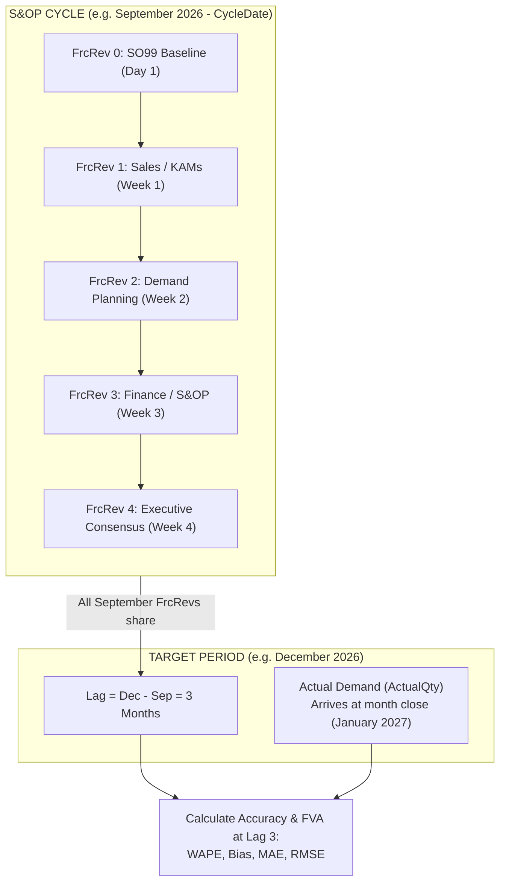
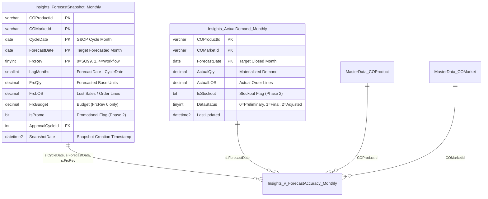
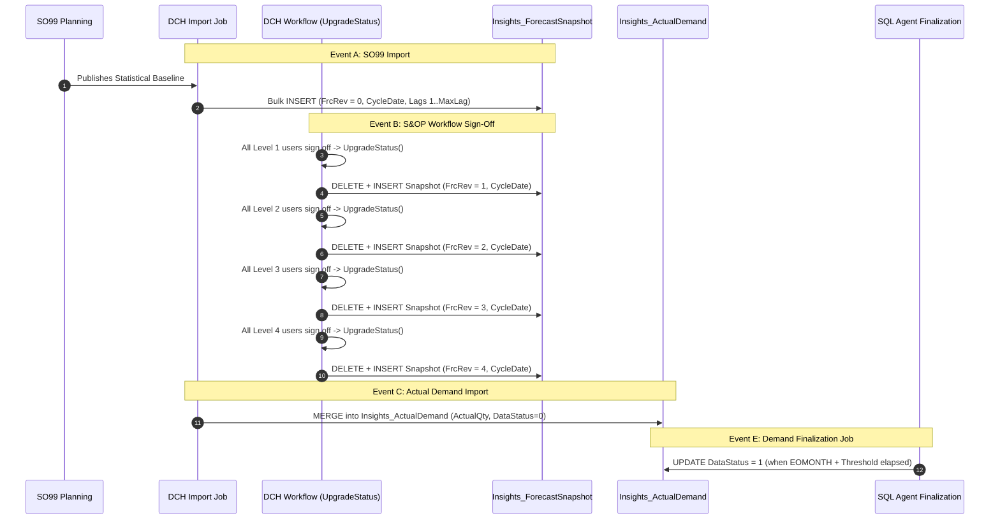
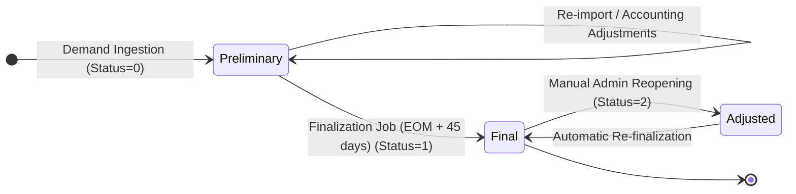

# Forecast Accuracy Model for DCH Insights
## Technical Architecture & Database Specification

> **Status:** Proposal / Consolidated Technical Design  
> **Date:** 2026-09-07  
> **Author:** DCH Insights Team  
> **Version:** 2.0 (Enterprise Architecture & DCHConverter Consolidation)  

---

## 1. Executive Summary

### 1.1. Objective

Define a high-performance, scalable data model aligned with industry standards to measure **Forecast Accuracy with N Lags** within DCH Insights. The model natively integrates with the DCH ecosystem (`WebCO_Forecast*`, `WebCO_History*`, multi-level approval workflows, and `DCHConverter`) and the ToolsGroup SO99 supply chain planning system.

### 1.2. What is Forecast Accuracy with Lags and FVA?

Forecast Accuracy measures **how close the forecast was to the actual demand** that eventually materialized:

> *"When we predicted $X$ units for month $M$, made $N$ periods ago (Lag $N$), how much did we deviate from the $Y$ units that were actually sold?"*

Additionally, by capturing the different review levels of the collaborative DCH workflow (FrcRev 0 through 4), the model measures **Forecast Value Add (FVA)**:
$$\text{FVA} = \text{Error}(\text{FrcRev 0 - Baseline}) - \text{Error}(\text{FrcRev N - Consensus})$$
This answers the key S&OP question: *Do human manual overrides from Sales, Marketing, or Leadership improve or degrade the accuracy of SO99's automated statistical forecast?*



### 1.3. Architecture Decisions Summary

| Decision | Selection | Technical Rationale |
|---|---|---|
| **Storage Model** | **2 Tables + Analytical View (Optimized Proposal B)** | **100% Immutable Snapshots (Append-Only)** in Columnstore. Zero fragmentation from `UPDATE`s. Single, centralized source of truth for actual demand. Transparent consumption in Insights via an abstraction View. |
| **Design Scale** | **Enterprise: 250,000 to 1,000,000 combinations** | Designed to support large enterprise portfolios (up to 1 Billion rows over 3 years). |
| **Forecast Levels** | **Configurable: FrcRev 0 (SO99) + FrcRev 1..4 (Workflow)** | Full coverage of the collaborative S&OP ladder for Forecast Value Add (FVA) tracking. |
| **Temporal Identifier** | **`CycleDate` (DATE) + `ForecastDate` (DATE)** | Represents the S&OP planning cycle month. Natural unique key. Prevents double-counting without artificial flags. |
| **Stored Metrics** | **Pure Base Units (`DECIMAL(18,4)`)** | No calculated financial values or volumetric conversions are persisted in fact tables. Value (€) or Volume ($m^3$) metrics are resolved dynamically at query time via joins with `MasterData_COProduct`. |
| **Storage Engine** | **Clustered Columnstore Index (CCI)** | High-density compression (8x to 10x) and in-memory Batch Mode vector processing. |
| **Deployment & Integration** | **Hybrid via `DCHConverter`** | Physical tables defined in the standard schema repository (`.mdb`); Columnstore indexes and analytical Views deployed via post-processing scripts (`Configuration.vb` / `TSQL`). |
| **`LagWeeks` Calculation** | **In-memory within DCH (.NET)** | Enforces strict ISO-8601 calendar compliance according to DCH corporate calendar, avoiding dependencies on SQL Server `@@DATEFIRST`. |

---

## 2. Domain Context & Scale

### 2.1. Real-World DCH Operational Scale

In production DCH enterprise installations, the `DCH_ProductMarket` table contains between **250,000 and 1,000,000 Product × Market combinations**.

Analyzing a 3-year historical retention window, evaluating **Lags 1 through 6** and **5 forecast revision levels (FrcRev 0 to 4)**:

| Portfolio (Combinations) | Snapshot Rows / Cycle | Snapshot Rows / Year (12 cycles) | Snapshot Rows in 3 Years | Actual Demand Rows (3 Years) | Disk Space Footprint (Columnstore) |
| :--- | :--- | :--- | :--- | :--- | :--- |
| **250,000** | $250\text{k} \times 6 \times 5 =$ **7.5 M / month** | **90 Million / year** | **270 Million rows** | **9 Million rows** | **~2.5 - 3.5 GB** |
| **1,000,000** | $1\text{M} \times 6 \times 5 =$ **30 M / month** | **360 Million / year** | **1,080 Million rows** | **36 Million rows** | **~10 - 13 GB** |

> [!IMPORTANT]
> **Why the Unified Table Model (former Proposal A) was Discarded:**  
> At this scale, updating actual demand inside a unified table would require executing an `UPDATE` on **7.5 to 30 Million rows every month** over a Columnstore index.  
> In SQL Server Columnstore, updated rows are marked as deleted in the *Delete Bitmap* and re-inserted into the uncompressed *Delta Store*. This causes:
> 1. Severe index fragmentation within weeks.
> 2. Transaction Log (`LDF`) explosion of dozens of GB per cycle.
> 3. Unacceptable query response times in live Insights dashboards.
> 
> The **2-Table Model (Append-Only Snapshots + Dedicated Actual Demand)** ensures that the snapshot archive **never receives a single `UPDATE`**, achieving maximum physical compression and optimal batch-mode scan speeds.

---

## 3. Data Model Architecture

The data architecture consists of **two physical tables** and **one abstraction analytical view**.



### 3.1. DDL: Forecast Snapshot Fact Table (Monthly)

Immutable table (*Append-Only*), optimized for high-speed direct batch inserts and Columnstore compression.

```sql
-- ============================================================
-- Forecast Snapshot Fact Table (Monthly)
-- Immutable (Bulk INSERTs only, Zero UPDATEs)
-- ============================================================
CREATE TABLE Insights_ForecastSnapshot_Monthly (
    -- ── Primary Dimensions ──
    COProductId     VARCHAR(32)     NOT NULL,
    COMarketId      VARCHAR(12)     NOT NULL,
    CycleDate       DATE            NOT NULL,   -- First day of S&OP planning cycle (e.g. '2026-09-01')
    ForecastDate    DATE            NOT NULL,   -- First day of target forecasted month (e.g. '2026-12-01')
    FrcRev          TINYINT         NOT NULL,   -- 0 = SO99 Baseline; 1..4 = Workflow Revisions

    -- ── Materialized Planning Lag ──
    LagMonths       SMALLINT        NOT NULL,   -- DATEDIFF(MONTH, CycleDate, ForecastDate)

    -- ── Forecast Metrics (Base Physical Units) ──
    FrcQty          DECIMAL(18,4)   NOT NULL,
    FrcLOS          DECIMAL(18,4)   NULL,
    FrcBudget       DECIMAL(18,4)   NULL,       -- Populated only for FrcRev = 0

    -- ── Context Flags (Phase 2) ──
    IsPromo         BIT             NULL,       -- TRUE if promotional activity was active in target period

    -- ── Audit & Traceability ──
    ApprovalCycleId INT             NULL,       -- FK → Wkf_ApprovalCycle
    SnapshotDate    DATETIME2       NOT NULL DEFAULT GETUTCDATE(),

    -- ── Primary Key (NONCLUSTERED required for Clustered Columnstore) ──
    CONSTRAINT PK_Insights_FrcSnap_Monthly PRIMARY KEY NONCLUSTERED (
        COProductId, COMarketId, CycleDate, ForecastDate, FrcRev
    )
);

-- Clustered Columnstore Index for vector compression (8x - 10x)
CREATE CLUSTERED COLUMNSTORE INDEX CCI_Insights_FrcSnap_Monthly 
    ON Insights_ForecastSnapshot_Monthly;
```

### 3.2. DDL: Actual Demand Fact Table (Monthly)

Lean table (a single row per product-market combination and month), managed via `MERGE`/`UPDATE`.

```sql
-- ============================================================
-- Actual Demand Fact Table (Monthly)
-- Single source of truth for demand. Independent from forecast snapshots.
-- ============================================================
CREATE TABLE Insights_ActualDemand_Monthly (
    COProductId     VARCHAR(32)     NOT NULL,
    COMarketId      VARCHAR(12)     NOT NULL,
    ForecastDate    DATE            NOT NULL,   -- Month corresponding to actual demand (e.g. '2026-08-01')

    -- ── Actual Demand Metrics ──
    ActualQty       DECIMAL(18,4)   NOT NULL,
    ActualLOS       DECIMAL(18,4)   NULL,

    -- ── Context Flags (Phase 2) ──
    IsStockout      BIT             NULL,       -- TRUE if warehouse experienced stockout (SO99 C_STOCKOUTS)

    -- ── Data Quality & Lifecycle ──
    DataStatus      TINYINT         NOT NULL DEFAULT 0, -- 0 = Preliminary, 1 = Final (Frozen), 2 = Adjusted
    LastUpdated     DATETIME2       NOT NULL DEFAULT GETUTCDATE(),

    CONSTRAINT PK_Insights_ActDem_Monthly PRIMARY KEY CLUSTERED (
        COProductId, COMarketId, ForecastDate
    )
);
```

### 3.3. DDL: Analytical Virtualization View (`Insights_v_ForecastAccuracy_Monthly`)

This view decouples physical storage from consumption queries. **DCH Insights and external BI tools query this view as a unified fact table**, while SQL Server executes an in-memory *Batch Mode Hash Join*.

```sql
-- ============================================================
-- Analytical View for DCH Insights (Monthly)
-- ============================================================
CREATE OR ALTER VIEW Insights_v_ForecastAccuracy_Monthly AS
SELECT 
    s.COProductId,
    s.COMarketId,
    s.CycleDate,
    s.ForecastDate,
    s.FrcRev,
    s.LagMonths,
    
    -- Forecast Metrics
    s.FrcQty,
    s.FrcLOS,
    s.FrcBudget,
    
    -- Actual Demand Metrics (NULL if target month has not elapsed)
    d.ActualQty,
    d.ActualLOS,
    
    -- Vectorized In-Memory Error Calculations
    (s.FrcQty - d.ActualQty) AS Error,
    ABS(s.FrcQty - d.ActualQty) AS AbsoluteError,
    
    -- Context Flags
    s.IsPromo,
    d.IsStockout,
    
    -- Status & Audit
    ISNULL(d.DataStatus, 0) AS DataStatus,
    s.ApprovalCycleId,
    s.SnapshotDate,
    d.LastUpdated AS DemandUpdatedDate
FROM Insights_ForecastSnapshot_Monthly s
LEFT JOIN Insights_ActualDemand_Monthly d
    ON s.COProductId = d.COProductId 
   AND s.COMarketId = d.COMarketId 
   AND s.ForecastDate = d.ForecastDate;
```

---

### 3.4. DDL: Weekly Granularity Models

```sql
-- ============================================================
-- Forecast Snapshot Fact Table (Weekly)
-- ============================================================
CREATE TABLE Insights_ForecastSnapshot_Weekly (
    COProductId     VARCHAR(32)     NOT NULL,
    COMarketId      VARCHAR(12)     NOT NULL,
    CycleDate       DATE            NOT NULL,   -- Monday of S&OP planning cycle week
    ForecastDate    DATE            NOT NULL,   -- Monday of target forecasted week
    FrcRev          TINYINT         NOT NULL,
    LagWeeks        SMALLINT        NOT NULL,   -- Calculated in DCH (.NET) via ISO-8601
    FrcQty          DECIMAL(18,4)   NOT NULL,
    FrcLOS          DECIMAL(18,4)   NULL,
    FrcBudget       DECIMAL(18,4)   NULL,
    IsPromo         BIT             NULL,
    ApprovalCycleId INT             NULL,
    SnapshotDate    DATETIME2       NOT NULL DEFAULT GETUTCDATE(),

    CONSTRAINT PK_Insights_FrcSnap_Weekly PRIMARY KEY NONCLUSTERED (
        COProductId, COMarketId, CycleDate, ForecastDate, FrcRev
    )
);

CREATE CLUSTERED COLUMNSTORE INDEX CCI_Insights_FrcSnap_Weekly 
    ON Insights_ForecastSnapshot_Weekly;

-- ============================================================
-- Actual Demand Fact Table (Weekly)
-- ============================================================
CREATE TABLE Insights_ActualDemand_Weekly (
    COProductId     VARCHAR(32)     NOT NULL,
    COMarketId      VARCHAR(12)     NOT NULL,
    ForecastDate    DATE            NOT NULL,
    ActualQty       DECIMAL(18,4)   NOT NULL,
    ActualLOS       DECIMAL(18,4)   NULL,
    IsStockout      BIT             NULL,
    DataStatus      TINYINT         NOT NULL DEFAULT 0,
    LastUpdated     DATETIME2       NOT NULL DEFAULT GETUTCDATE(),

    CONSTRAINT PK_Insights_ActDem_Weekly PRIMARY KEY CLUSTERED (
        COProductId, COMarketId, ForecastDate
    )
);

-- ============================================================
-- Analytical View for DCH Insights (Weekly)
-- ============================================================
CREATE OR ALTER VIEW Insights_v_ForecastAccuracy_Weekly AS
SELECT 
    s.COProductId,
    s.COMarketId,
    s.CycleDate,
    s.ForecastDate,
    s.FrcRev,
    s.LagWeeks,
    s.FrcQty,
    s.FrcLOS,
    s.FrcBudget,
    d.ActualQty,
    d.ActualLOS,
    (s.FrcQty - d.ActualQty) AS Error,
    ABS(s.FrcQty - d.ActualQty) AS AbsoluteError,
    s.IsPromo,
    d.IsStockout,
    ISNULL(d.DataStatus, 0) AS DataStatus,
    s.ApprovalCycleId,
    s.SnapshotDate,
    d.LastUpdated AS DemandUpdatedDate
FROM Insights_ForecastSnapshot_Weekly s
LEFT JOIN Insights_ActualDemand_Weekly d
    ON s.COProductId = d.COProductId 
   AND s.COMarketId = d.COMarketId 
   AND s.ForecastDate = d.ForecastDate;
```

---

## 4. Column Detail & Business Logic

### 4.1. Cycle and Key Definition (`CycleDate`)

Earlier designs used `CalcDate` (exact execution timestamp). In supply chain operations, this causes duplicate records when background jobs are re-executed.

* **`CycleDate` (DATE):** Represents the S&OP planning cycle period (e.g., `2026-09-01`).
* **Uniqueness:** The composite key `(COProductId, COMarketId, CycleDate, ForecastDate, FrcRev)` guarantees that for a given cycle, there is **exactly one official snapshot per revision level**.
* **Re-runs:** If SO99 is re-imported or a workflow level is recalculated within the same month before close, the ETL executes an idempotent `DELETE + INSERT` on that cycle's records, eliminating duplicate entries.

### 4.2. Lag Calculation & Horizon Capping (*Lag Capping*)

```
LagMonths = DATEDIFF(MONTH, CycleDate, ForecastDate)
```
* **Horizon Capping:** While SO99 projects 24 to 36 months ahead, Insights caps snapshots to relevant accuracy evaluation horizons (configurable via `@MaxLagThreshold`, default **Lags 1 through 6** or **1 through 12**).
* **Storage Reduction:** Capping Lags at $> 12$ reduces data volume by more than 50%.
* **`LagWeeks` in memory:** DCH calculates `LagWeeks` in .NET using `DateUtil.PeriodsBetweenDates(..., SeriesPeriodType.Weekly)` to enforce strict ISO-8601 calendar logic prior to SQL insertion.

### 4.3. Unit of Measure (UoM) and Financial Valuation

* Fact tables store exclusively **physical Base Units (`DECIMAL(18,4)`)**.
* When Insights displays volume-weighted metrics in **Economic Value (€)** or **Volume ($m^3$)**, the query aggregates by multiplying by unit price from `MasterData_COProduct`:
  $$\text{AbsoluteErrorVal} = \text{ABS}(s.\text{FrcQty} - d.\text{ActualQty}) \times p.\text{SALESPRICE}$$

---

## 5. Ingestion Pipeline & DCH Event Triggers



### 5.1. Event A: SO99 Baseline Import $\rightarrow$ FrcRev = 0

* **Trigger:** Completion of `WebCO_ForecastMonthly` import in [`ForecastImportDal.vb`](file:///d:/DevelopmentLocal/Daniel/DCH/Branches/DCH440_Git.worktrees/DCH440_Forecast_Lags/SrcWeb/DAL/Import/ForecastImportDal.vb).
* **Action:** Direct batch `INSERT` into `Insights_ForecastSnapshot_Monthly` for `FrcRev = 0`:

```sql
INSERT INTO Insights_ForecastSnapshot_Monthly (
    COProductId, COMarketId, CycleDate, ForecastDate, FrcRev,
    LagMonths, FrcQty, FrcLOS, FrcBudget, IsPromo, ApprovalCycleId, SnapshotDate
)
SELECT 
    f.COProductId,
    f.COMarketId,
    @CurrentCycleDate AS CycleDate,
    DATEFROMPARTS(f.Year, f.Month, 1) AS ForecastDate,
    0 AS FrcRev,
    DATEDIFF(MONTH, @CurrentCycleDate, DATEFROMPARTS(f.Year, f.Month, 1)) AS LagMonths,
    f.FrcQty,
    f.FrcLOS,
    f.Budget AS FrcBudget,
    NULL AS IsPromo,
    @CurrentApprovalCycleId AS ApprovalCycleId,
    GETUTCDATE() AS SnapshotDate
FROM WebCO_ForecastMonthly f
WHERE DATEDIFF(MONTH, @CurrentCycleDate, DATEFROMPARTS(f.Year, f.Month, 1)) BETWEEN 1 AND @MaxLagThreshold
  AND NOT EXISTS (
      SELECT 1 FROM Insights_ForecastSnapshot_Monthly s
      WHERE s.COProductId = f.COProductId
        AND s.COMarketId = f.COMarketId
        AND s.CycleDate = @CurrentCycleDate
        AND s.ForecastDate = DATEFROMPARTS(f.Year, f.Month, 1)
        AND s.FrcRev = 0
  );
```

### 5.2. Event B: Workflow Level Capture $\rightarrow$ FrcRev = 1..4

* **Trigger:** In [`ApprovalWorkflowBCC140.vb`](file:///d:/DevelopmentLocal/Daniel/DCH/Branches/DCH440_Git.worktrees/DCH440_Forecast_Lags/SrcWeb/BLL/ApprovalWorkflowBCC140.vb#L450) inside the `UpgradeStatus()` method.
* **Condition:** When `UpgradeStatus()` detects that 100% of level $N$ users are in `SignOff` status and initializes level $N+1$.
* **Reopening Support (Idempotent DELETE + INSERT Pattern):**  
  To support cases where a supervisor reopens a level (`RestoreEditingUserByParent`), numbers are corrected, and the level is signed off again, the operation deterministically replaces previous snapshots for that level and cycle:

```sql
-- 1. Remove previous snapshot for this level/cycle if it exists due to re-opening
DELETE FROM Insights_ForecastSnapshot_Monthly
WHERE CycleDate = @CurrentCycleDate
  AND FrcRev = @FrcRevLevel
  AND DATEDIFF(MONTH, @CurrentCycleDate, ForecastDate) BETWEEN 1 AND @MaxLagThreshold;

-- 2. Direct batch INSERT
INSERT INTO Insights_ForecastSnapshot_Monthly (
    COProductId, COMarketId, CycleDate, ForecastDate, FrcRev,
    LagMonths, FrcQty, FrcLOS, FrcBudget, IsPromo, ApprovalCycleId, SnapshotDate
)
SELECT 
    f.COProductId,
    f.COMarketId,
    @CurrentCycleDate AS CycleDate,
    DATEFROMPARTS(f.Year, f.Month, 1) AS ForecastDate,
    @FrcRevLevel AS FrcRev,
    DATEDIFF(MONTH, @CurrentCycleDate, DATEFROMPARTS(f.Year, f.Month, 1)) AS LagMonths,
    CASE @FrcRevLevel
        WHEN 1 THEN f.COQty1
        WHEN 2 THEN f.COQty2
        WHEN 3 THEN f.COQty3
        WHEN 4 THEN f.COQty4
    END AS FrcQty,
    NULL AS FrcLOS,
    NULL AS FrcBudget,
    NULL AS IsPromo,
    @CurrentApprovalCycleId AS ApprovalCycleId,
    GETUTCDATE() AS SnapshotDate
FROM WebCO_ForecastMonthly f
WHERE DATEDIFF(MONTH, @CurrentCycleDate, DATEFROMPARTS(f.Year, f.Month, 1)) BETWEEN 1 AND @MaxLagThreshold;
```

### 5.3. Event C: Actual Demand Ingestion $\rightarrow$ `Insights_ActualDemand`

* **Trigger:** Completion of sales/history import in `WebCO_HistoryMonthly`.
* **Action:** Target `MERGE` against the small table `Insights_ActualDemand_Monthly` (zero impact on snapshot table).

```sql
MERGE Insights_ActualDemand_Monthly AS target
USING (
    SELECT 
        COProductId, 
        COMarketId, 
        DATEFROMPARTS(Year, Month, 1) AS ForecastDate,
        Quantity AS ActualQty,
        OrdLines AS ActualLOS
    FROM WebCO_HistoryMonthly
) AS source
ON (target.COProductId = source.COProductId 
    AND target.COMarketId = source.COMarketId 
    AND target.ForecastDate = source.ForecastDate)
WHEN MATCHED AND target.DataStatus = 0 THEN
    UPDATE SET 
        target.ActualQty = source.ActualQty,
        target.ActualLOS = source.ActualLOS,
        target.LastUpdated = GETUTCDATE()
WHEN NOT MATCHED THEN
    INSERT (COProductId, COMarketId, ForecastDate, ActualQty, ActualLOS, IsStockout, DataStatus, LastUpdated)
    VALUES (source.COProductId, source.COMarketId, source.ForecastDate, source.ActualQty, source.ActualLOS, NULL, 0, GETUTCDATE());
```

### 5.4. Event E: Demand Finalization Job (*DataStatus*)

* **Trigger:** Scheduled task in SQL Agent (daily or weekly execution).
* **State Lifecycle (`DataStatus`):**



* **Action:** Freeze periods whose month-end close date exceeds the configured threshold (default 45 days):

```sql
UPDATE Insights_ActualDemand_Monthly
SET DataStatus = 1,
    LastUpdated = GETUTCDATE()
WHERE DataStatus = 0
  AND EOMONTH(ForecastDate) < DATEADD(DAY, -@DataFinalThreshold, GETDATE());
```

---

## 6. Deployment via `DCHConverter`

Because the Access MDB schema generator ([`DataRepositoryDCH440.mdb`](file:///d:/DevelopmentLocal/Daniel/DCH/Branches/DCH440_Git.worktrees/DCH440_Forecast_Lags/DCHDBRepository/DataRepositoryDCH440.mdb)) only produces standard B-Tree indexes with `PAD_INDEX=ON, FILLFACTOR=80`, deployment is handled in two stages:

### 6.1. Base Definition in MDB (`DCHDBRepository`)
1. **`Insights_ActualDemand_Monthly` / `_Weekly`**: Defined in MDB with standard Clustered PK (`COProductId, COMarketId, ForecastDate`).
2. **`Insights_ForecastSnapshot_Monthly` / `_Weekly`**: Defined in MDB with columns and Primary Key configured as `NONCLUSTERED`.

### 6.2. Post-Processing Pipeline in `DCHConverter`
In [`Configuration.vb`](file:///d:/DevelopmentLocal/Daniel/DCH/Branches/DCH440_Git.worktrees/DCH440_Forecast_Lags/DCHConverter/SrcDCHcnv/Configuration.vb) inside `ConvDataPostProcess` / `RunConfigurationUpgrade`, the post-process T-SQL script is executed for both granularities:

```sql
-- 1. Create Columnstore indexes if they do not exist
IF NOT EXISTS (
    SELECT 1 FROM sys.indexes 
    WHERE object_id = OBJECT_ID('Insights_ForecastSnapshot_Monthly') 
      AND type IN (5, 6)
)
BEGIN
    CREATE CLUSTERED COLUMNSTORE INDEX CCI_Insights_FrcSnap_Monthly 
        ON Insights_ForecastSnapshot_Monthly;
END

IF NOT EXISTS (
    SELECT 1 FROM sys.indexes 
    WHERE object_id = OBJECT_ID('Insights_ForecastSnapshot_Weekly') 
      AND type IN (5, 6)
)
BEGIN
    CREATE CLUSTERED COLUMNSTORE INDEX CCI_Insights_FrcSnap_Weekly 
        ON Insights_ForecastSnapshot_Weekly;
END

-- 2. Create / Update Analytical Views
CREATE OR ALTER VIEW Insights_v_ForecastAccuracy_Monthly AS
SELECT 
    s.COProductId, s.COMarketId, s.CycleDate, s.ForecastDate, s.FrcRev, s.LagMonths,
    s.FrcQty, s.FrcLOS, s.FrcBudget,
    d.ActualQty, d.ActualLOS,
    (s.FrcQty - d.ActualQty) AS Error,
    ABS(s.FrcQty - d.ActualQty) AS AbsoluteError,
    s.IsPromo,
    d.IsStockout,
    ISNULL(d.DataStatus, 0) AS DataStatus,
    s.ApprovalCycleId, s.SnapshotDate, d.LastUpdated AS DemandUpdatedDate
FROM Insights_ForecastSnapshot_Monthly s
LEFT JOIN Insights_ActualDemand_Monthly d
    ON s.COProductId = d.COProductId 
   AND s.COMarketId = d.COMarketId 
   AND s.ForecastDate = d.ForecastDate;
GO

CREATE OR ALTER VIEW Insights_v_ForecastAccuracy_Weekly AS
SELECT 
    s.COProductId, s.COMarketId, s.CycleDate, s.ForecastDate, s.FrcRev, s.LagWeeks,
    s.FrcQty, s.FrcLOS, s.FrcBudget,
    d.ActualQty, d.ActualLOS,
    (s.FrcQty - d.ActualQty) AS Error,
    ABS(s.FrcQty - d.ActualQty) AS AbsoluteError,
    s.IsPromo,
    d.IsStockout,
    ISNULL(d.DataStatus, 0) AS DataStatus,
    s.ApprovalCycleId, s.SnapshotDate, d.LastUpdated AS DemandUpdatedDate
FROM Insights_ForecastSnapshot_Weekly s
LEFT JOIN Insights_ActualDemand_Weekly d
    ON s.COProductId = d.COProductId 
   AND s.COMarketId = d.COMarketId 
   AND s.ForecastDate = d.ForecastDate;
GO
```

---

## 7. Analytical Metrics & Queries for Insights

All analytical queries target the abstraction view `Insights_v_ForecastAccuracy_Monthly`.

### 7.1. WAPE and Bias by Product Family and Planning Lag

```sql
SELECT
    p.FREEATTR1 AS ProductFamily,
    fa.LagMonths,
    -- WAPE (%) = SUM(|Error|) / SUM(Actual) * 100
    SUM(fa.AbsoluteError) / NULLIF(SUM(fa.ActualQty), 0) * 100 AS WAPE,
    -- Bias (%) = SUM(Error) / SUM(Actual) * 100
    SUM(fa.Error) / NULLIF(SUM(fa.ActualQty), 0) * 100 AS Bias,
    COUNT(*) AS NumObservations
FROM Insights_v_ForecastAccuracy_Monthly fa
JOIN MasterData_COProduct p ON fa.COProductId = p.COProductId
WHERE fa.FrcRev = 4                       -- Consensus Level
  AND fa.LagMonths BETWEEN 1 AND 6
  AND fa.DataStatus = 1                   -- Consolidated Demand
  AND fa.ForecastDate >= '2026-01-01'
GROUP BY p.FREEATTR1, fa.LagMonths
ORDER BY p.FREEATTR1, fa.LagMonths;
```

### 7.2. Multi-Level Forecast Value Add (FVA) Analysis

Evaluates accuracy value added by each collaborative workflow step relative to SO99 baseline:

```sql
SELECT 
    fa.FrcRev,
    CASE fa.FrcRev
        WHEN 0 THEN 'SO99 Baseline'
        WHEN 1 THEN 'Sales (KAM)'
        WHEN 2 THEN 'Demand Planning'
        WHEN 3 THEN 'Finance / S&OP'
        WHEN 4 THEN 'Executive Consensus'
    END AS LevelName,
    SUM(fa.AbsoluteError) / NULLIF(SUM(fa.ActualQty), 0) * 100 AS WAPE,
    SUM(fa.Error) / NULLIF(SUM(fa.ActualQty), 0) * 100 AS Bias,
    -- FVA relative to SO99 Baseline (FrcRev 0)
    (FIRST_VALUE(SUM(fa.AbsoluteError) / NULLIF(SUM(fa.ActualQty), 0) * 100) 
        OVER (ORDER BY fa.FrcRev)) - 
    (SUM(fa.AbsoluteError) / NULLIF(SUM(fa.ActualQty), 0) * 100) AS FVA_Improvement_vs_SO99
FROM Insights_v_ForecastAccuracy_Monthly fa
WHERE fa.LagMonths = 1
  AND fa.DataStatus = 1
  AND fa.ForecastDate >= '2026-01-01'
GROUP BY fa.FrcRev
ORDER BY fa.FrcRev;
```

### 7.3. Economic Value-Weighted WAPE (€)

```sql
SELECT
    p.FREEATTR1 AS ProductFamily,
    fa.LagMonths,
    -- Value WAPE = SUM(|Error| * Price) / SUM(Actual * Price) * 100
    SUM(fa.AbsoluteError * ISNULL(p.SALESPRICE, 1)) / 
        NULLIF(SUM(fa.ActualQty * ISNULL(p.SALESPRICE, 1)), 0) * 100 AS WAPE_Value
FROM Insights_v_ForecastAccuracy_Monthly fa
JOIN MasterData_COProduct p ON fa.COProductId = p.COProductId
WHERE fa.FrcRev = 4
  AND fa.LagMonths = 1
  AND fa.DataStatus = 1
GROUP BY p.FREEATTR1, fa.LagMonths;
```

---

## 8. Implementation Roadmap

| Phase | Core Deliverables | Target Components |
|---|---|---|
| **Phase 1: Repository & DCHConverter** | 1. Add physical tables into `DataRepositoryDCH440.mdb` and build repository.<br/>2. Add post-process T-SQL in `Configuration.vb` to create CCIs and Views.<br/>3. Validate deployment on both clean and upgraded databases. | `DCHDBRepository`, `DCHConverter` |
| **Phase 2: ETL Event A (SO99 Baseline)** | 1. Implement `FrcRev = 0` snapshot capture upon completion of monthly and weekly forecast import.<br/>2. Parameterize `@MaxLagThreshold` (default Lags 1..6). | `ForecastImportDal.vb` |
| **Phase 3: ETL Event B (Workflow 1..4)** | 1. Hook progressive level snapshots into `UpgradeStatus()` upon 100% sign-off.<br/>2. Implement idempotent `DELETE + INSERT` pattern for supervisor reopenings (`RestoreEditingUserByParent`). | `ApprovalWorkflowBCC140.vb` |
| **Phase 4: ETL Events C & E (Demand & Freeze)** | 1. Implement target `MERGE` into `Insights_ActualDemand` on sales import.<br/>2. Scheduled background task to freeze `DataStatus` after 45-day threshold. | `HistoryDAL.vb`, SQL Agent |
| **Phase 5: Insights Consumption Service** | 1. Implement API endpoints and service layers querying `Insights_v_ForecastAccuracy_*` for dashboard consumption. | `Controllers/API`, `DCH.Application` |
