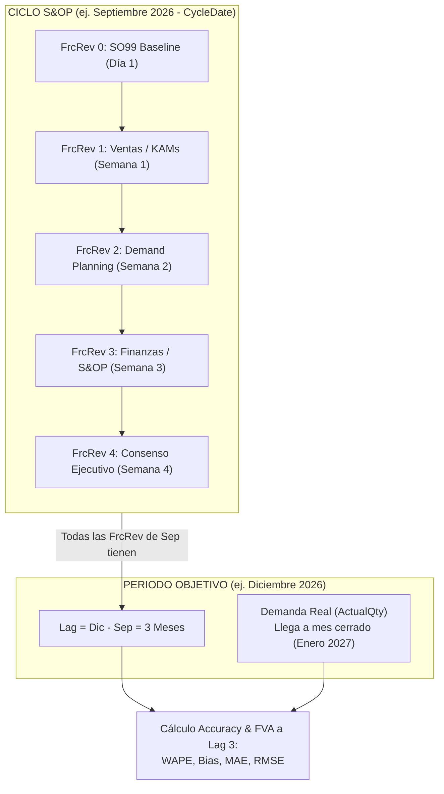
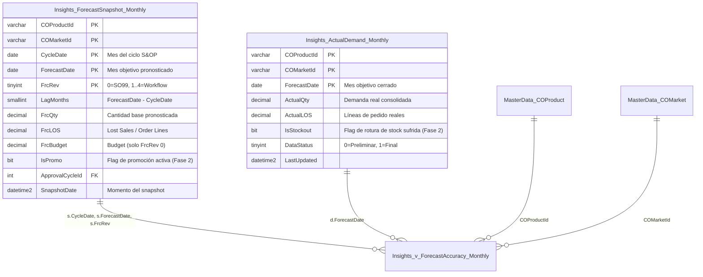
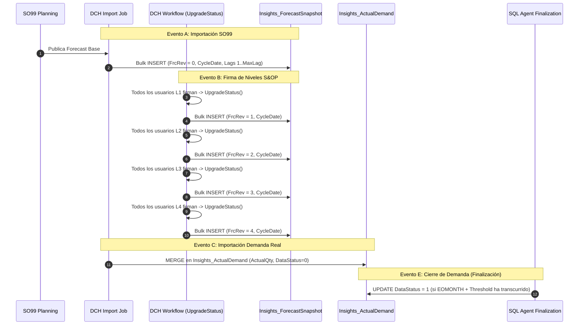
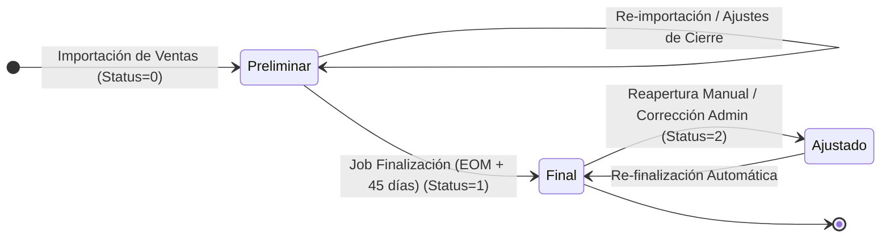

# Modelo de Forecast Accuracy para DCH Insights

> **Estado:** Aprobado / Diseño Técnico Consolidado  
> **Fecha:** 2026-09-08  
> **Autor:** DCH Insights Team  
> **Versión:** 2.0 (Consolidación Arquitectura Enterprise & DCHConverter)

---

## 1. Resumen Ejecutivo

### 1.1. Objetivo

Definir un modelo de datos escalable, de alto rendimiento y alineado con los estándares de la industria para medir el **Forecast Accuracy con N Lags** dentro de DCH Insights. El modelo debe integrarse de forma nativa en el ecosistema DCH (`WebCO_Forecast*`, `WebCO_History*`, Workflow de aprobación multi-nivel, `DCHConverter`) y el sistema de planificación de cadena de suministro SO99.

### 1.2. ¿Qué es Forecast Accuracy con Lags y FVA?

El Forecast Accuracy mide **la cercanía entre el pronóstico y la demanda real** que finalmente se materializó:

> *"Cuando pronosticamos $X$ unidades para el mes $M$, predicción realizada $N$ periodos atrás (Lag $N$), ¿cuánto nos desviamos de las $Y$ unidades que realmente se vendieron?"*

Adicionalmente, al incorporar los distintos niveles del workflow colaborativo de DCH (FrcRev 0 a 4), el modelo permite medir el **Forecast Value Add (FVA)**:
$$\text{FVA} = \text{Error}(\text{FrcRev 0 - Baseline}) - \text{Error}(\text{FrcRev N - Consenso})$$
Permitiendo responder: *¿Las intervenciones humanas de Ventas, Marketing o Dirección mejoran o degradan la precisión del pronóstico automático de SO99?*



### 1.3. Resumen de Decisiones de Arquitectura

| Decisión | Elección | Justificación Técnica |
|---|---|---|
| **Modelo de Almacenamiento** | **2 Tablas + Vista Analítica (Propuesta B Optimizada)** | **Snapshots 100% inmutables (Append-Only)** en Columnstore. Cero fragmentación por `UPDATE`. Demanda real única y centralizada. Consumo transparente para Insights mediante Vista. |
| **Escala de Diseño** | **Enterprise: 250.000 a 1.000.000 combinaciones** | Diseñado para soportar carteras masivas (hasta 1.000 Millones de filas en 3 años). |
| **Niveles de Pronóstico** | **5 Niveles: FrcRev 0 (SO99) + FrcRev 1..4 (Workflow)** | Cobertura completa del ciclo S&OP para medición de Forecast Value Add (FVA). |
| **Identificador Temporal** | **`CycleDate` (DATE) + `ForecastDate` (DATE)** | Representa el mes del ciclo de planificación S&OP. Clave única natural. Elimina el riesgo de doble conteo sin banderas artificiales. |
| **Métricas Almacenadas** | **Unidades Base puras (`DECIMAL(18,4)`)** | No se persisten importes ni conversiones en la tabla de hechos. Los cálculos en Valor (€) o Volumen ($m^3$) se resuelven en la capa analítica mediante join con `MasterData_COProduct`. |
| **Motor de Almacenamiento** | **Clustered Columnstore Index (CCI)** | Compresión masiva (8x a 10x) y procesamiento vectorial en Batch Mode. |
| **Despliegue e Integración** | **Híbrido en `DCHConverter`** | Tablas creadas en el Repositorio estándar (`.mdb`); índice Columnstore y Vista analítica desplegados mediante scripts de Post-Proceso (`Configuration.vb` / `TSQL`). |
| **Cálculo de `LagWeeks`** | **En memoria en DCH (.NET)** | Garantiza alineación con la norma ISO-8601 y el calendario corporativo de DCH, evitando dependencias de `@@DATEFIRST` de SQL Server. |

---

## 2. Contexto de Dominio y Escala

### 2.1. Escala Real de DCH

En instalaciones reales de DCH, la tabla `DCH_ProductMarket` contiene entre **250.000 y 1.000.000 de combinaciones Producto × Mercado**.

Analizando una retención histórica de 3 años, evaluando **Lags 1 a 6** y **5 niveles de pronóstico (FrcRev 0 a 4)**:

| Cartera (Combinaciones) | Filas Snapshot / Ciclo | Filas Snapshot / Año (12 ciclos) | Filas Snapshot en 3 Años | Filas Demanda Real (3 Años) | Espacio en Disco (Columnstore) |
| :--- | :--- | :--- | :--- | :--- | :--- |
| **250.000** | $250\text{k} \times 6 \times 5 =$ **7,5 M / mes** | **90 Millones / año** | **270 Millones de filas** | **9 Millones de filas** | **~2,5 - 3,5 GB** |
| **1.000.000** | $1\text{M} \times 6 \times 5 =$ **30 M / mes** | **360 Millones / año** | **1.080 Millones de filas** | **36 Millones de filas** | **~10 - 13 GB** |

> [!IMPORTANT]
> **Por qué la Tabla Unificada (antigua Propuesta A) fue descartada:**  
> A esta escala, actualizar la demanda real en una tabla unificada requeriría ejecutar un `UPDATE` de **7,5 a 30 Millones de filas cada mes** sobre un índice Columnstore.  
> En SQL Server Columnstore, cada fila actualizada se marca como eliminada en el *Delete Bitmap* y se reinserta en el *Delta Store*. Esto provocaría:
> 1. Fragmentación extrema del índice Columnstore en pocas semanas.
> 2. Explosión del Log de transacciones (`LDF`) en decenas de GB por ciclo.
> 3. Tiempos de respuesta inaceptables en los dashboards de Insights.
> 
> El modelo de **2 Tablas (Snapshots Append-Only + Demanda Única)** garantiza que la tabla de pronósticos **nunca recibe un solo `UPDATE`**, alcanzando máxima compresión física y velocidad de escaneo óptima.

---

## 3. Modelo de Datos Definitivo

El modelo se compone de **dos tablas físicas** y **una vista analítica de abstracción**.



### 3.1. DDL: Tabla de Snapshots de Pronóstico (Mensual)

Tabla inmutable (*Append-Only*), optimizada para inserción directa en lotes y compresión Columnstore.

```sql
-- ============================================================
-- Tabla de Snapshots de Pronóstico (Mensual)
-- Inmutable (Solo INSERTs masivos, Cero UPDATEs)
-- ============================================================
CREATE TABLE Insights_ForecastSnapshot_Monthly (
    -- ── Dimensiones Primarias ──
    COProductId     VARCHAR(32)     NOT NULL,
    COMarketId      VARCHAR(12)     NOT NULL,
    CycleDate       DATE            NOT NULL,   -- Primer día del mes del ciclo S&OP (ej. '2026-09-01')
    ForecastDate    DATE            NOT NULL,   -- Primer día del mes objetivo pronosticado (ej. '2026-12-01')
    FrcRev          TINYINT         NOT NULL,   -- 0 = SO99 Baseline; 1..4 = Niveles de Workflow

    -- ── Lag Materializado ──
    LagMonths       SMALLINT        NOT NULL,   -- DATEDIFF(MONTH, CycleDate, ForecastDate)

    -- ── Métricas de Pronóstico (Unidades Base) ──
    FrcQty          DECIMAL(18,4)   NOT NULL,
    FrcLOS          DECIMAL(18,4)   NULL,
    FrcBudget       DECIMAL(18,4)   NULL,       -- Únicamente poblado para FrcRev = 0

    -- ── Context Flags (Fase 2) ──
    IsPromo         BIT             NULL,       -- TRUE si hubo promoción activa en el mes objetivo

    -- ── Auditoría y Trazabilidad ──
    ApprovalCycleId INT             NULL,       -- FK → Wkf_ApprovalCycle
    SnapshotDate    DATETIME2       NOT NULL DEFAULT GETUTCDATE(),

    -- ── Clave Primaria (NONCLUSTERED obligatoria para CCI) ──
    CONSTRAINT PK_Insights_FrcSnap_Monthly PRIMARY KEY NONCLUSTERED (
        COProductId, COMarketId, CycleDate, ForecastDate, FrcRev
    )
);

-- Índice Columnstore Clustered para compresión vectorial (8x - 10x)
CREATE CLUSTERED COLUMNSTORE INDEX CCI_Insights_FrcSnap_Monthly 
    ON Insights_ForecastSnapshot_Monthly;
```

### 3.2. DDL: Tabla de Demanda Real (Mensual)

Tabla de tamaño reducido (un único registro por combinación y mes), gestionada mediante `MERGE`/`UPDATE`.

```sql
-- ============================================================
-- Tabla de Demanda Real (Mensual)
-- Única fuente de la verdad para la demanda. Independiente del Forecast.
-- ============================================================
CREATE TABLE Insights_ActualDemand_Monthly (
    COProductId     VARCHAR(32)     NOT NULL,
    COMarketId      VARCHAR(12)     NOT NULL,
    ForecastDate    DATE            NOT NULL,   -- Mes al que corresponde la demanda (ej. '2026-08-01')

    -- ── Métricas de Demanda Real ──
    ActualQty       DECIMAL(18,4)   NOT NULL,
    ActualLOS       DECIMAL(18,4)   NULL,

    -- ── Context Flags (Fase 2) ──
    IsStockout      BIT             NULL,       -- TRUE si hubo rotura de stock registrada en SO99

    -- ── Calidad del Dato ──
    DataStatus      TINYINT         NOT NULL DEFAULT 0, -- 0 = Preliminar, 1 = Final (Cerrado), 2 = Ajustado
    LastUpdated     DATETIME2       NOT NULL DEFAULT GETUTCDATE(),

    CONSTRAINT PK_Insights_ActDem_Monthly PRIMARY KEY CLUSTERED (
        COProductId, COMarketId, ForecastDate
    )
);
```

### 3.3. DDL: Vista Analítica de Consumo (`Insights_v_ForecastAccuracy_Monthly`)

Esta vista desacopla el almacenamiento de la consulta analítica. **Insights y los reportes consultan esta vista como si fuera una única tabla unificada**, mientras que SQL Server ejecuta internamente un *Batch Mode Hash Join* en memoria caché.

```sql
-- ============================================================
-- Vista Analítica para DCH Insights (Mensual)
-- ============================================================
CREATE OR ALTER VIEW Insights_v_ForecastAccuracy_Monthly AS
SELECT 
    s.COProductId,
    s.COMarketId,
    s.CycleDate,
    s.ForecastDate,
    s.FrcRev,
    s.LagMonths,
    
    -- Métricas de Pronóstico
    s.FrcQty,
    s.FrcLOS,
    s.FrcBudget,
    
    -- Métricas de Demanda Real (NULL si el mes no ha ocurrido aún)
    d.ActualQty,
    d.ActualLOS,
    
    -- Cálculos de Error en Memoria (Vectorizados)
    (s.FrcQty - d.ActualQty) AS Error,
    ABS(s.FrcQty - d.ActualQty) AS AbsoluteError,
    
    -- Context Flags
    s.IsPromo,
    d.IsStockout,
    
    -- Estado y Auditoría
    ISNULL(d.DataStatus, 0) AS DataStatus,
    s.ApprovalCycleId,
    s.SnapshotDate,
    d.LastUpdated AS DemandUpdatedDate
FROM Insights_ForecastSnapshot_Monthly s
LEFT JOIN Insights_ActualDemand_Monthly d
    ON s.COProductId = d.COProductId 
   AND s.COMarketId = d.COMarketId 
   AND s.ForecastDate = d.ForecastDate;
```

---

### 3.4. DDL: Modelos Semanales (Granularidad Semanal)

```sql
-- ============================================================
-- Tabla de Snapshots de Pronóstico (Semanal)
-- ============================================================
CREATE TABLE Insights_ForecastSnapshot_Weekly (
    COProductId     VARCHAR(32)     NOT NULL,
    COMarketId      VARCHAR(12)     NOT NULL,
    CycleDate       DATE            NOT NULL,   -- Lunes de la semana del ciclo
    ForecastDate    DATE            NOT NULL,   -- Lunes de la semana objetivo pronosticada
    FrcRev          TINYINT         NOT NULL,
    LagWeeks        SMALLINT        NOT NULL,   -- Calculado en DCH (.NET) vía ISO-8601
    FrcQty          DECIMAL(18,4)   NOT NULL,
    FrcLOS          DECIMAL(18,4)   NULL,
    FrcBudget       DECIMAL(18,4)   NULL,
    IsPromo         BIT             NULL,
    ApprovalCycleId INT             NULL,
    SnapshotDate    DATETIME2       NOT NULL DEFAULT GETUTCDATE(),

    CONSTRAINT PK_Insights_FrcSnap_Weekly PRIMARY KEY NONCLUSTERED (
        COProductId, COMarketId, CycleDate, ForecastDate, FrcRev
    )
);

CREATE CLUSTERED COLUMNSTORE INDEX CCI_Insights_FrcSnap_Weekly 
    ON Insights_ForecastSnapshot_Weekly;

-- ============================================================
-- Tabla de Demanda Real (Semanal)
-- ============================================================
CREATE TABLE Insights_ActualDemand_Weekly (
    COProductId     VARCHAR(32)     NOT NULL,
    COMarketId      VARCHAR(12)     NOT NULL,
    ForecastDate    DATE            NOT NULL,
    ActualQty       DECIMAL(18,4)   NOT NULL,
    ActualLOS       DECIMAL(18,4)   NULL,
    IsStockout      BIT             NULL,
    DataStatus      TINYINT         NOT NULL DEFAULT 0,
    LastUpdated     DATETIME2       NOT NULL DEFAULT GETUTCDATE(),

    CONSTRAINT PK_Insights_ActDem_Weekly PRIMARY KEY CLUSTERED (
        COProductId, COMarketId, ForecastDate
    )
);

-- ============================================================
-- Vista Analítica para DCH Insights (Semanal)
-- ============================================================
CREATE OR ALTER VIEW Insights_v_ForecastAccuracy_Weekly AS
SELECT 
    s.COProductId,
    s.COMarketId,
    s.CycleDate,
    s.ForecastDate,
    s.FrcRev,
    s.LagWeeks,
    s.FrcQty,
    s.FrcLOS,
    s.FrcBudget,
    d.ActualQty,
    d.ActualLOS,
    (s.FrcQty - d.ActualQty) AS Error,
    ABS(s.FrcQty - d.ActualQty) AS AbsoluteError,
    s.IsPromo,
    d.IsStockout,
    ISNULL(d.DataStatus, 0) AS DataStatus,
    s.ApprovalCycleId,
    s.SnapshotDate,
    d.LastUpdated AS DemandUpdatedDate
FROM Insights_ForecastSnapshot_Weekly s
LEFT JOIN Insights_ActualDemand_Weekly d
    ON s.COProductId = d.COProductId 
   AND s.COMarketId = d.COMarketId 
   AND s.ForecastDate = d.ForecastDate;
```

---

## 4. Detalle de Columnas y Reglas de Negocio

### 4.1. Definición de la Clave y el Ciclo (`CycleDate`)

En la versión inicial se utilizaba `CalcDate` (marca de tiempo exacta de ejecución). En la práctica industrial de Supply Chain, esto genera duplicados si un proceso se re-ejecuta.

* **`CycleDate` (DATE):** Representa el periodo de planificación S&OP (ejemplo: `2026-09-01`).
* **Unicidad:** La clave `(COProductId, COMarketId, CycleDate, ForecastDate, FrcRev)` garantiza que para un ciclo dado existe **un único pronóstico oficial por nivel de revisión**.
* **Re-importaciones:** Si SO99 se re-importa o un nivel de workflow se recalcula dentro del mismo mes antes del cierre, la operación hace un `UPSERT` sobre el registro del ciclo, impidiendo registros dobles.

### 4.2. Cálculo de Lags y Acotamiento de Horizonte (*Lag Capping*)

```
LagMonths = DATEDIFF(MONTH, CycleDate, ForecastDate)
```
* **Horizonte Acotado:** Aunque SO99 genere proyecciones a 24 o 36 meses vista, Insights acota los snapshots a los Lags relevantes para análisis de precisión (configurable mediante `@MaxLagThreshold`, por defecto **Lags 1 a 6** o **1 a 12**).
* **Ahorro de Almacenamiento:** Descartar Lags $> 12$ reduce el volumen de datos en más de un 50%.
* **`LagWeeks` en memoria:** DCH calcula `LagWeeks` en el código .NET utilizando `DateUtil.PeriodsBetweenDates(..., SeriesPeriodType.Weekly)` para cumplir estrictamente la norma ISO-8601 antes de insertar el dato en SQL.

### 4.3. Unidades de Medida (UoM) y Moneda

* Las tablas físicas almacenan exclusivamente **cantidades en Unidades Base (`DECIMAL(18,4)`)**.
* Si Insights requiere mostrar métricas ponderadas en **Valor Económico (€)** o **Volumen ($m^3$)**, la consulta de agregación multiplica por el precio o ratio correspondiente de `MasterData_COProduct`:
  $$\text{AbsoluteErrorVal} = \text{ABS}(s.\text{FrcQty} - d.\text{ActualQty}) \times p.\text{SALESPRICE}$$

---

## 5. Proceso de Consolidación y Disparadores en DCH



### 5.1. Evento A: Importación de Pronóstico SO99 $\rightarrow$ FrcRev = 0

* **Disparador:** Fin del proceso de importación de `WebCO_ForecastMonthly` en [`ForecastImportDal.vb`](file:///d:/DevelopmentLocal/Daniel/DCH/Branches/DCH440_Git.worktrees/DCH440_Forecast_Lags/SrcWeb/DAL/Import/ForecastImportDal.vb).
* **Acción:** `INSERT` en bloque directamente en `Insights_ForecastSnapshot_Monthly` para `FrcRev = 0`:

```sql
-- Inserción directa en Columnstore (Lotes >= 102.400 filas para Direct Path)
INSERT INTO Insights_ForecastSnapshot_Monthly (
    COProductId, COMarketId, CycleDate, ForecastDate, FrcRev,
    LagMonths, FrcQty, FrcLOS, FrcBudget, ApprovalCycleId, SnapshotDate
)
SELECT 
    f.COProductId,
    f.COMarketId,
    @CurrentCycleDate AS CycleDate,
    DATEFROMPARTS(f.Year, f.Month, 1) AS ForecastDate,
    0 AS FrcRev,
    DATEDIFF(MONTH, @CurrentCycleDate, DATEFROMPARTS(f.Year, f.Month, 1)) AS LagMonths,
    f.FrcQty,
    f.FrcLOS,
    f.Budget AS FrcBudget,
    @CurrentApprovalCycleId AS ApprovalCycleId,
    GETUTCDATE() AS SnapshotDate
FROM WebCO_ForecastMonthly f
WHERE DATEDIFF(MONTH, @CurrentCycleDate, DATEFROMPARTS(f.Year, f.Month, 1)) BETWEEN 1 AND @MaxLagThreshold
  AND NOT EXISTS (
      SELECT 1 FROM Insights_ForecastSnapshot_Monthly s
      WHERE s.COProductId = f.COProductId
        AND s.COMarketId = f.COMarketId
        AND s.CycleDate = @CurrentCycleDate
        AND s.ForecastDate = DATEFROMPARTS(f.Year, f.Month, 1)
        AND s.FrcRev = 0
  );
```

### 5.2. Evento B: Captura de Niveles de Workflow $\rightarrow$ FrcRev = 1..4

* **Disparador:** En [`ApprovalWorkflowBCC140.vb`](file:///d:/DevelopmentLocal/Daniel/DCH/Branches/DCH440_Git.worktrees/DCH440_Forecast_Lags/SrcWeb/BLL/ApprovalWorkflowBCC140.vb#L450) dentro del método `UpgradeStatus()`.
* **Condición:** Cuando el bucle de `UpgradeStatus()` detecta que el 100% de los usuarios del nivel $N$ están en estado `SignOff` y se inicializa/habilita el nivel $N+1$.
* **Acción con Soporte de Reaperturas (UPSERT Robusto):**
  Para soportar escenarios donde un supervisor reabre un nivel (`RestoreEditingUserByParent`), se modifican las cifras y el nivel se vuelve a firmar, la operación debe sobrescribir de forma determinista el snapshot anterior para ese nivel y ciclo.
  Se ejecuta mediante una transacción `DELETE + INSERT` por lote (óptimo para Columnstore, evitando bloqueos de página):

```sql
-- 1. Eliminar snapshot previo del nivel si existiera por reapertura (Garantía de idempotencia)
DELETE FROM Insights_ForecastSnapshot_Monthly
WHERE CycleDate = @CurrentCycleDate
  AND FrcRev = @FrcRevLevel
  AND DATEDIFF(MONTH, @CurrentCycleDate, ForecastDate) BETWEEN 1 AND @MaxLagThreshold;

-- 2. Inserción directa en lote
INSERT INTO Insights_ForecastSnapshot_Monthly (
    COProductId, COMarketId, CycleDate, ForecastDate, FrcRev,
    LagMonths, FrcQty, FrcLOS, FrcBudget, IsPromo, ApprovalCycleId, SnapshotDate
)
SELECT 
    f.COProductId,
    f.COMarketId,
    @CurrentCycleDate AS CycleDate,
    DATEFROMPARTS(f.Year, f.Month, 1) AS ForecastDate,
    @FrcRevLevel AS FrcRev,
    DATEDIFF(MONTH, @CurrentCycleDate, DATEFROMPARTS(f.Year, f.Month, 1)) AS LagMonths,
    CASE @FrcRevLevel
        WHEN 1 THEN f.COQty1
        WHEN 2 THEN f.COQty2
        WHEN 3 THEN f.COQty3
        WHEN 4 THEN f.COQty4
    END AS FrcQty,
    NULL AS FrcLOS,
    NULL AS FrcBudget,
    NULL AS IsPromo,
    @CurrentApprovalCycleId AS ApprovalCycleId,
    GETUTCDATE() AS SnapshotDate
FROM WebCO_ForecastMonthly f
WHERE DATEDIFF(MONTH, @CurrentCycleDate, DATEFROMPARTS(f.Year, f.Month, 1)) BETWEEN 1 AND @MaxLagThreshold;
```

> [!NOTE]
> Este patrón `DELETE + INSERT` dentro de una transacción garantiza que la tabla mantenga estrictamente una única versión oficial del nivel por ciclo, absorbiendo cualquier corrección operativa sin violar la Primary Key.

### 5.3. Evento C: Importación de Demanda Real $\rightarrow$ `Insights_ActualDemand`

* **Disparador:** Fin del proceso de importación de ventas/histórico en `WebCO_HistoryMonthly`.
* **Acción:** `MERGE` únicamente contra la tabla pequeña `Insights_ActualDemand_Monthly`. Cero impacto en la tabla de snapshots.

```sql
MERGE Insights_ActualDemand_Monthly AS target
USING (
    SELECT 
        COProductId, 
        COMarketId, 
        DATEFROMPARTS(Year, Month, 1) AS ForecastDate,
        Quantity AS ActualQty,
        OrdLines AS ActualLOS
    FROM WebCO_HistoryMonthly
) AS source
ON (target.COProductId = source.COProductId 
    AND target.COMarketId = source.COMarketId 
    AND target.ForecastDate = source.ForecastDate)
WHEN MATCHED AND target.DataStatus = 0 THEN
    UPDATE SET 
        target.ActualQty = source.ActualQty,
        target.ActualLOS = source.ActualLOS,
        target.LastUpdated = GETUTCDATE()
WHEN NOT MATCHED THEN
    INSERT (COProductId, COMarketId, ForecastDate, ActualQty, ActualLOS, DataStatus, LastUpdated)
    VALUES (source.COProductId, source.COMarketId, source.ForecastDate, source.ActualQty, source.ActualLOS, 0, GETUTCDATE());
```

### 5.4. Evento E: Job de Finalización de Demanda (*DataStatus*)

* **Disparador:** Tarea programada en SQL Agent (ejecución diaria o semanal).
* **Ciclo de Estados (`DataStatus`):**



* **Acción:** Congelar periodos cuya fecha de cierre de mes supere el umbral configurado (por defecto 45 días):

```sql
UPDATE Insights_ActualDemand_Monthly
SET DataStatus = 1,
    LastUpdated = GETUTCDATE()
WHERE DataStatus = 0
  AND EOMONTH(ForecastDate) < DATEADD(DAY, -@DataFinalThreshold, GETDATE());
```

---

## 6. Despliegue en `DCHConverter`

Dado que el generador basado en Access MDB ([`DataRepositoryDCH440.mdb`](file:///d:/DevelopmentLocal/Daniel/DCH/Branches/DCH440_Git.worktrees/DCH440_Forecast_Lags/DCHDBRepository/DataRepositoryDCH440.mdb)) solo genera índices B-Tree estándar con `PAD_INDEX=ON, FILLFACTOR=80`, el despliegue se divide en dos fases:

### 6.1. Definición Base en MDB (`DCHDBRepository`)
1. **`Insights_ActualDemand_Monthly` / `_Weekly`**: Se define en el MDB con su PK Clustered estándar (`COProductId, COMarketId, ForecastDate`).
2. **`Insights_ForecastSnapshot_Monthly` / `_Weekly`**: Se define en el MDB con sus columnas y su Primary Key declarada como `NONCLUSTERED`.

### 6.2. Pipeline de Post-Proceso en `DCHConverter`
En [`Configuration.vb`](file:///d:/DevelopmentLocal/Daniel/DCH/Branches/DCH440_Git.worktrees/DCH440_Forecast_Lags/DCHConverter/SrcDCHcnv/Configuration.vb) dentro de `ConvDataPostProcess` / `RunConfigurationUpgrade`, se ejecuta el script T-SQL de post-proceso para ambas granularidades:

```sql
-- 1. Creación de índices Columnstore (Mensual y Semanal) si no existen
IF NOT EXISTS (
    SELECT 1 FROM sys.indexes 
    WHERE object_id = OBJECT_ID('Insights_ForecastSnapshot_Monthly') 
      AND type IN (5, 6)
)
BEGIN
    CREATE CLUSTERED COLUMNSTORE INDEX CCI_Insights_FrcSnap_Monthly 
        ON Insights_ForecastSnapshot_Monthly;
END

IF NOT EXISTS (
    SELECT 1 FROM sys.indexes 
    WHERE object_id = OBJECT_ID('Insights_ForecastSnapshot_Weekly') 
      AND type IN (5, 6)
)
BEGIN
    CREATE CLUSTERED COLUMNSTORE INDEX CCI_Insights_FrcSnap_Weekly 
        ON Insights_ForecastSnapshot_Weekly;
END

-- 2. Creación / Actualización de las Vistas Analíticas (Mensual y Semanal)
CREATE OR ALTER VIEW Insights_v_ForecastAccuracy_Monthly AS
SELECT 
    s.COProductId, s.COMarketId, s.CycleDate, s.ForecastDate, s.FrcRev, s.LagMonths,
    s.FrcQty, s.FrcLOS, s.FrcBudget,
    d.ActualQty, d.ActualLOS,
    (s.FrcQty - d.ActualQty) AS Error,
    ABS(s.FrcQty - d.ActualQty) AS AbsoluteError,
    s.IsPromo,
    d.IsStockout,
    ISNULL(d.DataStatus, 0) AS DataStatus,
    s.ApprovalCycleId, s.SnapshotDate, d.LastUpdated AS DemandUpdatedDate
FROM Insights_ForecastSnapshot_Monthly s
LEFT JOIN Insights_ActualDemand_Monthly d
    ON s.COProductId = d.COProductId 
   AND s.COMarketId = d.COMarketId 
   AND s.ForecastDate = d.ForecastDate;
GO

CREATE OR ALTER VIEW Insights_v_ForecastAccuracy_Weekly AS
SELECT 
    s.COProductId, s.COMarketId, s.CycleDate, s.ForecastDate, s.FrcRev, s.LagWeeks,
    s.FrcQty, s.FrcLOS, s.FrcBudget,
    d.ActualQty, d.ActualLOS,
    (s.FrcQty - d.ActualQty) AS Error,
    ABS(s.FrcQty - d.ActualQty) AS AbsoluteError,
    s.IsPromo,
    d.IsStockout,
    ISNULL(d.DataStatus, 0) AS DataStatus,
    s.ApprovalCycleId, s.SnapshotDate, d.LastUpdated AS DemandUpdatedDate
FROM Insights_ForecastSnapshot_Weekly s
LEFT JOIN Insights_ActualDemand_Weekly d
    ON s.COProductId = d.COProductId 
   AND s.COMarketId = d.COMarketId 
   AND s.ForecastDate = d.ForecastDate;
GO
```
```

---

## 7. Métricas y Consultas Analíticas para Insights

Todas las consultas atacan directamente a la vista `Insights_v_ForecastAccuracy_Monthly`.

### 7.1. WAPE y Bias por Familia de Producto y Lag

```sql
SELECT
    p.FREEATTR1 AS ProductFamily,
    fa.LagMonths,
    -- WAPE (%) = SUM(|Error|) / SUM(Actual) * 100
    SUM(fa.AbsoluteError) / NULLIF(SUM(fa.ActualQty), 0) * 100 AS WAPE,
    -- Bias (%) = SUM(Error) / SUM(Actual) * 100
    SUM(fa.Error) / NULLIF(SUM(fa.ActualQty), 0) * 100 AS Bias,
    COUNT(*) AS NumObservaciones
FROM Insights_v_ForecastAccuracy_Monthly fa
JOIN MasterData_COProduct p ON fa.COProductId = p.COProductId
WHERE fa.FrcRev = 4                       -- Nivel de Consenso
  AND fa.LagMonths BETWEEN 1 AND 6
  AND fa.DataStatus = 1                   -- Datos consolidados
  AND fa.ForecastDate >= '2026-01-01'
GROUP BY p.FREEATTR1, fa.LagMonths
ORDER BY p.FREEATTR1, fa.LagMonths;
```

### 7.2. Análisis de Forecast Value Add (FVA) a través de los 5 Niveles

Permite verificar el valor agregado por cada escalón del workflow de DCH respecto al baseline de SO99 para un Lag determinado:

```sql
SELECT 
    fa.FrcRev,
    CASE fa.FrcRev
        WHEN 0 THEN 'SO99 Baseline'
        WHEN 1 THEN 'Ventas (KAM)'
        WHEN 2 THEN 'Demand Planning'
        WHEN 3 THEN 'Finanzas / S&OP'
        WHEN 4 THEN 'Consenso Dirección'
    END AS NivelNombre,
    SUM(fa.AbsoluteError) / NULLIF(SUM(fa.ActualQty), 0) * 100 AS WAPE,
    SUM(fa.Error) / NULLIF(SUM(fa.ActualQty), 0) * 100 AS Bias,
    -- FVA respecto a SO99 Baseline (FrcRev 0)
    (FIRST_VALUE(SUM(fa.AbsoluteError) / NULLIF(SUM(fa.ActualQty), 0) * 100) 
        OVER (ORDER BY fa.FrcRev)) - 
    (SUM(fa.AbsoluteError) / NULLIF(SUM(fa.ActualQty), 0) * 100) AS FVA_Improvement_vs_SO99
FROM Insights_v_ForecastAccuracy_Monthly fa
WHERE fa.LagMonths = 1
  AND fa.DataStatus = 1
  AND fa.ForecastDate >= '2026-01-01'
GROUP BY fa.FrcRev
ORDER BY fa.FrcRev;
```

### 7.3. WAPE Ponderado por Valor Económico (€)

```sql
SELECT
    p.FREEATTR1 AS ProductFamily,
    fa.LagMonths,
    -- WAPE en Valor = SUM(|Error| * Precio) / SUM(Actual * Precio) * 100
    SUM(fa.AbsoluteError * ISNULL(p.SALESPRICE, 1)) / 
        NULLIF(SUM(fa.ActualQty * ISNULL(p.SALESPRICE, 1)), 0) * 100 AS WAPE_Value
FROM Insights_v_ForecastAccuracy_Monthly fa
JOIN MasterData_COProduct p ON fa.COProductId = p.COProductId
WHERE fa.FrcRev = 4
  AND fa.LagMonths = 1
  AND fa.DataStatus = 1
GROUP BY p.FREEATTR1, fa.LagMonths;
```

---

## 8. Plan de Implementación por Fases

| Fase | Tareas Principales | Componentes Afectados |
|---|---|---|
| **Fase 1: Repositorio & DCHConverter** | 1. Añadir tablas en `DataRepositoryDCH440.mdb` y generar repositorio.<br/>2. Añadir post-proceso T-SQL en `Configuration.vb` para crear CCI y Vistas analíticas.<br/>3. Validar creación en base de datos limpia y actualización en BD existente. | `DCHDBRepository`, `DCHConverter` |
| **Fase 2: ETL Evento A (SO99 Baseline)** | 1. Implementar captura de `FrcRev = 0` al finalizar la importación de pronóstico mensual y semanal.<br/>2. Parametrizar `@MaxLagThreshold` (por defecto Lags 1..6). | `ForecastImportDal.vb` |
| **Fase 3: ETL Evento B (Workflow 1..4)** | 1. Enganchar captura progresiva de niveles en `UpgradeStatus()` al completar 100% de firmas del nivel.<br/>2. Gestión de reaperturas (`RestoreEditingUserByParent`). | `ApprovalWorkflowBCC140.vb` |
| **Fase 4: ETL Evento C & E (Demanda & Cierre)** | 1. Implementar `MERGE` en `Insights_ActualDemand` al importar historial.<br/>2. Procedimiento programado de cierre de `DataStatus` a los 45 días. | `HistoryDAL.vb`, SQL Agent |
| **Fase 5: Servicio de Consumo para Insights** | 1. Crear endpoint API o servicio de consulta para alimentar los componentes visuales de Insights atacando a `Insights_v_ForecastAccuracy_*`. | `Controllers/API`, `DCH.Application` |
