# Forecast Accuracy & Forecast Value Add (FVA) Model for DCH Insights
## Product Specification & Functional Architecture

> **Target Audience:** Product Management, Functional Leads, Product Designers, Engineering Leads  
> **Status:** Approved Architecture & Functional Specification  
> **Date:** September 2026  
> **Version:** 2.0 (Enterprise Scalable & FVA Enabled)  
> **Author:** DCH Product & Architecture Team  

---

## 1. Executive Summary & Purpose

This document provides a comprehensive, didactic explanation of the **Forecast Accuracy with N Lags** and **Forecast Value Add (FVA)** capabilities being introduced into **DCH Insights**. 

The purpose of this specification is to:
1. Explain the **functional mechanics** of Multi-Lag Forecast Accuracy and Forecast Value Add (FVA) in an intuitive, visual, and didactic way.
2. Detail how DCH captures historical projections across the collaborative S&OP workflow cycles without degrading database performance.
3. Define the **key analytical views and user experience (UX) dashboards** that DCH Insights will deliver to business planners and executives.
4. Establish the **enterprise-grade data architecture (2-Table Immutable Pattern)** in an accessible manner, including a technical appendix for engineering teams.

---

## 2. DCH Context & SO99 Integration

To understand how Forecast Accuracy and FVA fit into the platform, we must first look at DCH's role alongside ToolsGroup SO99 (Supply Chain Planning system).

### 2.1. DCH Overview
DCH (Demand Collaboration Hub) is the collaborative S&OP module for SO99. Its core mission is to:
1. **Import the Statistical Forecast Baseline** generated by SO99's automated engine into DCH working tables (`WebCO_ForecastMonthly` or `WebCO_ForecastWeekly`).
2. **Empower Multi-Level Collaboration**: Enable cross-functional teams (Sales, Marketing, Demand Planning, Finance) to enrich and adjust projections through configurable Forecast Revisions (FrcRev levels).
3. **Orchestrate Approval Workflows**: Manage review and sign-off stages from Field Sales up to Executive Consensus.
4. **Export Approved Consensus**: Send the finalized commercial override (CO) back to SO99 to drive inventory optimization, supply planning, and MRP.
5. **Ingest Actual Demand**: Periodically import closed sales orders and shipments into `WebCO_HistoryMonthly` or `WebCO_HistoryWeekly`.

### 2.2. SO99 & DCH Integration Points

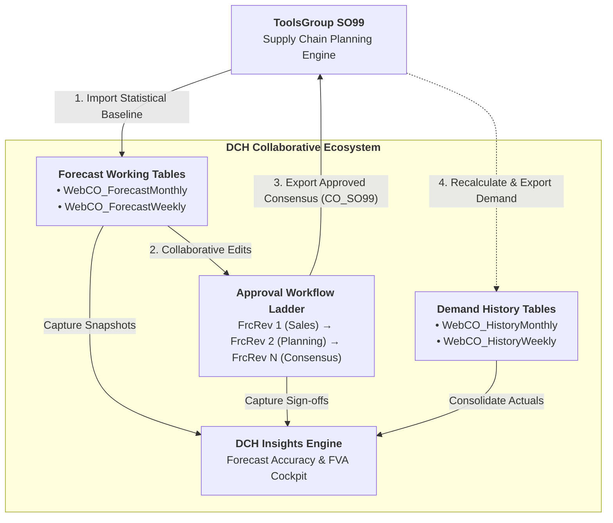

### 2.3. Core Working Tables
Instead of burdening users with internal schema complexities, Insights connects directly to DCH's established operational data foundation:
* **`WebCO_ForecastMonthly` / `WebCO_ForecastWeekly`**: The live operational forecast tables. They contain the baseline from SO99 (`FrcQty`, `FrcLOS`, `Budget`), outstanding orders, and the working columns for each collaborative revision (`COQty1` to `COQty8`).
* **`WebCO_HistoryMonthly` / `WebCO_HistoryWeekly`**: The definitive demand history tables populated from ERP/SO99, capturing real volume (`Quantity`) and order lines (`OrdLines`).

Insights extracts historical snapshots from these tables during import and workflow events, ensuring zero disruption to daily planning operations.

---

## 3. Core Concepts: Forecast Accuracy, Multi-Lag & Forecast Value Add (FVA)

Measuring demand planning performance requires moving beyond a simple "Forecast vs. Actual" comparison. In enterprise supply chains, **when** a forecast is made and **who** modified it are just as important as the final accuracy number.

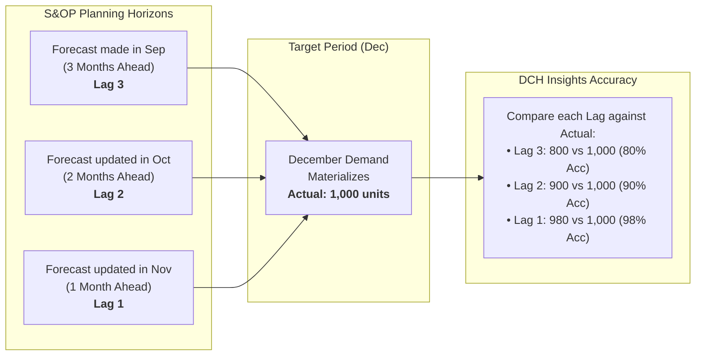

### 3.1. What is Forecast Accuracy?

Forecast Accuracy measures **how close the forecast was to the actual demand** that materialized. It answers the question:

> *"When we predicted X units for month M, made N months ago, how close were we to the Y units that actually sold?"*

Key concepts:

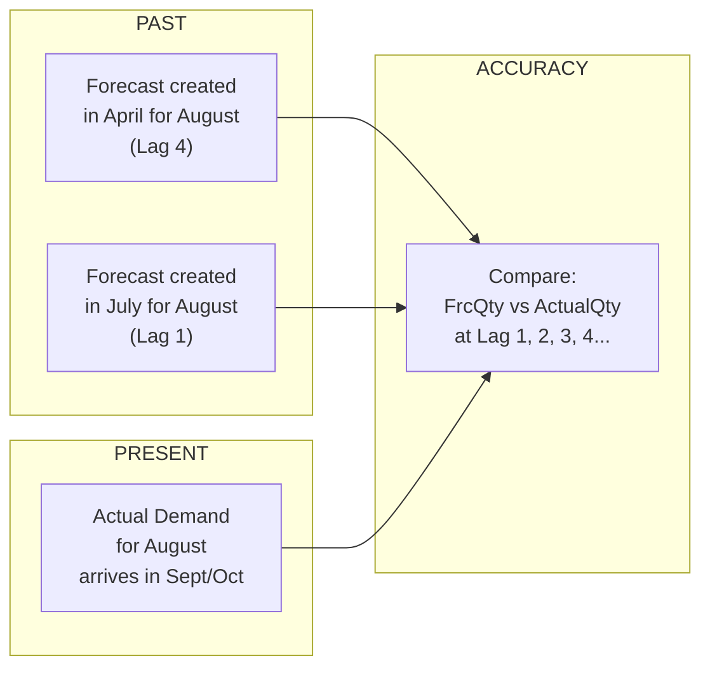

**Lag** is the number of periods between when the forecast was **created** and the **target period** being forecasted:

```
Lag = TargetPeriod − ForecastCreationPeriod

Example: Forecast for December 2026, created in September 2026
         → Lag = 3 months
```

### 3.2. What is a Planning Lag?
In supply chain planning, **Lag** represents the lead time (in periods) between the moment a forecast was generated/approved and the target period for which the demand was predicted:

$$\text{Lag} = \text{Target Period} - \text{Planning Cycle Period}$$

* **Lag 1 (Operational Horizon):** Forecast created 1 month/week before the execution month. Critical for warehouse allocation, production scheduling, and short-term transportation.
* **Lag 3 (Tactical Horizon):** Forecast created 3 months/weeks before. Critical for procurement, supplier contracts, raw materials ordering, and workforce shift planning.
* **Lag 6+ (Strategic Horizon):** Mid-to-long term horizon used for S&OP executive decisions, budget alignment, and capacity investments.

**The Golden Rule of Forecasting:** Accuracy should naturally improve as the Lag decreases (e.g., Accuracy at Lag 1 should be significantly higher than at Lag 6). If it does not, the planning process is failing to absorb newer market signals.

---

### 3.3. What is Forecast Value Add (FVA)?
Enterprise supply chains spend thousands of person-hours in consensus meetings where Sales, Marketing, Demand Planning, and Finance modify the baseline statistical forecast. 

**Forecast Value Add (FVA)** answers the most critical ROI question in demand planning:
> *"Did human manual overrides actually improve forecast accuracy, or did they introduce human bias and degrade the statistical baseline?"*

$$\text{FVA}(\text{Step } N) = \text{Error}(\text{Step } N-1) - \text{Error}(\text{Step } N)$$

$$\text{Cumulative FVA vs. Baseline} = \text{Error}(\text{FrcRev 0 - Machine Baseline}) - \text{Error}(\text{FrcRev } N - \text{Consensus})$$

* A **Positive FVA (+)** indicates human intervention successfully increased accuracy (e.g., market intelligence about promotions, client wins, or competitor stockouts).
* A **Negative FVA (-)** indicates human intervention degraded the forecast (e.g., sales sandbagging targets, subjective optimism, or unnecessary noise).

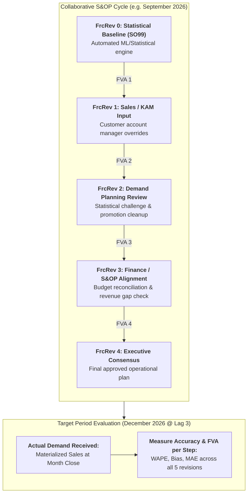

> **Flexibility Note on Forecast Revisions (FrcRev):**  
> While this document illustrates the industry-standard 5-step S&OP ladder (FrcRev 0 to 4), DCH natively supports **customizable workflow depth (from 2 up to 10 FrcRev levels)**. Customers configure their exact review steps (e.g., Level 1 = Field Sales, Level 2 = Country Lead, Level 3 = VP) via `CONFIG_ForecastRevision`. Insights automatically benchmarks whichever active levels exist.

---

## 4. Didactic Walkthrough: A Real S&OP Cycle from Creation to Evaluation

To make this completely tangible for stakeholders, let us follow a product (`SKU-PRO-MAX`) in a specific market (`ES-Retail`) evaluated for the **Target Month: August 2026**.

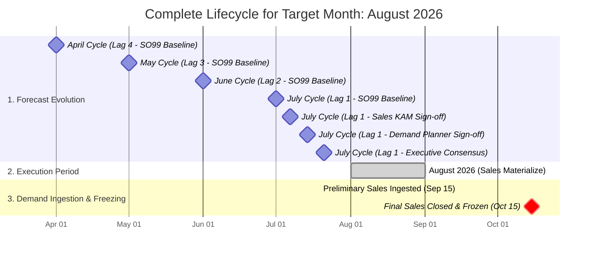

### Step 1: The Long-Range Horizon (Lags 4, 3, and 2)
* **April 2026 (Lag 4):** SO99 imports its statistical projection for August 2026 $\rightarrow$ **800 units**.
* **May 2026 (Lag 3):** New market data arrives; SO99 recalculates August 2026 $\rightarrow$ **820 units**.
* **June 2026 (Lag 2):** Summer trends firm up; SO99 recalculates August 2026 $\rightarrow$ **850 units**.

### Step 2: The Operational Cycle (July 2026 $\rightarrow$ Lag 1 Collaborative Workflow)
During the July S&OP planning cycle, all workflow levels review and sign off the forecast for the imminent month of August:
* **July 01 (FrcRev 0 - SO99 Baseline):** The system generates **830 units**.
* **July 07 (FrcRev 1 - Sales KAM Sign-off):** Sales adds commercial optimism and promises **870 units**.
* **July 14 (FrcRev 2 - Demand Planner Sign-off):** Demand Planning tempers sales enthusiasm based on historical trends, adjusting down to **860 units**.
* **July 21 (FrcRev 4 - Executive Consensus):** S&OP committee ratifies **860 units** as the official consensus export back to SO99 and production.

### Step 3: Sales Execution (August 2026)
August passes. Real customer shipments and orders occur. Actual Demand will not be finalized until month-end accounting and ERP batch reconciliations are closed.

### Step 4: Actual Demand Arrival and Freezing Lifecycle (`DataStatus`)

Actual sales numbers are not static; they evolve through an operational reconciliation lifecycle before becoming frozen for official accuracy reporting:

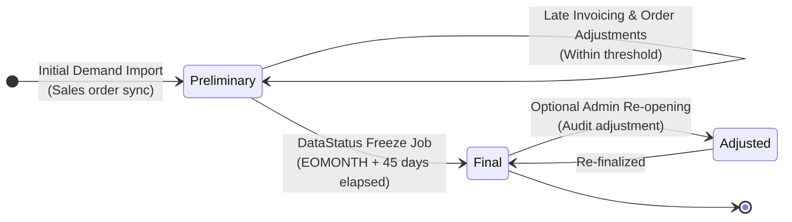

* **September 15 (Preliminary Demand - `DataStatus = 0`):** ERP pushes August orders to DCH $\rightarrow$ **850 units** recorded. This initial figure is preliminary because late invoices, warehouse shipments, or customer returns may still arrive.
* **October 01 (Late Orders / Returns Ingestion):** Re-import from ERP updates August sales to **855 units** (`DataStatus = 0`). The preliminary status allows safe updates without manual locks.
* **October 15 (Demand Freeze - `DataStatus = 1`):** 45 days past month-end (`EOMONTH + Threshold`), an automated background job freezes August demand permanently. From this moment onward, **the demand is immutable**, preventing historical accuracy figures from shifting during executive audits.

---

### Step 5: Insights Performance & FVA Scoring
With demand finalized at **855 units**, DCH Insights automatically calculates the performance metrics:

#### A. Forecast Evolution Across Time (Lags 4 down to 1 - Machine Baseline)
| Planning Period | Lag | Forecast (FrcQty) | Actual Demand | Signed Error | Absolute Error | Accuracy % |
| :--- | :---: | :---: | :---: | :---: | :---: | :---: |
| April 2026 | **Lag 4** | 800 | 855 | -55 | 55 | **93.6%** |
| May 2026 | **Lag 3** | 820 | 855 | -35 | 35 | **95.9%** |
| June 2026 | **Lag 2** | 850 | 855 | -5 | 5 | **99.4%** |
| July 2026 | **Lag 1** | 830 | 855 | -25 | 25 | **97.1%** |

$$\text{Multi-Lag WAPE (Lags 1 to 4)} = \frac{55 + 35 + 5 + 25}{855 \times 4} \times 100 = \frac{120}{3420} \times 100 = \mathbf{3.5\% \text{ Error (96.5\% Accuracy)}}$$

#### B. Forecast Value Add (FVA) Across Workflow Revisions (at Lag 1)
| Workflow Step | Description | Forecast | Error vs Actual (855) | Absolute Error | Step FVA | Cumulative FVA vs Baseline |
| :--- | :--- | :---: | :---: | :---: | :---: | :---: |
| **FrcRev 0** | SO99 Baseline | 830 | -25 | 25 | *Baseline* | *Baseline* |
| **FrcRev 1** | Sales (KAM) | 870 | +15 | 15 | **+10 units (+1.2%)** | **+10 units (+1.2%)** |
| **FrcRev 2** | Demand Planning | 860 | +5 | 5 | **+10 units (+1.2%)** | **+20 units (+2.4%)** |
| **FrcRev 4** | Final Consensus | 860 | +5 | 5 | **0 units (0.0%)** | **+20 units (+2.4%)** |

**Business Insight Revealed:**  
1. Sales accurately anticipated extra volume (+10 FVA), but slightly overshot (+15 error).
2. Demand Planning refined the estimate down to 860, achieving an outstanding absolute error of only 5 units (99.4% accuracy).
3. The human collaboration added **+2.4 percentage points of accuracy** over the automated statistical baseline.

---

## 5. Analytical Metrics Catalog

All KPIs in DCH Insights are calculated **dynamically at query time** using purely additive components stored in the underlying database (`AbsoluteError`, `Signed Error`, `ActualQty`, and `Count`). This guarantees mathematically sound aggregations across any product, customer, or geographical hierarchy.

| Metric | Business Definition | Formula | Interpretation for Users |
| :--- | :--- | :--- | :--- |
| **WAPE**<br/>*(Weighted Absolute % Error)* | Primary supply chain accuracy metric. Weighting by volume prevents low-volume noise from distorting portfolio health. | `[SUM(\|FrcQty - ActualQty\|) / SUM(ActualQty)] × 100` | Lower is better.<br/>`Accuracy = 100% - WAPE`. |
| **Bias (%)** | Measures systematic directional deviation (chronic over-forecasting vs. chronic under-forecasting). | `[SUM(FrcQty - ActualQty) / SUM(ActualQty)] × 100` | **Positive (+):** Over-forecasting (Working Capital & Waste risk).<br/>**Negative (-):** Under-forecasting (Stockout & Lost Sales risk). |
| **MAE**<br/>*(Mean Absolute Error)* | Average absolute error per item/period in native physical units (e.g., cases, pallets). | `SUM(\|FrcQty - ActualQty\|) / N` | Intuitive unit deviation for warehouse managers and plant supervisors. |
| **RMSE**<br/>*(Root Mean Squared Error)* | Quadratic error metric that heavily penalizes large unexpected swings. | `SQRT(SUM((FrcQty - ActualQty)²) / N)` | Essential for safety stock and buffer sizing calculations. |
| **FVA (%)** | Percentage accuracy improvement or deterioration introduced by a specific workflow step. | `WAPE(Previous_Step) - WAPE(Current_Step)` | **Green (>0):** Value added.<br/>**Red (<0):** Value destroyed. |
| **Economic Impact (€)** | Translates physical unit error into working capital risk or lost revenue exposure. | `SUM(\|Error\| × SalesPrice)` | Speaks the language of Finance and C-Suite executives. |

---

## 6. DCH Insights Dashboard & Visual UX Concept

To provide Product Management, UI/UX designers, and executive stakeholders with clear functional mockups, DCH Insights will deliver **four core interactive analytical views** alongside an **Executive Cockpit summary**.

### 6.1. Executive Cockpit View (Overview Simulation)

The consolidated cockpit provides executive leadership with a single-pane-of-glass overview of portfolio accuracy, systematic bias, net human value-add, and capital at risk.

#### Light Theme (Recommended for Daytime Operations & Reports)
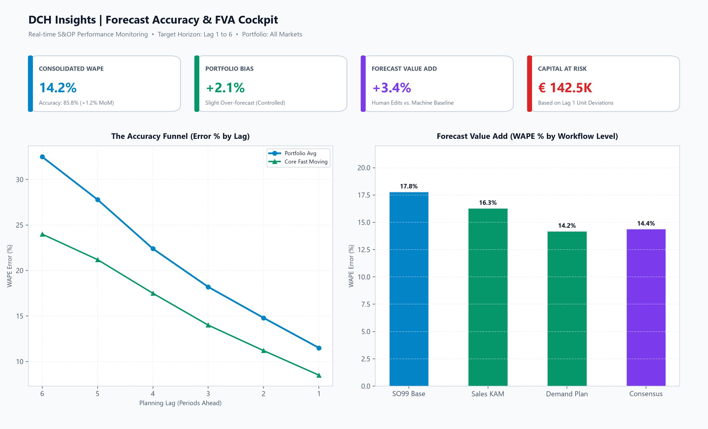

#### Dark Theme (Executive Control Room)
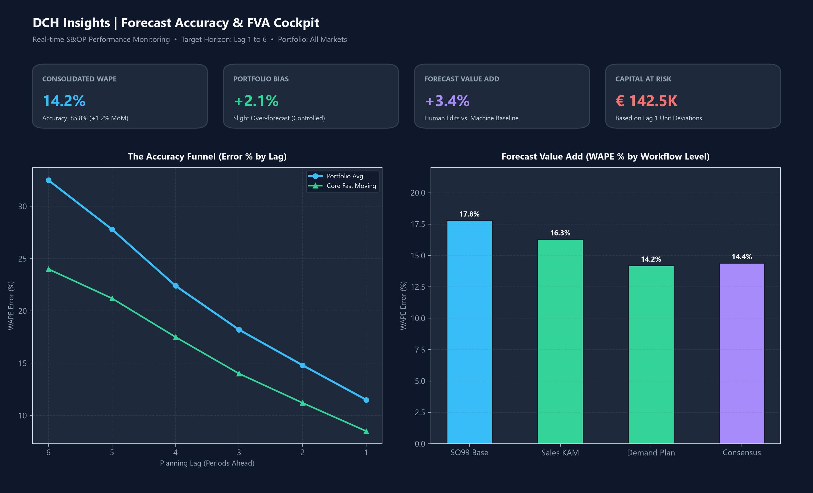

---

### 6.2. Dashboard 1: The Accuracy Funnel (Lag Evolution by Category)
* **Goal:** Verify that uncertainty decreases as lead time shortens (error convergence).
* **Component:** Multi-line chart plotting WAPE (%) and MAE on the Y-axis against Lags (6 down to 1) on the X-axis.
* **Interaction:** Planners can click on any Lag milestone to filter product families driving the widest error variance.

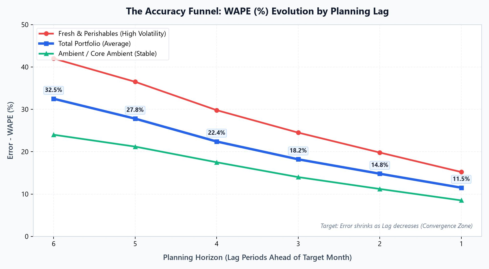

---

### 6.3. Dashboard 2: Forecast Value Add (FVA) Waterfall Chart
* **Goal:** Visual accountability for every participant in the S&OP process.
* **Component:** Classic financial waterfall chart. Starts with the baseline SO99 error, displaying green downward bars for steps that reduced error (value added) and red upward bars for steps that degraded accuracy (value destroyed).
* **Key Filter:** Toggle between *Volume Units (Cases)* and *Economic Value (€)*.

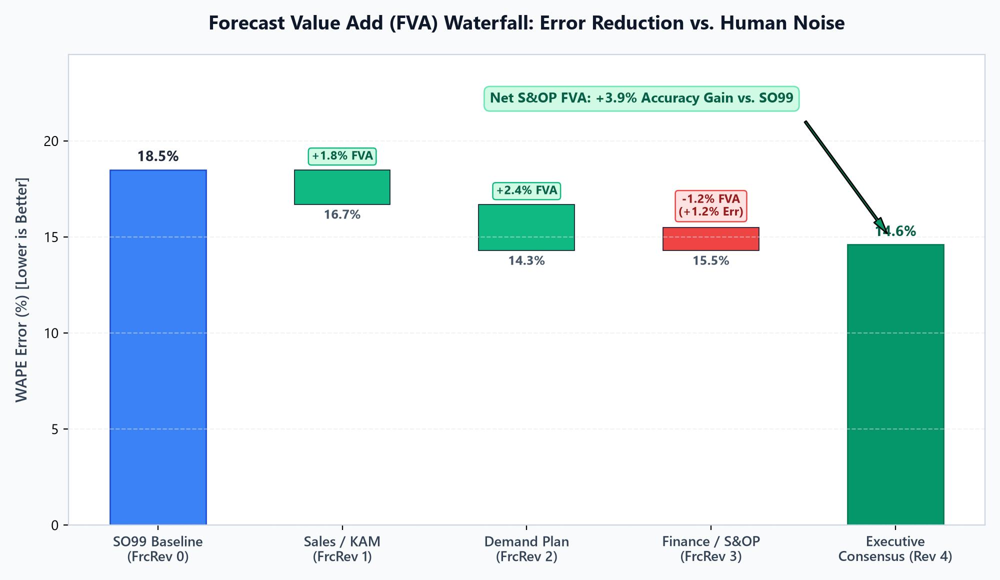

---

### 6.4. Dashboard 3: Bias vs. Error Quadrant Matrix
* **Goal:** Instantly pinpoint chronic operational dysfunction across product categories or geographic markets.
* **Component:** 4-Quadrant Scatter Plot:
  * **X-Axis:** Bias % (-50% to +50%).
  * **Y-Axis:** WAPE % (0% to 100%).
  * **Bubble Size:** Total Economic Turnover (€).
* **Diagnostic Logic:**
  * *Top-Right:* Chronic Over-forecasters (driving excess inventory and working capital bloat).
  * *Top-Left:* Chronic Under-forecasters (driving stockouts and emergency freight costs).
  * *Bottom-Center:* High-performing, balanced portfolios.

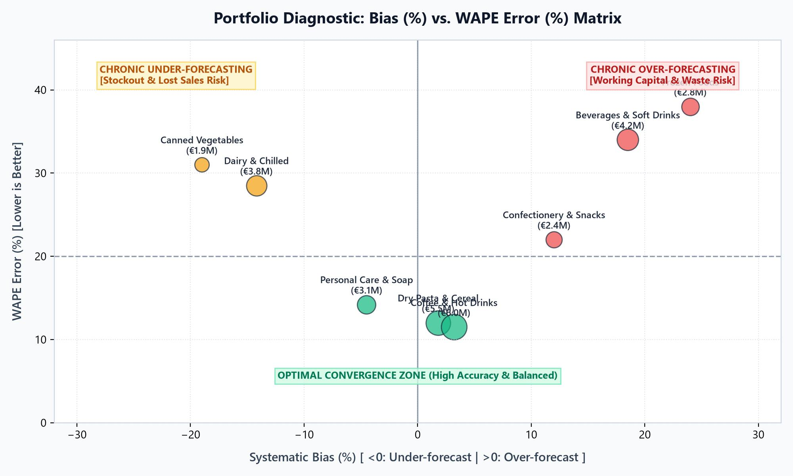

---

### 6.5. Dashboard 4: S&OP Cycle-over-Cycle Stability Heatmap
* **Goal:** Compare the consistency of planning cycles across the fiscal year.
* **Component:** Matrix where Rows = Planning Cycles (`CycleDate`) and Columns = Target Months (`ForecastDate`). Cells are color-coded by an accuracy heatmap (Deep Green = 95%+, Dark Red = <65%).

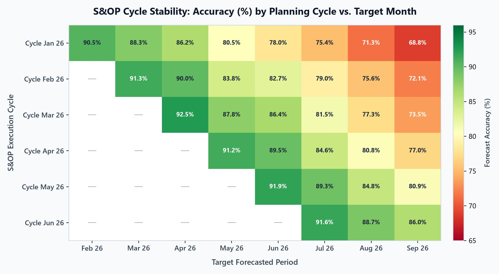

---

### 6.6. High-Value Roadmap Views: Touchless Planning & Financial Exposure

These two views build directly upon the core data model and represent the most compelling extensions for S&OP managers and executive leadership:

#### 1. The FVA League Table & Touchless Planning Candidate Matrix
* **Concept:** An interactive matrix that segments the product portfolio based on human intervention behavior versus statistical baseline performance.
  * **Touchless Planning Candidates (Zero-Touch):** Highly predictable, stable product families where SO99 delivers $>90\%$ baseline accuracy and human manual overrides produce an FVA near $0\%$ or negative. Planners should stop manually touching these SKUs.
  * **Human Value-Add Zones (Focus Areas):** Volatile categories, seasonal spikes, or promotional lines where collaborative human intelligence consistently delivers $+5\%$ or more FVA over the baseline.
* **Product Value:** Empowers the Demand Planning Manager to make data-backed process decisions: *"Let us automate 70% of our portfolio touches and redirect our planners' time exclusively to volatile, high-impact categories."*

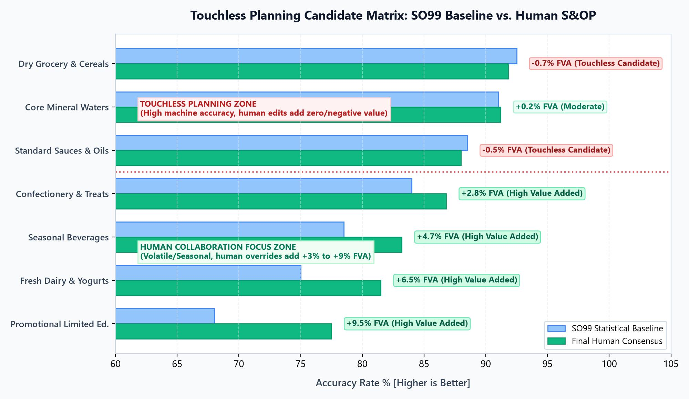

#### 2. Economic Impact & Working Capital Exposure Dashboard (€ / $)
* **Concept:** A financial translation layer that converts physical unit errors into monetary exposure by multiplying deviations by unit sales price (`SALESPRICE`) or standard production cost:
  * **Over-forecasting Exposure (€):** Trapped working capital, holding costs, and obsolescence/spoilage write-down risk in the warehouse.
  * **Under-forecasting Exposure (€):** Potential unfulfilled revenue, stockout penalty exposure, and emergency expedited freight expenses.
* **Product Value:** The primary entry point for **Finance and C-Suite Executives**. While planners speak in WAPE percentages, CFOs make decisions based on cash: *"Chronic over-forecasting in the Beverage line tied up €450,000 in surplus inventory this quarter."*

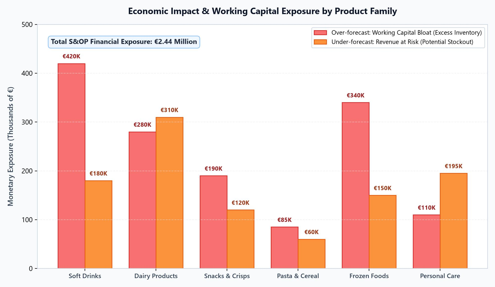

---

### 6.7. Additional Strategic Analytics for Future Releases

The following views round out the enterprise vision, addressing specialized supply chain operational needs:

#### 1. ABC / XYZ Segmentation Accuracy Matrix
* **Concept:** A 9-box quadrant crossing volume/revenue importance (**ABC**: A = High value, B = Medium, C = Low long-tail) with demand predictability/volatility (**XYZ**: X = Low variation/steady, Y = Cyclical/seasonal, Z = Erratic/intermittent).
* **Product Value:** Establishes differentiated accuracy expectations. Planners should demand $<8\%$ WAPE on **AX** items (high revenue, stable demand). Conversely, expecting low error on **CZ** items is unrealistic; tracking this matrix prevents planners from wasting hours fine-tuning erratic low-volume tail items.

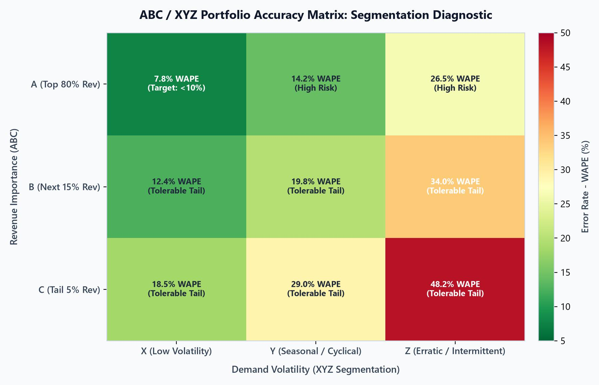

#### 2. Promotion vs. Baseline Accuracy Split (Phase 2 Overlay)
* **Concept:** A comparative clustered bar visual that isolates baseline demand performance from promotional uplift accuracy using the `IsPromo` context flag.
* **Product Value:** Resolves the perennial S&OP tension between Sales and Operations. Often, SO99's baseline accuracy is outstanding ($95\%+$), but overall accuracy collapses because Sales projected a $+300\%$ promotional spike that only generated $+60\%$. This dashboard isolates promotional forecast error from underlying operational demand health.

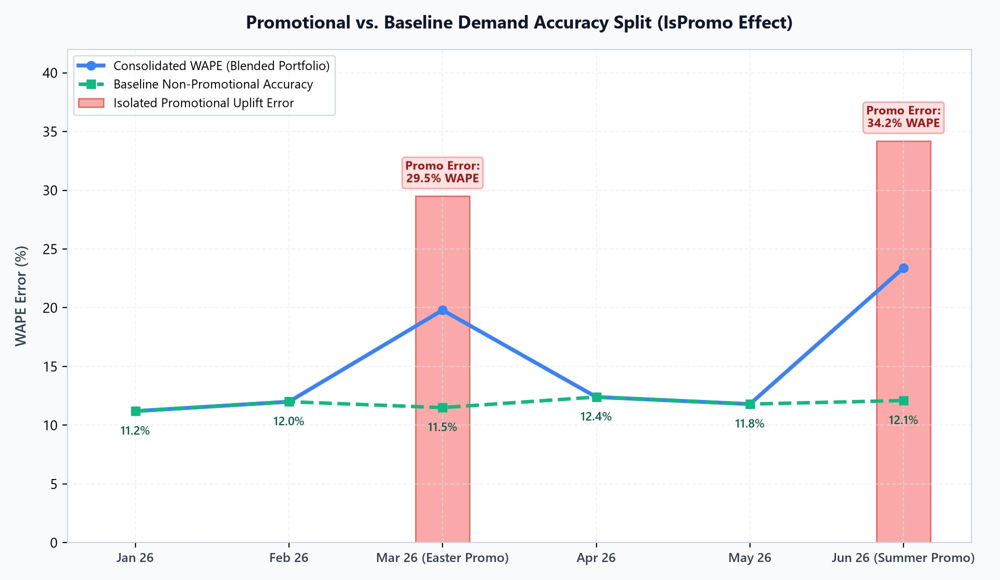

#### 3. Multi-Lag Horizon Heatmap (The Vintage / Triangle Report)
* **Concept:** A classic triangular matrix plotting planning cycles on the vertical axis against target execution months on the horizontal axis, revealing diagonal bands of error aging across 12 to 24 months.
* **Product Value:** A favorite diagnostic tool for supply chain data scientists and statistical analysts to audit structural model drift across multi-year planning horizons.

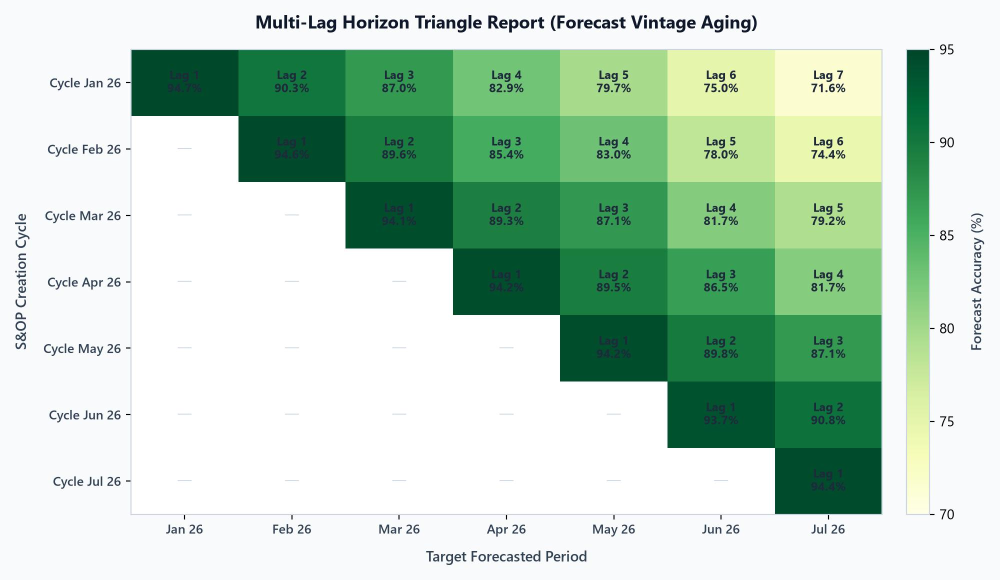

---

## 7. Functional Architecture & Enterprise Scale

### 7.1. Scalability Reality in DCH Customer Deployments
In enterprise DCH installations, clients manage between **250,000 and 1,000,000 Product $\times$ Market combinations**.

When calculating historical depth over a standard 3-year audit window, tracking Lags 1 to 6 across 5 workflow revisions:
* **Monthly Ingestion Rate:** $250\text{k} \times 6 \text{ Lags} \times 5 \text{ Revisions} = \mathbf{7.5 \text{ Million rows / month}}$ (or **30M rows/month** at 1M SKUs).
* **3-Year Historical Footprint:** Between **270 Million and 1.08 Billion snapshot records**.

### 7.2. The Winning Storage Architecture: 2 Tables + Analytical View
To ensure instant dashboard response times without degrading the production server, the architectural model uses a **Separated Immutable Pattern (Proposal B Optimized)**:

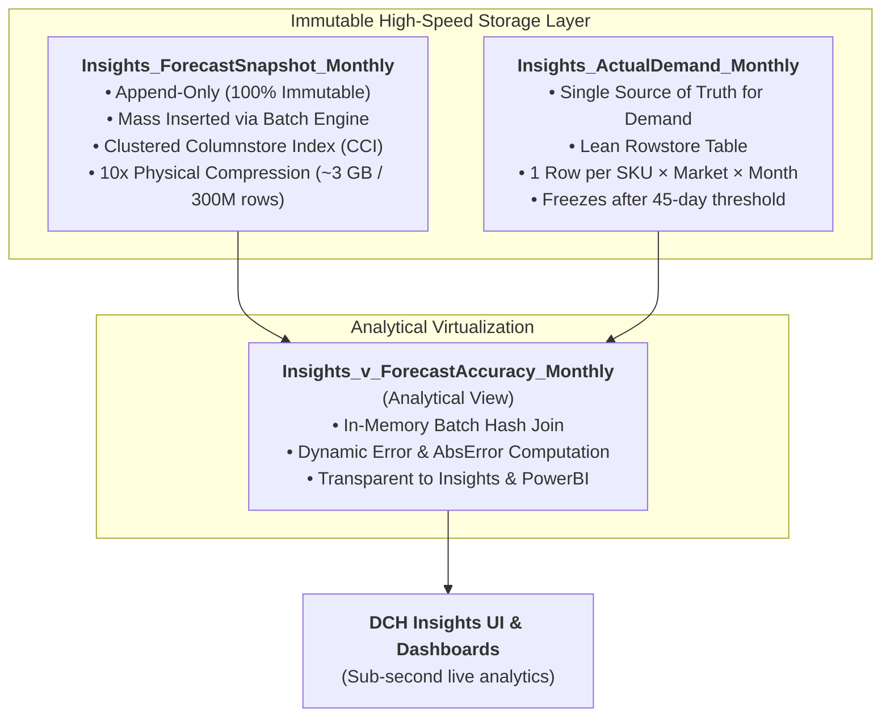

#### Why the Unified Table Pattern was Replaced:
In traditional architectures, storing Forecast and Actual Demand in a single unified table requires running an `UPDATE` on **7.5 to 30 Million rows every single month** to backfill actual demand into past snapshots. In modern Columnstore engines, updating a row marks it as deleted in a bitmap and appends a new row to the delta store, causing catastrophic index fragmentation, transaction log explosion, and slow queries.

By decoupling into **Snapshots (Append-Only)** and **Actual Demand (Lean Rowstore)**, the snapshot archive is **never updated**, achieving maximum physical compression (10x) and sub-second dashboard queries via the analytical view.

---

## 8. Product Delivery Roadmap

The feature set is organized into three logical releases to deliver immediate customer value while laying the ground for advanced analytics:

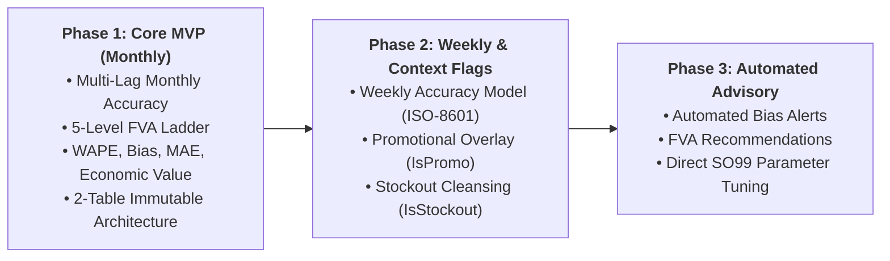

### Phase 1: Core MVP (Monthly Horizon & FVA Engine)
* Monthly granularity support for Lags 1 to 12.
* Automated capture of SO99 Baseline (FrcRev 0) and completed Workflow Sign-offs (FrcRev 1..N).
* Automatic demand consolidation and 45-day freeze lifecycle (`DataStatus`).
* Core KPIs: WAPE, Bias, MAE, RMSE, FVA, and Economic Valuation (€).
* Standard Insights Dashboards (Accuracy Funnel, FVA Waterfall, Bias Quadrant).

### Phase 2: Granular Operations & Context Awareness
* Weekly Granularity (`Insights_ForecastSnapshot_Weekly`) calculated strictly according to ISO-8601.
* **Context Flag: `IsPromo`:** Overlay promotional calendars from DCH/SO99 (`C_PROMOAREA`) to separate baseline forecast accuracy from promotional uplift accuracy.
* **Context Flag: `IsStockout`:** Ingest unfulfilled demand and stockouts (`C_STOCKOUTS`) to ensure planners are not penalized for forecasting demand that the warehouse could not fulfill.

### Phase 3: Prescriptive Analytics & Smart Insights
* **Automated Bias Alerts:** System proactively notifies planners: *"Product Family X has shown positive bias (>+15%) for 4 consecutive cycles"*.
* **FVA Process Recommendations:** Identifies workflow participants whose overrides systematically degrade baseline accuracy, recommending touchless automation for specific low-variability categories.

---

## 9. Technical Appendix (For Engineering & Database Implementation)

> *This appendix provides the exact database structures, indexing strategy, and SQL definitions agreed upon by the development architecture.*

### 9.1. Entity Relationship & Data Flow Diagram

The following diagram illustrates how the immutable snapshot tables and the lean actual demand tables are joined into the analytical consumption view alongside DCH master dimension data:

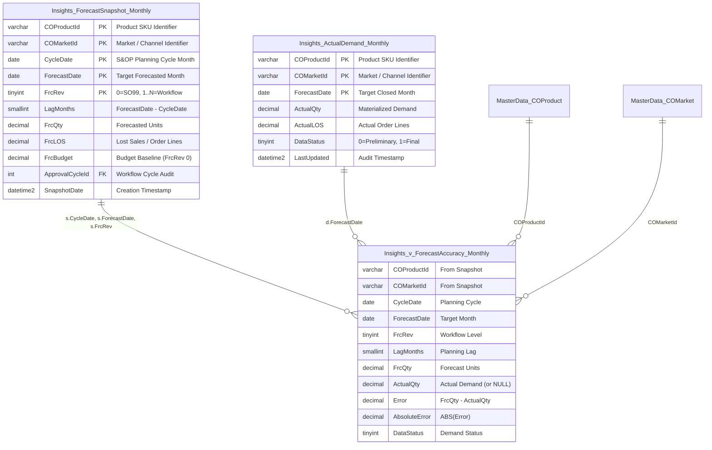

### 9.2. Database Schemas (DDL)

#### 1. Immutable Forecast Snapshot Table
```sql
CREATE TABLE Insights_ForecastSnapshot_Monthly (
    COProductId     VARCHAR(32)     NOT NULL,
    COMarketId      VARCHAR(12)     NOT NULL,
    CycleDate       DATE            NOT NULL,   -- First day of S&OP planning cycle (e.g. '2026-09-01')
    ForecastDate    DATE            NOT NULL,   -- First day of target forecasted month (e.g. '2026-12-01')
    FrcRev          TINYINT         NOT NULL,   -- 0 = SO99 Baseline, 1..N = Workflow Levels
    LagMonths       SMALLINT        NOT NULL,   -- DATEDIFF(MONTH, CycleDate, ForecastDate)
    FrcQty          DECIMAL(18,4)   NOT NULL,   -- Forecasted base units
    FrcLOS          DECIMAL(18,4)   NULL,       -- Lost sales / order lines forecast
    FrcBudget       DECIMAL(18,4)   NULL,       -- Budget baseline (populated only for FrcRev 0)
    ApprovalCycleId INT             NULL,       -- Reference to DCH Wkf_ApprovalCycle
    SnapshotDate    DATETIME2       NOT NULL DEFAULT GETUTCDATE(),

    CONSTRAINT PK_Insights_FrcSnap_Monthly PRIMARY KEY NONCLUSTERED (
        COProductId, COMarketId, CycleDate, ForecastDate, FrcRev
    )
);

-- High-performance vector compression index
CREATE CLUSTERED COLUMNSTORE INDEX CCI_Insights_FrcSnap_Monthly 
    ON Insights_ForecastSnapshot_Monthly;
```

#### 2. Actual Demand Single Source of Truth Table
```sql
CREATE TABLE Insights_ActualDemand_Monthly (
    COProductId     VARCHAR(32)     NOT NULL,
    COMarketId      VARCHAR(12)     NOT NULL,
    ForecastDate    DATE            NOT NULL,   -- Target month closed
    ActualQty       DECIMAL(18,4)   NOT NULL,   -- Materialized demand
    ActualLOS       DECIMAL(18,4)   NULL,
    DataStatus      TINYINT         NOT NULL DEFAULT 0, -- 0 = Preliminary, 1 = Final (Frozen)
    LastUpdated     DATETIME2       NOT NULL DEFAULT GETUTCDATE(),

    CONSTRAINT PK_Insights_ActDem_Monthly PRIMARY KEY CLUSTERED (
        COProductId, COMarketId, ForecastDate
    )
);
```

#### 3. Analytical Virtualization View
```sql
CREATE OR ALTER VIEW Insights_v_ForecastAccuracy_Monthly AS
SELECT 
    s.COProductId,
    s.COMarketId,
    s.CycleDate,
    s.ForecastDate,
    s.FrcRev,
    s.LagMonths,
    s.FrcQty,
    s.FrcLOS,
    s.FrcBudget,
    d.ActualQty,
    d.ActualLOS,
    (s.FrcQty - d.ActualQty) AS Error,
    ABS(s.FrcQty - d.ActualQty) AS AbsoluteError,
    ISNULL(d.DataStatus, 0) AS DataStatus,
    s.ApprovalCycleId,
    s.SnapshotDate,
    d.LastUpdated AS DemandUpdatedDate
FROM Insights_ForecastSnapshot_Monthly s
LEFT JOIN Insights_ActualDemand_Monthly d
    ON s.COProductId = d.COProductId 
   AND s.COMarketId = d.COMarketId 
   AND s.ForecastDate = d.ForecastDate;
```

### 9.3. Sample Business Query: Multi-Level FVA Calculation
This query demonstrates how Insights retrieves the FVA waterfall at Lag 1 in real time:

```sql
SELECT 
    fa.FrcRev,
    CASE fa.FrcRev
        WHEN 0 THEN 'SO99 Machine Baseline'
        WHEN 1 THEN 'Sales / Commercial'
        WHEN 2 THEN 'Demand Planning'
        WHEN 3 THEN 'Finance / S&OP'
        WHEN 4 THEN 'Executive Consensus'
        ELSE CONCAT('Custom FrcRev ', fa.FrcRev)
    END AS WorkflowStep,
    SUM(fa.AbsoluteError) / NULLIF(SUM(fa.ActualQty), 0) * 100 AS WAPE,
    SUM(fa.Error) / NULLIF(SUM(fa.ActualQty), 0) * 100 AS Bias,
    -- Cumulative FVA compared to SO99 Baseline
    (FIRST_VALUE(SUM(fa.AbsoluteError) / NULLIF(SUM(fa.ActualQty), 0) * 100) 
        OVER (ORDER BY fa.FrcRev)) - 
    (SUM(fa.AbsoluteError) / NULLIF(SUM(fa.ActualQty), 0) * 100) AS Cumulative_FVA_Improvement
FROM Insights_v_ForecastAccuracy_Monthly fa
WHERE fa.LagMonths = 1
  AND fa.DataStatus = 1
  AND fa.ForecastDate >= '2026-01-01'
GROUP BY fa.FrcRev
ORDER BY fa.FrcRev;
```
