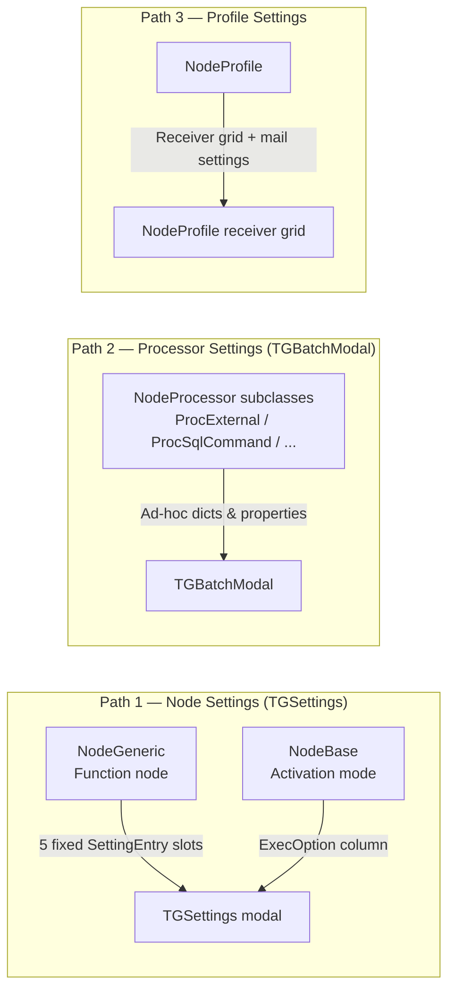
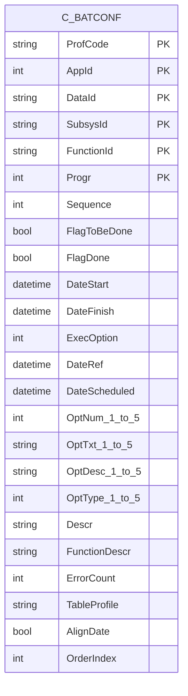
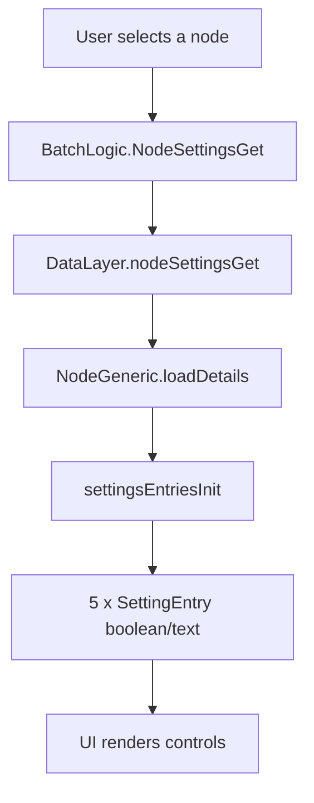
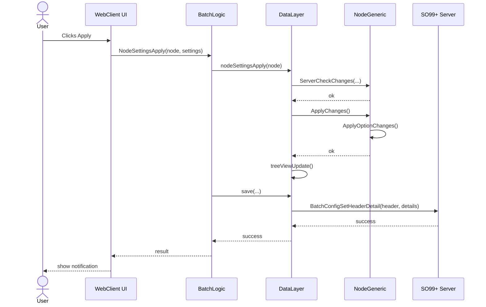

[Overview](README.md) • [Option A](option-a-extend-setting-entry.md) • [Option B](option-b-extrasettings-json-column.md) • [Option C](option-c-relational-properties-table.md) • [Option D](option-d-centralized-metadata-model.md) • [Current workarounds](current-custom-dropdown-workarounds.md) • [Web client analysis](web-client-analysis.md) • [Extending to processors](extending-to-processors.md)

---

# SOA-7702 — Batch Node Properties Refactor

> **Goal:** Add the ability to define extra node-level settings in the SO99+ Batch form, including dropdowns backed by enums, without hard-coding each new control.

This document is an onboarding-friendly analysis of the current Batch node settings mechanism and a proposal of possible implementation strategies. It is intended for developers who are new to the codebase.

---

## 1. What is a Batch node?

The Batch form in SO99+ shows a hierarchical tree:

```
Batch Profile
 └─ Main Batch
     ├─ Pre/Post processors
     ├─ Demand Planner  → Divisions
     ├─ Replenishment   → Tunnels
     │    └─ Subsystems
     │         └─ Functions   ← these leaves have "settings"
```

Each element is represented in the client logic by a class derived from `NodeBase`. The generic leaf/settings class is `NodeGeneric`. Specialized variants include `NodeProfile` and `NodeProcessor`.

### Node type hierarchy

| Node Type | CLR Class | Role | Has 5‑slot settings? |
|-----------|-----------|------|----------------------|
| **Function** | `NodeGeneric` | Leaf nodes under Subsystems (e.g. "Demand Planner", "Replenishment"). | Yes — uses `SettingEntry` slots 1–5. |
| **Profile** | `NodeProfile` | The root Batch Profile node. | No — uses its own receiver grid and mail settings. |
| **Processor** | `NodeProcessor` subclasses (`ProcExternal`, `ProcSqlCommand`, …) | Pre/Post processors attached to any node. | No — each subclass owns its own dictionaries and properties. |
| **Base** | `NodeBase` | Abstract base for all the above. | No — provides shared scheduling/activation logic. |

---

## 2. The two settings paths in the Batch form

When a user opens the settings dialog for a node, the code path depends on the node type. There are **two completely separate rendering pipelines**, and the proposals in this document (Options A–D) target only one of them.



### Path 1 — Node Settings (`NodeGeneric` → `TGSettings`)

1. User clicks ⚙️ on a **Function** node (leaf under a Subsystem).
2. `BatchController` calls `BatchAF.SettingsNodeGeneralPanel`.
3. The panel iterates over the **five fixed `SettingEntry` slots** (`OptNum1..5`, `OptTxt1..5`).
4. Each slot is rendered as a `TGSwitch` (boolean) or `TGTextBox` (text). There is no generic dropdown branch today.
5. A few extra controls (activation mode, table profile selector) are added outside the five slots — these are also hardcoded.

**This is the path that Options A, B, C, and D are designed to improve.** The goal is to add a `List` / dropdown type to `SettingEntry` (Option A) or replace the five-slot model entirely with a dynamic property system (Options C/D).

### Path 2 — Processor Settings (`NodeProcessor` → `TGBatchModal`)

1. User clicks ⚙️ on a **Pre/Post processor** node.
2. `BatchController` calls `BatchAF.GetProcessorModal`.
3. Each `NodeProcessor` subclass returns its own custom structure definition.
4. `TGBatchModal` renders dropdowns one by one using processor-specific control IDs (e.g. `cmbSQLProcedure`, `cmbStorageAccount`).

This path is **not covered** by Options A–D as currently scoped. The eight processor dropdowns documented in [`current-custom-dropdown-workarounds.md`](current-custom-dropdown-workarounds.md) would require extending the chosen option to also serve `NodeProcessor` subclasses. A detailed analysis of what that would entail is available in [`extending-to-processors.md`](extending-to-processors.md).

### Path 3 — Profile Settings (`NodeProfile`)

The `NodeProfile` node has its own receiver grid for email notification levels. It is a separate code path and is not the focus of SOA-7702.

### Scope of this document

| Path | Node Type | UI Modal | Covered by Options A–D? |
|------|-----------|----------|--------------------------|
| 1 | Function (`NodeGeneric`) | `TGSettings` | ✅ Yes — primary target of SOA-7702 |
| 1 | Base (`NodeBase`) | `TGSettings` | ✅ Partially — activation mode already generic |
| 2 | Processor (`NodeProcessor`) | `TGBatchModal` | ❌ No — requires extending the model (see [`extending-to-processors.md`](extending-to-processors.md)) |
| 3 | Profile (`NodeProfile`) | Receiver grid | ❌ No — out of scope |

---

## 3. Where settings are stored

All configuration ultimately lives in the `C_BATCONF` table. The column layout is described by the enum `BatchConfigTableStructure` in `SrcBTC/SrcCOM/BatchConfiguration.vb`.

```vb
Public Enum BatchConfigTableStructure
   ProfCode, AppId, DataId, SubsysId, FunctionId, Progr, Sequence,
   FlagToBeDone, FlagDone, DateStart, DateFinish, ExecOption, DateRef, DateScheduled,
   OptNum1 .. OptNum5,
   OptTxt1 .. OptTxt5,
   Descr,
   OptDesc1 .. OptDesc5,
   OptType1 .. OptType5,
   ...
End Enum
```

**Key point:** every Batch function has exactly **five configurable options**, each consisting of four columns:

| Column | Meaning |
|--------|---------|
| `OptDescN` | Label shown to the user. |
| `OptTypeN` | Data type (`dbFldType` such as `dbBool`, `dbText`, `dbInt`). |
| `OptNumN` | Numeric value. |
| `OptTxtN` | Text value. |

This model has been in place for many years and is very rigid: there is no room for a sixth option, and there is no concept of an enum or dropdown.

### Entity-relationship sketch of the current model



---

## 4. Load flow: from database to UI



### 4.1 Entry point — `BatchLogic.NodeSettingsGet`

[SrcCLI/System/Batch/batchLogic.vb](SrcCLI/System/Batch/batchLogic.vb#L876-L894)

```vb
Public Function NodeSettingsGet(...)
   If node.level <> BatchLevel.Main Then
      nodeSettings = currentProfileData.nodeSettingsGet(SO99Srv, sSessionID, node, activationDays)
   End If
End Function
```

`currentProfileData` is the in-memory data layer (`DataLayer`).

### 4.2 Data layer — `DataLayer.nodeSettingsGet`

[SrcCLI/System/Batch/DataLayer.vb](SrcCLI/System/Batch/DataLayer.vb#L236-L271)

This method assembles:
- Pre/post processors.
- Child divisions/tunnels (for intermediate levels).
- Then calls `NodeGeneric.loadDetails(...)`.

### 4.3 Node initialization — `NodeGeneric.loadDetails` and `init`

[SrcCLI/System/Batch/NodeGeneric.vb](SrcCLI/System/Batch/NodeGeneric.vb#L184-L210)

```vb
Public Shadows Function loadDetails(...)
   MyBase.LoadDetails(activationDaysData)
   _dictPreProcessors = preProcessors
   _dictPostProcessors = postProcessors
   ...
   settingsEntriesInit()
   init(SO99Srv, sSessionID)
End Function
```

### 4.4 The heart of settings — `settingsEntriesInit`

[SrcCLI/System/Batch/NodeGeneric.vb](SrcCLI/System/Batch/NodeGeneric.vb#L417-L430)

```vb
Protected Overridable Sub settingsEntriesInit()
   _dictSettings = New Generic.Dictionary(Of Short, SettingEntry)
   _dictSettings.Add(1, settingsEntryLoad(dr(OptDesc1), dr(OptType1), dr(OptNum1), dr(OptTxt1)))
   _dictSettings.Add(2, settingsEntryLoad(dr(OptDesc2), dr(OptType2), dr(OptNum2), dr(OptTxt2)))
   ...
   _dictSettings.Add(5, settingsEntryLoad(dr(OptDesc5), dr(OptType5), dr(OptNum5), dr(OptTxt5)))
End Sub
```

> **The imporant restricction**
> <p> It always creates exactly five entries.
> <p> No posibility to use extra properties

### 4.5 What the UI receives — `SettingEntry`

[SrcCLI/System/Batch/NodeGeneric.vb](SrcCLI/System/Batch/NodeGeneric.vb#L22-L38)

```vb
Public Structure SettingEntry
   Dim isEnabled As Boolean
   Dim Description As String
   Dim type As ObjOptionType      ' IsBoolean or IsText
   Dim fieldType As dbFldType     ' real database type
   Dim oValue As Object
End Structure

Public Enum ObjOptionType
   IsBoolean
   IsText
End Enum
```

Today the UI only knows how to render:
- a checkbox (`IsBoolean`), or
- a text box (`IsText`).

There is no `IsDropdown`, no enum list, no metadata.

---

## 5. Save flow: from UI to database

When the user clicks **Apply**:

1. `BatchLogic.NodeSettingsApply` → [SrcCLI/System/Batch/batchLogic.vb](SrcCLI/System/Batch/batchLogic.vb#L913-L941)
2. `DataLayer.nodeSettingsApply` → [SrcCLI/System/Batch/DataLayer.vb](SrcCLI/System/Batch/DataLayer.vb#L279-L290)
3. `NodeGeneric.ApplyChanges` → [SrcCLI/System/Batch/NodeGeneric.vb](SrcCLI/System/Batch/NodeGeneric.vb#L243-L254)
4. `ApplyOptionChanges` writes each `SettingEntry` back to `OptNumN` / `OptTxtN` → [SrcCLI/System/Batch/NodeGeneric.vb](SrcCLI/System/Batch/NodeGeneric.vb#L490-L518)

Finally `DataLayer.save` persists the `DataTable` via `SO99Srv.BatchConfigSetHeaderDetail`.



---

## 6. Current custom dropdown workarounds

There is **no generic dropdown for the five settings**. Every dropdown-like behavior has been implemented with ad-hoc code outside `SettingEntry`. A detailed catalogue is available in [`current-custom-dropdown-workarounds.md`](current-custom-dropdown-workarounds.md).

At a glance, the main clusters are:

| Feature | Where it lives | How it works |
|---------|---------------|--------------|
| Import details / profile grid | `NodeGeneric` special-cases `OptDescN = "import details"` and renders a custom detail grid. | Hard-coded label check. |
| Import/export table profile | `NodeGeneric.init` loads `_profileList` and exposes `Profile`. | Special property, not a `SettingEntry`. |
| Email level in profile | `NodeProfile.ReceiverDataInit` uses `TGInputType.ComboBox` on a grid column. | Custom grid, not the node settings modal. |
| Processor dropdowns | Each `NodeProcessor` subclass loads its own dictionary (storage, SQL procedure, aggregate type, batch profile, DB connection, etc.). | Rendered inside `TGBatchModal`. |

This is exactly the problem SOA-7702 wants to solve: new dropdowns should not require a new specialized class every time.

---

## 7. Current limitations

| Limitation | Impact |
|------------|--------|
| Maximum 5 options per node (`OptNum/OptTxt 1..5`). | No room for a sixth property. |
| Only `IsBoolean` / `IsText` UI types. | No dropdowns, combos, dates, enums, or lookups. |
| Metadata comes from fixed columns. | Cannot describe "this option is enum X with values A/B/C". |
| `SettingEntry` is a plain `Structure`. | Cannot carry value lists, validation, or dependencies. |
| Processors read `OptNum1`/`OptTxt1` directly. | Schema changes in the 5 slots affect all processors. |

---

## 8. Proposed implementation options

The following options are ordered from least to most invasive. Each has a dedicated document with more detail.

| Option | Approach | Effort | Flexibility | Best for |
|--------|----------|--------|-------------|----------|
| **A** | Extend `SettingEntry` to support a dropdown list. | Low | Low | One or two isolated dropdowns. |
| **B** | Add an `ExtraSettings` JSON/XML column to `C_BATCONF`. | Medium | Medium | Storing arbitrary properties with minimal schema changes. |
| **C** | Create a relational `C_BATCONF_PROP` table for dynamic properties. | Medium-High | High | A reusable, queryable, scalable mechanism. |
| **D** | Introduce a centralized metadata model (`FunctionDefinition` + values table). | High | Very High | Long-term configurability and multiple control types. |

Detailed documents:

- `option-a-extend-setting-entry.md`
- `option-b-extrasettings-json-column.md`
- `option-c-relational-properties-table.md`
- `option-d-centralized-metadata-model.md`

---

## 9. Web client validation

I inspected the actual TypeScript/MVC source under `../../../../SO99_Ordermngmnt/Web/SO99WebClient` and confirmed:

- The node settings modal is rendered by `TGSettings`, which inherits the generic `TGModal.createTGControl` pipeline.
- `TGModal` already supports `TGDropDownList`, `TGSwitch`, `TGTextBox`, `TGGrid`, etc.
- `BatchAF.SettingsNodeGeneralPanel` currently maps the five `SettingEntry` slots only to switch or textbox; it has no branch for a list.
- `TGSettings.SetSelectedValue` collects values generically, so a new dropdown will be sent back without extra framework work.
- Special controls (remote file browser, profile detail grid, processor reorder lists) should remain custom.

The full report is in [`web-client-analysis.md`](web-client-analysis.md). It confirms that the Option C / D direction is technically sound and does **not** require rethinking the model.

---

## 10. Recommendation

Given the ticket title **"Refactor current custom dropdown implementation"**, the goal is likely to replace ad-hoc dropdown code with a generic mechanism rather than redesign the entire Batch module.

**Suggested path:**

1. **Audit** which dropdowns currently exist and which enum/datasource each one needs.
2. **Choose Option A if** there are only 1–2 specific dropdowns and the team wants minimal risk.
3. **Choose Option C if** the goal is a reusable mechanism for future Batch settings. It does not touch the existing 5-slot schema and keeps data queryable.
4. **Avoid Option B** unless serialization round-trips are simpler in your stack than adding a table. JSON in `C_BATCONF` complicates SQL reporting and auditing.
5. **Keep Option D in mind** for a later phase if the Batch form keeps growing new control types.

---

## 11. Open questions before implementation

1. **Target audience:** Is the dropdown for Batch *functions* (rendered by `NodeGeneric`/`TGSettings`) or for *processors* (rendered by `TGBatchModal`)? See [section 2](#2-the-two-settings-paths-in-the-batch-form) and [`extending-to-processors.md`](extending-to-processors.md) for an analysis of both paths.
2. **Concrete enum:** Is there an existing .NET enum to expose, or does the list come from a database query?
3. **WebClient source:** Found at `../SO99plus/Web/SO99WebClient`. Generic dropdown support already exists; only `BatchAF.SettingsNodeGeneralPanel` needs a new branch for `List` properties.
4. **Backwards compatibility:** Must old `C_BATCONF` rows continue to work without migration?
5. **Transaction scope:** Should extra properties be saved in the same database transaction as `C_BATCONF`?

---

## 12. Key files to keep in mind

- [SrcCLI/System/Batch/batchLogic.vb](SrcCLI/System/Batch/batchLogic.vb#L876-L894) — UI entry points.
- [SrcCLI/System/Batch/DataLayer.vb](SrcCLI/System/Batch/DataLayer.vb#L236-L290) — Load/save orchestration.
- [SrcCLI/System/Batch/NodeGeneric.vb](SrcCLI/System/Batch/NodeGeneric.vb#L22-L518) — `SettingEntry`, `init`, apply.
- [SrcCLI/System/Batch/NodeBase.vb](SrcCLI/System/Batch/NodeBase.vb#L1) — Base node and `DataRow` access.
- [SrcCLI/System/Batch/NodeProfile.vb](SrcCLI/System/Batch/NodeProfile.vb#L18) — Profile-level settings.
- [SrcCLI/System/Batch/NodeProcessor.vb](SrcCLI/System/Batch/NodeProcessor.vb#L8) — Processor subclasses with ad-hoc dropdowns.
- [SrcBTC/SrcCOM/BatchConfiguration.vb](SrcBTC/SrcCOM/BatchConfiguration.vb#L55-L96) — `BatchConfigTableStructure` enum.
- [SrcSVR/BatchClass730.vb](SrcSVR/BatchClass730.vb#L885-L931) — Server-side `DataTable` creation.
- [SrcSVR/Services/SO99Service730.vb](SrcSVR/Services/SO99Service730.vb#L3626-L3695) — WCF service methods for Batch config.
