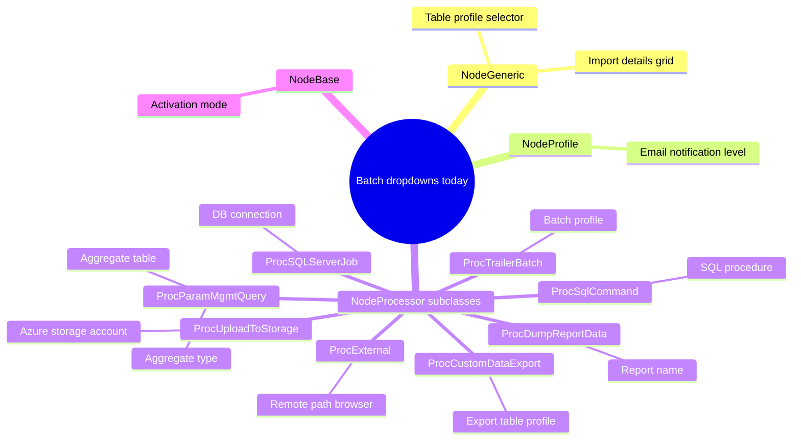
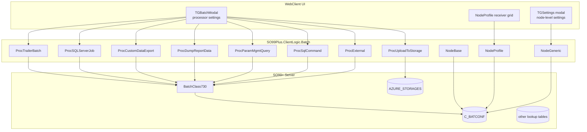

[Overview](README.md) • [Option A](option-a-extend-setting-entry.md) • [Option B](option-b-extrasettings-json-column.md) • [Option C](option-c-relational-properties-table.md) • [Option D](option-d-centralized-metadata-model.md) • [Current workarounds](current-custom-dropdown-workarounds.md) • [Web client analysis](web-client-analysis.md) • [Extending to processors](extending-to-processors.md)

---

# Current Custom Dropdown Workarounds in the Batch Form

This document catalogues the existing places where dropdown, combo-box, or list-like behavior appears in the SO99+ Batch form. None of them use a generic mechanism; each one has been implemented with ad-hoc code. Understanding these cases is important before designing a reusable solution for SOA-7702.

---

## Overview diagram



---

## 1. "Import details" grid inside `NodeGeneric`

### Location

[SrcCLI/System/Batch/NodeGeneric.vb](SrcCLI/System/Batch/NodeGeneric.vb#L446-L447)

```vb
ElseIf Trim(Desc) = "import details" Then
   'SPECIAL CASE parametrr for CO Import details shown in apposite Combo boxes
   opt.isEnabled = False
```

### What it does

When one of the five option labels equals the literal string `"import details"`, the generic `SettingEntry` for that slot is disabled. Instead, if the function supports a table profile (`_profileDetailGridEnabled`), a dedicated grid (`ProfileDetailGridLogic`) is shown with import-level information:

- Product level
- Market level
- Timeslot
- Unit of measure

### Why it is a workaround

The UI does not know it is rendering a dropdown or a details grid. The server encodes the behavior through a magic label, and `NodeGeneric` special-cases it.

### Relevant code

- `settingsEntriesInit` disables the slot.
- `init` loads the profile list from `SO99Srv.ImportExportDefinitionProfiles`.
- `Refresh` loads levels from `SO99Srv.ImportConfigCoLevelsGet` and fills the detail grid.

---

## 2. Import/export table profile selector

### Location

[SrcCLI/System/Batch/NodeGeneric.vb](SrcCLI/System/Batch/NodeGeneric.vb#L320-L343)

```vb
_profileEnabled = SO99Plus.Common.MasterInformation.CtlImpExpDef.fn_FunctionNeedTableProfile(...)
...
_profileList = New Generic.List(Of String)
_profileList.AddRange(sProfiles)
_profile = TableProfile
```

### What it does

For import/export functions, `NodeGeneric` loads a list of table profiles from the server. The selected profile is stored in the `TableProfile` column of `C_BATCONF` and exposed through the `Profile` property.

### Why it is a workaround

This is a dropdown, but it is not one of the five generic options. It uses its own column and its own property, so the UI must know about `NodeGeneric.Profile` specifically.

### Relevant properties

- `ProfileList` — list of available profiles.
- `Profile` — selected profile value.
- `ProfileEnabled` — whether the function supports profiles.
- `ProfileDetailGridEnabled` — whether the import-details grid should be shown.

---

## 3. Email notification level in `NodeProfile`

### Location

[SrcCLI/System/Batch/NodeProfile.vb](SrcCLI/System/Batch/NodeProfile.vb#L285-L305)

```vb
With receiverDataGrid.ColumnGet("WTR")
   .InputType = TGInputType.ComboBox
   .ValidValues = New Generic.Dictionary(Of Short, String)
   .ValidValues.Add(BatchMailLevel.NONE, m_txt_NoEmail)
   .ValidValues.Add(BatchMailLevel.ERR, m_txt_ErrorEmail)
   .ValidValues.Add(BatchMailLevel.ALL, m_txt_AllEmail)
End With
```

### What it does

In the profile-level mail recipients grid, the "Receives" column is a dropdown backed by the `BatchMailLevel` enum:

- `NONE` — No emails
- `ERR` — Error emails
- `ALL` — All emails

### Why it is a workaround

This dropdown is part of a custom `TGGridLogic` inside `NodeProfile`. It is not related to the five `SettingEntry` options of a Batch function.

### Relevant code

- `ReceiverDataInit` builds the grid and defines the combo values.
- `ReceiverDataLoad` binds saved values per email address.
- `receiverDataChanged` tracks pending changes.

---

## 4. Processor-specific dropdowns in `NodeProcessor`

The `NodeProcessor` subclasses (`NodeBaseProcessor` derivatives) contain the largest concentration of ad-hoc dropdowns. Each processor loads its own datasource and exposes dedicated properties.

### 4.1 External process — remote file/folder browser

| Aspect | Detail |
|--------|--------|
| Class | `ProcExternal` |
| File | [SrcCLI/System/Batch/NodeProcessor.vb](SrcCLI/System/Batch/NodeProcessor.vb#L100-L260) |
| Stored in | `OptTxt1` (external path) |
| Datasource | `_dictFolders`, `_dictFiles` loaded via `SO99Srv.RemoteBrowserFoldersGet` / `RemoteBrowserFileInfoGet` |

The user browses folders/files on the SO99+ server path. The selected path is stored as text, not as a dropdown index.

### 4.2 Upload to storage — Azure storage selector

| Aspect | Detail |
|--------|--------|
| Class | `ProcUploadToStorage` |
| File | [SrcCLI/System/Batch/NodeProcessor.vb](SrcCLI/System/Batch/NodeProcessor.vb#L340-L440) |
| Stored in | `OptTxt1` (storage account), `OptTxt2` (file path), `OptTxt3` (folder) |
| Datasource | `_StorageNames` loaded from the `AZURE_STORAGES` table |

```vb
Public Sub LoadStorageList(ByVal SO99Srv As ISO99Service, ByVal sSessionID As String)
   _StorageNames = New Generic.Dictionary(Of String, String)
   dt = SO99Srv.DataTableRead(sSessionID, "AZURE_STORAGES")
   For Each row As DataRow In dt.Rows
      _StorageNames.Add(row(0), row(2))
   Next
End Sub
```

### 4.3 SQL command — SQL procedure selector

| Aspect | Detail |
|--------|--------|
| Class | `ProcSqlCommand` |
| File | [SrcCLI/System/Batch/NodeProcessor.vb](SrcCLI/System/Batch/NodeProcessor.vb#L470-L540) |
| Stored in | `OptTxt1` |
| Datasource | `_dictSQLProcedure` loaded via `SO99Srv.DatabaseSQLProceduresListGet` |

### 4.4 Parameter management query — aggregate type and table

| Aspect | Detail |
|--------|--------|
| Class | `ProcParamMgmtQuery` |
| File | [SrcCLI/System/Batch/NodeProcessor.vb](SrcCLI/System/Batch/NodeProcessor.vb#L650-L760) |
| Stored in | `OptNum3` (aggregate type), `OptTxt1` (aggregate), `OptTxt2` (aggregate table) |
| Datasource | `_dictAggregateType` (enum `ParamMgmtType`), `_dictAggregate`, `_dictAggregateTable` |

```vb
Public Property AggregateType As ParamMgmtType
   Get
      Return datasource(columnStructure.OptNum3)
   End Get
   Set(value As ParamMgmtType)
      datasource(columnStructure.OptNum3) = value
   End Set
End Property
```

### 4.5 Dump report data — report selector

| Aspect | Detail |
|--------|--------|
| Class | `ProcDumpReportData` |
| File | [SrcCLI/System/Batch/NodeProcessor.vb](SrcCLI/System/Batch/NodeProcessor.vb#L990-L1060) |
| Stored in | `OptTxt1` |
| Datasource | report list from the server |

### 4.6 Custom data export — table profile selector

| Aspect | Detail |
|--------|--------|
| Class | `ProcCustomDataExport` |
| File | [SrcCLI/System/Batch/NodeProcessor.vb](SrcCLI/System/Batch/NodeProcessor.vb#L1450-L1560) |
| Stored in | `OptTxt1` |
| Datasource | `SO99Srv.ImportExportDefinitionProfiles` |

### 4.7 SQL Server job — DB connection selector

| Aspect | Detail |
|--------|--------|
| Class | `ProcSQLServerJob` |
| File | [SrcCLI/System/Batch/NodeProcessor.vb](SrcCLI/System/Batch/NodeProcessor.vb#L1610-L1750) |
| Stored in | `OptTxt1` (connection), `OptNum1` (reinitialize flag) |
| Datasource | `_dictDBConnection` loaded from the server |

### 4.8 Trailer batch — batch profile selector

| Aspect | Detail |
|--------|--------|
| Class | `ProcTrailerBatch` |
| File | [SrcCLI/System/Batch/NodeProcessor.vb](SrcCLI/System/Batch/NodeProcessor.vb#L1760-L1810) |
| Stored in | `OptTxt1` |
| Datasource | `_dictBatchProfile` loaded via `SO99Srv.BatchProfilesGet` |

### Why these are workarounds

Each processor subclass owns its own loading, storage, and default-value logic. The UI (`TGBatchModal`) renders them through processor-specific structure definitions returned by the server. There is no shared abstraction for "a dropdown setting".

---

## 5. Activation mode dropdown

### Location

[SrcCLI/System/Batch/NodeBase.vb](SrcCLI/System/Batch/NodeBase.vb#L380-L440)

### What it does

Every node has an `ActivationMode` derived from the `ExecOption` column. `NodeBase` builds a dictionary of activation modes (`Daily`, `Weekly`, `Monthly fixed day`, etc.) and exposes:

- `ActivationModeDictionary`
- `ActivationModeDescription`
- `ActivationMode`

### Why it is relevant

This is the closest existing example of a generic enum-to-dropdown mapping in the Batch form. However, it is tied to scheduling and stored in `ExecOption`, not in the five option slots.

---

## 6. Summary table

| # | Feature | Node Type | UI Path | Storage | Is Custom | Migrable* |
|---|---------|-----------|---------|---------|-----------|-----------|
| 1 | Import details grid | Function | `NodeGeneric → TGSettings` | `OptDescN = "import details"` + profile grid | Yes | ❌ |
| 2 | Table profile selector | Function | `NodeGeneric → TGSettings` | `TableProfile` column | Yes | ✅ |
| 3 | Email level combo | Profile | `NodeProfile → receiver grid` | `batchMailDest` table | Yes | ⚠ |
| 4 | External process path | Processor | `ProcExternal → TGBatchModal` | `OptTxt1` | Yes | ❌ |
| 5 | Azure storage selector | Processor | `ProcUploadToStorage → TGBatchModal` | `OptTxt1` | Yes | 🔄 |
| 6 | SQL procedure selector | Processor | `ProcSqlCommand → TGBatchModal` | `OptTxt1` | Yes | 🔄 |
| 7 | Aggregate type/table | Processor | `ProcParamMgmtQuery → TGBatchModal` | `OptNum3` / `OptTxt2` | Yes | 🔄 |
| 8 | Dump report selector | Processor | `ProcDumpReportData → TGBatchModal` | `OptTxt1` | Yes | 🔄 |
| 9 | Custom export table profile | Processor | `ProcCustomDataExport → TGBatchModal` | `OptTxt1` | Yes | 🔄 |
| 10 | DB connection selector | Processor | `ProcSQLServerJob → TGBatchModal` | `OptTxt1` | Yes | 🔄 |
| 11 | Batch profile selector | Processor | `ProcTrailerBatch → TGBatchModal` | `OptTxt1` | Yes | 🔄 |
| 12 | Activation mode | Base | `NodeBase → TGSettings` | `ExecOption` | Yes | ✅ |

> **\*Migrable legend:**
> - ✅ **Yes (Phase 1)** — Already on the `NodeGeneric → TGSettings` path targeted by SOA-7702. Migrable with Options A/C/D as scoped.
> - 🔄 **Phase 2** — Lives on the `NodeProcessor → TGBatchModal` path. Migrable if the chosen option is extended to processors. See [`extending-to-processors.md`](extending-to-processors.md) for the detailed gap analysis.
> - ⚠ **Partial** — Requires additional changes beyond the current proposal scope (e.g. extending the model to `NodeProfile`).
> - ❌ **No** — Should remain custom. `TGFileBrowser`, complex grids, and other domain-specific controls are explicitly out of scope (see [section 9](#9-controls-that-should-remain-custom)).

---

## 7. Architecture view



---

## 8. Implications for SOA-7702

The common pattern is:

1. A setting needs a list of allowed values.
2. A developer creates a specialized property or subclass.
3. The value is squeezed into one of the five `OptNumN` / `OptTxtN` columns.
4. The UI layer (`TGSettings` or `TGBatchModal`) learns about the new property specifically.

A successful refactor should:

- Replace magic labels like `"import details"`.
- Avoid adding one-off properties to `NodeGeneric` for each new dropdown.
- Keep processor subclasses focused on business logic rather than dropdown loading.
- Allow the UI to render a dropdown from metadata instead of hard-coded control IDs.

The two biggest clusters to address are:

- **Node-level function settings** (`NodeGeneric` + `TGSettings`) — where the five fixed options live.
- **Processor settings** (`NodeProcessor` subclasses + `TGBatchModal`) — where most current dropdowns exist.

---

## 9. Controls that should remain custom

Not every list-like interaction should be forced into a generic `List` property. The following are domain-specific and should keep their current specialised implementations:

- **Remote file browser** (`TGFileBrowser`) used by `ProcExternal` and `ProcDumpReportData` — path browsing requires server-side folder/file navigation.
- **Profile detail grid** (`TGGrid`) for import details — shows multiple related columns, not a simple key/value list.
- **Processor reordering** (`TGSortable`) and **Copy-To multi-select** (`TGMultiSelect`) — these are action-specific ordering/selection controls, not node properties.
