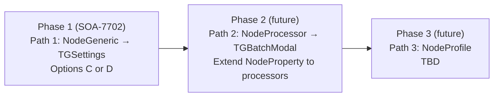

[Overview](README.md) • [Option A](option-a-extend-setting-entry.md) • [Option B](option-b-extrasettings-json-column.md) • [Option C](option-c-relational-properties-table.md) • [Option D](option-d-centralized-metadata-model.md) • [Current workarounds](current-custom-dropdown-workarounds.md) • [Web client analysis](web-client-analysis.md) • [Extending to processors](extending-to-processors.md)

---

# Extending the Model to Processor Settings

> **Status:** Phase 2 analysis — not in scope for the initial SOA-7702 delivery.

Options A through D in the [README](README.md) focus on **Path 1**: the `NodeGeneric → TGSettings` pipeline where five fixed `SettingEntry` slots are rendered. However, the majority of existing ad-hoc dropdowns live in **Path 2**: the `NodeProcessor → TGBatchModal` pipeline. This document analyses what would be required to extend the chosen option (likely C or D) to also cover processor settings.

---

## 1. Current state of processor dropdowns

Each `NodeProcessor` subclass owns its own:

- **Datasource loading** (e.g. `LoadStorageList`, `LoadSQLProcedureList`).
- **Storage** (usually `OptTxt1` or `OptNum1/2/3` on the same `C_BATCONF` row).
- **UI rendering** (hardcoded control IDs inside `TGBatchModal`).

There is **no shared abstraction** — not even a common interface — across the eight processor subclasses that need dropdowns:

| Processor | Dropdown | Datasource |
|-----------|----------|------------|
| `ProcUploadToStorage` | Azure storage account | `AZURE_STORAGES` table |
| `ProcSqlCommand` | SQL procedure | Server method `DatabaseSQLProceduresListGet` |
| `ProcParamMgmtQuery` | Aggregate type (enum) + table | .NET enum `ParamMgmtType` + server query |
| `ProcDumpReportData` | Report name | Server method |
| `ProcCustomDataExport` | Export table profile | `ImportExportDefinitionProfiles` |
| `ProcSQLServerJob` | DB connection | Server method |
| `ProcTrailerBatch` | Batch profile | `BatchProfilesGet` |
| `ProcExternal` | Remote path browser | `TGFileBrowser` — custom control, out of scope |

The `ProcExternal` remote file browser is deliberately excluded because `TGFileBrowser` is a domain-specific control with server-side folder navigation logic. It should remain custom (see [`web-client-analysis.md`](web-client-analysis.md), section 9).

---

## 2. What "extending to processors" means

If Options C or D are chosen for Path 1 (`NodeGeneric → TGSettings`), the same `NodeProperty` abstraction could be reused for processors. The required changes fall into three layers:

### 2.1 Client logic layer (`NodeProcessor` subclasses)

Each processor subclass would need to be refactored so that instead of owning private dictionaries and properties, it exposes a collection of `NodeProperty` objects.

**Today (ad-hoc):**

```vb
' ProcUploadToStorage
Private _StorageNames As Dictionary(Of String, String)

Public Sub LoadStorageList(SO99Srv As ISO99Service, sSessionID As String)
    _StorageNames = New Dictionary(Of String, String)
    Dim dt = SO99Srv.DataTableRead(sSessionID, "AZURE_STORAGES")
    For Each row As DataRow In dt.Rows
        _StorageNames.Add(row(0), row(2))
    Next
End Sub

Public Property StorageAccount As String
    Get
        Return datasource(columnStructure.OptTxt1)
    End Get
    Set(value As String)
        datasource(columnStructure.OptTxt1) = value
    End Set
End Property
```

**Target (generic):**

```vb
' ProcUploadToStorage — refactored
Public Overrides Function GetNodeProperties(SO99Srv As ISO99Service, sSessionID As String) As List(Of NodeProperty)
    Dim props As New List(Of NodeProperty)

    ' Storage account dropdown
    Dim storageProp As New NodeProperty With {
        .Index = 1,
        .Name = "StorageAccount",
        .PropertyType = NodePropertyType.List,
        .Value = datasource(columnStructure.OptTxt1),
        .Datasource = "AZURE_STORAGES"   ' or populate ListValues from the server
    }
    props.Add(storageProp)

    ' File path (stays as text)
    Dim pathProp As New NodeProperty With {
        .Index = 2,
        .Name = "FilePath",
        .PropertyType = NodePropertyType.Text,
        .Value = datasource(columnStructure.OptTxt2)
    }
    props.Add(pathProp)

    Return props
End Function
```

The key design decision is whether the datasource name (`"AZURE_STORAGES"`) is resolved server-side or client-side. Option D's metadata model (`C_BATFUNC_DEF`) solves this by storing the datasource reference in a table.

### 2.2 Application layer (`BatchAF`)

`BatchAF.GetProcessorModal` currently builds processor-specific structures with hardcoded control IDs. It would need a generic branch that:

1. Calls `processor.GetNodeProperties(...)`.
2. For each `NodeProperty` with `PropertyType.List`, converts the values to `List<TGValue>`.
3. Emits a `TGDropDownList` via `TGControlsAF.DropDownListInit(...)`.
4. Collects selected values generically on save (same as `TGSettings.SetSelectedValue` does today).

This is analogous to what `SettingsNodeGeneralPanel` would need for Path 1 — the same pattern, applied to a different modal.

### 2.3 UI layer (`TGBatchModal`)

`TGBatchModal` already uses `TGModal.createTGControl` under the hood, which supports `TGDropDownList`. The main effort is removing the processor-specific branches and replacing them with a generic control factory loop — the same approach `TGSettings` uses.

---

## 3. What changes per option

| Option | Effort to extend to processors | Notes |
|--------|-------------------------------|-------|
| **A** | Not applicable | Option A only extends `SettingEntry` within `NodeGeneric`. Processors don't use `SettingEntry` at all. |
| **B** | Low-Medium | JSON `ExtraSettings` column could store processor properties too. But each processor would still need to serialize/deserialize its own JSON shape — doesn't solve the lack of abstraction. |
| **C** | Medium | `C_BATCONF_PROP` table could also store processor properties. The `NodeProperty` class and `BatchAF` generic branch would be reused. Main effort: refactoring each processor subclass. |
| **D** | Medium-High | `C_BATFUNC_DEF` would define properties for processor function IDs too. Most flexible, but requires the metadata admin screen to support processor definitions. |

---

## 4. Recommended phasing



1. **Phase 1** — Implement Option C (or D) for `NodeGeneric` function nodes. This delivers the core value of SOA-7702: replacing ad-hoc dropdowns in the five-slot settings panel.
2. **Phase 2** — Refactor `NodeProcessor` subclasses to use the same `NodeProperty` abstraction. This requires changes in each processor, `BatchAF`, and `TGBatchModal`, but reuses the infrastructure built in Phase 1.
3. **Phase 3** — (Optional) Extend to `NodeProfile` receiver grid if needed.

---

## 5. Risk assessment

| Risk | Level | Mitigation |
|------|-------|------------|
| Processor-specific business logic bleeds into generic code | Medium | Keep `GetNodeProperties` as an overridable method; each processor can still add custom behaviour. |
| `TGBatchModal` refactor breaks existing processor modals | High | Implement behind a feature flag; migrate processors one at a time. |
| Two systems coexist during migration | Medium | Accept temporary duality; old processors keep their ad-hoc code until migrated. |
| `TGFileBrowser` and other custom controls don't fit the generic model | Low | Explicitly exclude them (see [current workarounds doc](current-custom-dropdown-workarounds.md), section 9). |

---

## 6. Key files that would be affected

- [SrcCLI/System/Batch/NodeProcessor.vb](SrcCLI/System/Batch/NodeProcessor.vb) — all processor subclasses.
- [SrcCLI/System/Batch/NodeGeneric.vb](SrcCLI/System/Batch/NodeGeneric.vb) — `NodeProperty` class (if defined there).
- [SrcCLI/System/Batch/DataLayer.vb](SrcCLI/System/Batch/DataLayer.vb) — load/save orchestration for processor properties.
- `Web/SO99WebClient/Src/AF/System/BatchAF.cs` — `GetProcessorModal` and processor-specific panel methods.
- `Web/SO99WebClient/Scripts/TGControls/Modal/TGBatchModal.ts` — render generic dropdowns.
- [SrcSVR/BatchClass730.vb](SrcSVR/BatchClass730.vb) — server-side property persistence.