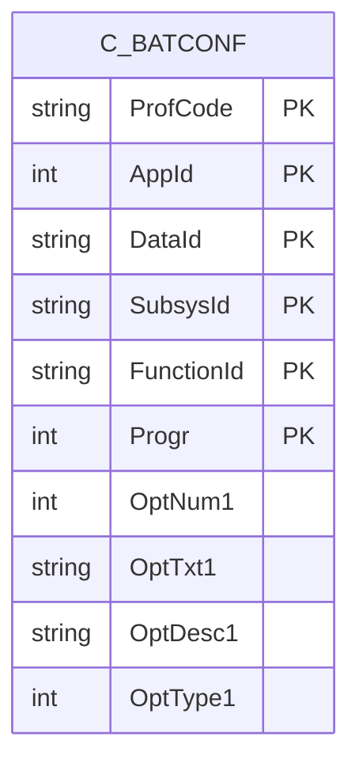
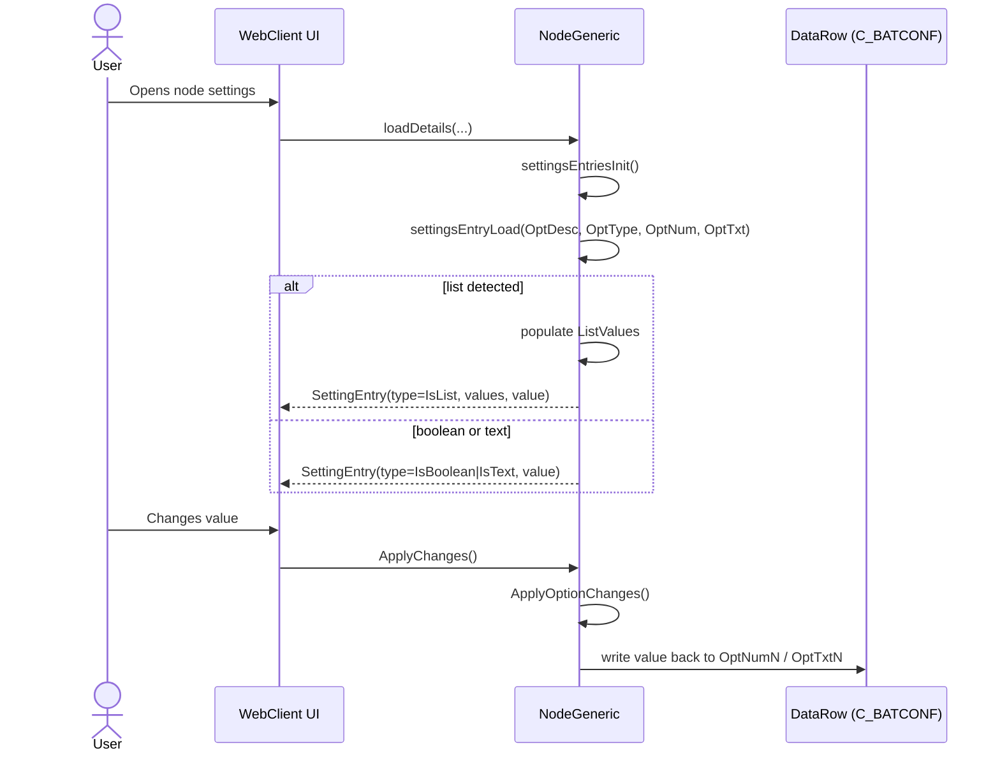

[Overview](README.md) • [Option A](option-a-extend-setting-entry.md) • [Option B](option-b-extrasettings-json-column.md) • [Option C](option-c-relational-properties-table.md) • [Option D](option-d-centralized-metadata-model.md) • [Current workarounds](current-custom-dropdown-workarounds.md) • [Web client analysis](web-client-analysis.md) • [Extending to processors](extending-to-processors.md)

---

# Option A — Extend `SettingEntry` to Support Lists

## Goal

Add list (dropdown/enum) support to the existing five-option model with the smallest possible change.

## Idea

Extend the `ObjOptionType` enum and the `SettingEntry` structure so that a setting can carry a list of allowed values. The dropdown data still lives within the current `OptNumN` / `OptTxtN` columns.

## Required changes

### 1. Extend `ObjOptionType`

[SrcCLI/System/Batch/NodeGeneric.vb](SrcCLI/System/Batch/NodeGeneric.vb#L36)

```vb
Public Enum ObjOptionType
   IsBoolean
   IsText
   IsList          ' new
End Enum
```

### 2. Extend `SettingEntry`

```vb
Public Structure SettingEntry
   Dim isEnabled As Boolean
   Dim Description As String
   Dim type As ObjOptionType
   Dim fieldType As dbFldType
   Dim oValue As Object
   Dim ListValues As Generic.List(Of KeyValuePair(Of String, String))
   Dim EnumTypeName As String   ' optional metadata for the UI
End Structure
```

### 3. Detect list during load

In `settingsEntryLoad`, decide when a setting is a list. Options:

- Add a new `dbFldType` value (e.g., `dbEnum`) and map `OptTypeN` to it.
- Use a convention in `OptDescN` (e.g., a prefix or a known label).
- Maintain a static dictionary keyed by `FunctionId` that says "option 3 is enum X".

### 4. Keep values in existing columns

- The selected **key** can be stored in `OptNumN` (numeric lists) or `OptTxtN` (string lists).
- The list of allowed values is provided by code, not stored in `C_BATCONF`.

### 5. Apply changes

`ApplyOptionChanges` already writes the value back to `OptNumN`/`OptTxtN`. No change is needed if the selected value fits the existing columns.

### Database impact

No schema change. The same `C_BATCONF` table continues to store everything; only the interpretation of existing columns changes.



## Files affected

- [SrcCLI/System/Batch/NodeGeneric.vb](SrcCLI/System/Batch/NodeGeneric.vb)
- The UI layer that consumes `SettingEntry` (not located in this workspace).

## Pros

- Very small footprint.
- No database schema change.
- Backwards compatible with existing rows.

## Cons

- Still limited to five options per node.
- The enum definition is hard-coded or convention-based, not data-driven.
- Every new dropdown requires a code change.
- Risk of overloading `OptNumN` / `OptTxtN` with semantics they were not designed for.

## Data flow



## When to use

Choose this option if:
- There are only one or two specific dropdowns to add.
- The team wants the lowest-risk, fastest delivery.
- A future refactor to Option C or D is acceptable later.

## Risk assessment

| Risk | Level | Mitigation |
|------|-------|------------|
| UI does not understand `IsList` | Medium | Coordinate with the WebClient/TypeScript team. |
| Enum hard-coding grows over time | Medium | Document the convention clearly. |
| Collision with existing `OptNumN` usage | Low | Use `OptTxtN` for string-based enum keys. |
