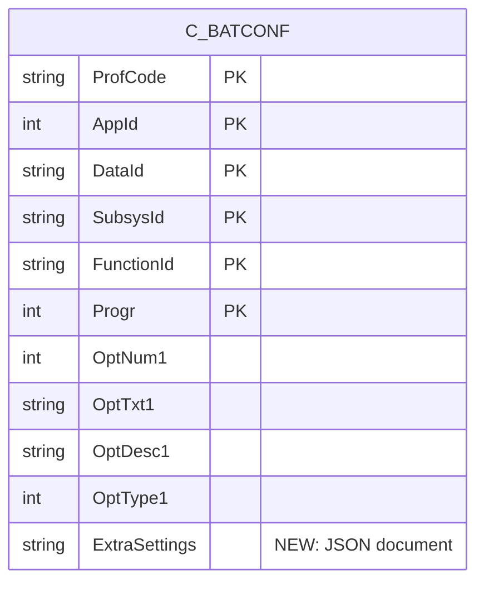
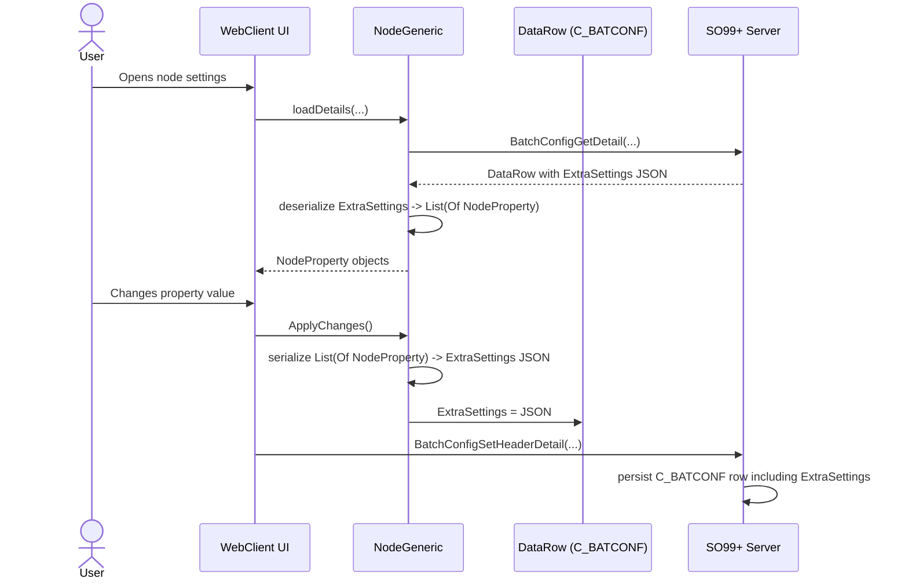

[Overview](README.md) • [Option A](option-a-extend-setting-entry.md) • [Option B](option-b-extrasettings-json-column.md) • [Option C](option-c-relational-properties-table.md) • [Option D](option-d-centralized-metadata-model.md) • [Current workarounds](current-custom-dropdown-workarounds.md) • [Web client analysis](web-client-analysis.md) • [Extending to processors](extending-to-processors.md)

---

# Option B — Add an `ExtraSettings` JSON Column to `C_BATCONF`

## Goal

Store an arbitrary number of extra node properties in a single new column without creating additional tables.

This option is the fastest way to escape the rigid five-option limit: one schema change gives the model space for any number of booleans, texts, lists (enum-backed or arbitrary), and dates. The trade-off is that the property definitions live in code, not in the database, so reporting and auditing on those properties requires parsing JSON.

## Idea

Add a new column `ExtraSettings` (e.g., `NVARCHAR(MAX)`) to `C_BATCONF`. It contains a JSON document describing additional properties and their values.

Example JSON value:

```json
{
  "properties": [
    {
      "key": "ExportMode",
      "type": "list",
      "enumType": "ExportModes",
      "value": "Delta"
    },
    {
      "key": "TargetWarehouse",
      "type": "list",
      "source": "warehouses",
      "value": "WH01"
    },
    {
      "key": "NextRunDate",
      "type": "date",
      "value": "2026-08-15"
    }
  ]
}
```

## Required changes

### 1. Database schema

```sql
ALTER TABLE C_BATCONF ADD ExtraSettings NVARCHAR(MAX) NULL;
```



### 2. Enum update

Add `ExtraSettings` to `BatchConfigTableStructure` in [SrcBTC/SrcCOM/BatchConfiguration.vb](SrcBTC/SrcCOM/BatchConfiguration.vb#L55-L96).

### 3. Server-side read/write

Update [SrcSVR/BatchClass730.vb](SrcSVR/BatchClass730.vb) to:
- Populate the column when building the `ConfigDb` `DataTable`.
- Parse and persist the JSON during `BatchConfig_WriteHeaderDetail`.

### 4. Client classes

Introduce:

```vb
Public Class NodeProperty
   Public Property Key As String
   Public Property PropertyType As NodePropertyType
   Public Property Value As Object
   Public Property EnumTypeName As String
   Public Property ListValues As Dictionary(Of String, String)
End Class

Public Enum NodePropertyType
   Boolean
   Text
   List
   Date
End Enum
```

### 5. `NodeGeneric`

- Add a `NodeProperties` collection.
- In `settingsEntriesInit` or `init`, deserialize `ExtraSettings`.
- In `ApplyChanges`, serialize the collection back to the `DataRow`.
- A `List` property renders as a dropdown. If `EnumTypeName` is set, populate the dropdown from the enum; otherwise use `ListValues`.
- A `Date` property renders as a date picker.

### 6. WCF/Service contract

If the `DataTable` already carries the new column, no contract change is needed. Otherwise, expose a new transport structure.

## Files affected

- Database migration script.
- [SrcBTC/SrcCOM/BatchConfiguration.vb](SrcBTC/SrcCOM/BatchConfiguration.vb)
- [SrcSVR/BatchClass730.vb](SrcSVR/BatchClass730.vb)
- [SrcSVR/Services/SO99Service730.vb](SrcSVR/Services/SO99Service730.vb)
- [SrcCLI/System/Batch/NodeGeneric.vb](SrcCLI/System/Batch/NodeGeneric.vb)
- [SrcCLI/System/Batch/DataLayer.vb](SrcCLI/System/Batch/DataLayer.vb)

## Pros

- Single schema change.
- No new tables or joins.
- Easy to read/write the whole object at once.
- Supports any number of properties.

## Cons

- JSON is hard to query, index, or audit with plain SQL.
- Adds parsing complexity in VB.NET / SQL Server.
- Touches the central `C_BATCONF` schema.
- Versioning/migration of the JSON shape can become messy.
- Less discoverable for DBAs and support.

## Data flow



## When to use

Consider this option if:
- The team prefers minimal schema changes.
- Properties are read/written only through the application.
- There is no need for SQL reporting or bulk updates on the extra properties.

## Risk assessment

| Risk | Level | Mitigation |
|------|-------|------------|
| JSON parsing errors | Medium | Use a schema version field and validate on load. |
| Column size growth | Low | Use `NVARCHAR(MAX)` and monitor. |
| Reporting limitations | High | Document that extra properties are application-only. |
| Backwards compatibility | Low | Nullable column; old rows have `NULL`. |
