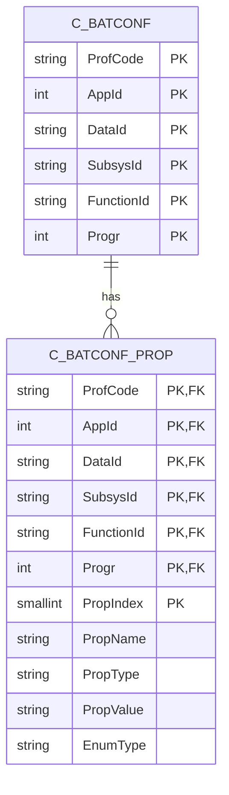
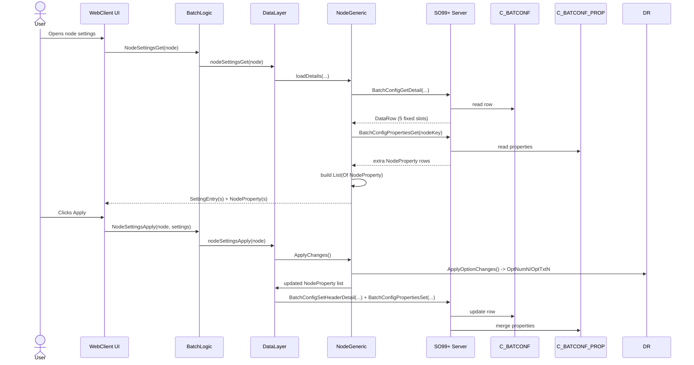

[Overview](README.md) • [Option A](option-a-extend-setting-entry.md) • [Option B](option-b-extrasettings-json-column.md) • [Option C](option-c-relational-properties-table.md) • [Option D](option-d-centralized-metadata-model.md) • [Current workarounds](current-custom-dropdown-workarounds.md) • [Web client analysis](web-client-analysis.md) • [Extending to processors](extending-to-processors.md)

---

# Option C — Relational Table for Dynamic Properties

## Goal

Create a separate, normalized table for extra node properties, keeping the existing `C_BATCONF` schema untouched.

This option turns every extra property into a real row: queryable, auditable, and not tied to a fixed number of columns. It is the most balanced choice when the team wants a reusable mechanism without the overhead of building a metadata administration screen.

## Idea

Instead of adding columns to `C_BATCONF`, create `C_BATCONF_PROP`. Each row represents one extra property of one node.

```sql
CREATE TABLE C_BATCONF_PROP (
   ProfCode    VARCHAR(20)  NOT NULL,
   AppId       INT          NOT NULL,
   DataId      VARCHAR(20)  NOT NULL,
   SubsysId    VARCHAR(20)  NOT NULL,
   FunctionId  VARCHAR(20)  NOT NULL,
   Progr       INT          NOT NULL,
   PropIndex   SMALLINT     NOT NULL,
   PropName    VARCHAR(100) NOT NULL,
   PropType    VARCHAR(20)  NOT NULL,   -- 'bool'|'text'|'list'|'date'
   PropValue   VARCHAR(MAX) NULL,
   EnumType    VARCHAR(100) NULL,
   CONSTRAINT PK_C_BATCONF_PROP PRIMARY KEY (
      ProfCode, AppId, DataId, SubsysId, FunctionId, Progr, PropIndex
   )
);
```

The primary key mirrors the natural key of `C_BATCONF` so that every property is unambiguously tied to a node.



## Required changes

### 1. Database schema

Create the new table and a foreign key to `C_BATCONF` if referential integrity is desired.

### 2. Server-side read/write

Add methods in [SrcSVR/BatchClass730.vb](SrcSVR/BatchClass730.vb):

```vb
Public Function BatchConfigPropertiesGet(...) As DataTable
Public Function BatchConfigPropertiesSet(...) As Boolean
```

Expose them through [SrcSVR/Services/SO99Service730.vb](SrcSVR/Services/SO99Service730.vb).

### 3. Client classes

Add to the client logic:

```vb
Public Enum NodePropertyType
   Boolean
   Text
   List
   Date
End Enum

Public Class NodeProperty
   Public Property Index As Short
   Public Property Name As String
   Public Property PropertyType As NodePropertyType
   Public Property Value As Object
   Public Property EnumTypeName As String
   Public Property ListValues As Dictionary(Of String, String)
End Class
```

### 4. `NodeGeneric`

- Add `_listProperties As List(Of NodeProperty)`.
- In `settingsEntriesInit`, call a new `propertiesInit(SO99Srv, sSessionID)`.
- In `ApplyChanges`, persist properties back to a temporary structure.

### 5. `DataLayer`

- `nodeSettingsGet`: load extra properties for the selected node.
- `save`: call the new server method to persist properties alongside `BatchConfigSetHeaderDetail`.

### 6. Transactional save

Make sure `BatchConfigSetHeaderDetail` and `BatchConfigPropertiesSet` run in the same transaction, or merge them into a single server method.

## Files affected

- Database migration script.
- [SrcSVR/BatchClass730.vb](SrcSVR/BatchClass730.vb)
- [SrcSVR/Services/SO99Service730.vb](SrcSVR/Services/SO99Service730.vb)
- [SrcCLI/System/Batch/NodeGeneric.vb](SrcCLI/System/Batch/NodeGeneric.vb)
- [SrcCLI/System/Batch/DataLayer.vb](SrcCLI/System/Batch/DataLayer.vb)
- The UI layer that consumes the new `NodeProperty` collection.

## Pros

- Does not touch the existing `C_BATCONF` schema or `BatchConfigTableStructure`.
- Normalized and queryable with standard SQL.
- Unlimited number of properties per node.
- Easy to audit and report.
- Can support booleans, texts, lists (enum-backed or arbitrary), and dates with the same table.

## Cons

- Requires new CRUD methods on the server.
- Requires coordination between `DataLayer.save` and the new persistence method.
- More tables and joins than Option B.
- Slightly more code than Option B.

## Data flow



## When to use

Choose this option if:
- The goal is a reusable, data-driven mechanism.
- You want to avoid JSON in the database.
- SQL reporting and auditing matter.
- Future property types (date pickers, multi-select, etc.) are likely.

## Pragmatic first phase

To keep the scope of SOA-7702 small, implement only the `List` type backed by an enum in the first iteration. Leave `Date` and database-driven arbitrary lists for follow-up tasks.

## Risk assessment

| Risk | Level | Mitigation |
|------|-------|------------|
| Two-table save inconsistency | Medium | Wrap `BatchConfigSetHeaderDetail` and property save in one transaction or one service call. |
| Old code ignores new table | Low | The existing 5 slots remain untouched and functional. |
| Performance of extra joins | Low | Load properties only when a node is selected. |
