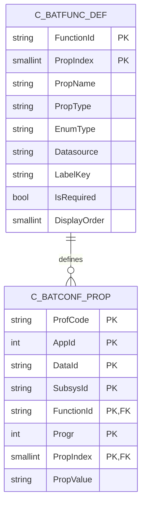
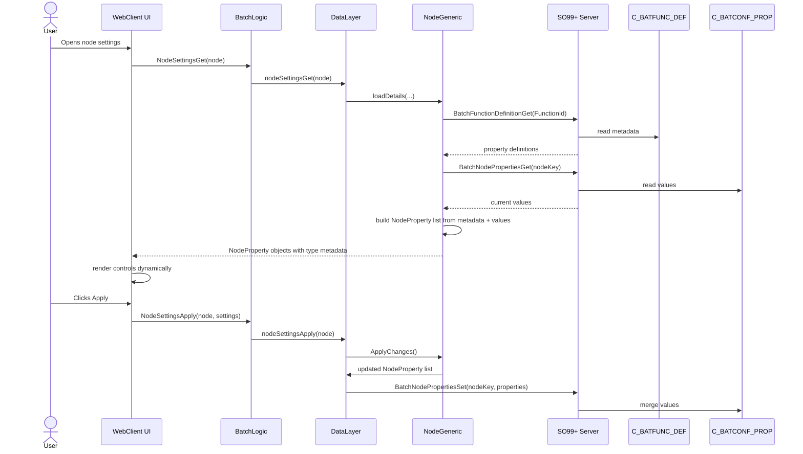

  [Overview](README.md) • [Option A](option-a-extend-setting-entry.md) • [Option B](option-b-extrasettings-json-column.md) • [Option C](option-c-relational-properties-table.md) • [Option D](option-d-centralized-metadata-model.md) • [Current workarounds](current-custom-dropdown-workarounds.md) • [Web client analysis](web-client-analysis.md) • [Extending to processors](extending-to-processors.md)

---

# Option D — Centralized Metadata Model


## Goal

Separate the *definition* of which properties a Batch function can have from the *values* each node actually stores.

While Options B and C only store per-node values, Option D also stores **what each `FunctionId` is allowed to expose**: name, type, order, label, enum/datasource, and whether it is required. This makes the Batch form configurable by function, enables validation and localization, and guarantees that every node of the same function uses the same settings schema. The extra cost is justified when Batch settings are expected to keep evolving or when multiple teams need to add properties independently.

## Idea

Introduce a metadata layer that describes, for each `FunctionId`, what properties are available, their type, order, labels, enum names, and data sources. The actual per-node values are stored separately.

### Proposed tables

```sql
-- Metadata: what properties each function supports
CREATE TABLE C_BATFUNC_DEF (
   FunctionId   VARCHAR(20)  NOT NULL,
   PropIndex    SMALLINT     NOT NULL,
   PropName     VARCHAR(100) NOT NULL,
   PropType     VARCHAR(20)  NOT NULL,   -- 'bool'|'text'|'list'|'date'
   EnumType     VARCHAR(100) NULL,       -- .NET enum name or lookup category
   Datasource   VARCHAR(100) NULL,       -- optional: stored procedure/table for dropdowns
   LabelKey     VARCHAR(100) NULL,       -- localization key
   IsRequired   BIT          NOT NULL DEFAULT 0,
   DisplayOrder SMALLINT     NOT NULL,
   CONSTRAINT PK_C_BATFUNC_DEF PRIMARY KEY (FunctionId, PropIndex)
);

-- Values: actual per-node property values
CREATE TABLE C_BATCONF_PROP (
   ProfCode    VARCHAR(20)  NOT NULL,
   AppId       INT          NOT NULL,
   DataId      VARCHAR(20)  NOT NULL,
   SubsysId    VARCHAR(20)  NOT NULL,
   FunctionId  VARCHAR(20)  NOT NULL,
   Progr       INT          NOT NULL,
   PropIndex   SMALLINT     NOT NULL,
   PropValue   VARCHAR(MAX) NULL,
   CONSTRAINT PK_C_BATCONF_PROP PRIMARY KEY (
      ProfCode, AppId, DataId, SubsysId, FunctionId, Progr, PropIndex
   )
);
```



### How it works

1. When the Batch form loads a node, it asks the server for:
   - The function definition (`C_BATFUNC_DEF`).
   - The current values (`C_BATCONF_PROP`).
   - Optional dropdown data if the definition specifies a datasource.
2. The UI generates controls dynamically based on `PropType`.
3. On save, only `C_BATCONF_PROP` is updated.

## Required changes

### 1. Metadata administration

- A screen or script to maintain `C_BATFUNC_DEF`.
- Migration of the current 5-option metadata into the new model (optional).

### 2. Server-side services

Add service methods in [SrcSVR/Services/SO99Service730.vb](SrcSVR/Services/SO99Service730.vb):

```vb
Function BatchFunctionDefinitionGet(FunctionId As String) As DataTable
Function BatchNodePropertiesGet(nodeKey As ...) As DataTable
Function BatchNodePropertiesSet(nodeKey As ..., properties As DataTable) As Boolean
```

### 3. Client refactoring

`NodeGeneric` would no longer decide "these are the 5 options". Instead, it would expose a collection of `NodeProperty` objects built from metadata.

```vb
Public Enum NodePropertyType
   Boolean
   Text
   List
   Date
End Enum
```

### 4. UI rendering

The WebClient/TypeScript layer would render controls based on metadata:
- `bool` → checkbox
- `text` → text box
- `list` → dropdown from enum values or arbitrary list
- `date` → date picker

## Files affected

- Database migration scripts.
- New metadata administration UI.
- [SrcSVR/BatchClass730.vb](SrcSVR/BatchClass730.vb)
- [SrcSVR/Services/SO99Service730.vb](SrcSVR/Services/SO99Service730.vb)
- [SrcCLI/System/Batch/NodeGeneric.vb](SrcCLI/System/Batch/NodeGeneric.vb)
- [SrcCLI/System/Batch/DataLayer.vb](SrcCLI/System/Batch/DataLayer.vb)
- WebClient TypeScript rendering layer.

## Pros

- Fully data-driven and scalable.
- New property types require only UI changes, not data-layer changes.
- Supports localization, validation, and ordering through metadata.
- Clean separation between definition and values.
- Unlike Option B/C, the schema per `FunctionId` is enforced in the database, so every node of the same function behaves consistently.

## Cons

- Largest effort of the four options.
- Requires a metadata administration screen.
- Needs careful migration of existing functions.
- Higher risk because it changes the fundamental design.

## Data flow



## When to use

Choose this option if:
- The Batch form is expected to keep growing with new control types.
- Multiple teams need to add Batch settings independently.
- The organization wants a low-code / configuration-driven approach.

## Risk assessment

| Risk | Level | Mitigation |
|------|-------|------------|
| Big-bang migration | High | Phase the implementation; keep old 5 slots as fallback. |
| Metadata maintenance | Medium | Provide an admin screen or seed scripts. |
| UI complexity | Medium | Build a generic renderer incrementally. |
| Performance | Low | Cache `C_BATFUNC_DEF` per session. |
